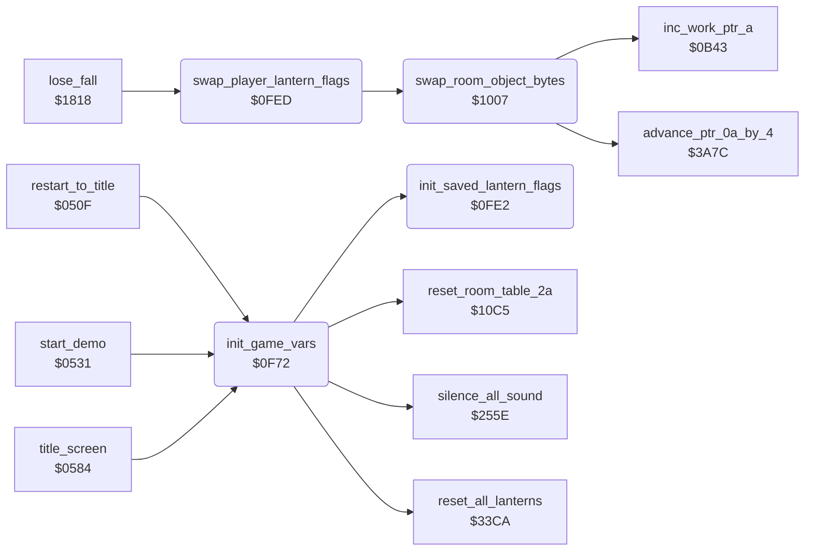

<!-- Generated by c64-docs from knowledge revision 20261016T170255.379-vv114c and src/source-map.json. Do not edit: change the knowledge, generate the source again, then run generate.ts. -->
# game_vars.asm: Game variables and player swap

Range `$0F72-$102A`. Source: [game_vars.asm](../../../src/game_vars.asm). Index: [the reference](../index.md).

## Call graph

A solid arrow is a call, a thick arrow a table entry, a dotted arrow a jump. Rounded nodes are in this file.

## Names

### [`init_game_vars`](../../../src/game_vars.asm#L6) `$0F72`

*routine*

New game: clears zero page $03-$F5 and $4EED-$4FE7, sets $0100-$0107 and $014B-$0152 to 1, loads the lantern counts, sets the room entry bonus flags, the falls (4, or 9 with a human opponent) and copies the player block $28-$43 to the second player's save area $439F.

- **Called from:** [`restart_to_title`](restart.md#restart_to_title) [`$0528`](../../../src/restart.asm#L20), [`start_demo`](restart.md#start_demo) [`$0550`](../../../src/restart.asm#L39), [`title_screen`](title.md#title_screen) [`$0746`](../../../src/title.asm#L208)
- **Calls:** [`silence_all_sound`](sound_effects.md#silence_all_sound), [`reset_room_table_2a`](room_state.md#reset_room_table_2a), [`reset_all_lanterns`](lanterns.md#reset_all_lanterns), [`init_saved_lantern_flags`](game_vars.md#init_saved_lantern_flags)
- **Reads:** [`human_opponent_mode`](variables.md#human_opponent_mode), [`first_extra_life_score+1`](variables.md#first_extra_life_score), [`first_extra_life_score+2`](variables.md#first_extra_life_score), [`score+1`](../variables.md#score), [`score+2`](../variables.md#score)
- **Writes:** [`contact_classes_col0`](actor_vars.md#contact_classes_col0), [`contact_classes_col0+1`](actor_vars.md#contact_classes_col0), [`yamo_idle_timer`](../variables.md#yamo_idle_timer), [`yamo_idle_timer+1`](../variables.md#yamo_idle_timer), [`room13_floor_bonus_flags+6`](../variables.md#room13_floor_bonus_flags), [`room13_floor_bonus_flags+7`](../variables.md#room13_floor_bonus_flags), [`actor_step_delay`](../variables.md#actor_step_delay), [`actor_step_delay+1`](../variables.md#actor_step_delay), [`bonus_falls_left`](room_tables.md#bonus_falls_left), [`bonus_falls_left+1`](room_tables.md#bonus_falls_left), [`room_entry_bonus_flags+38`](../variables.md#room_entry_bonus_flags), [`room_entry_bonus_flags+39`](../variables.md#room_entry_bonus_flags), [`room_entry_bonus_flags`](../variables.md#room_entry_bonus_flags), [`room_entry_bonus_flags+1`](../variables.md#room_entry_bonus_flags), [`falls_left`](../variables.md#falls_left), [`next_extra_life_score+1`](variables.md#next_extra_life_score), [`next_extra_life_score+2`](variables.md#next_extra_life_score), [`other_next_extra_life_score+1`](variables.md#other_next_extra_life_score), [`other_next_extra_life_score+2`](variables.md#other_next_extra_life_score), [`other_player_state+26`](variables.md#other_player_state), [`other_player_state+27`](variables.md#other_player_state)
- **Refers to:** [`yamo_idle_timer`](../variables.md#yamo_idle_timer), [`bonus_falls_left`](room_tables.md#bonus_falls_left), [`room_entry_bonus_flags`](../variables.md#room_entry_bonus_flags)

### [`init_stack_page_flags`](../../../src/game_vars.asm#L24) `$0F8D`

*label*

- **Jumped to from:** [`init_game_vars`](game_vars.md#init_game_vars) [`$0F94`](../../../src/game_vars.asm#L28)

### [`init_saved_lantern_flags`](../../../src/game_vars.asm#L67) `$0FE2`

*routine*

Sets all 97 bytes of saved_lantern_flags to 1 (all lanterns present for the second player).

- **Called from:** [`init_game_vars`](game_vars.md#init_game_vars) [`$0FB9`](../../../src/game_vars.asm#L44)
- **Writes:** [`saved_lantern_flags+95`](casbuf.md#saved_lantern_flags), [`saved_lantern_flags+96`](casbuf.md#saved_lantern_flags)

### [`swap_player_lantern_flags`](../../../src/game_vars.asm#L76) `$0FED`

*routine*

For rooms 0-19 swaps the state byte of each lantern record in room_lantern_lists with saved_lantern_flags (called when the players change).

- **Called from:** [`lose_fall`](game_over.md#lose_fall) [`$1870`](../../../src/game_over.asm#L50)
- **Calls:** [`swap_room_object_bytes`](game_vars.md#swap_room_object_bytes)
- **Reads:** [`last_key+3`](../variables.md#last_key)
- **Writes:** [`work_ptr_a`](../variables.md#work_ptr_a), [`work_ptr_a+1`](../variables.md#work_ptr_a), [`last_key+3`](../variables.md#last_key)
- **Refers to:** [`saved_lantern_flags`](casbuf.md#saved_lantern_flags), [`work_ptr_a`](../variables.md#work_ptr_a)

### [`swap_room_loop`](../../../src/game_vars.asm#L83) `$0FF9`

*label*

- **Jumped to from:** [`swap_player_lantern_flags`](game_vars.md#swap_player_lantern_flags) [`$1004`](../../../src/game_vars.asm#L90)

### [`swap_room_object_bytes`](../../../src/game_vars.asm#L93) `$1007`

*routine*

Swaps the first byte of each 4-byte entry of the room list at ($4CE2+X) with consecutive bytes at ($04), until an entry starts with a negative byte. $0FED runs it for all 20 rooms to exchange the room states of the two players.

- **Called from:** [`swap_player_lantern_flags`](game_vars.md#swap_player_lantern_flags) [`$0FFB`](../../../src/game_vars.asm#L86)
- **Calls:** [`advance_ptr_0a_by_4`](room_update.md#advance_ptr_0a_by_4), [`inc_work_ptr_a`](room_draw.md#inc_work_ptr_a)
- **Reads:** [`work_ptr_c+2`](../variables.md#work_ptr_c), [`exit2_x+2`](room_tables.md#exit2_x), [`work_ptr_a`](../variables.md#work_ptr_a), [`charset_src_0+433`](room_charset_src.md#charset_src_0)
- **Writes:** [`work_ptr_c+2`](../variables.md#work_ptr_c), [`work_ptr_c+3`](../variables.md#work_ptr_c), [`charset_src_0+433`](room_charset_src.md#charset_src_0), [`exit2_x+2`](room_tables.md#exit2_x)
- **Refers to:** [`lantern_list_ptrs`](room_tables.md#lantern_list_ptrs), [`lantern_list_ptrs+1`](room_tables.md#lantern_list_ptrs)
