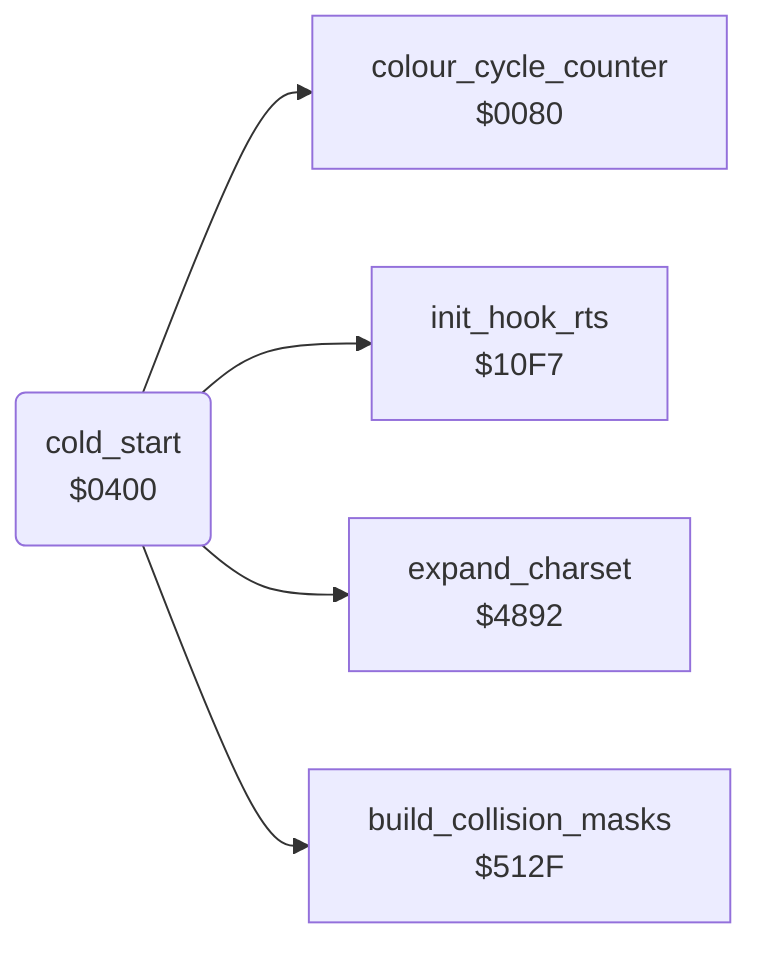

<!-- Generated by c64-docs from knowledge revision 20261016T170255.379-vv114c and src/source-map.json. Do not edit: change the knowledge, generate the source again, then run generate.ts. -->
# init.asm: Cold start and one-time initialisation

Range `$0400-$050E`. Source: [init.asm](../../../src/init.asm). Index: [the reference](../index.md).

## Call graph

A solid arrow is a call, a thick arrow a table entry, a dotted arrow a jump. Rounded nodes are in this file.

## Data

| Range | Type | Name | Read by | Written by |
|---|---|---|---|---|
| [`$0408`](../../../src/init.asm#L17)-`$0409` | dual-use | [`irq_chain_vector`](../../../src/init.asm#L15) | [`irq_handler`](interrupts.md#irq_handler) | [`title_screen`](title.md#title_screen), [`init_game_irq`](game_setup.md#init_game_irq), [`show_player_turn_screen`](player_turn.md#show_player_turn_screen), [`irq_split_top`](raster_irq_screens.md#irq_split_top), [`irq_split_bottom`](raster_irq_screens.md#irq_split_bottom), [`game_over`](game_over.md#game_over), [`irq_frame_top`](raster_irq_game.md#irq_frame_top), [`irq_playfield_top`](raster_irq_game.md#irq_playfield_top) |

## Names

### [`cold_start`](../../../src/init.asm#L6) `$0400`

*routine*

Program entry: blanks the screen, silences the sound engine, fills random_table with SID noise, copies and inverts the ROM font to $8800-$8BFF, expands the packed charsets $9000-$9FFF into $A000-$BFFF and sets sprite colours, then falls into restart_to_title.

- **Jumped to from:** `$A048`
- **Referred to by:** [`copy_frame_to_sprite`](sprite_render.md#copy_frame_to_sprite) [`$26AD`](../../../src/sprite_render.asm#L179), [`copy_frame_to_sprite`](sprite_render.md#copy_frame_to_sprite) [`$26B8`](../../../src/sprite_render.asm#L185), [`copy_frame_to_sprite`](sprite_render.md#copy_frame_to_sprite) [`$26BE`](../../../src/sprite_render.asm#L188), [`copy_frame_to_sprite`](sprite_render.md#copy_frame_to_sprite) [`$26E6`](../../../src/sprite_render.asm#L217), [`copy_frame_to_sprite`](sprite_render.md#copy_frame_to_sprite) [`$26F0`](../../../src/sprite_render.asm#L224), [`copy_frame_to_sprite`](sprite_render.md#copy_frame_to_sprite) [`$26FB`](../../../src/sprite_render.asm#L230), `$A023`
- **Calls:** [`colour_cycle_counter`](../variables.md#colour_cycle_counter), [`expand_charset`](charset_expand.md#expand_charset), [`build_collision_masks`](collision.md#build_collision_masks), [`init_hook_rts`](room_state.md#init_hook_rts)
- **Reads:** [`SCROLY`](../variables.md#SCROLY), [`warm_start_flag`](casbuf.md#warm_start_flag), [`RANDOM`](../variables.md#RANDOM), [`SP0X`](../variables.md#SP0X), [`SP0Y`](../variables.md#SP0Y), [`ld100`](../variables.md#ld100), [`ld100+1`](../variables.md#ld100)
- **Writes:** [`SCROLY`](../variables.md#SCROLY), [`sfx_v1_state`](sfx_voice1.md#sfx_v1_state), [`sfx_v2_state`](sfx_voice2.md#sfx_v2_state), [`sfx_v3_state`](sfx_voice3.md#sfx_v3_state), [`RANDOM`](../variables.md#RANDOM), [`FREHI3`](../variables.md#FREHI3), [`FRELO3`](../variables.md#FRELO3), [`VCREG3`](../variables.md#VCREG3), [`random_table`](../variables.md#random_table), [`R6510`](../variables.md#R6510), [`title_charset+256`](vic_bank2.md#title_charset), [`title_charset+257`](vic_bank2.md#title_charset), [`title_charset+768`](vic_bank2.md#title_charset), [`title_charset+769`](vic_bank2.md#title_charset), [`title_charset`](vic_bank2.md#title_charset), [`title_charset+1`](vic_bank2.md#title_charset), [`title_charset+512`](vic_bank2.md#title_charset), [`title_charset+513`](vic_bank2.md#title_charset), [`title_charset+262`](vic_bank2.md#title_charset), [`title_charset+263`](vic_bank2.md#title_charset), [`title_charset+534`](vic_bank2.md#title_charset), [`title_charset+535`](vic_bank2.md#title_charset), [`title_charset+694`](vic_bank2.md#title_charset), [`title_charset+695`](vic_bank2.md#title_charset), [`draw_count`](../variables.md#draw_count), [`work_ptr_a`](../variables.md#work_ptr_a), [`work_ptr_a+1`](../variables.md#work_ptr_a), [`work_ptr_b`](../variables.md#work_ptr_b), [`work_ptr_c`](../variables.md#work_ptr_c), [`work_ptr_b+1`](../variables.md#work_ptr_b), [`work_ptr_c+1`](../variables.md#work_ptr_c), [`SP1COL`](../variables.md#SP1COL), [`SP3COL`](../variables.md#SP3COL), [`SP4COL`](../variables.md#SP4COL), [`SP0COL`](../variables.md#SP0COL), [`SP2COL`](../variables.md#SP2COL)
- **Refers to:** [`title_charset`](vic_bank2.md#title_charset), [`charset_src_0`](room_charset_src.md#charset_src_0), [`work_ptr_a`](../variables.md#work_ptr_a), [`room_charset_0`](../variables.md#room_charset_0), [`work_ptr_b`](../variables.md#work_ptr_b), [`work_ptr_c`](../variables.md#work_ptr_c), [`charset_src_1`](room_charset_src.md#charset_src_1), [`room_charset_1`](../variables.md#room_charset_1), [`charset_src_2`](room_charset_src.md#charset_src_2), [`room_charset_2`](../variables.md#room_charset_2), [`charset_src_3`](room_charset_src.md#charset_src_3), [`room_charset_3`](../variables.md#room_charset_3)

### [`irq_chain_vector`](../../../src/init.asm#L15) `$0408`

*variable*

After boot these two bytes (the operand of the boot AND #$EF) are the target of the JMP ($0408) in the IRQ handler at $1103.
Address of the next raster IRQ handler; irq_handler jumps through it. Its two bytes are the AND #$EF instruction of the boot code at $0408, reused as a variable.

- **Read by:** [`irq_handler`](interrupts.md#irq_handler) [`$1113`](../../../src/interrupts.asm#L19)
- **Written by:** [`title_screen`](title.md#title_screen) [`$05DC`](../../../src/title.asm#L45), [`init_game_irq`](game_setup.md#init_game_irq) [`$083E`](../../../src/game_setup.asm#L105), [`show_player_turn_screen`](player_turn.md#show_player_turn_screen) [`$0F02`](../../../src/player_turn.asm#L50), [`irq_split_top`](raster_irq_screens.md#irq_split_top) [`$1551`](../../../src/raster_irq_screens.asm#L94), [`irq_split_bottom`](raster_irq_screens.md#irq_split_bottom) [`$1585`](../../../src/raster_irq_screens.asm#L123), [`game_over`](game_over.md#game_over) [`$18A4`](../../../src/game_over.asm#L77), [`irq_frame_top`](raster_irq_game.md#irq_frame_top) [`$48CD`](../../../src/raster_irq_game.asm#L12), [`irq_playfield_top`](raster_irq_game.md#irq_playfield_top) [`$494B`](../../../src/raster_irq_game.asm#L76), [`irq_playfield_top`](raster_irq_game.md#irq_playfield_top) [`$4977`](../../../src/raster_irq_game.asm#L102)

### [`irq_vector_hi`](../../../src/init.asm#L16) `$0409`

*variable*

- **Written by:** [`title_screen`](title.md#title_screen) [`$05E1`](../../../src/title.asm#L47), [`init_game_irq`](game_setup.md#init_game_irq) [`$0843`](../../../src/game_setup.asm#L107), [`show_player_turn_screen`](player_turn.md#show_player_turn_screen) [`$0F07`](../../../src/player_turn.asm#L52), [`irq_split_top`](raster_irq_screens.md#irq_split_top) [`$1556`](../../../src/raster_irq_screens.asm#L96), [`irq_split_bottom`](raster_irq_screens.md#irq_split_bottom) [`$158A`](../../../src/raster_irq_screens.asm#L125), [`game_over`](game_over.md#game_over) [`$18A9`](../../../src/game_over.asm#L79), [`irq_frame_top`](raster_irq_game.md#irq_frame_top) [`$48D2`](../../../src/raster_irq_game.asm#L14), [`irq_playfield_top`](raster_irq_game.md#irq_playfield_top) [`$4950`](../../../src/raster_irq_game.asm#L78), [`irq_playfield_top`](raster_irq_game.md#irq_playfield_top) [`$497C`](../../../src/raster_irq_game.asm#L104)

### [`boot_cold_init`](../../../src/init.asm#L23) `$0415`

*label*

- **Jumped to from:** [`cold_start`](init.md#cold_start) [`$0410`](../../../src/init.asm#L20)

### [`boot_random_fill`](../../../src/init.asm#L35) `$0432`

*label*

256 bytes of SID voice 3 noise, with a delay between samples

- **Jumped to from:** [`cold_start`](init.md#cold_start) [`$043E`](../../../src/init.asm#L43)

### [`boot_copy_font`](../../../src/init.asm#L48) `$0449`

*label*

ROM chars $00-$1F go to $8900, $20-$3F to $8800; inverted copies at $8B00/$8A00

- **Jumped to from:** [`cold_start`](init.md#cold_start) [`$0460`](../../../src/init.asm#L58)

### [`boot_patch_font`](../../../src/init.asm#L62) `$0468`

*label*

char $20 solid block, char $42 right bar, char $56 left bar (option markers)

- **Jumped to from:** [`cold_start`](init.md#cold_start) [`$0478`](../../../src/init.asm#L70)

### [`boot_expand_charsets`](../../../src/init.asm#L71) `$047A`

*label*

$9000->$A000/$A400

### [`boot_warm_start`](../../../src/init.asm#L114) `$04D1`

*label*

$9C00->$B800/$BC00

- **Jumped to from:** [`cold_start`](init.md#cold_start) [`$0412`](../../../src/init.asm#L22)
