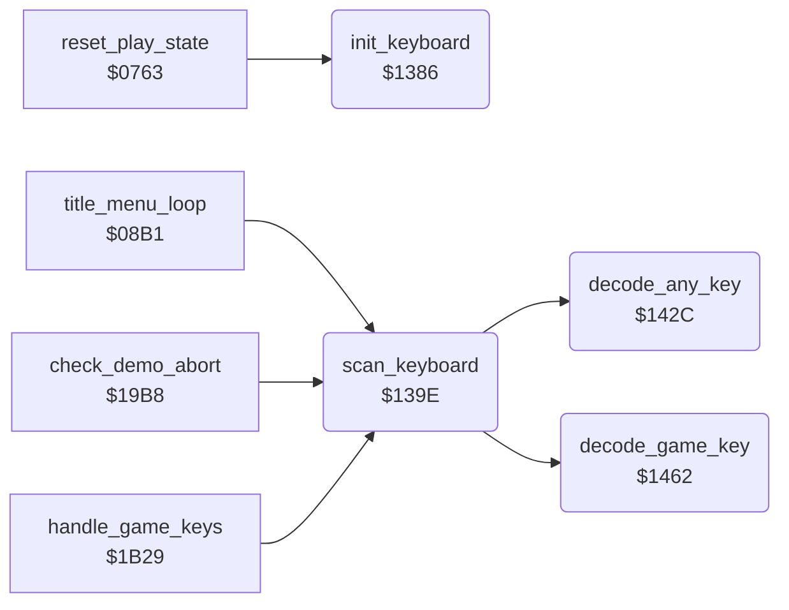

<!-- Generated by c64-docs from knowledge revision 20261029T162352.521-4j8tu8 and .c64-re-tools/local/generated/src/source-map.json. Do not edit: change the knowledge, generate the source again, then run docs.ts generate. -->
# input/keyboard_scan.asm: Keyboard and CIA setup, keyboard matrix scanner and key tables

Range `$1386-$14A3`. Source: [input/keyboard_scan.asm](../../../../src/input/keyboard_scan.asm). Index: [the reference](../../index.md).

## Routines

| Routine | Address | Reached from | Summary |
|---|---|---|---|
| [`init_keyboard`](keyboard_scan.md#init_keyboard) | `$1386` | [`reset_play_state`](../game/play_init.md#reset_play_state) | Reset the key state (key_code = $FF no key, key_ready = 0), set both CIA 1 ports as inputs and turn off all CIA 1 and CIA 2 interrupts, so only the VIC raster interrupt is used. |
| [`scan_keyboard`](keyboard_scan.md#scan_keyboard) | `$139E` | [`title_menu_loop`](../game/title_menu.md#title_menu_loop), [`check_demo_abort`](../game/pause_status_line.md#check_demo_abort), [`handle_game_keys`](../game/status_and_keys.md#handle_game_keys) | Read one key from the keyboard matrix. |
| [`decode_any_key`](keyboard_scan.md#decode_any_key) | `$142C` | [`scan_keyboard`](keyboard_scan.md#scan_keyboard) | Decode the first pressed key of the matrix. |
| [`decode_game_key`](keyboard_scan.md#decode_game_key) | `$1462` | [`scan_keyboard`](keyboard_scan.md#scan_keyboard) | Decode the keys used during a game: F1, S, SPACE and V. |

## Data

| Range | Type | Name | Read by | Written by |
|---|---|---|---|---|
| [`$1488`](../../../../src/input/keyboard_scan.asm#L157)-`$148F` | bytes of 2 | [`game_key_matrix`](../../../../src/input/keyboard_scan.asm#L156) | [`decode_game_key`](keyboard_scan.md#decode_game_key) |  |
| [`$1490`](../../../../src/input/keyboard_scan.asm#L163)-`$1493` | bytes | [`game_key_codes`](../../../../src/input/keyboard_scan.asm#L162) | [`decode_game_key`](keyboard_scan.md#decode_game_key) |  |
| [`$1494`](../../../../src/input/keyboard_scan.asm#L166)-`$149B` | bytes | [`single_bit_clear_masks`](../../../../src/input/keyboard_scan.asm#L165) | [`decode_any_key`](keyboard_scan.md#decode_any_key) |  |
| [`$149C`](../../../../src/input/keyboard_scan.asm#L169)-`$14A3` | bytes | [`key_column_base`](../../../../src/input/keyboard_scan.asm#L168) | [`decode_any_key`](keyboard_scan.md#decode_any_key) |  |

## Call graph

A solid arrow is a call, a thick arrow a table entry. Rounded nodes are in this file.

## Details

### [`init_keyboard`](../../../../src/input/keyboard_scan.asm#L7) `$1386`

*routine*

Reset the key state (key_code = $FF no key, key_ready = 0), set both CIA 1 ports as inputs and turn off all CIA 1 and CIA 2 interrupts, so only the VIC raster interrupt is used. Called by reset_play_state.

- **Called from:** [`reset_play_state`](../game/play_init.md#reset_play_state)
- **Writes:** [`key_code`](../../memory-map.md#key_code), [`key_ready`](../../memory-map.md#key_ready), [`CIADDRA`](../../memory-map.md#CIADDRA), [`CIADDRB`](../../memory-map.md#CIADDRB), [`CIAICR`](../../memory-map.md#CIAICR), [`CI2ICR`](../../memory-map.md#CI2ICR)

### [`scan_keyboard`](../../../../src/input/keyboard_scan.asm#L24) `$139E`

*routine*

Read one key from the keyboard matrix. Does nothing while a key waits (key_ready set) or while a joystick line is low. Drives all port B lines low and reads port A to find the columns with a key, notes a shift key in key_shift, then decodes: key_scan_mode = 0 any key (decode_any_key), else only F1, S, SPACE and V (decode_game_key). A new code is stored in key_code (column*8 + row, bit 7 = shift) and key_ready is set to 1. A held key gives one code only. key_scan_code holds the code of this scan ($FF = none). Leaves both CIA 1 ports as inputs. Called by title_menu_loop, check_demo_abort and handle_game_keys.

- **Called from:** [`title_menu_loop`](../game/title_menu.md#title_menu_loop), [`check_demo_abort`](../game/pause_status_line.md#check_demo_abort), [`handle_game_keys`](../game/status_and_keys.md#handle_game_keys)
- **Calls:** [`decode_any_key`](keyboard_scan.md#decode_any_key), [`decode_game_key`](keyboard_scan.md#decode_game_key)
- **Reads:** [`key_ready`](../../memory-map.md#key_ready), [`CIAPRA`](../../memory-map.md#CIAPRA), [`CIAPRB`](../../memory-map.md#CIAPRB), [`key_shift`](../../memory-map.md#key_shift), [`key_scan_mode`](../../memory-map.md#key_scan_mode), [`key_code`](../../memory-map.md#key_code), [`key_scan_code`](../../memory-map.md#key_scan_code)
- **Writes:** [`CIADDRB`](../../memory-map.md#CIADDRB), [`key_scan_code`](../../memory-map.md#key_scan_code), [`key_shift`](../../memory-map.md#key_shift), [`CIAPRB`](../../memory-map.md#CIAPRB), [`key_columns`](../../memory-map.md#key_columns), [`CIADDRA`](../../memory-map.md#CIADDRA), [`CIAPRA`](../../memory-map.md#CIAPRA), [`key_code`](../../memory-map.md#key_code), [`key_ready`](../../memory-map.md#key_ready)

| Label | Address | Comment |
|---|---|---|
| [`scan_keyboard_exit`](../../../../src/input/keyboard_scan.asm#L31) | `$13AD` |  |
| [`scan_keyboard_matrix`](../../../../src/input/keyboard_scan.asm#L33) | `$13AE` |  |
| [`scan_keyboard_shift`](../../../../src/input/keyboard_scan.asm#L56) | `$13E4` |  |
| [`scan_keyboard_decode`](../../../../src/input/keyboard_scan.asm#L58) | `$13E7` |  |
| [`scan_keyboard_game_keys`](../../../../src/input/keyboard_scan.asm#L63) | `$13F2` |  |
| [`scan_keyboard_release`](../../../../src/input/keyboard_scan.asm#L65) | `$13F5` |  |
| [`scan_keyboard_store`](../../../../src/input/keyboard_scan.asm#L74) | `$1408` |  |
| [`scan_keyboard_set_code`](../../../../src/input/keyboard_scan.asm#L82) | `$1419` |  |
| [`scan_keyboard_done`](../../../../src/input/keyboard_scan.asm#L90) | `$142B` |  |

### [`decode_any_key`](../../../../src/input/keyboard_scan.asm#L95) `$142C`

*routine*

Decode the first pressed key of the matrix. Input: key_columns = column bits read with all rows low. Takes the highest column with a key, drives it low, tests the rows 7 to 0 and stores column*8 + row in key_scan_code. The shift keys ($0F left, $34 right) are skipped. key_scan_code = $FF when no key.

- **Called from:** [`scan_keyboard`](keyboard_scan.md#scan_keyboard)
- **Reads:** [`key_columns`](../../memory-map.md#key_columns), [`single_bit_clear_masks`](keyboard_scan.md#single_bit_clear_masks), [`CIAPRB`](../../memory-map.md#CIAPRB), [`key_column_base`](keyboard_scan.md#key_column_base)
- **Writes:** [`key_columns`](../../memory-map.md#key_columns), [`key_scan_code`](../../memory-map.md#key_scan_code), [`CIAPRA`](../../memory-map.md#CIAPRA)

| Label | Address | Comment |
|---|---|---|
| [`decode_any_key_column`](../../../../src/input/keyboard_scan.asm#L97) | `$142E` | bit 7 first: column 7 down to 0 |
| [`decode_any_key_next_column`](../../../../src/input/keyboard_scan.asm#L100) | `$1433` |  |
| [`decode_any_key_rows`](../../../../src/input/keyboard_scan.asm#L105) | `$143A` |  |
| [`decode_any_key_row_loop`](../../../../src/input/keyboard_scan.asm#L107) | `$143C` | drive column x low |
| [`decode_any_key_next_row`](../../../../src/input/keyboard_scan.asm#L114) | `$144C` |  |
| [`decode_any_key_found`](../../../../src/input/keyboard_scan.asm#L118) | `$1451` |  |

### [`decode_game_key`](../../../../src/input/keyboard_scan.asm#L131) `$1462`

*routine*

Decode the keys used during a game: F1, S, SPACE and V. For each key it drives its column and compares port B with the exact row pattern of game_key_matrix. Stores the key code from game_key_codes in key_scan_code, or $6F for any other key.

- **Called from:** [`scan_keyboard`](keyboard_scan.md#scan_keyboard)
- **Reads:** [`CIAPRB`](../../memory-map.md#CIAPRB)
- **Writes:** [`CIAPRA`](../../memory-map.md#CIAPRA), [`key_scan_code`](../../memory-map.md#key_scan_code)

| Label | Address | Comment |
|---|---|---|
| [`decode_game_key_loop`](../../../../src/input/keyboard_scan.asm#L133) | `$1464` |  |
| [`decode_game_key_found`](../../../../src/input/keyboard_scan.asm#L147) | `$147E` |  |

### [`game_key_matrix`](../../../../src/input/keyboard_scan.asm#L156) `$1488-$148F`

*data*

4 pairs (port A column mask, port B value) of the game keys F1 (col 0 row 4), S (col 1 row 5), SPACE (col 7 row 4) and V (col 3 row 7), in the order of game_key_codes.

- **Read by:** [`decode_game_key`](keyboard_scan.md#decode_game_key)

### [`game_key_codes`](../../../../src/input/keyboard_scan.asm#L162) `$1490-$1493`

*data*

Key codes (column*8 + row) of the game keys: $04 F1, $0D S, $3C SPACE, $1F V.

- **Read by:** [`decode_game_key`](keyboard_scan.md#decode_game_key)

### [`single_bit_clear_masks`](../../../../src/input/keyboard_scan.asm#L165) `$1494-$149B`

*data*

8 masks with one bit clear, index = bit number: $FE, $FD, ... $7F. Column drive and row select.

- **Read by:** [`decode_any_key`](keyboard_scan.md#decode_any_key)

### [`key_column_base`](../../../../src/input/keyboard_scan.asm#L168) `$149C-$14A3`

*data*

Key code of row 0 of each column: column * 8.

- **Read by:** [`decode_any_key`](keyboard_scan.md#decode_any_key)
