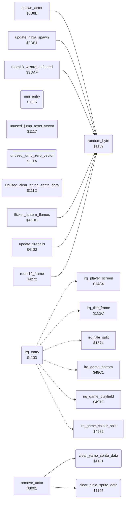

<!-- Generated by c64-docs from knowledge revision 20261017T124710.947-seivas and src/source-map.json. Do not edit: change the knowledge, generate the source again, then run generate.ts. -->
# interrupt_entry.asm: IRQ and NMI entry points, sprite data clears and the random byte routine

Range `$1103-$1165`. Source: [interrupt_entry.asm](../../../src/interrupt_entry.asm). Index: [the reference](../index.md).

## Call graph

A solid arrow is a call, a thick arrow a table entry, a dotted arrow a jump. Rounded nodes are in this file.

## Names

### [`irq_entry`](../../../src/interrupt_entry.asm#L10) `$1103`

*routine*

Hardware IRQ entry (hw_irq_vector at $FFFE). Saves A, X and Y, then jumps through irq_vector to the raster handler of the current screen. The test of the stacked status register uses AND #$00, so the BRK branch to JMP (io1_dummy) is never taken. Every handler ends with PLA/TAY/PLA/TAX/PLA/RTI. Handlers: irq_player_screen; irq_title_frame and irq_title_split (title and game over); irq_game_bottom, irq_game_playfield and irq_game_colour_split (game screen).

- **Entry of:** [`hw_nmi_vector`](../tables.md#hw_nmi_vector)
- **Jumps to:** [`irq_player_screen`](screen_raster_irqs.md#irq_player_screen), [`irq_title_frame`](screen_raster_irqs.md#irq_title_frame), [`irq_title_split`](screen_raster_irqs.md#irq_title_split), [`irq_game_bottom`](game_irq.md#irq_game_bottom), [`irq_game_playfield`](game_irq.md#irq_game_playfield), [`irq_game_colour_split`](game_irq.md#irq_game_colour_split)
- **Reads:** [`io1_dummy`](../variables.md#io1_dummy), [`irq_vector`](cold_start.md#irq_vector)

### [`irq_dispatch`](../../../src/interrupt_entry.asm#L22) `$1113`

*label*

raster handler of the current screen

- **Jumped to from:** [`irq_entry`](interrupt_entry.md#irq_entry) [`$110E`](../../../src/interrupt_entry.asm#L19)

### [`nmi_entry`](../../../src/interrupt_entry.asm#L25) `$1116`

*routine*

NMI vector ($FFFA) and RESET vector ($FFFC) target: returns at once, so RESTORE does nothing.

- **Entry of:** [`hw_nmi_vector`](../tables.md#hw_nmi_vector)

### [`unused_jump_reset_vector`](../../../src/interrupt_entry.asm#L30) `$1117`

*routine*

Unreachable code: JMP (hw_reset_vector), JMP ($0000), and a routine that clears both sprite images of Bruce in both sprite buffers, like clear_yamo_sprite_data below. Nothing jumps here.

### [`unused_jump_zero_vector`](../../../src/interrupt_entry.asm#L32) `$111A`

*routine*

### [`unused_clear_bruce_sprite_data`](../../../src/interrupt_entry.asm#L34) `$111D`

*routine*

### [`unused_clear_bruce_sprite_loop`](../../../src/interrupt_entry.asm#L40) `$1124`

*label*

sprite_buf_a_spr0/spr1 ($8180-$81FF)

### [`clear_yamo_sprite_data`](../../../src/interrupt_entry.asm#L51) `$1131`

*routine*

Clear both sprite images of Yamo (sprites 2 and 3) in both sprite buffers: sprite_buf_a_spr2/spr3 ($8200-$827F) and sprite_buf_b_spr2/spr3 ($8340-$83BF). Called by remove_actor. Keeps A and X.

- **Called from:** [`remove_actor`](touch_effects.md#remove_actor) [`$303F`](../../../src/touch_effects.asm#L67)
- **Writes:** [`sprite_buf_a_spr3+62`](../variables.md#sprite_buf_a_spr3), [`sprite_buf_a_spr3+63`](../variables.md#sprite_buf_a_spr3), [`sprite_buf_b_spr3+62`](../variables.md#sprite_buf_b_spr3), [`sprite_buf_b_spr3+63`](../variables.md#sprite_buf_b_spr3)

### [`clear_yamo_sprite_loop`](../../../src/interrupt_entry.asm#L57) `$1138`

*label*

- **Jumped to from:** [`clear_yamo_sprite_data`](interrupt_entry.md#clear_yamo_sprite_data) [`$113F`](../../../src/interrupt_entry.asm#L61)

### [`clear_ninja_sprite_data`](../../../src/interrupt_entry.asm#L68) `$1145`

*routine*

Clear the sprite image of the Ninja (sprite 4) in both sprite buffers: sprite_buf_a_spr4 ($8280-$82BF) and sprite_buf_b_spr4 ($83C0-$83FF). Called by remove_actor. Keeps A and X.

- **Called from:** [`remove_actor`](touch_effects.md#remove_actor) [`$3045`](../../../src/touch_effects.asm#L70)
- **Writes:** [`sprite_buf_a_spr4+62`](../variables.md#sprite_buf_a_spr4), [`sprite_buf_a_spr4+63`](../variables.md#sprite_buf_a_spr4), [`sprite_buf_b_spr4+62`](../variables.md#sprite_buf_b_spr4), [`sprite_buf_b_spr4+63`](../variables.md#sprite_buf_b_spr4)

### [`clear_ninja_sprite_loop`](../../../src/interrupt_entry.asm#L74) `$114C`

*label*

- **Jumped to from:** [`clear_ninja_sprite_data`](interrupt_entry.md#clear_ninja_sprite_data) [`$1153`](../../../src/interrupt_entry.asm#L78)

### [`random_byte`](../../../src/interrupt_entry.asm#L89) `$1159`

*routine*

Return a pseudo-random byte in A. In the demo (game_mode = 0) it returns 1, so the demo plays the same way each time. Else it increments random_ptr (frame_update also increments it each frame) and reads (random_ptr),y. restart_to_title points random_ptr at random_table, but init_game_variables then clears its high byte, so the read comes from zero page and the stack page. Input: Y = offset chosen by the caller. When protection_result is zero, actor_play_step_sound finally overwrites the first opcode of this routine ($9A, TXS).

- **Called from:** [`spawn_actor`](actor_spawn.md#spawn_actor) [`$0C09`](../../../src/actor_spawn.asm#L86), [`spawn_actor`](actor_spawn.md#spawn_actor) [`$0C17`](../../../src/actor_spawn.asm#L93), [`spawn_actor`](actor_spawn.md#spawn_actor) [`$0C31`](../../../src/actor_spawn.asm#L107), [`update_ninja_spawn`](actor_spawn.md#update_ninja_spawn) [`$0DCB`](../../../src/actor_spawn.asm#L369), [`room18_wizard_defeated`](wizard_room.md#room18_wizard_defeated) [`$3DB5`](../../../src/wizard_room.asm#L138), [`room18_wizard_defeated`](wizard_room.md#room18_wizard_defeated) [`$3DC4`](../../../src/wizard_room.asm#L146), [`room18_wizard_defeated`](wizard_room.md#room18_wizard_defeated) [`$3E00`](../../../src/wizard_room.asm#L174), [`flicker_lantern_flames`](room_hazard_draw.md#flicker_lantern_flames) [`$40C1`](../../../src/room_hazard_draw.asm#L100), [`flicker_lantern_flames`](room_hazard_draw.md#flicker_lantern_flames) [`$40CB`](../../../src/room_hazard_draw.asm#L105), [`flicker_lantern_flames`](room_hazard_draw.md#flicker_lantern_flames) [`$40EB`](../../../src/room_hazard_draw.asm#L120), [`flicker_lantern_flames`](room_hazard_draw.md#flicker_lantern_flames) [`$40F5`](../../../src/room_hazard_draw.asm#L125), [`flicker_lantern_flames`](room_hazard_draw.md#flicker_lantern_flames) [`$410D`](../../../src/room_hazard_draw.asm#L137), [`flicker_lantern_flames`](room_hazard_draw.md#flicker_lantern_flames) [`$4117`](../../../src/room_hazard_draw.asm#L142), [`update_fireballs`](wizard_fireballs.md#update_fireballs) [`$4137`](../../../src/wizard_fireballs.asm#L17), [`update_fireballs`](wizard_fireballs.md#update_fireballs) [`$4140`](../../../src/wizard_fireballs.asm#L20), [`update_fireballs`](wizard_fireballs.md#update_fireballs) [`$41F5`](../../../src/wizard_fireballs.asm#L131), [`room19_frame`](ending_room.md#room19_frame) [`$4298`](../../../src/ending_room.asm#L50)
- **Written by:** [`actor_play_step_sound`](actor_step.md#actor_play_step_sound) [`$1FE2`](../../../src/actor_step.asm#L583)
- **Reads:** [`game_mode`](../variables.md#game_mode), [`random_ptr`](../variables.md#random_ptr)
- **Writes:** [`random_ptr`](../variables.md#random_ptr)

### [`random_byte_read`](../../../src/interrupt_entry.asm#L94) `$1161`

*label*

- **Jumped to from:** [`random_byte`](interrupt_entry.md#random_byte) [`$115C`](../../../src/interrupt_entry.asm#L91)
