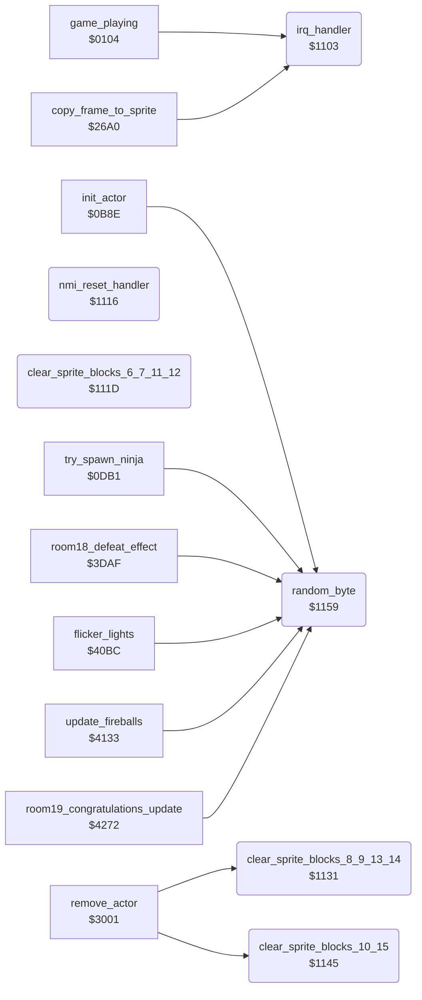

<!-- Generated by c64-docs from knowledge revision 20261016T170255.379-vv114c and src/source-map.json. Do not edit: change the knowledge, generate the source again, then run generate.ts. -->
# interrupts.asm: IRQ entry and dispatch through irq_chain_vector, NMI/RESET stub, sprite buffer clears, random numbers

Range `$1103-$1165`. Source: [interrupts.asm](../../../src/interrupts.asm). Index: [the reference](../index.md).

## Call graph

A solid arrow is a call, a thick arrow a table entry, a dotted arrow a jump. Rounded nodes are in this file.

## Names

### [`irq_handler`](../../../src/interrupts.asm#L6) `$1103`

*routine*

IRQ entry ($FFFE): pushes A, X, Y and jumps through irq_chain_vector ($0408), which each raster handler sets to the next one.

- **Called from:** [`game_playing`](../variables.md#game_playing) `$010A`, [`game_playing`](../variables.md#game_playing) `$0138`, [`game_playing`](../variables.md#game_playing) `$013A`, [`copy_frame_to_sprite`](sprite_render.md#copy_frame_to_sprite) [`$2703`](../../../src/sprite_render.asm#L235), [`$4C58`](../../../src/room_tables.asm#L202), [`$4E8D`](../../../src/room_tables.asm#L381), [`$646A`](../../../src/sprite_data.asm#L385), [`$CFE2`](../../../src/protection_signature.asm#L64), [`$EF71`](../../../src/sfx_voice2.asm#L9)
- **Jumped to from:** [`$4321`](../../../src/variables.asm#L44), `$A0D0`
- **Entry of:** [`hw_nmi_vector`](../tables.md#hw_nmi_vector)
- **Jumps to:** [`l_ef29`](../../../src/sfx_data.asm#L176)
- **Reads:** [`lde00`](../variables.md#lde00), [`irq_chain_vector`](init.md#irq_chain_vector)

### [`irq_dispatch`](../../../src/interrupts.asm#L18) `$1113`

*label*

JMP (irq_chain_vector)

- **Jumped to from:** [`irq_handler`](interrupts.md#irq_handler) [`$110E`](../../../src/interrupts.asm#L15)

### [`nmi_reset_handler`](../../../src/interrupts.asm#L21) `$1116`

*routine*

NMI and RESET vector target ($FFFA/$FFFC): RTI only, so RESTORE does nothing. The JMP ($FFFC) and JMP ($0000) after it are never reached.

- **Entry of:** [`hw_nmi_vector`](../tables.md#hw_nmi_vector)

### [`clear_sprite_blocks_6_7_11_12`](../../../src/interrupts.asm#L26) `$111D`

*routine*

Clears $8180-$81FF and $82C0-$833F (sprite blocks 6, 7, 11, 12). Keeps A and X. Nothing calls it.

### [`clear_sprite_blocks_8_9_13_14`](../../../src/interrupts.asm#L43) `$1131`

*routine*

Clears $8200-$827F and $8340-$83BF (sprite blocks 8, 9, 13, 14). Keeps A and X.

- **Called from:** [`remove_actor`](background_touch.md#remove_actor) [`$303F`](../../../src/background_touch.asm#L309)
- **Writes:** [`sprite_blocks+254`](vic_bank2.md#sprite_blocks), [`sprite_blocks+255`](vic_bank2.md#sprite_blocks), [`sprite_blocks+574`](vic_bank2.md#sprite_blocks), [`sprite_blocks+575`](vic_bank2.md#sprite_blocks)
- **Refers to:** [`sprite_blocks`](vic_bank2.md#sprite_blocks)

### [`clear_sprite_blocks_10_15`](../../../src/interrupts.asm#L59) `$1145`

*routine*

Clears $8280-$82BF and $83C0-$83FF (sprite blocks 10 and 15). Keeps A and X.

- **Called from:** [`remove_actor`](background_touch.md#remove_actor) [`$3045`](../../../src/background_touch.asm#L312)
- **Writes:** [`sprite_blocks+318`](vic_bank2.md#sprite_blocks), [`sprite_blocks+319`](vic_bank2.md#sprite_blocks), [`sprite_blocks+638`](vic_bank2.md#sprite_blocks), [`sprite_blocks+639`](vic_bank2.md#sprite_blocks)
- **Refers to:** [`sprite_blocks`](vic_bank2.md#sprite_blocks)

### [`random_byte`](../../../src/interrupts.asm#L75) `$1159`

*routine*

Returns a random byte in A: increments random_ptr and reads (random_ptr),Y from the SID-noise table at $0200. In demo mode (game_playing=0) returns 1, so the demo replays the same way.

- **Called from:** [`init_actor`](actors.md#init_actor) [`$0C09`](../../../src/actors.asm#L69), [`init_actor`](actors.md#init_actor) [`$0C17`](../../../src/actors.asm#L77), [`init_actor`](actors.md#init_actor) [`$0C31`](../../../src/actors.asm#L90), [`try_spawn_ninja`](actors.md#try_spawn_ninja) [`$0DCB`](../../../src/actors.asm#L328), [`room18_defeat_effect`](room_update.md#room18_defeat_effect) [`$3DB5`](../../../src/room_update.asm#L1023), [`room18_defeat_effect`](room_update.md#room18_defeat_effect) [`$3DC4`](../../../src/room_update.asm#L1031), [`room18_defeat_effect`](room_update.md#room18_defeat_effect) [`$3E00`](../../../src/room_update.asm#L1058), [`flicker_lights`](light_flicker.md#flicker_lights) [`$40C1`](../../../src/light_flicker.asm#L10), [`flicker_lights`](light_flicker.md#flicker_lights) [`$40CB`](../../../src/light_flicker.asm#L14), [`flicker_lights`](light_flicker.md#flicker_lights) [`$40EB`](../../../src/light_flicker.asm#L28), [`flicker_lights`](light_flicker.md#flicker_lights) [`$40F5`](../../../src/light_flicker.asm#L32), [`flicker_lights`](light_flicker.md#flicker_lights) [`$410D`](../../../src/light_flicker.asm#L43), [`flicker_lights`](light_flicker.md#flicker_lights) [`$4117`](../../../src/light_flicker.asm#L47), [`update_fireballs`](fireballs.md#update_fireballs) [`$4137`](../../../src/fireballs.asm#L10), [`update_fireballs`](fireballs.md#update_fireballs) [`$4140`](../../../src/fireballs.asm#L13), [`update_fireballs`](fireballs.md#update_fireballs) [`$41F5`](../../../src/fireballs.asm#L116), [`room19_congratulations_update`](final_room.md#room19_congratulations_update) [`$4298`](../../../src/final_room.asm#L56)
- **Written by:** [`play_sound_80_checked`](actor_movement.md#play_sound_80_checked) [`$1FE2`](../../../src/actor_movement.asm#L548)
- **Reads:** [`game_playing`](../variables.md#game_playing), [`random_ptr`](../variables.md#random_ptr)
- **Writes:** [`random_ptr`](../variables.md#random_ptr)
