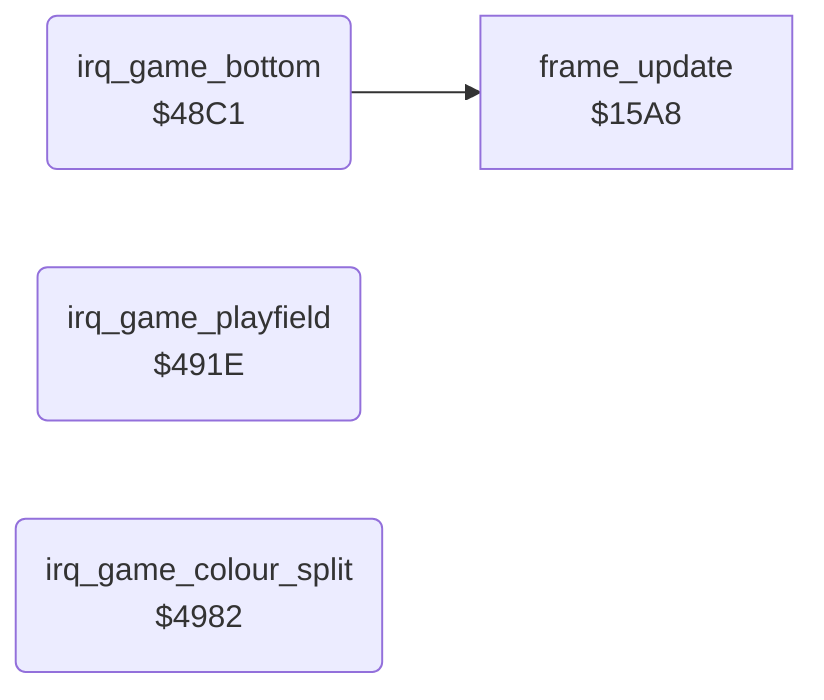

<!-- Generated by c64-docs from knowledge revision 20261029T162352.521-4j8tu8 and .c64-re-tools/local/generated/src/source-map.json. Do not edit: change the knowledge, generate the source again, then run docs.ts generate. -->
# irq/game_irq.asm: Game raster IRQ chain: bottom handler, playfield top and colour splits

Range `$48C1-$49BC`. Source: [irq/game_irq.asm](../../../../src/irq/game_irq.asm). Index: [the reference](../../index.md).

## Routines

| Routine | Address | Reached from | Summary |
|---|---|---|---|
| [`irq_game_bottom`](game_irq.md#irq_game_bottom) | `$48C1` | [`irq_entry`](interrupt_entry.md#irq_entry) | Game raster IRQ at the bottom of the screen (raster $FD), reached through irq_entry, which pushed A, X, Y. |
| [`irq_game_playfield`](game_irq.md#irq_game_playfield) | `$491E` | [`irq_entry`](interrupt_entry.md#irq_entry) | Game raster IRQ at line $40 (top of the playfield). |
| [`irq_game_colour_split`](game_irq.md#irq_game_colour_split) | `$4982` | [`irq_entry`](interrupt_entry.md#irq_entry) | Game raster IRQ at a split line r. |

## Call graph

A solid arrow is a call, a thick arrow a table entry. Rounded nodes are in this file.

## Details

### [`irq_game_bottom`](../../../../src/irq/game_irq.asm#L12) `$48C1`

*routine*

Game raster IRQ at the bottom of the screen (raster $FD), reached through irq_entry, which pushed A, X, Y. Sets up the status line for the top of the next frame (game_screen with text_font, BGCOL0 grey), arms irq_game_playfield at raster $40, copies the room's 12-byte band palette to room_band_colours and its split list to raster_split_lines, then runs the per-frame work frame_update (sound effects, timers, joysticks, ...) and returns from the interrupt. Chain: irq_game_bottom -> irq_game_playfield (line $40) -> irq_game_colour_split for each line in raster_split_lines -> irq_game_bottom (line $FD).
D018 $32: screen $8C00 (game_screen), charset $8800 (text_font)

- **Jumped to from:** [`irq_entry`](interrupt_entry.md#irq_entry)
- **Referred to by:** [`init_game_irq`](../game/play_init.md#init_game_irq), [`irq_game_playfield`](game_irq.md#irq_game_playfield)
- **Calls:** [`frame_update`](../game/frame_update.md#frame_update)
- **Reads:** [`SCROLY`](../../memory-map.md#SCROLY), [`room`](../../memory-map.md#room), [`room_palette_ptr`](../room/room_palettes_47a0.md#room_palette_ptr), [`room_split_list_ptr`](../room/room_palettes_47a0.md#room_split_list_ptr), [`aux_ptr`](../../memory-map.md#aux_ptr), [`split_list_ptr`](../../memory-map.md#split_list_ptr)
- **Writes:** [`VMCSB`](../../memory-map.md#VMCSB), [`BGCOL0`](../../memory-map.md#BGCOL0), [`irq_vector`](../game/cold_start.md#irq_vector), [`irq_vector_hi`](../game/cold_start.md#irq_vector_hi), [`IRQMSK`](../../memory-map.md#IRQMSK), [`VICIRQ`](../../memory-map.md#VICIRQ), [`SCROLY`](../../memory-map.md#SCROLY), [`RASTER`](../../memory-map.md#RASTER), [`aux_ptr`](../../memory-map.md#aux_ptr), [`split_list_ptr`](../../memory-map.md#split_list_ptr), [`room_band_colours`](../../memory-map.md#room_band_colours), [`raster_split_lines`](../room/room_palettes_47a0.md#raster_split_lines)
- **Refers to:** [`irq_game_playfield`](game_irq.md#irq_game_playfield), [`room_palette_ptr`](../room/room_palettes_47a0.md#room_palette_ptr), [`aux_ptr`](../../memory-map.md#aux_ptr), [`room_split_list_ptr`](../room/room_palettes_47a0.md#room_split_list_ptr), [`split_list_ptr`](../../memory-map.md#split_list_ptr)

| Label | Address | Comment |
|---|---|---|
| [`irq_bottom_copy`](../../../../src/irq/game_irq.asm#L42) | `$4904` | 12 palette bytes to room_band_colours; the first 4 split lines to raster_split_lines. |
| [`irq_bottom_copy_next`](../../../../src/irq/game_irq.asm#L49) | `$4912` |  |

### [`irq_game_playfield`](../../../../src/irq/game_irq.asm#L62) `$491E`

*routine*

Game raster IRQ at line $40 (top of the playfield). Waits until the raster passes $41 plus a short delay, then switches to the room font (room_vmcsb -> VMCSB) and the band 0 colours (room_band_colours+0..2), sets raster_split_index = 0 and band_palette_offset = 3, and arms the first split.

- **Jumped to from:** [`irq_entry`](interrupt_entry.md#irq_entry)
- **Referred to by:** [`irq_game_bottom`](game_irq.md#irq_game_bottom)
- **Reads:** [`RASTER`](../../memory-map.md#RASTER), [`room_vmcsb`](../../memory-map.md#room_vmcsb), [`room_band_colours`](../../memory-map.md#room_band_colours), [`SCROLY`](../../memory-map.md#SCROLY), [`raster_split_index`](../../memory-map.md#raster_split_index), [`raster_split_lines`](../room/room_palettes_47a0.md#raster_split_lines)
- **Writes:** [`VMCSB`](../../memory-map.md#VMCSB), [`BGCOL0`](../../memory-map.md#BGCOL0), [`BGCOL1`](../../memory-map.md#BGCOL1), [`BGCOL2`](../../memory-map.md#BGCOL2), [`raster_split_index`](../../memory-map.md#raster_split_index), [`band_palette_offset`](../../memory-map.md#band_palette_offset), [`irq_vector`](../game/cold_start.md#irq_vector), [`irq_vector_hi`](../game/cold_start.md#irq_vector_hi), [`IRQMSK`](../../memory-map.md#IRQMSK), [`VICIRQ`](../../memory-map.md#VICIRQ), [`SCROLY`](../../memory-map.md#SCROLY), [`RASTER`](../../memory-map.md#RASTER)
- **Refers to:** [`room_band_colours`](../../memory-map.md#room_band_colours), [`irq_game_colour_split`](game_irq.md#irq_game_colour_split), [`irq_game_bottom`](game_irq.md#irq_game_bottom)

| Label | Address | Comment |
|---|---|---|
| [`irq_playfield_wait`](../../../../src/irq/game_irq.asm#L64) | `$4920` |  |
| [`irq_playfield_delay`](../../../../src/irq/game_irq.asm#L68) | `$4927` |  |
| [`irq_arm_next_split`](../../../../src/irq/game_irq.asm#L89) | `$4953` | Arms the next IRQ at raster_split_lines[raster_split_index]. A value of $FD ends the list: then the vector goes back to irq_game_bottom (which runs at that same line $FD). |
| [`irq_game_return`](../../../../src/irq/game_irq.asm#L101) | `$496F` |  |
| [`irq_chain_to_bottom`](../../../../src/irq/game_irq.asm#L108) | `$4975` |  |

### [`irq_game_colour_split`](../../../../src/irq/game_irq.asm#L117) `$4982`

*routine*

Game raster IRQ at a split line r. Loads the next band colours (room_band_colours + band_palette_offset, 3 bytes), waits for raster line r+3 (or r+2 plus a delay) and writes BGCOL0-BGCOL2 together. Then band_palette_offset += 3, raster_split_index += 1 and the next split (or irq_game_bottom) is armed.

- **Jumped to from:** [`irq_entry`](interrupt_entry.md#irq_entry)
- **Referred to by:** [`irq_game_playfield`](game_irq.md#irq_game_playfield)
- **Jumps to:** [`irq_arm_next_split`](game_irq.md#irq_arm_next_split)
- **Reads:** [`band_palette_offset`](../../memory-map.md#band_palette_offset), [`room_band_colours`](../../memory-map.md#room_band_colours), [`raster_split_index`](../../memory-map.md#raster_split_index), [`raster_split_lines`](../room/room_palettes_47a0.md#raster_split_lines), [`RASTER`](../../memory-map.md#RASTER)
- **Writes:** [`BGCOL0`](../../memory-map.md#BGCOL0), [`BGCOL1`](../../memory-map.md#BGCOL1), [`BGCOL2`](../../memory-map.md#BGCOL2), [`band_palette_offset`](../../memory-map.md#band_palette_offset), [`raster_split_index`](../../memory-map.md#raster_split_index)
- **Refers to:** [`room_band_colours`](../../memory-map.md#room_band_colours)

| Label | Address | Comment |
|---|---|---|
| [`irq_split_wait`](../../../../src/irq/game_irq.asm#L127) | `$4991` |  |
| [`irq_split_delay`](../../../../src/irq/game_irq.asm#L133) | `$499D` |  |
| [`irq_split_set_colours`](../../../../src/irq/game_irq.asm#L136) | `$49A0` |  |
