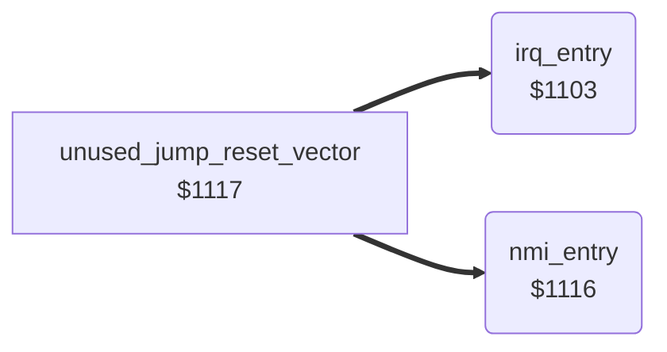

<!-- Generated by c64-docs from knowledge revision 20261025T141148.619-ij2l1b and .c64-re-tools/local/generated/src/source-map.json. Do not edit: change the knowledge, generate the source again, then run docs.ts generate. -->
# irq/interrupt_entry.asm: IRQ and NMI entry points, sprite data clears and the random byte routine

Range `$1103-$1116`. Source: [irq/interrupt_entry.asm](../../../../src/irq/interrupt_entry.asm). Index: [the reference](../../index.md).

## Routines

| Routine | Address | Reached from | Summary |
|---|---|---|---|
| [`irq_entry`](interrupt_entry.md#irq_entry) | `$1103` | [`unused_jump_reset_vector`](../leftovers/leftover_1117.md#unused_jump_reset_vector) | Hardware IRQ entry (hw_irq_vector at $FFFE). |
| [`nmi_entry`](interrupt_entry.md#nmi_entry) | `$1116` | [`unused_jump_reset_vector`](../leftovers/leftover_1117.md#unused_jump_reset_vector) | NMI vector ($FFFA) and RESET vector ($FFFC) target: returns at once, so RESTORE does nothing. |

## Call graph

A solid arrow is a call, a thick arrow a table entry. Rounded nodes are in this file.

## Details

### [`irq_entry`](../../../../src/irq/interrupt_entry.asm#L10) `$1103`

*routine*

Hardware IRQ entry (hw_irq_vector at $FFFE). Saves A, X and Y, then jumps through irq_vector to the raster handler of the current screen. The test of the stacked status register uses AND #$00, so the BRK branch to JMP (io1_dummy) is never taken. Every handler ends with PLA/TAY/PLA/TAX/PLA/RTI. Handlers: irq_player_screen; irq_title_frame and irq_title_split (title and game over); irq_game_bottom, irq_game_playfield and irq_game_colour_split (game screen).

- **Entry of:** [`hw_nmi_vector`](../../tables.md#hw_nmi_vector)
- **Jumps to:** [`irq_player_screen`](screen_raster_irqs.md#irq_player_screen), [`irq_title_frame`](screen_raster_irqs.md#irq_title_frame), [`irq_title_split`](screen_raster_irqs.md#irq_title_split), [`irq_game_bottom`](game_irq.md#irq_game_bottom), [`irq_game_playfield`](game_irq.md#irq_game_playfield), [`irq_game_colour_split`](game_irq.md#irq_game_colour_split)
- **Reads:** [`game_mode`](../../memory-map.md#game_mode), [`io1_dummy`](../../memory-map.md#io1_dummy), [`irq_vector`](../game/cold_start.md#irq_vector)

| Label | Address | Comment |
|---|---|---|
| [`irq_dispatch`](../../../../src/irq/interrupt_entry.asm#L22) | `$1113` | raster handler of the current screen |

### [`nmi_entry`](../../../../src/irq/interrupt_entry.asm#L25) `$1116`

*routine*

NMI vector ($FFFA) and RESET vector ($FFFC) target: returns at once, so RESTORE does nothing.

- **Jumped to from:** [`unused_jump_reset_vector`](../leftovers/leftover_1117.md#unused_jump_reset_vector)
- **Entry of:** [`hw_nmi_vector`](../../tables.md#hw_nmi_vector)
