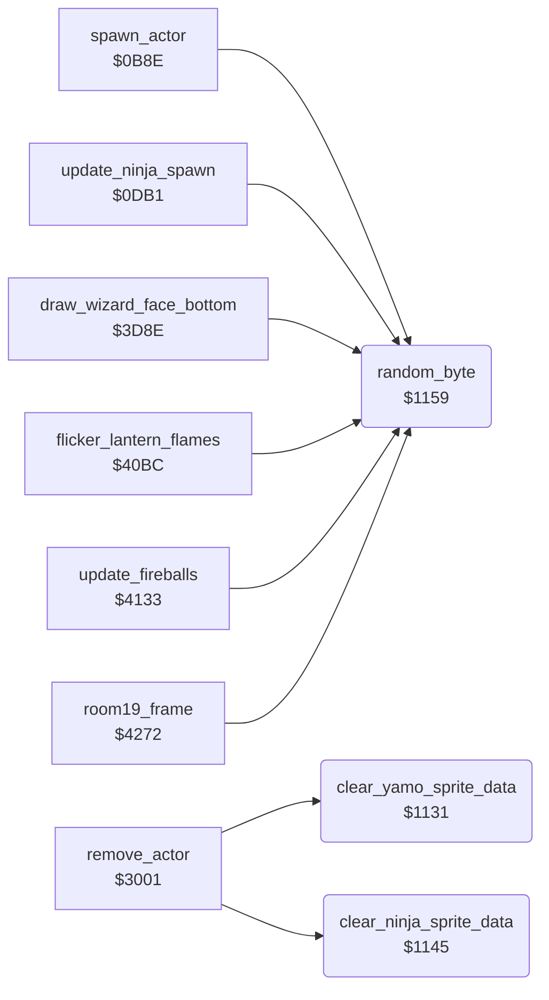

<!-- Generated by c64-docs from knowledge revision 20261029T162352.521-4j8tu8 and .c64-re-tools/local/generated/src/source-map.json. Do not edit: change the knowledge, generate the source again, then run docs.ts generate. -->
# irq/interrupt_entry_1131.asm

Range `$1131-$1165`. Source: [irq/interrupt_entry_1131.asm](../../../../src/irq/interrupt_entry_1131.asm). Index: [the reference](../../index.md).

## Routines

| Routine | Address | Reached from | Summary |
|---|---|---|---|
| [`clear_yamo_sprite_data`](interrupt_entry_1131.md#clear_yamo_sprite_data) | `$1131` | [`remove_actor`](../actor/touch_effects.md#remove_actor) | Clear both sprite images of Yamo (sprites 2 and 3) in both sprite buffers: sprite_buf_a_spr2/spr3 ($8200-$827F) and sprite_buf_b_spr2/spr3 ($8340-$83BF). |
| [`clear_ninja_sprite_data`](interrupt_entry_1131.md#clear_ninja_sprite_data) | `$1145` | [`remove_actor`](../actor/touch_effects.md#remove_actor) | Clear the sprite image of the Ninja (sprite 4) in both sprite buffers: sprite_buf_a_spr4 ($8280-$82BF) and sprite_buf_b_spr4 ($83C0-$83FF). |
| [`random_byte`](interrupt_entry_1131.md#random_byte) | `$1159` | [`spawn_actor`](../actor/actor_spawn.md#spawn_actor), [`update_ninja_spawn`](../actor/actor_spawn.md#update_ninja_spawn), [`draw_wizard_face_bottom`](../room/wizard_room.md#draw_wizard_face_bottom), [`flicker_lantern_flames`](../room/room_hazard_draw_40bc.md#flicker_lantern_flames), [`update_fireballs`](../room/wizard_fireballs.md#update_fireballs), [`room19_frame`](../room/ending_room.md#room19_frame) | Return a pseudo-random byte in A. |

## Call graph

A solid arrow is a call, a thick arrow a table entry. Rounded nodes are in this file.

## Details

### [`clear_yamo_sprite_data`](../../../../src/irq/interrupt_entry_1131.asm#L7) `$1131`

*routine*

Clear both sprite images of Yamo (sprites 2 and 3) in both sprite buffers: sprite_buf_a_spr2/spr3 ($8200-$827F) and sprite_buf_b_spr2/spr3 ($8340-$83BF). Called by remove_actor. Keeps A and X.

- **Called from:** [`remove_actor`](../actor/touch_effects.md#remove_actor)
- **Writes:** [`sprite_buf_a_spr2`](../../memory-map.md#sprite_buf_a_spr2), [`sprite_buf_b_spr2`](../../memory-map.md#sprite_buf_b_spr2)

| Label | Address | Comment |
|---|---|---|
| [`clear_yamo_sprite_loop`](../../../../src/irq/interrupt_entry_1131.asm#L13) | `$1138` |  |

### [`clear_ninja_sprite_data`](../../../../src/irq/interrupt_entry_1131.asm#L24) `$1145`

*routine*

Clear the sprite image of the Ninja (sprite 4) in both sprite buffers: sprite_buf_a_spr4 ($8280-$82BF) and sprite_buf_b_spr4 ($83C0-$83FF). Called by remove_actor. Keeps A and X.

- **Called from:** [`remove_actor`](../actor/touch_effects.md#remove_actor)
- **Writes:** [`sprite_buf_a_spr4`](../../memory-map.md#sprite_buf_a_spr4), [`sprite_buf_b_spr4`](../../memory-map.md#sprite_buf_b_spr4)

| Label | Address | Comment |
|---|---|---|
| [`clear_ninja_sprite_loop`](../../../../src/irq/interrupt_entry_1131.asm#L30) | `$114C` |  |

### [`random_byte`](../../../../src/irq/interrupt_entry_1131.asm#L45) `$1159`

*routine*

Return a pseudo-random byte in A. In the demo (game_mode = 0) it returns 1, so the demo plays the same way each time. Else it increments random_ptr (frame_update also increments it each frame) and reads (random_ptr),y. restart_to_title points random_ptr at random_table, but init_game_variables then clears its high byte, so the read comes from zero page and the stack page. Input: Y = offset chosen by the caller. When protection_result is zero, actor_play_step_sound finally overwrites the first opcode of this routine ($9A, TXS).

- **Called from:** [`spawn_actor`](../actor/actor_spawn.md#spawn_actor), [`update_ninja_spawn`](../actor/actor_spawn.md#update_ninja_spawn), [`draw_wizard_face_bottom`](../room/wizard_room.md#draw_wizard_face_bottom), [`flicker_lantern_flames`](../room/room_hazard_draw_40bc.md#flicker_lantern_flames), [`update_fireballs`](../room/wizard_fireballs.md#update_fireballs), [`room19_frame`](../room/ending_room.md#room19_frame)
- **Written by:** [`actor_play_step_sound`](../actor/actor_step.md#actor_play_step_sound)
- **Reads:** [`game_mode`](../../memory-map.md#game_mode), [`random_ptr`](../../memory-map.md#random_ptr)
- **Writes:** [`random_ptr`](../../memory-map.md#random_ptr)

| Label | Address | Comment |
|---|---|---|
| [`random_byte_read`](../../../../src/irq/interrupt_entry_1131.asm#L50) | `$1161` |  |
