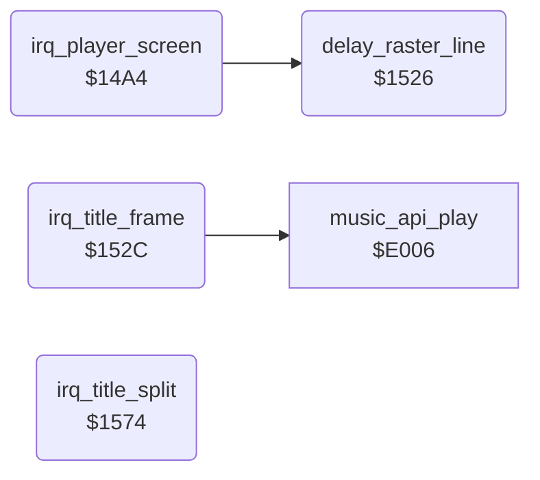

<!-- Generated by c64-docs from knowledge revision 20261025T214801.837-ucnw24 and .c64-re-tools/local/generated/src/source-map.json. Do not edit: change the knowledge, generate the source again, then run docs.ts generate. -->
# irq/screen_raster_irqs.asm: Raster interrupt handlers of the PLAYER n, title and game over screens

Range `$14A4-$15A7`. Source: [irq/screen_raster_irqs.asm](../../../../src/irq/screen_raster_irqs.asm). Index: [the reference](../../index.md).

## Routines

| Routine | Address | Reached from | Summary |
|---|---|---|---|
| [`irq_player_screen`](screen_raster_irqs.md#irq_player_screen) | `$14A4` | [`irq_entry`](interrupt_entry.md#irq_entry) | Raster IRQ handler of the PLAYER n screen, at raster line $63 (99). |
| [`delay_raster_line`](screen_raster_irqs.md#delay_raster_line) | `$1526` | [`irq_player_screen`](screen_raster_irqs.md#irq_player_screen) | Busy wait of about one raster line (10 DEX loops plus JSR/RTS). |
| [`irq_title_frame`](screen_raster_irqs.md#irq_title_frame) | `$152C` | [`irq_entry`](interrupt_entry.md#irq_entry) | Raster IRQ handler of the title and game over screens at raster line $FD (253): decrements frame_countdown and the 16-bit title_countdown (both stop at 0), sets the VIC to screen game_screen, charset $8000 (logo charset), multicolour 40 columns for the top of the next frame, plays the music (music_api_play), and sets irq_title_split at raster line $82 as the next handler. |
| [`irq_title_split`](screen_raster_irqs.md#irq_title_split) | `$1574` | [`irq_entry`](interrupt_entry.md#irq_entry) | Raster IRQ handler at raster line $82 (130) of the title and game over screens: after a short delay switches the lower part of the screen to the text font (charset text_font $8800), multicolour, 38 columns and x-scroll 6, then sets irq_title_frame at raster line $FD as the next handler. |

## Call graph

A solid arrow is a call, a thick arrow a table entry. Rounded nodes are in this file.

## Details

### [`irq_player_screen`](../../../../src/irq/screen_raster_irqs.asm#L10) `$14A4`

*routine*

Raster IRQ handler of the PLAYER n screen, at raster line $63 (99). Waits for line $6E (110), then changes BGCOL1 (multicolour 1) about every 2 lines to $B, $C, $F, $1, $F, $C, $B (dark grey to white and back), which shades the big PLAYER n text on rows 7-8. Then sets the VIC to screen game_screen, charset $8000 (logo charset), multicolour 40 columns, sets the next IRQ again at line $63, decrements frame_countdown and returns. Installed by show_player_screen.

- **Jumped to from:** [`irq_entry`](interrupt_entry.md#irq_entry)
- **Referred to by:** [`show_player_screen`](../game/title_player_screens.md#show_player_screen)
- **Calls:** [`delay_raster_line`](screen_raster_irqs.md#delay_raster_line)
- **Reads:** [`RASTER`](../../memory-map.md#RASTER), [`SCROLY`](../../memory-map.md#SCROLY), [`frame_countdown`](../../memory-map.md#frame_countdown)
- **Writes:** [`BGCOL1`](../../memory-map.md#BGCOL1), [`VMCSB`](../../memory-map.md#VMCSB), [`SCROLX`](../../memory-map.md#SCROLX), [`IRQMSK`](../../memory-map.md#IRQMSK), [`VICIRQ`](../../memory-map.md#VICIRQ), [`SCROLY`](../../memory-map.md#SCROLY), [`RASTER`](../../memory-map.md#RASTER), [`frame_countdown`](../../memory-map.md#frame_countdown)

| Label | Address | Comment |
|---|---|---|
| [`irq_player_screen_sync`](../../../../src/irq/screen_raster_irqs.asm#L13) | `$14A8` |  |
| [`irq_player_screen_delay`](../../../../src/irq/screen_raster_irqs.asm#L19) | `$14B4` |  |
| [`irq_player_screen_bars`](../../../../src/irq/screen_raster_irqs.asm#L22) | `$14B7` | dark grey |
| [`irq_player_screen_exit`](../../../../src/irq/screen_raster_irqs.asm#L63) | `$1520` |  |

### [`delay_raster_line`](../../../../src/irq/screen_raster_irqs.asm#L71) `$1526`

*routine*

Busy wait of about one raster line (10 DEX loops plus JSR/RTS). Changes X.

- **Called from:** [`irq_player_screen`](screen_raster_irqs.md#irq_player_screen)

| Label | Address | Comment |
|---|---|---|
| [`delay_raster_line_loop`](../../../../src/irq/screen_raster_irqs.asm#L73) | `$1528` |  |

### [`irq_title_frame`](../../../../src/irq/screen_raster_irqs.asm#L81) `$152C`

*routine*

Raster IRQ handler of the title and game over screens at raster line $FD (253): decrements frame_countdown and the 16-bit title_countdown (both stop at 0), sets the VIC to screen game_screen, charset $8000 (logo charset), multicolour 40 columns for the top of the next frame, plays the music (music_api_play), and sets irq_title_split at raster line $82 as the next handler.

- **Jumped to from:** [`irq_entry`](interrupt_entry.md#irq_entry)
- **Referred to by:** [`show_title_screen`](../game/title_demo_start.md#show_title_screen), [`irq_title_split`](screen_raster_irqs.md#irq_title_split), [`game_over`](../game/lose_fall_game_over.md#game_over)
- **Calls:** [`music_api_play`](../music/music_player_state.md#music_api_play)
- **Reads:** [`frame_countdown`](../../memory-map.md#frame_countdown), [`title_countdown`](../../memory-map.md#title_countdown), [`SCROLY`](../../memory-map.md#SCROLY)
- **Writes:** [`frame_countdown`](../../memory-map.md#frame_countdown), [`title_countdown`](../../memory-map.md#title_countdown), [`VMCSB`](../../memory-map.md#VMCSB), [`SCROLX`](../../memory-map.md#SCROLX), [`irq_vector`](../game/cold_start.md#irq_vector), [`irq_vector_hi`](../game/cold_start.md#irq_vector_hi), [`IRQMSK`](../../memory-map.md#IRQMSK), [`VICIRQ`](../../memory-map.md#VICIRQ), [`SCROLY`](../../memory-map.md#SCROLY), [`RASTER`](../../memory-map.md#RASTER)
- **Refers to:** [`title_countdown`](../../memory-map.md#title_countdown), [`irq_title_split`](screen_raster_irqs.md#irq_title_split)

| Label | Address | Comment |
|---|---|---|
| [`irq_title_countdown`](../../../../src/irq/screen_raster_irqs.asm#L85) | `$1532` |  |
| [`irq_title_set_upper`](../../../../src/irq/screen_raster_irqs.asm#L94) | `$1542` | VIC: screen $8C00, charset $8000 |

### [`irq_title_split`](../../../../src/irq/screen_raster_irqs.asm#L121) `$1574`

*routine*

Raster IRQ handler at raster line $82 (130) of the title and game over screens: after a short delay switches the lower part of the screen to the text font (charset text_font $8800), multicolour, 38 columns and x-scroll 6, then sets irq_title_frame at raster line $FD as the next handler.

- **Jumped to from:** [`irq_entry`](interrupt_entry.md#irq_entry)
- **Referred to by:** [`irq_title_frame`](screen_raster_irqs.md#irq_title_frame)
- **Reads:** [`SCROLY`](../../memory-map.md#SCROLY)
- **Writes:** [`VMCSB`](../../memory-map.md#VMCSB), [`SCROLX`](../../memory-map.md#SCROLX), [`irq_vector`](../game/cold_start.md#irq_vector), [`irq_vector_hi`](../game/cold_start.md#irq_vector_hi), [`IRQMSK`](../../memory-map.md#IRQMSK), [`VICIRQ`](../../memory-map.md#VICIRQ), [`SCROLY`](../../memory-map.md#SCROLY), [`RASTER`](../../memory-map.md#RASTER)
- **Refers to:** [`irq_title_frame`](screen_raster_irqs.md#irq_title_frame)

| Label | Address | Comment |
|---|---|---|
| [`irq_title_split_delay`](../../../../src/irq/screen_raster_irqs.asm#L123) | `$1576` |  |
