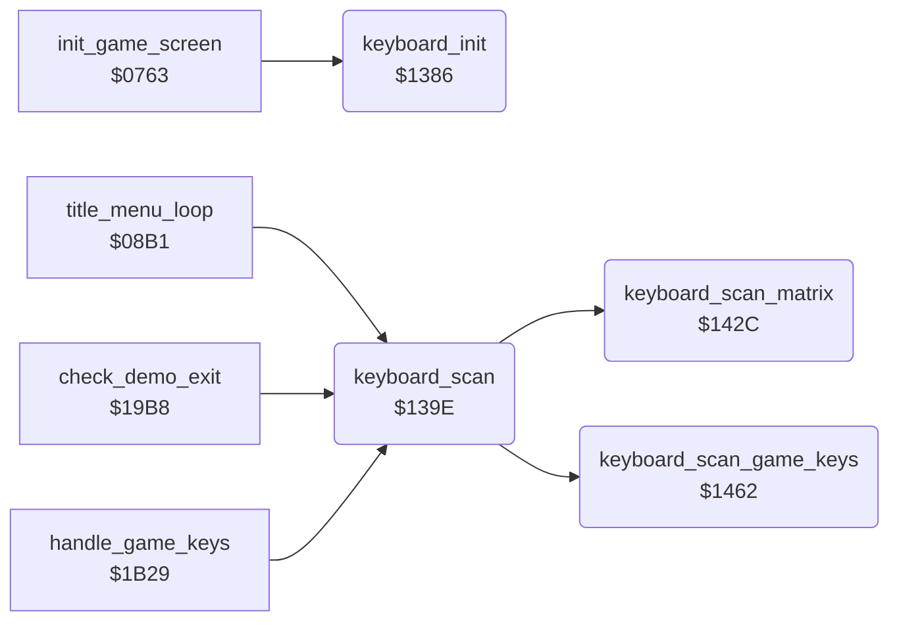

<!-- Generated by c64-docs from knowledge revision 20261016T170255.379-vv114c and src/source-map.json. Do not edit: change the knowledge, generate the source again, then run generate.ts. -->
# keyboard.asm: Keyboard scanner (full matrix on the title, four game keys in play)

Range `$1386-$14A3`. Source: [keyboard.asm](../../../src/keyboard.asm). Index: [the reference](../index.md).

## Call graph

A solid arrow is a call, a thick arrow a table entry, a dotted arrow a jump. Rounded nodes are in this file.

## Data

| Range | Type | Name | Read by | Written by |
|---|---|---|---|---|
| [`$1488`](../../../src/keyboard.asm#L147)-`$148F` | bytes of 2 | [`game_key_matrix`](../../../src/keyboard.asm#L146) | [`keyboard_scan_game_keys`](keyboard.md#keyboard_scan_game_keys) |  |
| [`$1490`](../../../src/keyboard.asm#L158)-`$1493` | bytes | [`game_key_codes`](../../../src/keyboard.asm#L157) | [`keyboard_scan_game_keys`](keyboard.md#keyboard_scan_game_keys) |  |
| [`$1494`](../../../src/keyboard.asm#L163)-`$149B` | bytes | [`keyboard_bit_masks`](../../../src/keyboard.asm#L162) | [`keyboard_scan_matrix`](keyboard.md#keyboard_scan_matrix) |  |
| [`$149C`](../../../src/keyboard.asm#L170)-`$14A3` | bytes | [`keyboard_column_base`](../../../src/keyboard.asm#L169) | [`keyboard_scan_matrix`](keyboard.md#keyboard_scan_matrix) |  |

## Names

### [`keyboard_init`](../../../src/keyboard.asm#L6) `$1386`

*routine*

Sets key_code to $FF, clears key_pending, sets both CIA1 ports to input and disables the CIA1 and CIA2 interrupts.

- **Called from:** [`init_game_screen`](game_setup.md#init_game_screen) [`$076C`](../../../src/game_setup.asm#L11)
- **Writes:** [`key_code`](../variables.md#key_code), [`key_pending`](../variables.md#key_pending), [`CIADDRA`](../variables.md#CIADDRA), [`CIADDRB`](../variables.md#CIADDRB), [`CIAICR`](../variables.md#CIAICR), [`CI2ICR`](../variables.md#CI2ICR)

### [`keyboard_scan`](../../../src/keyboard.asm#L18) `$139E`

*routine*

Scans the keyboard when no key is pending and no joystick or key line is active. key_scan_mode 0 decodes the full matrix, 1 only F1, S, SPACE and V. When the scanned code differs from key_code, it stores it in key_code (column*8+row, bit 7 = shift) and, for a pressed key, sets key_pending to 1: one event for each press.

- **Called from:** [`title_menu_loop`](title_menu.md#title_menu_loop) [`$08BF`](../../../src/title_menu.asm#L14), [`check_demo_exit`](status.md#check_demo_exit) [`$19C9`](../../../src/status.asm#L26), [`handle_game_keys`](status.md#handle_game_keys) [`$1B2E`](../../../src/status.asm#L239)
- **Calls:** [`keyboard_scan_matrix`](keyboard.md#keyboard_scan_matrix), [`keyboard_scan_game_keys`](keyboard.md#keyboard_scan_game_keys)
- **Reads:** [`key_pending`](../variables.md#key_pending), [`CIAPRA`](../variables.md#CIAPRA), [`CIAPRB`](../variables.md#CIAPRB), [`key_shift`](../variables.md#key_shift), [`key_scan_mode`](../variables.md#key_scan_mode), [`key_code`](../variables.md#key_code), [`key_scanned`](../variables.md#key_scanned)
- **Writes:** [`CIADDRB`](../variables.md#CIADDRB), [`key_scanned`](../variables.md#key_scanned), [`key_shift`](../variables.md#key_shift), [`CIAPRB`](../variables.md#CIAPRB), [`key_columns`](../variables.md#key_columns), [`CIADDRA`](../variables.md#CIADDRA), [`CIAPRA`](../variables.md#CIAPRA), [`key_code`](../variables.md#key_code), [`key_pending`](../variables.md#key_pending)

### [`keyboard_scan_lines`](../../../src/keyboard.asm#L27) `$13AE`

*label*

- **Jumped to from:** [`keyboard_scan`](keyboard.md#keyboard_scan) [`$13AB`](../../../src/keyboard.asm#L24)

### [`keyboard_wait_release`](../../../src/keyboard.asm#L60) `$13F5`

*label*

- **Jumped to from:** [`keyboard_scan`](keyboard.md#keyboard_scan) [`$13C2`](../../../src/keyboard.asm#L37), [`keyboard_scan`](keyboard.md#keyboard_scan) [`$13EF`](../../../src/keyboard.asm#L57)

### [`keyboard_scan_matrix`](../../../src/keyboard.asm#L88) `$142C`

*routine*

Full matrix decode: finds the first pressed key from the column mask key_columns and stores column*8+row in key_scanned ($FF none). Skips both SHIFT keys ($0F, $34).

- **Called from:** [`keyboard_scan`](keyboard.md#keyboard_scan) [`$13EC`](../../../src/keyboard.asm#L56)
- **Reads:** [`key_columns`](../variables.md#key_columns), [`keyboard_bit_masks+6`](keyboard.md#keyboard_bit_masks), [`CIAPRB`](../variables.md#CIAPRB), [`keyboard_bit_masks+7`](keyboard.md#keyboard_bit_masks), [`keyboard_column_base+6`](keyboard.md#keyboard_column_base)
- **Writes:** [`key_columns`](../variables.md#key_columns), [`key_scanned`](../variables.md#key_scanned), [`CIAPRA`](../variables.md#CIAPRA)

### [`keyboard_scan_game_keys`](../../../src/keyboard.asm#L123) `$1462`

*routine*

Tests the four game keys in game_key_matrix; stores the matching code from game_key_codes in key_scanned, or $6F when none matches.

- **Called from:** [`keyboard_scan`](keyboard.md#keyboard_scan) [`$13F2`](../../../src/keyboard.asm#L59)
- **Reads:** [`CIAPRB`](../variables.md#CIAPRB)
- **Writes:** [`CIAPRA`](../variables.md#CIAPRA), [`key_scanned`](../variables.md#key_scanned)

### [`game_key_matrix`](../../../src/keyboard.asm#L146) `$1488-$148F`

*data*

Game keys: 4 pairs (CIA1 port A column select, port B value when pressed) for F1, S, SPACE, V.

- **Read by:** [`keyboard_scan_game_keys`](keyboard.md#keyboard_scan_game_keys) [`$1464`](../../../src/keyboard.asm#L126), [`keyboard_scan_game_keys`](keyboard.md#keyboard_scan_game_keys) [`$1464`](../../../src/keyboard.asm#L126) (+2), [`keyboard_scan_game_keys`](keyboard.md#keyboard_scan_game_keys) [`$146E`](../../../src/keyboard.asm#L130) (+1), [`keyboard_scan_game_keys`](keyboard.md#keyboard_scan_game_keys) [`$146E`](../../../src/keyboard.asm#L130) (+3)

### [`game_key_codes`](../../../src/keyboard.asm#L157) `$1490-$1493`

*data*

Key codes of the 4 game keys: F1 $04, S $0D, SPACE $3C, V $1F.

- **Read by:** [`keyboard_scan_game_keys`](keyboard.md#keyboard_scan_game_keys) [`$1481`](../../../src/keyboard.asm#L142) (+1)

### [`keyboard_bit_masks`](../../../src/keyboard.asm#L162) `$1494-$149B`

*data*

Masks $FE,$FD,$FB,$F7,$EF,$DF,$BF,$7F: one line low, used for column select and row test.

- **Read by:** [`keyboard_scan_matrix`](keyboard.md#keyboard_scan_matrix) [`$143C`](../../../src/keyboard.asm#L102) (+6), [`keyboard_scan_matrix`](keyboard.md#keyboard_scan_matrix) [`$1445`](../../../src/keyboard.asm#L105) (+6), [`keyboard_scan_matrix`](keyboard.md#keyboard_scan_matrix) [`$1445`](../../../src/keyboard.asm#L105) (+7)

### [`keyboard_column_base`](../../../src/keyboard.asm#L169) `$149C-$14A3`

*data*

Key code of row 0 of each column: column*8.

- **Read by:** [`keyboard_scan_matrix`](keyboard.md#keyboard_scan_matrix) [`$1453`](../../../src/keyboard.asm#L115) (+6)
