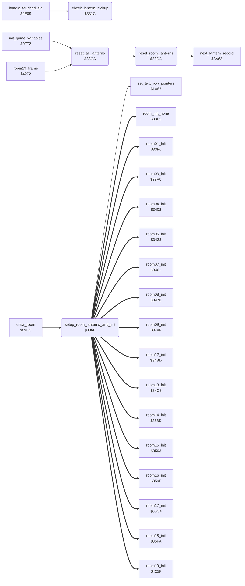

<!-- Generated by c64-docs from knowledge revision 20261018T222907.626-4u1tp6 and src/source-map.json. Do not edit: change the knowledge, generate the source again, then run docs.ts generate. -->
# lantern_pickup.asm: Lantern pickup, lantern redraw and reset, room init dispatch

Range `$331C-$33F4`. Source: [lantern_pickup.asm](../../../src/lantern_pickup.asm). Index: [the reference](../index.md).

## Call graph

A solid arrow is a call, a thick arrow a table entry, a dotted arrow a jump. Rounded nodes are in this file.

## Names

### [`check_lantern_pickup`](../../../src/lantern_pickup.asm#L15) `$331C`

*routine*

Looks for a lantern of the current room at the cell that the actor touches, and takes it. Input: current_actor (only Bruce calls it), Y = column of the touched cell. The row is actor_cell_row of the actor. The lantern list of the room comes from the pointer table lantern_list_ptr (index room*2). A record is 4 bytes: +0 state (1 = present, 0 = taken, $FF = end of list), +1 replacement char (drawn after the pickup), +2 column, +3 row. Output: C=1 when no present lantern is at that cell. C=0 when found: the record state becomes 0, room_lanterns_left+room is decremented, and A = replacement char AND $7F (the caller draws it and plays the pickup sound and score). Work: lantern_ptr list pointer, lantern_test_col, lantern_test_row, lantern_match.

- **Called from:** [`handle_touched_tile`](background_touch.md#handle_touched_tile) [`$2F0A`](../../../src/background_touch.asm#L146)
- **Reads:** [`current_actor`](../memory-map.md#current_actor), [`room`](../memory-map.md#room), [`lantern_ptr`](../memory-map.md#lantern_ptr), [`lantern_match`](../memory-map.md#lantern_match), [`lantern_test_col`](../memory-map.md#lantern_test_col), [`lantern_test_row`](../memory-map.md#lantern_test_row)
- **Writes:** [`lantern_test_row`](../memory-map.md#lantern_test_row), [`lantern_test_col`](../memory-map.md#lantern_test_col), [`lantern_ptr`](../memory-map.md#lantern_ptr), [`lantern_ptr+1`](../memory-map.md#lantern_ptr), [`lantern_match`](../memory-map.md#lantern_match)
- **Refers to:** [`lantern_list_ptr`](lantern_lists.md#lantern_list_ptr), [`lantern_list_ptr+1`](lantern_lists.md#lantern_list_ptr), [`lantern_ptr`](../memory-map.md#lantern_ptr)

### [`check_lantern_pickup_loop`](../../../src/lantern_pickup.asm#L28) `$3334`

*label*

match flag = 1; each failed test halves it to 0

- **Jumped to from:** [`check_lantern_pickup`](lantern_pickup.md#check_lantern_pickup) [`$3358`](../../../src/lantern_pickup.asm#L53)

### [`check_lantern_pickup_taken`](../../../src/lantern_pickup.asm#L34) `$333E`

*label*

### [`check_lantern_pickup_cmp_col`](../../../src/lantern_pickup.asm#L36) `$3340`

*label*

- **Jumped to from:** [`check_lantern_pickup`](lantern_pickup.md#check_lantern_pickup) [`$333C`](../../../src/lantern_pickup.asm#L33)

### [`check_lantern_pickup_cmp_row`](../../../src/lantern_pickup.asm#L43) `$334A`

*label*

- **Jumped to from:** [`check_lantern_pickup`](lantern_pickup.md#check_lantern_pickup) [`$3346`](../../../src/lantern_pickup.asm#L41)

### [`check_lantern_pickup_test`](../../../src/lantern_pickup.asm#L49) `$3353`

*label*

- **Jumped to from:** [`check_lantern_pickup`](lantern_pickup.md#check_lantern_pickup) [`$334F`](../../../src/lantern_pickup.asm#L47)

### [`check_lantern_pickup_none`](../../../src/lantern_pickup.asm#L54) `$335A`

*label*

C=1: no lantern here

- **Jumped to from:** [`check_lantern_pickup`](lantern_pickup.md#check_lantern_pickup) [`$333A`](../../../src/lantern_pickup.asm#L32)

### [`check_lantern_pickup_found`](../../../src/lantern_pickup.asm#L59) `$335C`

*label*

Found: mark the record taken, decrement the lantern count of the room, return the replacement char.

- **Jumped to from:** [`check_lantern_pickup`](lantern_pickup.md#check_lantern_pickup) [`$3355`](../../../src/lantern_pickup.asm#L51)

### [`setup_room_lanterns_and_init`](../../../src/lantern_pickup.asm#L79) `$336E`

*routine*

Called by draw_room after the room map is drawn. 1. For each lantern record of the room with state 0 (taken), draws its replacement char in place of the lantern: char AND $7F in the top line of the cell and char OR $80 in the bottom line (row from the record, screen row address from set_text_row_pointers). 2. Clears the five room variables room_state_a..room_state_e. 3. Jumps to the room init handler through the RTS table room_init_handlers (index room*2). Work: lantern_ptr list pointer, temp_y saved list index.

- **Called from:** [`draw_room`](draw_room.md#draw_room) [`$0B30`](../../../src/draw_room.asm#L223)
- **Calls:** [`set_text_row_pointers`](pause_status_line.md#set_text_row_pointers)
- **Jumps to:** [`room_init_none`](room_specific_init.md#room_init_none), [`room01_init`](room_specific_init.md#room01_init), [`room03_init`](room_specific_init.md#room03_init), [`room04_init`](room_specific_init.md#room04_init), [`room05_init`](room_specific_init.md#room05_init), [`room07_init`](room_specific_init.md#room07_init), [`room08_init`](room_specific_init.md#room08_init), [`room09_init`](room_specific_init.md#room09_init), [`room12_init`](room_specific_init.md#room12_init), [`room13_init`](room_specific_init.md#room13_init), [`room14_init`](room_specific_init.md#room14_init), [`room15_init`](room_specific_init.md#room15_init), [`room16_init`](room_specific_init.md#room16_init), [`room17_init`](room_specific_init.md#room17_init), [`room18_init`](room_specific_init.md#room18_init), [`room19_init`](ending_room.md#room19_init)
- **Reads:** [`room`](../memory-map.md#room), [`lantern_ptr`](../memory-map.md#lantern_ptr), [`row_ptr_top`](../memory-map.md#row_ptr_top), [`temp_y`](../memory-map.md#temp_y)
- **Writes:** [`lantern_ptr`](../memory-map.md#lantern_ptr), [`lantern_ptr+1`](../memory-map.md#lantern_ptr), [`temp_y`](../memory-map.md#temp_y), [`room_state_d`](room_dispatch.md#room_state_d), [`room_state_e`](room_dispatch.md#room_state_e)
- **Refers to:** [`lantern_list_ptr`](lantern_lists.md#lantern_list_ptr), [`lantern_list_ptr+1`](lantern_lists.md#lantern_list_ptr), [`lantern_ptr`](../memory-map.md#lantern_ptr), [`room_init_handlers+1`](room_dispatch.md#room_init_handlers), [`room_init_handlers`](room_dispatch.md#room_init_handlers)

### [`setup_room_lanterns_loop`](../../../src/lantern_pickup.asm#L88) `$337E`

*label*

- **Jumped to from:** [`setup_room_lanterns_and_init`](lantern_pickup.md#setup_room_lanterns_and_init) [`$33B0`](../../../src/lantern_pickup.asm#L125)

### [`setup_room_lanterns_skip_record`](../../../src/lantern_pickup.asm#L119) `$33AC`

*label*

- **Jumped to from:** [`setup_room_lanterns_and_init`](lantern_pickup.md#setup_room_lanterns_and_init) [`$3382`](../../../src/lantern_pickup.asm#L91)

### [`setup_room_lanterns_next_record`](../../../src/lantern_pickup.asm#L123) `$33AF`

*label*

- **Jumped to from:** [`setup_room_lanterns_and_init`](lantern_pickup.md#setup_room_lanterns_and_init) [`$33A9`](../../../src/lantern_pickup.asm#L118)

### [`room_init_clear_vars`](../../../src/lantern_pickup.asm#L128) `$33B3`

*label*

Clear the room variables room_state_a..room_state_e, which the room handlers use as one-shot flags and timers.

- **Jumped to from:** [`setup_room_lanterns_and_init`](lantern_pickup.md#setup_room_lanterns_and_init) [`$3380`](../../../src/lantern_pickup.asm#L90)

### [`room_init_clear_loop`](../../../src/lantern_pickup.asm#L131) `$33B7`

*label*

- **Jumped to from:** [`setup_room_lanterns_and_init`](lantern_pickup.md#setup_room_lanterns_and_init) [`$33BB`](../../../src/lantern_pickup.asm#L134)

### [`room_init_dispatch`](../../../src/lantern_pickup.asm#L136) `$33BD`

*label*

Dispatch to the init handler of the room (RTS table room_init_handlers: target - 1, low byte first).

### [`reset_all_lanterns`](../../../src/lantern_pickup.asm#L147) `$33CA`

*routine*

Marks every lantern of rooms 19..0 as present again (state 1). Called at the start of a game and at the end of room 19 before the next game loop. Uses next_room as the room loop counter.
start at room 19

- **Called from:** [`init_game_variables`](game_setup.md#init_game_variables) [`$0FB6`](../../../src/game_setup.asm#L56), [`room19_frame`](ending_room.md#room19_frame) [`$428D`](../../../src/ending_room.asm#L45)
- **Calls:** [`reset_room_lanterns`](lantern_pickup.md#reset_room_lanterns)
- **Reads:** [`next_room`](../memory-map.md#next_room)
- **Writes:** [`next_room`](../memory-map.md#next_room)

### [`reset_all_lanterns_loop`](../../../src/lantern_pickup.asm#L150) `$33CE`

*label*

- **Jumped to from:** [`reset_all_lanterns`](lantern_pickup.md#reset_all_lanterns) [`$33D7`](../../../src/lantern_pickup.asm#L156)

### [`reset_room_lanterns`](../../../src/lantern_pickup.asm#L160) `$33DA`

*routine*

Sets the state byte of every lantern record of one room to 1 (present). Input: X = room*2 (index into lantern_list_ptr). Uses lantern_ptr.

- **Called from:** [`reset_all_lanterns`](lantern_pickup.md#reset_all_lanterns) [`$33D2`](../../../src/lantern_pickup.asm#L154)
- **Calls:** [`next_lantern_record`](passage_open.md#next_lantern_record)
- **Reads:** [`lantern_ptr`](../memory-map.md#lantern_ptr)
- **Writes:** [`lantern_ptr`](../memory-map.md#lantern_ptr), [`lantern_ptr+1`](../memory-map.md#lantern_ptr)
- **Refers to:** [`lantern_list_ptr`](lantern_lists.md#lantern_list_ptr), [`lantern_list_ptr+1`](lantern_lists.md#lantern_list_ptr), [`lantern_ptr`](../memory-map.md#lantern_ptr)

### [`reset_room_lanterns_loop`](../../../src/lantern_pickup.asm#L166) `$33E6`

*label*

- **Jumped to from:** [`reset_room_lanterns`](lantern_pickup.md#reset_room_lanterns) [`$33F1`](../../../src/lantern_pickup.asm#L172)

### [`reset_room_lanterns_done`](../../../src/lantern_pickup.asm#L173) `$33F4`

*label*

- **Jumped to from:** [`reset_room_lanterns`](lantern_pickup.md#reset_room_lanterns) [`$33E8`](../../../src/lantern_pickup.asm#L168)
