<!-- Generated by c64-docs from knowledge revision 20261016T170255.379-vv114c and src/source-map.json. Do not edit: change the knowledge, generate the source again, then run generate.ts. -->
# lanterns.asm: Lantern lists: collect, redraw collected, reset, room init dispatch

Range `$331C-$33F4`. Source: [lanterns.asm](../../../src/lanterns.asm). Index: [the reference](../index.md).

## Call graph

A solid arrow is a call, a thick arrow a table entry, a dotted arrow a jump. Rounded nodes are in this file.

```mermaid
flowchart LR
  n09bc["draw_room<br/>$09BC"]
  n0f72["init_game_vars<br/>$0F72"]
  n1574["irq_split_bottom<br/>$1574"]
  n1a67["set_text_line_ptrs<br/>$1A67"]
  n2008["continue_object_action<br/>$2008"]
  n2a2b["next_partner_bit<br/>$2A2B"]
  n2e89["handle_touched_char<br/>$2E89"]
  n331c("collect_lantern_at<br/>$331C")
  n336e("redraw_taken_lanterns<br/>$336E")
  n33ca("reset_all_lanterns<br/>$33CA")
  n33da("reset_room_lanterns<br/>$33DA")
  n33f5["room_init_none<br/>$33F5"]
  n33f6["room01_init<br/>$33F6"]
  n33fc["room03_init<br/>$33FC"]
  n3402["room04_init<br/>$3402"]
  n3428["room05_init<br/>$3428"]
  n3461["room07_init<br/>$3461"]
  n3478["room08_init<br/>$3478"]
  n348f["room09_init<br/>$348F"]
  n34bd["room12_init<br/>$34BD"]
  n34c3["room13_init<br/>$34C3"]
  n358d["room14_init<br/>$358D"]
  n3593["room15_init<br/>$3593"]
  n359f["room16_init<br/>$359F"]
  n35c4["room17_init<br/>$35C4"]
  n35fa["room18_init<br/>$35FA"]
  n3642["room00_update<br/>$3642"]
  n3679["room01_update<br/>$3679"]
  n36a6["room02_update<br/>$36A6"]
  n3702["room03_update<br/>$3702"]
  n3760["room04_update<br/>$3760"]
  n38ab["room05_update<br/>$38AB"]
  n39aa["room06_update<br/>$39AA"]
  n39c3["room07_update<br/>$39C3"]
  n3a63["next_lantern_entry<br/>$3A63"]
  n3ad4["room08_update<br/>$3AD4"]
  n3bb2["room09_update<br/>$3BB2"]
  n3c90["room10_update<br/>$3C90"]
  n3cc0["room11_update<br/>$3CC0"]
  n3cdc["room18_wizard_update<br/>$3CDC"]
  n3e4c["room12_update<br/>$3E4C"]
  n3e7c["room13_update<br/>$3E7C"]
  n3ecc["room14_update<br/>$3ECC"]
  n3ee6["room15_update<br/>$3EE6"]
  n3f5b["room16_update<br/>$3F5B"]
  n3f71["room17_update<br/>$3F71"]
  n425f["room19_init<br/>$425F"]
  n4272["room19_congratulations_update<br/>$4272"]
  n5212["actor_background_collision<br/>$5212"]
  n5431["eval_contact_classes<br/>$5431"]
  n09bc --> n336e
  n0f72 --> n33ca
  n2e89 --> n331c
  n331c -.-> n1574
  n336e -.-> n1574
  n336e --> n1a67
  n336e -.-> n2008
  n336e -.-> n2a2b
  n336e ==> n33f5
  n336e ==> n33f6
  n336e ==> n33fc
  n336e ==> n3402
  n336e ==> n3428
  n336e ==> n3461
  n336e ==> n3478
  n336e ==> n348f
  n336e ==> n34bd
  n336e ==> n34c3
  n336e ==> n358d
  n336e ==> n3593
  n336e ==> n359f
  n336e ==> n35c4
  n336e ==> n35fa
  n336e -.-> n3642
  n336e -.-> n3679
  n336e -.-> n36a6
  n336e -.-> n3702
  n336e -.-> n3760
  n336e -.-> n38ab
  n336e -.-> n39aa
  n336e -.-> n39c3
  n336e -.-> n3ad4
  n336e -.-> n3bb2
  n336e -.-> n3c90
  n336e -.-> n3cc0
  n336e -.-> n3cdc
  n336e -.-> n3e4c
  n336e -.-> n3e7c
  n336e -.-> n3ecc
  n336e -.-> n3ee6
  n336e -.-> n3f5b
  n336e -.-> n3f71
  n336e ==> n425f
  n336e -.-> n4272
  n336e -.-> n5212
  n336e -.-> n5431
  n33ca --> n33da
  n33da -.-> n1574
  n33da --> n3a63
  n4272 --> n33ca
```

## Names

### [`collect_lantern_at`](../../../src/lanterns.asm#L6) `$331C`

*routine*

Searches the current room's lantern list for a present entry at column Y and row actor_cell_row of current_actor. Found: marks it taken, decrements lanterns_left of the room and returns C=0 with A = the background char to restore. Not found: C=1.

- **Called from:** [`handle_touched_char`](background_touch.md#handle_touched_char) [`$2F0A`](../../../src/background_touch.asm#L135)
- **Jumps to:** [`l_1585`](../../../src/raster_irq_screens.asm#L122)
- **Reads:** [`current_actor`](../variables.md#current_actor), [`current_room`](../variables.md#current_room), [`lantern_ptr`](../variables.md#lantern_ptr), [`l_0871`](../../../src/game_setup.asm#L128), [`lantern_match`](../variables.md#lantern_match), [`saved_y+1`](../variables.md#saved_y), [`saved_y+2`](../variables.md#saved_y)
- **Writes:** [`saved_y+2`](../variables.md#saved_y), [`saved_y+1`](../variables.md#saved_y), [`lantern_ptr`](../variables.md#lantern_ptr), [`lantern_ptr+1`](../variables.md#lantern_ptr), [`lantern_match`](../variables.md#lantern_match)
- **Refers to:** [`lantern_list_ptrs`](room_tables.md#lantern_list_ptrs), [`lantern_list_ptrs+1`](room_tables.md#lantern_list_ptrs), [`lantern_ptr`](../variables.md#lantern_ptr)

### [`lantern_search_loop`](../../../src/lanterns.asm#L19) `$3334`

*label*

- **Jumped to from:** [`collect_lantern_at`](lanterns.md#collect_lantern_at) [`$3358`](../../../src/lanterns.asm#L44)

### [`lantern_not_found`](../../../src/lanterns.asm#L45) `$335A`

*label*

- **Jumped to from:** [`collect_lantern_at`](lanterns.md#collect_lantern_at) [`$333A`](../../../src/lanterns.asm#L23)

### [`lantern_found`](../../../src/lanterns.asm#L49) `$335C`

*label*

- **Jumped to from:** [`collect_lantern_at`](lanterns.md#collect_lantern_at) [`$3355`](../../../src/lanterns.asm#L42)

### [`redraw_taken_lanterns`](../../../src/lanterns.asm#L63) `$336E`

*routine*

After the map is drawn: for each record of the current room's lantern list with state 0 (taken) draws the record's cell (byte 1 & $7F, bottom char |$80) at text row byte 3, column byte 2 through set_text_line_ptrs. Then clears room_script_vars and RTS-dispatches to the room init handler from room_setup_handlers; the handler's RTS returns to draw_room.

- **Called from:** [`draw_room`](room_draw.md#draw_room) [`$0B30`](../../../src/room_draw.asm#L200)
- **Calls:** [`set_text_line_ptrs`](status.md#set_text_line_ptrs)
- **Jumps to:** [`l_1585`](../../../src/raster_irq_screens.asm#L122), [`l_2021`](../../../src/object_actions.asm#L19), [`l_20a1`](../../../src/object_actions.asm#L88), [`next_partner_bit`](combat_hits.md#next_partner_bit), [`room_init_none`](room_init.md#room_init_none), [`room01_init`](room_init.md#room01_init), [`room03_init`](room_init.md#room03_init), [`room04_init`](room_init.md#room04_init), [`room05_init`](room_init.md#room05_init), [`room07_init`](room_init.md#room07_init), [`room08_init`](room_init.md#room08_init), [`room09_init`](room_init.md#room09_init), [`room12_init`](room_init.md#room12_init), [`room13_init`](room_init.md#room13_init), [`room14_init`](room_init.md#room14_init), [`room15_init`](room_init.md#room15_init), [`room16_init`](room_init.md#room16_init), [`room17_init`](room_init.md#room17_init), [`room18_init`](room_init.md#room18_init), [`room00_update`](room_update.md#room00_update), [`room01_update`](room_update.md#room01_update), [`room02_update`](room_update.md#room02_update), [`room03_update`](room_update.md#room03_update), [`room04_update`](room_update.md#room04_update), [`room05_update`](room_update.md#room05_update), [`room06_update`](room_update.md#room06_update), [`room07_update`](room_update.md#room07_update), [`room08_update`](room_update.md#room08_update), [`room09_update`](room_update.md#room09_update), [`room10_update`](room_update.md#room10_update), [`room11_update`](room_update.md#room11_update), [`room18_wizard_update`](room_update.md#room18_wizard_update), [`room12_update`](room_update.md#room12_update), [`room13_update`](room_update.md#room13_update), [`room14_update`](room_update.md#room14_update), [`room15_update`](room_update.md#room15_update), [`room16_update`](room_update.md#room16_update), [`room17_update`](room_update.md#room17_update), [`room19_init`](final_room.md#room19_init), [`room19_congratulations_update`](final_room.md#room19_congratulations_update) and 18 more
- **Reads:** [`current_room`](../variables.md#current_room), [`lantern_ptr`](../variables.md#lantern_ptr), [`l_0871`](../../../src/game_setup.asm#L128), [`l_0872`](../../../src/game_setup.asm#L129), [`l_0873`](../../../src/game_setup.asm#L130), [`l_0874`](../../../src/game_setup.asm#L132), [`work_ptr_a`](../variables.md#work_ptr_a), [`temp_y`](../variables.md#temp_y)
- **Writes:** [`lantern_ptr`](../variables.md#lantern_ptr), [`lantern_ptr+1`](../variables.md#lantern_ptr), [`temp_y`](../variables.md#temp_y), [`charset_src_0+500`](room_charset_src.md#charset_src_0), [`charset_src_0+546`](room_charset_src.md#charset_src_0), [`room_script_vars+3`](room_tables.md#room_script_vars), [`room_script_vars+4`](room_tables.md#room_script_vars)
- **Refers to:** [`lantern_list_ptrs`](room_tables.md#lantern_list_ptrs), [`lantern_list_ptrs+1`](room_tables.md#lantern_list_ptrs), [`lantern_ptr`](../variables.md#lantern_ptr), [`charset_src_0+433`](room_charset_src.md#charset_src_0), [`room_setup_handlers`](room_tables.md#room_setup_handlers), [`room_setup_handlers+1`](room_tables.md#room_setup_handlers)

### [`redraw_lantern_loop`](../../../src/lanterns.asm#L72) `$337E`

*label*

- **Jumped to from:** [`redraw_taken_lanterns`](lanterns.md#redraw_taken_lanterns) [`$33B0`](../../../src/lanterns.asm#L108)

### [`redraw_lantern_skip`](../../../src/lanterns.asm#L102) `$33AC`

*label*

- **Jumped to from:** [`redraw_taken_lanterns`](lanterns.md#redraw_taken_lanterns) [`$3382`](../../../src/lanterns.asm#L75)

### [`dispatch_room_init`](../../../src/lanterns.asm#L110) `$33B3`

*label*

Clears room_script_vars (5 bytes) and jumps to room_setup_handlers[current_room] + 1 with PHA/PHA/RTS.

- **Jumped to from:** [`redraw_taken_lanterns`](lanterns.md#redraw_taken_lanterns) [`$3380`](../../../src/lanterns.asm#L74)

### [`reset_all_lanterns`](../../../src/lanterns.asm#L126) `$33CA`

*routine*

Marks every lantern of rooms 19..0 as present (game start).

- **Called from:** [`init_game_vars`](game_vars.md#init_game_vars) [`$0FB6`](../../../src/game_vars.asm#L43), [`room19_congratulations_update`](final_room.md#room19_congratulations_update) [`$428D`](../../../src/final_room.asm#L51)
- **Calls:** [`reset_room_lanterns`](lanterns.md#reset_room_lanterns)
- **Reads:** [`last_key+3`](../variables.md#last_key)
- **Writes:** [`last_key+3`](../variables.md#last_key)

### [`reset_room_lanterns`](../../../src/lanterns.asm#L138) `$33DA`

*routine*

X = room*2: sets the state byte of every entry in that room's lantern list to 1 (present).

- **Called from:** [`reset_all_lanterns`](lanterns.md#reset_all_lanterns) [`$33D2`](../../../src/lanterns.asm#L133)
- **Calls:** [`next_lantern_entry`](room_update.md#next_lantern_entry)
- **Jumps to:** [`l_1585`](../../../src/raster_irq_screens.asm#L122)
- **Reads:** [`lantern_ptr`](../variables.md#lantern_ptr), [`l_0871`](../../../src/game_setup.asm#L128)
- **Writes:** [`lantern_ptr`](../variables.md#lantern_ptr), [`lantern_ptr+1`](../variables.md#lantern_ptr), [`l_0871`](../../../src/game_setup.asm#L128)
- **Refers to:** [`lantern_list_ptrs`](room_tables.md#lantern_list_ptrs), [`lantern_list_ptrs+1`](room_tables.md#lantern_list_ptrs), [`lantern_ptr`](../variables.md#lantern_ptr)
