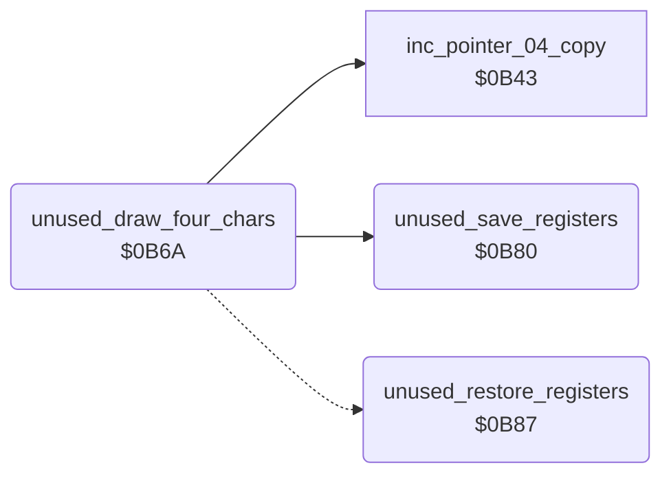

<!-- Generated by c64-docs from knowledge revision 20261023T151738.098-ndlxeh and .c64-re-tools/local/generated/src/source-map.json. Do not edit: change the knowledge, generate the source again, then run docs.ts generate. -->
# leftovers/leftover_0b6a.asm

Range `$0B6A-$0B8D`. Source: [leftovers/leftover_0b6a.asm](../../../../src/leftovers/leftover_0b6a.asm). Index: [the reference](../../index.md).

## Call graph

A solid arrow is a call, a thick arrow a table entry, a dotted arrow a jump. Rounded nodes are in this file.

## Names

### [`unused_draw_four_chars`](../../../../src/leftovers/leftover_0b6a.asm#L7) `$0B6A`

*routine*

Unused code: nothing calls it. Saves A/X/Y, writes character $86 to four cells from (row_ptr_top),y, sets temp_counter = $27 and restores A/X/Y.

- **Calls:** [`unused_save_registers`](leftover_0b6a.md#unused_save_registers), [`inc_pointer_04_copy`](../room/draw_room.md#inc_pointer_04_copy)
- **Jumps to:** [`unused_restore_registers`](leftover_0b6a.md#unused_restore_registers)
- **Reads:** [`row_ptr_top`](../../memory-map.md#row_ptr_top)
- **Writes:** [`temp_counter`](../../memory-map.md#temp_counter)

### [`unused_draw_four_chars_loop`](../../../../src/leftovers/leftover_0b6a.asm#L12) `$0B71`

*label*

- **Jumped to from:** [`unused_draw_four_chars`](leftover_0b6a.md#unused_draw_four_chars) [`$0B77`](../../../../src/leftovers/leftover_0b6a.asm#L16)

### [`unused_save_registers`](../../../../src/leftovers/leftover_0b6a.asm#L21) `$0B80`

*routine*

Unused: save A, X, Y in unused_saved_a/x/y.

- **Called from:** [`unused_draw_four_chars`](leftover_0b6a.md#unused_draw_four_chars) [`$0B6A`](../../../../src/leftovers/leftover_0b6a.asm#L9)
- **Writes:** [`unused_saved_a`](../../memory-map.md#unused_saved_a), [`unused_saved_x`](../../memory-map.md#unused_saved_x), [`unused_saved_y`](../../memory-map.md#unused_saved_y)

### [`unused_restore_registers`](../../../../src/leftovers/leftover_0b6a.asm#L27) `$0B87`

*routine*

Unused: restore Y, X, A from unused_saved_y/x/a.

- **Jumped to from:** [`unused_draw_four_chars`](leftover_0b6a.md#unused_draw_four_chars) [`$0B7D`](../../../../src/leftovers/leftover_0b6a.asm#L19)
- **Reads:** [`unused_saved_y`](../../memory-map.md#unused_saved_y), [`unused_saved_x`](../../memory-map.md#unused_saved_x), [`unused_saved_a`](../../memory-map.md#unused_saved_a)
