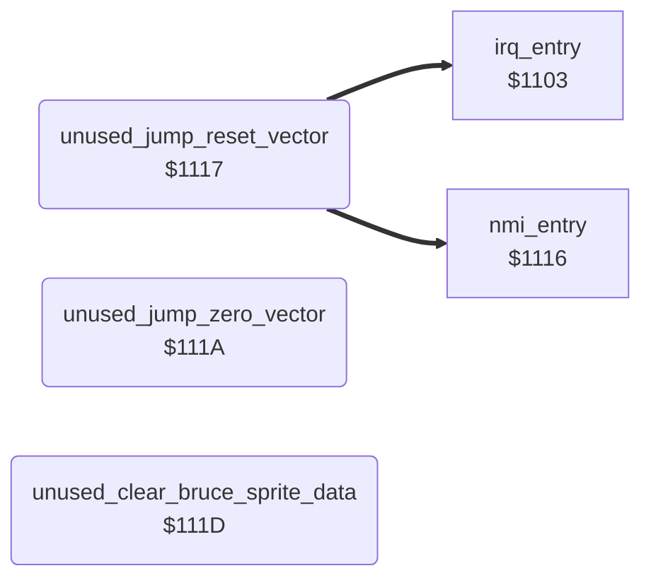

<!-- Generated by c64-docs from knowledge revision 20261025T214801.837-ucnw24 and .c64-re-tools/local/generated/src/source-map.json. Do not edit: change the knowledge, generate the source again, then run docs.ts generate. -->
# leftovers/leftover_1117.asm

Range `$1117-$1130`. Source: [leftovers/leftover_1117.asm](../../../../src/leftovers/leftover_1117.asm). Index: [the reference](../../index.md).

## Routines

| Routine | Address | Reached from | Summary |
|---|---|---|---|
| [`unused_jump_reset_vector`](leftover_1117.md#unused_jump_reset_vector) | `$1117` |  | Unreachable code: JMP (hw_reset_vector), JMP ($0000), and a routine that clears both sprite images of Bruce in both sprite buffers, like clear_yamo_sprite_data below. |
| [`unused_jump_zero_vector`](leftover_1117.md#unused_jump_zero_vector) | `$111A` |  |  |
| [`unused_clear_bruce_sprite_data`](leftover_1117.md#unused_clear_bruce_sprite_data) | `$111D` |  |  |

## Call graph

A solid arrow is a call, a thick arrow a table entry. Rounded nodes are in this file.

## Details

### [`unused_jump_reset_vector`](../../../../src/leftovers/leftover_1117.asm#L7) `$1117`

*routine*

Unreachable code: JMP (hw_reset_vector), JMP ($0000), and a routine that clears both sprite images of Bruce in both sprite buffers, like clear_yamo_sprite_data below. Nothing jumps here.

- **Jumps to:** [`nmi_entry`](../irq/interrupt_entry.md#nmi_entry)
- **Reads:** [`hw_reset_vector`](../irq/hardware_vectors.md#hw_reset_vector)

### [`unused_jump_zero_vector`](../../../../src/leftovers/leftover_1117.asm#L10) `$111A`

*routine*

- **Reads:** [`D6510`](../../memory-map.md#D6510)

### [`unused_clear_bruce_sprite_data`](../../../../src/leftovers/leftover_1117.asm#L12) `$111D`

*routine*

- **Writes:** [`sprite_buf_a_spr0`](../../memory-map.md#sprite_buf_a_spr0), [`sprite_buf_b_spr0`](../../memory-map.md#sprite_buf_b_spr0)

| Label | Address | Comment |
|---|---|---|
| [`unused_clear_bruce_sprite_loop`](../../../../src/leftovers/leftover_1117.asm#L18) | `$1124` | sprite_buf_a_spr0/spr1 ($8180-$81FF) |
