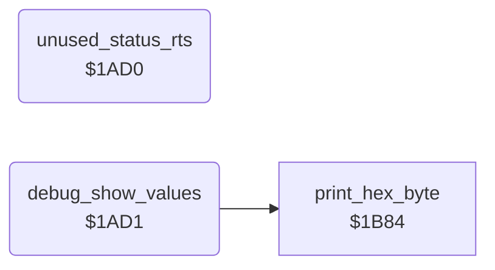

<!-- Generated by c64-docs from knowledge revision 20261029T162352.521-4j8tu8 and .c64-re-tools/local/generated/src/source-map.json. Do not edit: change the knowledge, generate the source again, then run docs.ts generate. -->
# leftovers/leftover_1ad0.asm

Range `$1AD0-$1AEC`. Source: [leftovers/leftover_1ad0.asm](../../../../src/leftovers/leftover_1ad0.asm). Index: [the reference](../../index.md).

## Routines

| Routine | Address | Reached from | Summary |
|---|---|---|---|
| [`unused_status_rts`](leftover_1ad0.md#unused_status_rts) | `$1AD0` |  | Unused: an RTS and a debug routine that shows actor_cell_col, actor_cell_row, lantern_test_col and lantern_test_row as hex on the status line. |
| [`debug_show_values`](leftover_1ad0.md#debug_show_values) | `$1AD1` |  |  |

## Call graph

A solid arrow is a call, a thick arrow a table entry. Rounded nodes are in this file.

## Details

### [`unused_status_rts`](../../../../src/leftovers/leftover_1ad0.asm#L7) `$1AD0`

*routine*

Unused: an RTS and a debug routine that shows actor_cell_col, actor_cell_row, lantern_test_col and lantern_test_row as hex on the status line.

### [`debug_show_values`](../../../../src/leftovers/leftover_1ad0.asm#L10) `$1AD1`

*routine*

- **Calls:** [`print_hex_byte`](../game/status_and_keys.md#print_hex_byte)
- **Jumps to:** [`print_hex_byte`](../game/status_and_keys.md#print_hex_byte)
- **Reads:** [`actor_cell_col`](../../memory-map.md#actor_cell_col), [`actor_cell_row`](../../memory-map.md#actor_cell_row), [`lantern_test_col`](../../memory-map.md#lantern_test_col), [`lantern_test_row`](../../memory-map.md#lantern_test_row)
