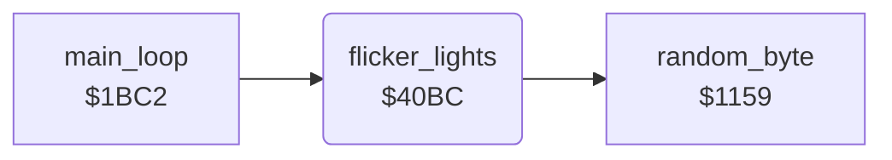

<!-- Generated by c64-docs from knowledge revision 20261016T170255.379-vv114c and src/source-map.json. Do not edit: change the knowledge, generate the source again, then run generate.ts. -->
# light_flicker.asm: Flickering lights in the charsets

Range `$40BC-$4132`. Source: [light_flicker.asm](../../../src/light_flicker.asm). Index: [the reference](../index.md).

## Call graph

A solid arrow is a call, a thick arrow a table entry, a dotted arrow a jump. Rounded nodes are in this file.

## Names

### [`flicker_lights`](../../../src/light_flicker.asm#L6) `$40BC`

*routine*

Flickers three light sources. Each timer $0101-$0103 counts down per call; on expiry it is reloaded with a random 1-15 and random pixel bits are written into rows 2-3 of the light characters in the charsets ($a432/$a49a/$ac9a, $a58a/$ad8a, $a4a2/$aca2/$a73a).

- **Called from:** [`main_loop`](main_loop.md#main_loop) [`$1BEE`](../../../src/main_loop.asm#L26)
- **Calls:** [`random_byte`](interrupts.md#random_byte)
- **Reads:** [`light_flicker_timers`](../variables.md#light_flicker_timers), [`light_flicker_timers+1`](../variables.md#light_flicker_timers), [`light_flicker_timers+2`](../variables.md#light_flicker_timers)
- **Writes:** [`light_flicker_timers`](../variables.md#light_flicker_timers), `$AC9A`, `$AC9B`, [`room_charset_0+1178`](../variables.md#room_charset_0), [`room_charset_0+1179`](../variables.md#room_charset_0), [`room_charset_0+1074`](../variables.md#room_charset_0), [`room_charset_0+1075`](../variables.md#room_charset_0), [`light_flicker_timers+1`](../variables.md#light_flicker_timers), `$AD8A`, `$AD8B`, [`room_charset_0+1418`](../variables.md#room_charset_0), [`room_charset_0+1419`](../variables.md#room_charset_0), [`light_flicker_timers+2`](../variables.md#light_flicker_timers), `$ACA2`, `$ACA3`, [`room_charset_0+1186`](../variables.md#room_charset_0), [`room_charset_0+1187`](../variables.md#room_charset_0), [`room_charset_0+1850`](../variables.md#room_charset_0), [`room_charset_0+1851`](../variables.md#room_charset_0)
- **Refers to:** [`room_charset_1`](../variables.md#room_charset_1), [`room_charset_0`](../variables.md#room_charset_0)

### [`flicker_light2`](../../../src/light_flicker.asm#L24) `$40E6`

*label*

- **Jumped to from:** [`flicker_lights`](light_flicker.md#flicker_lights) [`$40BF`](../../../src/light_flicker.asm#L8)

### [`flicker_light3`](../../../src/light_flicker.asm#L39) `$4108`

*label*

- **Jumped to from:** [`flicker_lights`](light_flicker.md#flicker_lights) [`$40E9`](../../../src/light_flicker.asm#L26)
