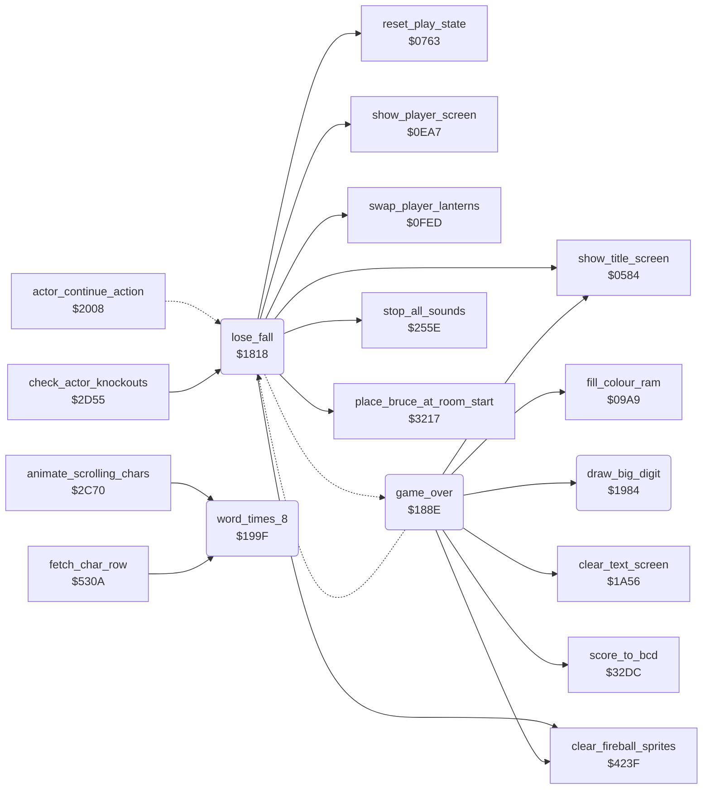

<!-- Generated by c64-docs from knowledge revision 20261017T124710.947-seivas and src/source-map.json. Do not edit: change the knowledge, generate the source again, then run generate.ts. -->
# lose_fall_game_over.asm: Losing a fall, switching players and the game over screen

Range `$1818-$19B7`. Source: [lose_fall_game_over.asm](../../../src/lose_fall_game_over.asm). Index: [the reference](../index.md).

## Call graph

A solid arrow is a call, a thick arrow a table entry, a dotted arrow a jump. Rounded nodes are in this file.

## Names

### [`lose_fall`](../../../src/lose_fall_game_over.asm#L14) `$1818`

*routine*

Bruce has lost a fall. Silences the sound. In the demo: back to the title (title music next time). Else decrements falls_left; negative goes to game_over. Else (next_turn): actor_energy of all three actors = $24, enemy_follow_x cleared, fireball sprite rows cleared. In a two-player game where the other player still has falls (falls_left in inactive_player_state not negative) it switches current_player. Shows the PLAYER n screen; on a switch it also exchanges the player block $28-$43 (falls_left ... score) with inactive_player_state, the lantern states (swap_player_lanterns) and bonus_fall_next_score of the two players. Then resets the game screen (reset_play_state, spawns Bruce) and enters the room again (place_bruce_at_room_start). Called by actor_continue_action (end of a death) and check_actor_knockouts (Bruce knocked out).
silence all sound

- **Called from:** [`check_actor_knockouts`](actor_helpers.md#check_actor_knockouts) [`$2D79`](../../../src/actor_helpers.asm#L34)
- **Jumped to from:** [`actor_continue_action`](actor_timed_actions.md#actor_continue_action) [`$217A`](../../../src/actor_timed_actions.asm#L210)
- **Calls:** [`stop_all_sounds`](sound_request.md#stop_all_sounds), [`show_title_screen`](title_demo_start.md#show_title_screen), [`clear_fireball_sprites`](wizard_fireballs.md#clear_fireball_sprites), [`show_player_screen`](title_player_screens.md#show_player_screen), [`swap_player_lanterns`](game_setup.md#swap_player_lanterns), [`reset_play_state`](play_init.md#reset_play_state), [`place_bruce_at_room_start`](room_misc_support.md#place_bruce_at_room_start)
- **Jumps to:** [`game_over`](lose_fall_game_over.md#game_over)
- **Reads:** [`game_mode`](../variables.md#game_mode), [`falls_left`](../variables.md#falls_left), [`option_two_players`](options_and_patterns.md#option_two_players), [`inactive_player_state`](fireball_text_score_vars.md#inactive_player_state), [`current_player`](../variables.md#current_player), [`SCROLY`](../variables.md#SCROLY), [`score+1`](../variables.md#score), [`score+2`](../variables.md#score), [`inactive_player_state+26`](fireball_text_score_vars.md#inactive_player_state), [`inactive_player_state+27`](fireball_text_score_vars.md#inactive_player_state), [`bonus_fall_next_score+1`](fireball_text_score_vars.md#bonus_fall_next_score), [`bonus_fall_next_score+2`](fireball_text_score_vars.md#bonus_fall_next_score), [`bonus_fall_next_score_other+1`](fireball_text_score_vars.md#bonus_fall_next_score_other), [`bonus_fall_next_score_other+2`](fireball_text_score_vars.md#bonus_fall_next_score_other), [`room`](../variables.md#room)
- **Writes:** [`title_music_skip_count`](title_menu.md#title_music_skip_count), [`falls_left`](../variables.md#falls_left), [`actor_energy`](../variables.md#actor_energy), [`actor_energy+1`](../variables.md#actor_energy), [`actor_energy+2`](../variables.md#actor_energy), [`enemy_follow_x`](../variables.md#enemy_follow_x), [`enemy_follow_x+1`](../variables.md#enemy_follow_x), [`current_player`](../variables.md#current_player), [`SCROLY`](../variables.md#SCROLY), [`inactive_player_state+26`](fireball_text_score_vars.md#inactive_player_state), [`inactive_player_state+27`](fireball_text_score_vars.md#inactive_player_state), [`score+1`](../variables.md#score), [`score+2`](../variables.md#score), [`bonus_fall_next_score+1`](fireball_text_score_vars.md#bonus_fall_next_score), [`bonus_fall_next_score+2`](fireball_text_score_vars.md#bonus_fall_next_score), [`bonus_fall_next_score_other+1`](fireball_text_score_vars.md#bonus_fall_next_score_other), [`bonus_fall_next_score_other+2`](fireball_text_score_vars.md#bonus_fall_next_score_other)
- **Refers to:** [`actor_energy`](../variables.md#actor_energy), [`enemy_follow_x`](../variables.md#enemy_follow_x)

### [`lose_fall_count`](../../../src/lose_fall_game_over.asm#L20) `$1826`

*label*

- **Jumped to from:** [`lose_fall`](lose_fall_game_over.md#lose_fall) [`$181E`](../../../src/lose_fall_game_over.asm#L17)

### [`next_turn`](../../../src/lose_fall_game_over.asm#L23) `$182A`

*label*

full energy for all three actors

- **Jumped to from:** [`game_over`](lose_fall_game_over.md#game_over) [`$1976`](../../../src/lose_fall_game_over.asm#L203)

### [`next_turn_player_screen`](../../../src/lose_fall_game_over.asm#L40) `$184B`

*label*

- **Jumped to from:** [`lose_fall`](lose_fall_game_over.md#lose_fall) [`$183E`](../../../src/lose_fall_game_over.asm#L33), [`lose_fall`](lose_fall_game_over.md#lose_fall) [`$1843`](../../../src/lose_fall_game_over.asm#L36)

### [`next_turn_swap_block_loop`](../../../src/lose_fall_game_over.asm#L52) `$1862`

*label*

- **Jumped to from:** [`lose_fall`](lose_fall_game_over.md#lose_fall) [`$186E`](../../../src/lose_fall_game_over.asm#L59)

### [`next_turn_swap_score_loop`](../../../src/lose_fall_game_over.asm#L63) `$1875`

*label*

- **Jumped to from:** [`lose_fall`](lose_fall_game_over.md#lose_fall) [`$1884`](../../../src/lose_fall_game_over.asm#L71)

### [`next_turn_enter_room`](../../../src/lose_fall_game_over.asm#L72) `$1886`

*label*

reset the game screen and spawn Bruce

- **Jumped to from:** [`lose_fall`](lose_fall_game_over.md#lose_fall) [`$1859`](../../../src/lose_fall_game_over.asm#L46), [`lose_fall`](lose_fall_game_over.md#lose_fall) [`$185E`](../../../src/lose_fall_game_over.asm#L49)

### [`game_over`](../../../src/lose_fall_game_over.asm#L82) `$188E`

*routine*

Game over screen of the current player. Clears the fireball sprite rows and the text screen, installs irq_title_frame at raster line $FB with a blue screen, fills screen rows 0-9 with the blank logo character, draws the big GAME OVER text (game_over_letters_top/bottom) on rows 1-2, PLAYER n on rows 5-6 and the 6-digit score in big digits on rows 8-9, then waits 254 frames. In a two-player game where the other player still has falls it continues with next_turn; else it waits 64 more frames and goes to show_title_screen.

- **Jumped to from:** [`lose_fall`](lose_fall_game_over.md#lose_fall) [`$1828`](../../../src/lose_fall_game_over.asm#L22)
- **Calls:** [`clear_fireball_sprites`](wizard_fireballs.md#clear_fireball_sprites), [`clear_text_screen`](pause_status_line.md#clear_text_screen), [`fill_colour_ram`](title_menu.md#fill_colour_ram), [`score_to_bcd`](room_misc_support.md#score_to_bcd), [`draw_big_digit`](lose_fall_game_over.md#draw_big_digit), [`show_title_screen`](title_demo_start.md#show_title_screen)
- **Jumps to:** [`next_turn`](lose_fall_game_over.md#next_turn)
- **Reads:** [`SCROLY`](../variables.md#SCROLY), [`game_over_letters_top`](options_and_patterns.md#game_over_letters_top), [`game_over_letters_bottom`](options_and_patterns.md#game_over_letters_bottom), [`current_player`](../variables.md#current_player), [`player_banner_top+14`](banners.md#player_banner_top), [`player_banner_top+15`](banners.md#player_banner_top), [`player_banner_bottom+14`](banners.md#player_banner_bottom), [`player_banner_bottom+15`](banners.md#player_banner_bottom), [`bcd_conv_digits+1`](fireball_text_score_vars.md#bcd_conv_digits), [`bcd_conv_digits+2`](fireball_text_score_vars.md#bcd_conv_digits), [`frame_countdown`](../variables.md#frame_countdown), [`option_two_players`](options_and_patterns.md#option_two_players), [`inactive_player_state`](fireball_text_score_vars.md#inactive_player_state)
- **Writes:** [`SCROLY`](../variables.md#SCROLY), [`SPENA`](../variables.md#SPENA), [`irq_vector`](cold_start.md#irq_vector), [`irq_vector_hi`](cold_start.md#irq_vector_hi), [`IRQMSK`](../variables.md#IRQMSK), [`VICIRQ`](../variables.md#VICIRQ), [`RASTER`](../variables.md#RASTER), [`EXTCOL`](../variables.md#EXTCOL), [`BGCOL0`](../variables.md#BGCOL0), [`BGCOL1`](../variables.md#BGCOL1), [`BGCOL2`](../variables.md#BGCOL2), [`SCROLX`](../variables.md#SCROLX), [`RANDOM+1477`](../variables.md#RANDOM), [`RANDOM+1478`](../variables.md#RANDOM), [`RANDOM+1733`](../variables.md#RANDOM), [`RANDOM+1734`](../variables.md#RANDOM), [`game_screen`](../variables.md#game_screen), [`game_screen+1`](../variables.md#game_screen), [`game_screen+144`](../variables.md#game_screen), [`game_screen+145`](../variables.md#game_screen), [`game_screen+67`](../variables.md#game_screen), [`game_screen+68`](../variables.md#game_screen), [`game_screen+107`](../variables.md#game_screen), [`game_screen+108`](../variables.md#game_screen), [`player_banner_top+14`](banners.md#player_banner_top), [`exit2_dest_room+12`](room_tables.md#exit2_dest_room), [`player_banner_bottom+14`](banners.md#player_banner_bottom), [`exit3_dest_room+8`](room_tables.md#exit3_dest_room), [`game_screen+226`](../variables.md#game_screen), [`game_screen+227`](../variables.md#game_screen), [`game_screen+266`](../variables.md#game_screen), [`game_screen+267`](../variables.md#game_screen), [`row_ptr_top`](../variables.md#row_ptr_top), [`data_ptr`](../variables.md#data_ptr), [`row_ptr_top+1`](../variables.md#row_ptr_top), [`data_ptr+1`](../variables.md#data_ptr), [`frame_countdown`](../variables.md#frame_countdown)
- **Refers to:** [`irq_title_frame`](screen_raster_irqs.md#irq_title_frame), [`game_screen`](../variables.md#game_screen), [`player_banner_digit_top`](banners.md#player_banner_digit_top), [`player_banner_top`](banners.md#player_banner_top), [`player_banner_digit_bottom`](banners.md#player_banner_digit_bottom), [`player_banner_bottom`](banners.md#player_banner_bottom), [`row_ptr_top`](../variables.md#row_ptr_top), [`data_ptr`](../variables.md#data_ptr)

### [`game_over_clear_loop`](../../../src/lose_fall_game_over.asm#L115) `$18DB`

*label*

white for rows 12-24

- **Jumped to from:** [`game_over`](lose_fall_game_over.md#game_over) [`$18EC`](../../../src/lose_fall_game_over.asm#L123)

### [`game_over_text_loop`](../../../src/lose_fall_game_over.asm#L126) `$18F0`

*label*

- **Jumped to from:** [`game_over`](lose_fall_game_over.md#game_over) [`$1901`](../../../src/lose_fall_game_over.asm#L134)

### [`game_over_digit_loop`](../../../src/lose_fall_game_over.asm#L144) `$1909`

*label*

Bug: the loop runs once (DEY/BPL from Y = 0), so only the left half of the player digit is copied. No visible effect: lose_fall shows the PLAYER n screen of the current player at the start of each fall, so the right half is already the digit of the same player.

- **Jumped to from:** [`game_over`](lose_fall_game_over.md#game_over) [`$1916`](../../../src/lose_fall_game_over.asm#L150)

### [`game_over_player_loop`](../../../src/lose_fall_game_over.asm#L153) `$191A`

*label*

- **Jumped to from:** [`game_over`](lose_fall_game_over.md#game_over) [`$192B`](../../../src/lose_fall_game_over.asm#L161)

### [`game_over_score_loop`](../../../src/lose_fall_game_over.asm#L173) `$1942`

*label*

high digit

- **Jumped to from:** [`game_over`](lose_fall_game_over.md#game_over) [`$1959`](../../../src/lose_fall_game_over.asm#L187)

### [`game_over_wait`](../../../src/lose_fall_game_over.asm#L195) `$1968`

*label*

- **Jumped to from:** [`game_over`](lose_fall_game_over.md#game_over) [`$196A`](../../../src/lose_fall_game_over.asm#L197)

### [`game_over_to_title`](../../../src/lose_fall_game_over.asm#L204) `$1979`

*label*

- **Jumped to from:** [`game_over`](lose_fall_game_over.md#game_over) [`$196F`](../../../src/lose_fall_game_over.asm#L199), [`game_over`](lose_fall_game_over.md#game_over) [`$1974`](../../../src/lose_fall_game_over.asm#L202)

### [`game_over_wait_title`](../../../src/lose_fall_game_over.asm#L207) `$197D`

*label*

- **Jumped to from:** [`game_over`](lose_fall_game_over.md#game_over) [`$197F`](../../../src/lose_fall_game_over.asm#L209)

### [`draw_big_digit`](../../../src/lose_fall_game_over.asm#L214) `$1984`

*routine*

Draw digit A (low nybble) as 2x2 characters of the logo charset: base character c = digit*4 + $B4. Upper row (row_ptr_top),y = c, lower row (data_ptr),y = c+1, then at Y+1: upper c+2, lower c+3. Output: Y advanced by 1. Called by game_over.

- **Called from:** [`game_over`](lose_fall_game_over.md#game_over) [`$1949`](../../../src/lose_fall_game_over.asm#L179), [`game_over`](lose_fall_game_over.md#game_over) [`$1952`](../../../src/lose_fall_game_over.asm#L183)
- **Reads:** [`row_ptr_top`](../variables.md#row_ptr_top), [`data_ptr`](../variables.md#data_ptr)

### [`word_times_8`](../../../src/lose_fall_game_over.asm#L234) `$199F`

*routine*

Multiply mul8_value by 8 into the 16-bit value mul8_result_hi (high) : mul8_value (low). Used to turn a character code into a charset offset. Changes A.

- **Called from:** [`animate_scrolling_chars`](animated_chars.md#animate_scrolling_chars) [`$2D0D`](../../../src/animated_chars.asm#L108), [`fetch_char_row`](background_contact.md#fetch_char_row) [`$531E`](../../../src/background_contact.asm#L175), [`fetch_char_row`](background_contact.md#fetch_char_row) [`$533E`](../../../src/background_contact.asm#L189), [`fetch_char_row`](background_contact.md#fetch_char_row) [`$5366`](../../../src/background_contact.asm#L210)
- **Reads:** [`mul8_value`](fireball_text_score_vars.md#mul8_value), [`mul8_result_hi`](fireball_text_score_vars.md#mul8_result_hi)
- **Writes:** [`mul8_result_hi`](fireball_text_score_vars.md#mul8_result_hi), [`mul8_value`](fireball_text_score_vars.md#mul8_value)
