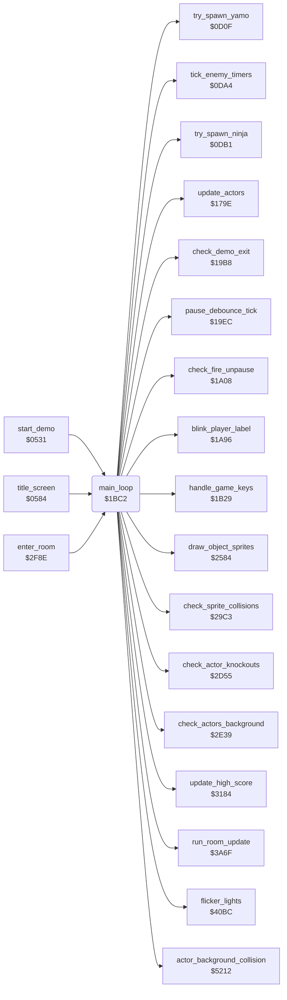

<!-- Generated by c64-docs from knowledge revision 20261016T170255.379-vv114c and src/source-map.json. Do not edit: change the knowledge, generate the source again, then run generate.ts. -->
# main_loop.asm: Main game loop

Range `$1BC2-$1C38`. Source: [main_loop.asm](../../../src/main_loop.asm). Index: [the reference](../index.md).

## Call graph

A solid arrow is a call, a thick arrow a table entry, a dotted arrow a jump. Rounded nodes are in this file.

## Names

### [`main_loop`](../../../src/main_loop.asm#L6) `$1BC2`

*routine*

Main game loop; one pass takes 3 frames or more. Demo exit check; in a game the game keys and the pause (a paused pass ends here); energy masks of actors 1/2, player label blink, light flicker, enemy timers and spawns, frame_parity, room handler, background collision and touches, protection key 2, sprite collisions, score and high score, actor input and movement, object sprites, knock-outs; then waits until frame_countdown is 0.

- **Called from:** [`start_demo`](restart.md#start_demo) [`$0581`](../../../src/restart.asm#L58), [`title_screen`](title.md#title_screen) [`$0760`](../../../src/title.asm#L219), [`enter_room`](background_touch.md#enter_room) [`$2FD3`](../../../src/background_touch.asm#L251)
- **Calls:** [`check_demo_exit`](status.md#check_demo_exit), [`handle_game_keys`](status.md#handle_game_keys), [`pause_debounce_tick`](status.md#pause_debounce_tick), [`check_fire_unpause`](status.md#check_fire_unpause), [`blink_player_label`](status.md#blink_player_label), [`flicker_lights`](light_flicker.md#flicker_lights), [`tick_enemy_timers`](actors.md#tick_enemy_timers), [`try_spawn_yamo`](actors.md#try_spawn_yamo), [`try_spawn_ninja`](actors.md#try_spawn_ninja), [`run_room_update`](room_update.md#run_room_update), [`actor_background_collision`](collision.md#actor_background_collision), [`check_actors_background`](background_touch.md#check_actors_background), [`check_sprite_collisions`](combat_hits.md#check_sprite_collisions), [`update_high_score`](score.md#update_high_score), [`update_actors`](actor_input.md#update_actors), [`draw_object_sprites`](sprite_render.md#draw_object_sprites), [`check_actor_knockouts`](actor_checks.md#check_actor_knockouts)
- **Reads:** [`game_playing`](../variables.md#game_playing), [`pause_state`](../variables.md#pause_state), [`actor_energy+1`](../variables.md#actor_energy), [`actor_energy+2`](../variables.md#actor_energy), [`room_without_enemies`](../variables.md#room_without_enemies), [`frame_parity`](../variables.md#frame_parity), [`protection_sig_a+1`](protection_signature.md#protection_sig_a), [`protection_sig_b+1`](protection_signature.md#protection_sig_b), [`current_room`](../variables.md#current_room), [`frame_countdown`](../variables.md#frame_countdown)
- **Writes:** [`frame_countdown`](../variables.md#frame_countdown), [`actor_energy+1`](../variables.md#actor_energy), [`actor_energy+2`](../variables.md#actor_energy), [`frame_parity`](../variables.md#frame_parity), [`protection_key2`](actor_movement.md#protection_key2)
- **Refers to:** [`actor_energy`](../variables.md#actor_energy), [`protection_sig_a`](protection_signature.md#protection_sig_a), [`protection_sig_b`](protection_signature.md#protection_sig_b), [`room_no_combat_flags`](room_tables.md#room_no_combat_flags)

### [`main_loop_frame_work`](../../../src/main_loop.asm#L18) `$1BDF`

*label*

- **Jumped to from:** [`main_loop`](main_loop.md#main_loop) [`$1BCC`](../../../src/main_loop.asm#L11), [`main_loop`](main_loop.md#main_loop) [`$1BDA`](../../../src/main_loop.asm#L16)

### [`main_loop_toggle_parity`](../../../src/main_loop.asm#L32) `$1BFE`

*label*

- **Jumped to from:** [`main_loop`](main_loop.md#main_loop) [`$1BF3`](../../../src/main_loop.asm#L28)

### [`frame_parity_clear`](../../../src/main_loop.asm#L38) `$1C08`

*label*

- **Jumped to from:** [`main_loop`](main_loop.md#main_loop) [`$1C00`](../../../src/main_loop.asm#L34)

### [`main_loop_room_and_actors`](../../../src/main_loop.asm#L40) `$1C0A`

*label*

- **Jumped to from:** [`main_loop`](main_loop.md#main_loop) [`$1C06`](../../../src/main_loop.asm#L37)

### [`compute_protection_key2`](../../../src/main_loop.asm#L44) `$1C13`

*label*

protection_key2 = $CF7A XOR $CF9A

- **Referred to by:** [`play_sound_80_checked`](actor_movement.md#play_sound_80_checked) [`$1FEA`](../../../src/actor_movement.asm#L553), [`play_sound_80_checked`](actor_movement.md#play_sound_80_checked) [`$1FED`](../../../src/actor_movement.asm#L554), [`play_sound_80_checked`](actor_movement.md#play_sound_80_checked) [`$1FF0`](../../../src/actor_movement.asm#L555)

### [`main_loop_wait`](../../../src/main_loop.asm#L59) `$1C32`

*label*

- **Jumped to from:** [`main_loop`](main_loop.md#main_loop) [`$1BDC`](../../../src/main_loop.asm#L17), [`main_loop`](main_loop.md#main_loop) [`$1C34`](../../../src/main_loop.asm#L61)
