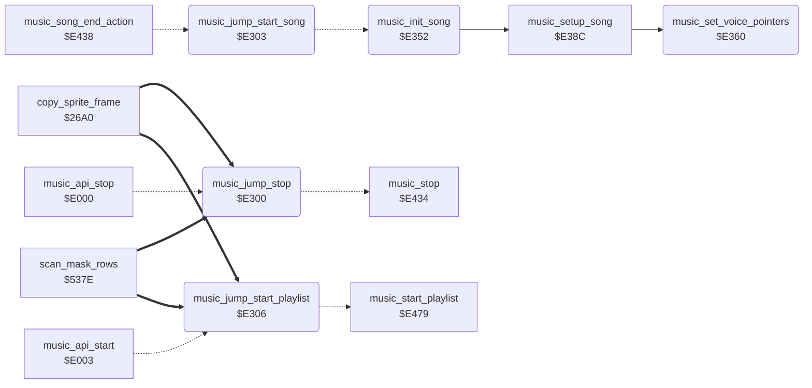

<!-- Generated by c64-docs from knowledge revision 20261023T151738.098-ndlxeh and .c64-re-tools/local/generated/src/source-map.json. Do not edit: change the knowledge, generate the source again, then run docs.ts generate. -->
# music/music_player.asm: Music player code (Micropearl music player by John A. Fitzpatrick, 1983)

Range `$E300-$E387`. Source: [music/music_player.asm](../../../../src/music/music_player.asm). Index: [the reference](../../index.md).

## Call graph

A solid arrow is a call, a thick arrow a table entry, a dotted arrow a jump. Rounded nodes are in this file.

## Data

| Range | Type | Name | Read by | Written by |
|---|---|---|---|---|
| [`$E300`](../../../../src/music/music_player.asm#L8)-`$E308` | jumps | [`music_jump_stop`](../../../../src/music/music_player.asm#L7) |  |  |
| [`$E309`](../../../../src/music/music_player.asm#L16)-`$E314` | bytes | [`music_song`](../../../../src/music/music_player.asm#L15) | [`music_set_voice_pointers`](music_player.md#music_set_voice_pointers), [`music_reset_state`](music_player_e38c.md#music_reset_state), [`music_song_end_action`](music_player_e38c.md#music_song_end_action), [`music_apply_volume`](music_player_e38c.md#music_apply_volume), [`music_play_frame`](music_player_e38c.md#music_play_frame), [`music_voice_commands`](music_player_e38c.md#music_voice_commands), [`music_note_length`](music_player_e38c.md#music_note_length) | [`start_attract_demo`](../game/title_demo_start.md#start_attract_demo), [`show_title_screen`](../game/title_demo_start.md#show_title_screen), [`music_init_song`](music_player.md#music_init_song), [`music_reset_state`](music_player_e38c.md#music_reset_state), [`music_song_end_action`](music_player_e38c.md#music_song_end_action), [`music_apply_volume`](music_player_e38c.md#music_apply_volume), [`music_voice_commands`](music_player_e38c.md#music_voice_commands), [`music_note_length`](music_player_e38c.md#music_note_length) |
| [`$E315`](../../../../src/music/music_player.asm#L51)-`$E351` | petscii | [`music_player_credit`](../../../../src/music/music_player.asm#L50) |  |  |

## Names

### [`music_jump_stop`](../../../../src/music/music_player.asm#L7) `$E300`

*routine*

Internal jump table of the music player: stop, start the current song, start the playlist. music_jump_stop: stops the music (music_stop); reached from music_api_stop.

- **Jumped to from:** [`music_api_stop`](music_player_state.md#music_api_stop) [`$E000`](../../../../src/music/music_player_state.asm#L8)
- **Entry of:** [`music_api_stop`](../../tables.md#music_api_stop)
- **Jumps to:** [`music_stop`](music_player_e38c.md#music_stop)

### [`music_jump_start_song`](../../../../src/music/music_player.asm#L10) `$E303`

*routine*

Starts the song in music_song (music_init_song); the playlist code jumps here after it sets music_song (music_start_song_x).

- **Jumped to from:** [`music_song_end_action`](music_player_e38c.md#music_song_end_action) [`$E458`](../../../../src/music/music_player_e38c.asm#L164)
- **Jumps to:** [`music_init_song`](music_player.md#music_init_song)

### [`music_jump_start_playlist`](../../../../src/music/music_player.asm#L13) `$E306`

*routine*

Starts the playlist (music_start_playlist); reached from music_api_start.

- **Jumped to from:** [`music_api_start`](music_player_state.md#music_api_start) [`$E003`](../../../../src/music/music_player_state.asm#L11)
- **Entry of:** [`music_api_stop`](../../tables.md#music_api_stop)
- **Jumps to:** [`music_start_playlist`](music_player_e38c.md#music_start_playlist)

### [`music_song`](../../../../src/music/music_player.asm#L15) `$E309`

*variable*

song number being played (0 = title tune)

- **Read by:** [`music_set_voice_pointers`](music_player.md#music_set_voice_pointers) [`$E360`](../../../../src/music/music_player.asm#L66), [`music_song_end_action`](music_player_e38c.md#music_song_end_action) [`$E445`](../../../../src/music/music_player_e38c.asm#L153)
- **Written by:** [`music_song_end_action`](music_player_e38c.md#music_song_end_action) [`$E455`](../../../../src/music/music_player_e38c.asm#L163)

### [`music_stop_request`](../../../../src/music/music_player.asm#L17) `$E30A`

*variable*

nonzero: music_play_frame silences the SID and stops

- **Read by:** [`music_play_frame`](music_player_e38c.md#music_play_frame) [`$E49E`](../../../../src/music/music_player_e38c.asm#L216)
- **Written by:** [`start_attract_demo`](../game/title_demo_start.md#start_attract_demo) [`$0547`](../../../../src/game/title_demo_start.asm#L44), [`show_title_screen`](../game/title_demo_start.md#show_title_screen) [`$0726`](../../../../src/game/title_demo_start.asm#L294), [`music_reset_state`](music_player_e38c.md#music_reset_state) [`$E3C5`](../../../../src/music/music_player_e38c.asm#L40)

### [`music_song_ended`](../../../../src/music/music_player.asm#L18) `$E30B`

*variable*

set to 1 when a voice reaches its $FF end byte; nothing reads it

- **Written by:** [`music_reset_state`](music_player_e38c.md#music_reset_state) [`$E3C2`](../../../../src/music/music_player_e38c.asm#L36), [`music_voice_commands`](music_player_e38c.md#music_voice_commands) [`$E5CC`](../../../../src/music/music_player_e38c.asm#L362)

### [`music_playing`](../../../../src/music/music_player.asm#L19) `$E30C`

*variable*

1 = the song plays, 0 = stopped (also 0 while a song is set up)

- **Read by:** [`music_play_frame`](music_player_e38c.md#music_play_frame) [`$E4A3`](../../../../src/music/music_player_e38c.asm#L218)
- **Written by:** [`music_init_song`](music_player.md#music_init_song) [`$E354`](../../../../src/music/music_player.asm#L57), [`music_init_song`](music_player.md#music_init_song) [`$E35C`](../../../../src/music/music_player.asm#L60), [`music_reset_state`](music_player_e38c.md#music_reset_state) [`$E3CB`](../../../../src/music/music_player_e38c.asm#L42)

### [`music_tempo`](../../../../src/music/music_player.asm#L20) `$E30D`

*variable*

frames per tick, set by command $E0

- **Read by:** [`music_reset_state`](music_player_e38c.md#music_reset_state) [`$E3BB`](../../../../src/music/music_player_e38c.asm#L33), [`music_play_frame`](music_player_e38c.md#music_play_frame) [`$E4C3`](../../../../src/music/music_player_e38c.asm#L236)
- **Written by:** [`music_note_length`](music_player_e38c.md#music_note_length) [`$E7B5`](../../../../src/music/music_player_e38c.asm#L648)

### [`music_end_marker`](../../../../src/music/music_player.asm#L21) `$E30E`

*variable*

$FF when a voice has reached its end byte; then music_end_action decides

- **Read by:** [`music_play_frame`](music_player_e38c.md#music_play_frame) [`$E4A9`](../../../../src/music/music_player_e38c.asm#L223)
- **Written by:** [`music_reset_state`](music_player_e38c.md#music_reset_state) [`$E3C8`](../../../../src/music/music_player_e38c.asm#L41), [`music_voice_commands`](music_player_e38c.md#music_voice_commands) [`$E5D1`](../../../../src/music/music_player_e38c.asm#L364)

### [`music_filter_mode`](../../../../src/music/music_player.asm#L22) `$E30F`

*variable*

filter mode bits for the high nibble of $D418

- **Read by:** [`music_apply_volume`](music_player_e38c.md#music_apply_volume) [`$E489`](../../../../src/music/music_player_e38c.asm#L203)
- **Written by:** [`music_reset_state`](music_player_e38c.md#music_reset_state) [`$E3AA`](../../../../src/music/music_player_e38c.asm#L25), [`music_note_length`](music_player_e38c.md#music_note_length) [`$E798`](../../../../src/music/music_player_e38c.asm#L635)

### [`music_volume_voice`](../../../../src/music/music_player.asm#L23) `$E310`

*variable*

voice number + 1 whose next note writes $D418/$D417; 0 = nothing pending

- **Read by:** [`music_play_frame`](music_player_e38c.md#music_play_frame) [`$E4E2`](../../../../src/music/music_player_e38c.asm#L248), [`music_play_frame`](music_player_e38c.md#music_play_frame) [`$E51C`](../../../../src/music/music_player_e38c.asm#L275), [`music_play_frame`](music_player_e38c.md#music_play_frame) [`$E556`](../../../../src/music/music_player_e38c.asm#L302)
- **Written by:** [`music_apply_volume`](music_player_e38c.md#music_apply_volume) [`$E49A`](../../../../src/music/music_player_e38c.asm#L209), [`music_voice_commands`](music_player_e38c.md#music_voice_commands) [`$E621`](../../../../src/music/music_player_e38c.asm#L422), [`music_note_length`](music_player_e38c.md#music_note_length) [`$E79F`](../../../../src/music/music_player_e38c.asm#L638)

### [`music_volume`](../../../../src/music/music_player.asm#L24) `$E311`

*variable*

master volume (low nibble of $D418), set by command $9x

- **Read by:** [`music_apply_volume`](music_player_e38c.md#music_apply_volume) [`$E48C`](../../../../src/music/music_player_e38c.asm#L204)
- **Written by:** [`music_voice_commands`](music_player_e38c.md#music_voice_commands) [`$E61A`](../../../../src/music/music_player_e38c.asm#L419)

### [`music_temp`](../../../../src/music/music_player.asm#L25) `$E312-$E313`

*variable*

scratch byte of the player

- **Read by:** [`music_voice_commands`](music_player_e38c.md#music_voice_commands) [`$E6AC`](../../../../src/music/music_player_e38c.asm#L501), [`music_note_length`](music_player_e38c.md#music_note_length) [`$E6DD`](../../../../src/music/music_player_e38c.asm#L536), [`music_note_length`](music_player_e38c.md#music_note_length) [`$E6E4`](../../../../src/music/music_player_e38c.asm#L540), [`music_note_length`](music_player_e38c.md#music_note_length) [`$E6F4`](../../../../src/music/music_player_e38c.asm#L551), [`music_note_length`](music_player_e38c.md#music_note_length) [`$E7A9`](../../../../src/music/music_player_e38c.asm#L642)
- **Written by:** [`music_voice_commands`](music_player_e38c.md#music_voice_commands) [`$E6A1`](../../../../src/music/music_player_e38c.asm#L497), [`music_note_length`](music_player_e38c.md#music_note_length) [`$E6D6`](../../../../src/music/music_player_e38c.asm#L533), [`music_note_length`](music_player_e38c.md#music_note_length) [`$E6ED`](../../../../src/music/music_player_e38c.asm#L547), [`music_note_length`](music_player_e38c.md#music_note_length) [`$E7A5`](../../../../src/music/music_player_e38c.asm#L640)

### [`music_end_action`](../../../../src/music/music_player.asm#L26) `$E314`

*variable*

What happens when the song ends (the title code sets 3): 0 = stop; bit 7 set = play song (value AND $7F); bit 1 set = take the next playlist entry (bit 0 set = restart the playlist at its end, clear = stop); else play the next song number (after music_last_song: bit 0 set = song 0, clear = stop).

- **Read by:** [`music_play_frame`](music_player_e38c.md#music_play_frame) [`$E4B0`](../../../../src/music/music_player_e38c.asm#L226)
- **Written by:** [`show_title_screen`](../game/title_demo_start.md#show_title_screen) [`$06CE`](../../../../src/game/title_demo_start.asm#L236)

### [`music_player_credit`](../../../../src/music/music_player.asm#L50) `$E315-$E351`

*data*

Text in the player: " MICROPEARL MUSIC PLAYER  COPYRIGHT 1983 JOHN A. FITZPATRICK ". Nothing reads it.

### [`music_init_song`](../../../../src/music/music_player.asm#L55) `$E352`

*routine*

Starts song music_song: clears music_playing, sets the song up (music_setup_song) and sets music_playing to 1. Reached through music_jump_start_song from the playlist code.

- **Jumped to from:** [`music_jump_start_song`](music_player.md#music_jump_start_song) [`$E303`](../../../../src/music/music_player.asm#L11)
- **Entry of:** [`music_jump_stop`](../../tables.md#music_jump_stop)
- **Calls:** [`music_setup_song`](music_player_e38c.md#music_setup_song)
- **Writes:** [`music_playing`](music_player.md#music_playing)

### [`music_set_voice_pointers`](../../../../src/music/music_player.asm#L65) `$E360`

*routine*

Copies the three voice stream addresses of song music_song (limited to music_last_song) from music_song_table (8 bytes per song) into the operands of music_fetch_voice0/1/2 (music_fetch_voice0_src, music_fetch_voice1_src, music_fetch_voice2_src). X steps 0,1, 4,5, 8,9.

- **Called from:** [`music_setup_song`](music_player_e38c.md#music_setup_song) [`$E38C`](../../../../src/music/music_player_e38c.asm#L8)
- **Reads:** [`music_song`](music_player.md#music_song), [`music_last_song`](music_data_e86b.md#music_last_song), [`music_song_table`](music_songs.md#music_song_table)
- **Writes:** [`music_fetch_voice0_src`](music_player_e38c.md#music_fetch_voice0_src)

### [`music_set_voice_pointers_index`](../../../../src/music/music_player.asm#L71) `$E36B`

*label*

song * 8 = offset in music_song_table

- **Jumped to from:** [`music_set_voice_pointers`](music_player.md#music_set_voice_pointers) [`$E366`](../../../../src/music/music_player.asm#L68)

### [`music_set_voice_pointers_loop`](../../../../src/music/music_player.asm#L77) `$E371`

*label*

- **Jumped to from:** [`music_set_voice_pointers`](music_player.md#music_set_voice_pointers) [`$E385`](../../../../src/music/music_player.asm#L89)
