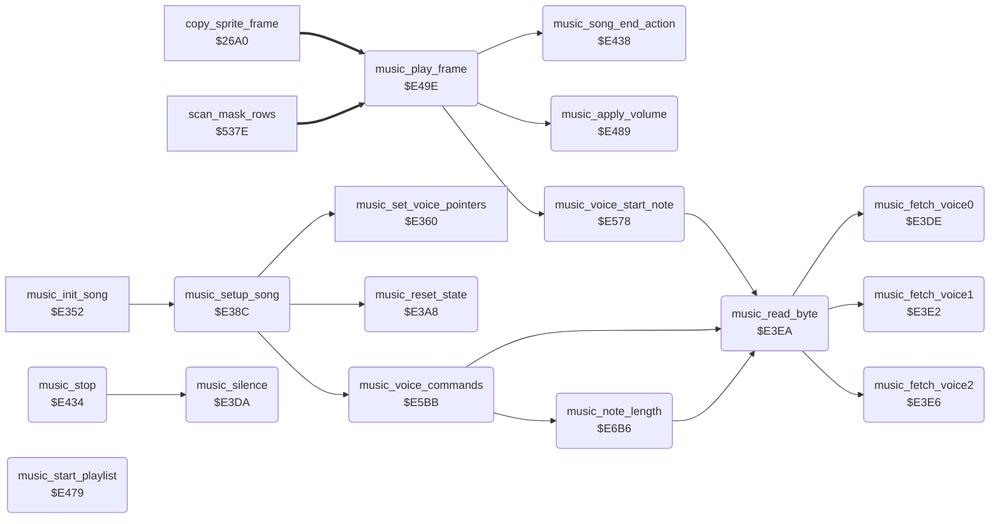

<!-- Generated by c64-docs from knowledge revision 20261025T214801.837-ucnw24 and .c64-re-tools/local/generated/src/source-map.json. Do not edit: change the knowledge, generate the source again, then run docs.ts generate. -->
# music/music_player_e38c.asm

Range `$E38C-$E7BD`. Source: [music/music_player_e38c.asm](../../../../src/music/music_player_e38c.asm). Index: [the reference](../../index.md).

## Routines

| Routine | Address | Reached from | Summary |
|---|---|---|---|
| [`music_setup_song`](music_player_e38c.md#music_setup_song) | `$E38C` | [`music_init_song`](music_player.md#music_init_song) | Sets up the current song: voice stream pointers, reset of the voice state and the SID, then for each voice reads the commands before its first note (music_voice_commands with music_lookahead = $FF). |
| [`music_reset_state`](music_player_e38c.md#music_reset_state) | `$E3A8` | [`music_setup_song`](music_player_e38c.md#music_setup_song) | Resets the player: filter mode and resonance 0, voice state from music_voice_init, tempo counter from music_tempo, then falls into music_clear_and_silence with A = 0. |
| [`music_silence`](music_player_e38c.md#music_silence) | `$E3DA` | [`music_stop`](music_player_e38c.md#music_stop) | Stops the music: clears the player flags and the SID voice and filter registers (A = 0). |
| [`music_fetch_voice0`](music_player_e38c.md#music_fetch_voice0) | `$E3DE` | [`music_read_byte`](music_player_e38c.md#music_read_byte) | LDA abs / RTS fetch routines, one per voice. |
| [`music_fetch_voice0_src`](music_player_e38c.md#music_fetch_voice0_src) | `$E3DF` |  |  |
| [`music_fetch_voice0_src_hi`](music_player_e38c.md#music_fetch_voice0_src_hi) | `$E3E0` |  |  |
| [`music_fetch_voice1`](music_player_e38c.md#music_fetch_voice1) | `$E3E2` | [`music_read_byte`](music_player_e38c.md#music_read_byte) | operand music_fetch_voice1_src = stream pointer of voice 1: set by music_set_voice_pointers, advanced by music_read_byte |
| [`music_fetch_voice1_src`](music_player_e38c.md#music_fetch_voice1_src) | `$E3E3` |  |  |
| [`music_fetch_voice1_src_hi`](music_player_e38c.md#music_fetch_voice1_src_hi) | `$E3E4` |  |  |
| [`music_fetch_voice2`](music_player_e38c.md#music_fetch_voice2) | `$E3E6` | [`music_read_byte`](music_player_e38c.md#music_read_byte) | operand music_fetch_voice2_src = stream pointer of voice 2: set by music_set_voice_pointers, advanced by music_read_byte |
| [`music_fetch_voice2_src`](music_player_e38c.md#music_fetch_voice2_src) | `$E3E7` |  |  |
| [`music_fetch_voice2_src_hi`](music_player_e38c.md#music_fetch_voice2_src_hi) | `$E3E8` |  |  |
| [`music_read_byte`](music_player_e38c.md#music_read_byte) | `$E3EA` | [`music_voice_start_note`](music_player_e38c.md#music_voice_start_note), [`music_voice_commands`](music_player_e38c.md#music_voice_commands), [`music_note_length`](music_player_e38c.md#music_note_length) | Reads the next byte of the stream of voice music_voice and advances the stream. |
| [`music_stop`](music_player_e38c.md#music_stop) | `$E434` | [`music_jump_stop`](music_player.md#music_jump_stop) | Stop entry (music_api_stop): silences the SID and clears the player flags. |
| [`music_song_end_action`](music_player_e38c.md#music_song_end_action) | `$E438` | [`music_play_frame`](music_player_e38c.md#music_play_frame) | Chooses what plays after a song ends. |
| [`music_start_playlist`](music_player_e38c.md#music_start_playlist) | `$E479` | [`music_jump_start_playlist`](music_player.md#music_jump_start_playlist) | Start entry (music_api_start): starts the playlist at music_playlist_start (Y = 1 = loop). |
| [`music_apply_volume`](music_player_e38c.md#music_apply_volume) | `$E489` | [`music_play_frame`](music_player_e38c.md#music_play_frame) | Writes $D418 = music_filter_mode OR music_volume and $D417 = music_resonance, and clears music_volume_voice. |
| [`music_play_frame`](music_player_e38c.md#music_play_frame) | `$E49E` | [`copy_sprite_frame`](../actor/actor_sprites.md#copy_sprite_frame), [`scan_mask_rows`](../actor/background_contact.md#scan_mask_rows), [`music_api_play`](music_player_state.md#music_api_play) | Per-frame music player (music_api_play, from the title screen IRQ). |
| [`music_voice_start_note`](music_player_e38c.md#music_voice_start_note) | `$E578` | [`music_play_frame`](music_player_e38c.md#music_play_frame) | Plays the next note of voice X and runs the commands after it. |
| [`music_voice_commands`](music_player_e38c.md#music_voice_commands) | `$E5BB` | [`music_setup_song`](music_player_e38c.md#music_setup_song) | Runs the command bytes that follow in the stream of voice music_voice, until the next note byte (music_lookahead bit 7 clear). |
| [`music_cmd_offset`](music_player_e38c.md#music_cmd_offset) | `$E5E7` |  |  |
| [`music_note_length`](music_player_e38c.md#music_note_length) | `$E6B6` | [`music_voice_commands`](music_player_e38c.md#music_voice_commands) | Converts a length code into tick counts. |

## Data

| Range | Type | Name | Read by | Written by |
|---|---|---|---|---|
| [`$E5E8`](../../../../src/music/music_player_e38c.asm#L393)-`$E5FC` | jumps | [`music_cmd_jumps`](../../../../src/music/music_player_e38c.asm#L392) |  |  |
| [`$E68B`](../../../../src/music/music_player_e38c.asm#L483)-`$E68D` | bytes | [`music_envelope_offsets`](../../../../src/music/music_player_e38c.asm#L482) | [`music_voice_commands`](music_player_e38c.md#music_voice_commands) |  |
| [`$E6F9`](../../../../src/music/music_player_e38c.asm#L558)-`$E718` | bytes of 16 | [`music_length_table`](../../../../src/music/music_player_e38c.asm#L557) | [`music_note_length`](music_player_e38c.md#music_note_length) |  |
| [`$E719`](../../../../src/music/music_player_e38c.asm#L561)-`$E71B` | bytes | [`sid_voice_offsets`](../../../../src/music/music_player_e38c.asm#L560) | [`music_voice_start_note`](music_player_e38c.md#music_voice_start_note), [`music_note_length`](music_player_e38c.md#music_note_length) |  |
| [`$E71C`](../../../../src/music/music_player_e38c.asm#L563)-`$E71F` | bytes | [`music_waveforms`](../../../../src/music/music_player_e38c.asm#L562) | [`music_voice_commands`](music_player_e38c.md#music_voice_commands) |  |

## Call graph

A solid arrow is a call, a thick arrow a table entry. Rounded nodes are in this file.

## Details

### [`music_setup_song`](../../../../src/music/music_player_e38c.asm#L7) `$E38C`

*routine*

Sets up the current song: voice stream pointers, reset of the voice state and the SID, then for each voice reads the commands before its first note (music_voice_commands with music_lookahead = $FF).

- **Called from:** [`music_init_song`](music_player.md#music_init_song)
- **Calls:** [`music_set_voice_pointers`](music_player.md#music_set_voice_pointers), [`music_reset_state`](music_player_e38c.md#music_reset_state), [`music_voice_commands`](music_player_e38c.md#music_voice_commands)
- **Reads:** [`music_voice`](music_voice_state.md#music_voice)
- **Writes:** [`music_voice`](music_voice_state.md#music_voice), [`music_lookahead`](music_voice_state.md#music_lookahead)

| Label | Address | Comment |
|---|---|---|
| [`music_setup_song_voice_loop`](../../../../src/music/music_player_e38c.asm#L11) | `$E394` |  |

### [`music_reset_state`](../../../../src/music/music_player_e38c.asm#L23) `$E3A8`

*routine*

Resets the player: filter mode and resonance 0, voice state from music_voice_init, tempo counter from music_tempo, then falls into music_clear_and_silence with A = 0.

- **Called from:** [`music_setup_song`](music_player_e38c.md#music_setup_song)
- **Reads:** [`note_freq_hi`](music_frequency_table.md#note_freq_hi), [`music_tempo`](music_player.md#music_tempo)
- **Writes:** [`music_filter_mode`](music_player.md#music_filter_mode), [`music_resonance`](music_frequency_table.md#music_resonance), `$E0FF`, [`music_tempo_counter`](music_voice_state.md#music_tempo_counter), [`music_song_ended`](music_player.md#music_song_ended), [`music_stop_request`](music_player.md#music_stop_request), [`music_end_marker`](music_player.md#music_end_marker), [`music_playing`](music_player.md#music_playing), [`music_transpose`](music_voice_state.md#music_transpose), [`FRELO1`](../../memory-map.md#FRELO1)
- **Refers to:** [`music_voice_init`](music_frequency_table.md#music_voice_init), [`music_transpose`](music_voice_state.md#music_transpose)

| Label | Address | Comment |
|---|---|---|
| [`music_reset_state_copy`](../../../../src/music/music_player_e38c.asm#L28) | `$E3B2` |  |
| [`music_clear_and_silence`](../../../../src/music/music_player_e38c.asm#L39) | `$E3C5` | Stores A into music_stop_request, music_end_marker, music_playing and music_transpose, and zeroes the SID registers $D400-$D417 (the volume register $D418 keeps its value). |
| [`music_clear_sid_loop`](../../../../src/music/music_player_e38c.asm#L45) | `$E3D3` |  |

### [`music_silence`](../../../../src/music/music_player_e38c.asm#L51) `$E3DA`

*routine*

Stops the music: clears the player flags and the SID voice and filter registers (A = 0).

- **Called from:** [`music_stop`](music_player_e38c.md#music_stop)
- **Jumped to from:** [`music_start_playlist`](music_player_e38c.md#music_start_playlist), [`music_play_frame`](music_player_e38c.md#music_play_frame)
- **Jumps to:** [`music_clear_and_silence`](music_player_e38c.md#music_clear_and_silence)

### [`music_fetch_voice0`](../../../../src/music/music_player_e38c.asm#L57) `$E3DE`

*routine*

LDA abs / RTS fetch routines, one per voice. Their operands are the stream read positions: music_set_voice_pointers sets them and music_read_byte increments them (self-modified code). The operands in the program are positions left from an earlier play of the title tune.
operand music_fetch_voice0_src = stream pointer of voice 0: set by music_set_voice_pointers, advanced by music_read_byte

- **Called from:** [`music_read_byte`](music_player_e38c.md#music_read_byte)
- **Reads:** [`music_title_voice0`](music_songs_e8d0.md#music_title_voice0)
- **Refers to:** [`music_title_voice0`](music_songs_e8d0.md#music_title_voice0)

### [`music_fetch_voice0_src`](../../../../src/music/music_player_e38c.asm#L58) `$E3DF`

*label*

- **Read by:** [`music_read_byte`](music_player_e38c.md#music_read_byte)
- **Written by:** [`music_set_voice_pointers`](music_player.md#music_set_voice_pointers), [`music_read_byte`](music_player_e38c.md#music_read_byte)

### [`music_fetch_voice0_src_hi`](../../../../src/music/music_player_e38c.asm#L59) `$E3E0`

*label*

- **Read by:** [`music_read_byte`](music_player_e38c.md#music_read_byte)
- **Written by:** [`music_read_byte`](music_player_e38c.md#music_read_byte)

### [`music_fetch_voice1`](../../../../src/music/music_player_e38c.asm#L60) `$E3E2`

*routine*

operand music_fetch_voice1_src = stream pointer of voice 1: set by music_set_voice_pointers, advanced by music_read_byte

- **Called from:** [`music_read_byte`](music_player_e38c.md#music_read_byte)
- **Reads:** [`music_title_voice1`](music_songs_e8d0.md#music_title_voice1)
- **Refers to:** [`music_title_voice1`](music_songs_e8d0.md#music_title_voice1)

### [`music_fetch_voice1_src`](../../../../src/music/music_player_e38c.asm#L61) `$E3E3`

*label*

- **Read by:** [`music_read_byte`](music_player_e38c.md#music_read_byte)
- **Written by:** [`music_read_byte`](music_player_e38c.md#music_read_byte)

### [`music_fetch_voice1_src_hi`](../../../../src/music/music_player_e38c.asm#L62) `$E3E4`

*label*

- **Read by:** [`music_read_byte`](music_player_e38c.md#music_read_byte)
- **Written by:** [`music_read_byte`](music_player_e38c.md#music_read_byte)

### [`music_fetch_voice2`](../../../../src/music/music_player_e38c.asm#L63) `$E3E6`

*routine*

operand music_fetch_voice2_src = stream pointer of voice 2: set by music_set_voice_pointers, advanced by music_read_byte

- **Called from:** [`music_read_byte`](music_player_e38c.md#music_read_byte)
- **Reads:** [`music_title_voice2`](music_songs_e8d0.md#music_title_voice2)
- **Refers to:** [`music_title_voice2`](music_songs_e8d0.md#music_title_voice2)

### [`music_fetch_voice2_src`](../../../../src/music/music_player_e38c.asm#L64) `$E3E7`

*label*

- **Read by:** [`music_read_byte`](music_player_e38c.md#music_read_byte)
- **Written by:** [`music_read_byte`](music_player_e38c.md#music_read_byte)

### [`music_fetch_voice2_src_hi`](../../../../src/music/music_player_e38c.asm#L65) `$E3E8`

*label*

- **Read by:** [`music_read_byte`](music_player_e38c.md#music_read_byte)
- **Written by:** [`music_read_byte`](music_player_e38c.md#music_read_byte)

### [`music_read_byte`](../../../../src/music/music_player_e38c.asm#L89) `$E3EA`

*routine*

Reads the next byte of the stream of voice music_voice and advances the stream. Output: A = the byte, N and Z flags from it; music_lookahead = the byte after it. Uses the self-modified fetch routines music_fetch_voice0/1/2.

- **Called from:** [`music_voice_start_note`](music_player_e38c.md#music_voice_start_note), [`music_voice_commands`](music_player_e38c.md#music_voice_commands), [`music_note_length`](music_player_e38c.md#music_note_length)
- **Calls:** [`music_fetch_voice2`](music_player_e38c.md#music_fetch_voice2), [`music_fetch_voice0`](music_player_e38c.md#music_fetch_voice0), [`music_fetch_voice1`](music_player_e38c.md#music_fetch_voice1)
- **Reads:** [`music_voice`](music_voice_state.md#music_voice), [`music_fetch_voice2_src`](music_player_e38c.md#music_fetch_voice2_src), [`music_fetch_voice2_src_hi`](music_player_e38c.md#music_fetch_voice2_src_hi), [`music_fetch_voice0_src`](music_player_e38c.md#music_fetch_voice0_src), [`music_fetch_voice0_src_hi`](music_player_e38c.md#music_fetch_voice0_src_hi), [`music_fetch_voice1_src`](music_player_e38c.md#music_fetch_voice1_src), [`music_fetch_voice1_src_hi`](music_player_e38c.md#music_fetch_voice1_src_hi)
- **Writes:** [`music_fetch_voice2_src`](music_player_e38c.md#music_fetch_voice2_src), [`music_fetch_voice2_src_hi`](music_player_e38c.md#music_fetch_voice2_src_hi), [`music_lookahead`](music_voice_state.md#music_lookahead), [`music_fetch_voice0_src`](music_player_e38c.md#music_fetch_voice0_src), [`music_fetch_voice0_src_hi`](music_player_e38c.md#music_fetch_voice0_src_hi), [`music_fetch_voice1_src`](music_player_e38c.md#music_fetch_voice1_src), [`music_fetch_voice1_src_hi`](music_player_e38c.md#music_fetch_voice1_src_hi)

| Label | Address | Comment |
|---|---|---|
| [`music_read_byte_voice2`](../../../../src/music/music_player_e38c.asm#L94) | `$E3F2` |  |
| [`music_read_byte_voice2_peek`](../../../../src/music/music_player_e38c.asm#L101) | `$E3FE` |  |
| [`music_read_byte_voice0`](../../../../src/music/music_player_e38c.asm#L108) | `$E408` |  |
| [`music_read_byte_voice0_peek`](../../../../src/music/music_player_e38c.asm#L114) | `$E414` |  |
| [`music_read_byte_voice1`](../../../../src/music/music_player_e38c.asm#L121) | `$E41E` |  |
| [`music_read_byte_voice1_peek`](../../../../src/music/music_player_e38c.asm#L127) | `$E42A` |  |

### [`music_stop`](../../../../src/music/music_player_e38c.asm#L135) `$E434`

*routine*

Stop entry (music_api_stop): silences the SID and clears the player flags.

- **Jumped to from:** [`music_jump_stop`](music_player.md#music_jump_stop)
- **Entry of:** [`music_jump_stop`](../../tables.md#music_jump_stop)
- **Calls:** [`music_silence`](music_player_e38c.md#music_silence)

### [`music_song_end_action`](../../../../src/music/music_player_e38c.asm#L141) `$E438`

*routine*

Chooses what plays after a song ends. Input: Y = music_end_action (nonzero). Bit 7: play song Y AND $7F. Bit 1: next playlist entry. Else: next song number; after the last song, bit 0 set wraps to song 0, clear stops. Called from music_play_frame.

- **Called from:** [`music_play_frame`](music_player_e38c.md#music_play_frame)
- **Jumps to:** [`music_end_stop`](music_player_e38c.md#music_end_stop), [`music_jump_start_song`](music_player.md#music_jump_start_song), [`music_playlist_restart`](music_player_e38c.md#music_playlist_restart)
- **Reads:** [`music_song`](music_player.md#music_song), [`music_last_song`](music_data_e86b.md#music_last_song), [`music_playlist_pos`](music_data_e86b.md#music_playlist_pos), [`music_playlist`](music_data_e870.md#music_playlist)
- **Writes:** [`music_song`](music_player.md#music_song), [`music_transpose`](music_voice_state.md#music_transpose), [`music_playlist_pos`](music_data_e86b.md#music_playlist_pos)

| Label | Address | Comment |
|---|---|---|
| [`music_end_check_playlist`](../../../../src/music/music_player_e38c.asm#L148) | `$E441` | bit 1: continue the playlist |
| [`music_end_next_song`](../../../../src/music/music_player_e38c.asm#L151) | `$E445` |  |
| [`music_end_wrap_song`](../../../../src/music/music_player_e38c.asm#L160) | `$E454` |  |
| [`music_start_song_x`](../../../../src/music/music_player_e38c.asm#L162) | `$E455` | start song X |
| [`music_playlist_next`](../../../../src/music/music_player_e38c.asm#L165) | `$E45B` |  |
| [`music_playlist_read`](../../../../src/music/music_player_e38c.asm#L169) | `$E45E` | Playlist entry: $00-$3F = song number; $40-$7F = transpose (value AND $3F), then the next entry; $80-$FF = end of the playlist. The transpose has no effect: music_reset_state clears it. |
| [`music_playlist_song`](../../../../src/music/music_player_e38c.asm#L181) | `$E470` |  |

### [`music_start_playlist`](../../../../src/music/music_player_e38c.asm#L189) `$E479`

*routine*

Start entry (music_api_start): starts the playlist at music_playlist_start (Y = 1 = loop). Also the end-of-playlist path of music_song_end_action with Y = music_end_action.

- **Jumped to from:** [`music_jump_start_playlist`](music_player.md#music_jump_start_playlist)
- **Entry of:** [`music_jump_stop`](../../tables.md#music_jump_stop)
- **Jumps to:** [`music_playlist_read`](music_player_e38c.md#music_playlist_read), [`music_silence`](music_player_e38c.md#music_silence)
- **Reads:** [`music_playlist_start`](music_data_e86b.md#music_playlist_start)
- **Writes:** [`music_playlist_pos`](music_data_e86b.md#music_playlist_pos)

| Label | Address | Comment |
|---|---|---|
| [`music_playlist_restart`](../../../../src/music/music_player_e38c.asm#L191) | `$E47B` |  |
| [`music_end_stop`](../../../../src/music/music_player_e38c.asm#L197) | `$E486` |  |

### [`music_apply_volume`](../../../../src/music/music_player_e38c.asm#L202) `$E489`

*routine*

Writes $D418 = music_filter_mode OR music_volume and $D417 = music_resonance, and clears music_volume_voice. Called when the voice named in music_volume_voice starts its next note.

- **Called from:** [`music_play_frame`](music_player_e38c.md#music_play_frame)
- **Reads:** [`music_filter_mode`](music_player.md#music_filter_mode), [`music_volume`](music_player.md#music_volume), [`music_resonance`](music_frequency_table.md#music_resonance)
- **Writes:** [`SIGVOL`](../../memory-map.md#SIGVOL), [`RESON`](../../memory-map.md#RESON), [`music_volume_voice`](music_player.md#music_volume_voice)

### [`music_play_frame`](../../../../src/music/music_player_e38c.asm#L215) `$E49E`

*routine*

Per-frame music player (music_api_play, from the title screen IRQ). Stops on music_stop_request; does nothing while music_playing is 0; at the song end runs music_song_end_action. Every music_tempo frames (a tick) it updates the three voices: each tick counter counts down; at 0 the gate goes off (unless tied); when it reaches the end tick, the counters reload and music_voice_start_note plays the next note.

- **Jumped to from:** [`music_api_play`](music_player_state.md#music_api_play)
- **Entry of:** [`music_api_stop`](../../tables.md#music_api_stop)
- **Calls:** [`music_song_end_action`](music_player_e38c.md#music_song_end_action), [`music_apply_volume`](music_player_e38c.md#music_apply_volume), [`music_voice_start_note`](music_player_e38c.md#music_voice_start_note)
- **Jumps to:** [`music_silence`](music_player_e38c.md#music_silence)
- **Reads:** [`music_stop_request`](music_player.md#music_stop_request), [`music_playing`](music_player.md#music_playing), [`music_end_marker`](music_player.md#music_end_marker), [`music_end_action`](music_player.md#music_end_action), [`music_tempo_counter`](music_voice_state.md#music_tempo_counter), [`music_tempo`](music_player.md#music_tempo), [`music_voice_ticks`](music_voice_state.md#music_voice_ticks), [`music_voice_end_tick`](music_voice_state.md#music_voice_end_tick), [`music_voice_gate_ticks`](music_voice_state.md#music_voice_gate_ticks), [`music_voice_end_reload`](music_voice_state.md#music_voice_end_reload), [`music_volume_voice`](music_player.md#music_volume_voice), [`music_voice_tie`](music_voice_state.md#music_voice_tie) and 1 more
- **Writes:** [`music_tempo_counter`](music_voice_state.md#music_tempo_counter), [`music_voice_ticks`](music_voice_state.md#music_voice_ticks), [`music_voice_end_tick`](music_voice_state.md#music_voice_end_tick), [`VCREG1`](../../memory-map.md#VCREG1), [`VCREG2`](../../memory-map.md#VCREG2), [`VCREG3`](../../memory-map.md#VCREG3)
- **Refers to:** [`music_voice_ticks`](music_voice_state.md#music_voice_ticks), [`music_voice_end_tick`](music_voice_state.md#music_voice_end_tick), [`music_voice_gate_ticks`](music_voice_state.md#music_voice_gate_ticks), [`music_voice_end_reload`](music_voice_state.md#music_voice_end_reload), [`music_voice_tie`](music_voice_state.md#music_voice_tie), [`music_voice_control`](music_voice_state.md#music_voice_control)

| Label | Address | Comment |
|---|---|---|
| [`music_play_frame_done`](../../../../src/music/music_player_e38c.asm#L220) | `$E4A8` |  |
| [`music_play_frame_check_end`](../../../../src/music/music_player_e38c.asm#L222) | `$E4A9` |  |
| [`music_play_frame_stop`](../../../../src/music/music_player_e38c.asm#L230) | `$E4BB` |  |
| [`music_play_frame_tick`](../../../../src/music/music_player_e38c.asm#L233) | `$E4BE` |  |
| [`music_voice0_next_note`](../../../../src/music/music_player_e38c.asm#L253) | `$E4EC` |  |
| [`music_voice0_check_gate`](../../../../src/music/music_player_e38c.asm#L257) | `$E4F4` |  |
| [`music_voice1_update`](../../../../src/music/music_player_e38c.asm#L265) | `$E503` | Voice 1: same as voice 0 with the second entry of each array. |
| [`music_voice1_next_note`](../../../../src/music/music_player_e38c.asm#L280) | `$E526` |  |
| [`music_voice1_check_gate`](../../../../src/music/music_player_e38c.asm#L284) | `$E52E` |  |
| [`music_voice2_update`](../../../../src/music/music_player_e38c.asm#L292) | `$E53D` | Voice 2: same as voice 0 with the third entry of each array. |
| [`music_voice2_next_note`](../../../../src/music/music_player_e38c.asm#L306) | `$E560` |  |
| [`music_voice2_check_gate`](../../../../src/music/music_player_e38c.asm#L310) | `$E568` |  |
| [`music_play_frame_exit`](../../../../src/music/music_player_e38c.asm#L317) | `$E577` |  |

### [`music_voice_start_note`](../../../../src/music/music_player_e38c.asm#L322) `$E578`

*routine*

Plays the next note of voice X and runs the commands after it. Reads the note byte: 0 = rest (frequency 0, the gate stays as it is); else frequency = note + music_transpose from the note tables. Unless the voice is tied, writes AD, SR and control (gate on). Then music_voice_commands.

- **Called from:** [`music_play_frame`](music_player_e38c.md#music_play_frame)
- **Calls:** [`music_read_byte`](music_player_e38c.md#music_read_byte)
- **Jumps to:** [`music_voice_commands`](music_player_e38c.md#music_voice_commands)
- **Reads:** [`music_voice`](music_voice_state.md#music_voice), [`sid_voice_offsets`](music_player_e38c.md#sid_voice_offsets), [`music_transpose`](music_voice_state.md#music_transpose), [`note_freq_hi`](music_frequency_table.md#note_freq_hi), [`note_freq_lo`](music_frequency_table.md#note_freq_lo), [`music_voice_tie`](music_voice_state.md#music_voice_tie), [`music_voice_attack_decay`](music_voice_state.md#music_voice_attack_decay), [`music_voice_sustain_release`](music_voice_state.md#music_voice_sustain_release), [`music_voice_control`](music_voice_state.md#music_voice_control)
- **Writes:** [`music_voice`](music_voice_state.md#music_voice), [`FRELO1`](../../memory-map.md#FRELO1), [`FREHI1`](../../memory-map.md#FREHI1), [`ATDCY1`](../../memory-map.md#ATDCY1), [`SUREL1`](../../memory-map.md#SUREL1), [`VCREG1`](../../memory-map.md#VCREG1)

| Label | Address | Comment |
|---|---|---|
| [`music_voice_set_freq`](../../../../src/music/music_player_e38c.asm#L332) | `$E590` |  |

### [`music_voice_commands`](../../../../src/music/music_player_e38c.asm#L353) `$E5BB`

*routine*

Runs the command bytes that follow in the stream of voice music_voice, until the next note byte (music_lookahead bit 7 clear). $FF ends the song (music_end_marker = $FF). Other commands go through music_cmd_offsets and the self-modified branch at music_cmd_branch to music_cmd_jumps; each handler returns here. Commands written before a note apply to that note.

- **Called from:** [`music_setup_song`](music_player_e38c.md#music_setup_song)
- **Jumped to from:** [`music_voice_start_note`](music_player_e38c.md#music_voice_start_note)
- **Calls:** [`music_read_byte`](music_player_e38c.md#music_read_byte), [`music_note_length`](music_player_e38c.md#music_note_length)
- **Jumps to:** [`music_cmd_instrument`](music_player_e38c.md#music_cmd_instrument), [`music_cmd_pulse_width`](music_player_e38c.md#music_cmd_pulse_width), [`music_cmd_filter`](music_player_e38c.md#music_cmd_filter), [`music_cmd_tempo`](music_player_e38c.md#music_cmd_tempo)
- **Reads:** [`music_lookahead`](music_voice_state.md#music_lookahead), [`music_cmd_offsets`](music_frequency_table.md#music_cmd_offsets), [`music_voice`](music_voice_state.md#music_voice), [`music_voice_articulation`](music_voice_state.md#music_voice_articulation), [`music_waveforms`](music_player_e38c.md#music_waveforms), [`music_envelopes`](music_voice_state.md#music_envelopes), [`music_voice_control`](music_voice_state.md#music_voice_control), [`music_temp`](music_player.md#music_temp)
- **Writes:** [`music_song_ended`](music_player.md#music_song_ended), [`music_end_marker`](music_player.md#music_end_marker), [`music_voice_gate_ticks`](music_voice_state.md#music_voice_gate_ticks), [`music_voice_end_reload`](music_voice_state.md#music_voice_end_reload), [`music_volume`](music_player.md#music_volume), [`music_volume_voice`](music_player.md#music_volume_voice), [`music_long_lengths`](music_frequency_table.md#music_long_lengths), [`music_voice_control`](music_voice_state.md#music_voice_control), [`music_voice_articulation`](music_voice_state.md#music_voice_articulation), [`music_voice_sustain_release`](music_voice_state.md#music_voice_sustain_release), [`music_voice_attack_decay`](music_voice_state.md#music_voice_attack_decay), [`music_voice_tie`](music_voice_state.md#music_voice_tie) and 1 more
- **Refers to:** [`music_envelopes`](music_voice_state.md#music_envelopes)

| Label | Address | Comment |
|---|---|---|
| [`music_voice_read_command`](../../../../src/music/music_player_e38c.asm#L357) | `$E5C3` |  |
| [`music_voice_dispatch`](../../../../src/music/music_player_e38c.asm#L366) | `$E5D7` |  |
| [`music_cmd_branch`](../../../../src/music/music_player_e38c.asm#L377) | `$E5E6` | self-modified: offset from music_cmd_offsets, always taken (C = 0) |
| [`music_cmd_jumps`](../../../../src/music/music_player_e38c.asm#L392) | `$E5E8` | Command handlers: $8x length, $9x volume, $Ax voice option, $Bx instrument, $Cx pulse width, $Dx filter, $Ex tempo. Group $Fx has offset $15 and lands on music_cmd_length after the table. |
| [`music_cmd_length`](../../../../src/music/music_player_e38c.asm#L403) | `$E5FD` | Command $8n (and $Fn): note length code n for the following notes; computes the gate and end ticks with the articulation of the voice (music_note_length). |
| [`music_cmd_volume`](../../../../src/music/music_player_e38c.asm#L416) | `$E617` | Command $9n: master volume n; the voice's next note writes it to $D418 (music_volume_voice). |
| [`music_cmd_length_set`](../../../../src/music/music_player_e38c.asm#L425) | `$E627` | Commands $AC-$AF: bit 0 selects the length table (1 = doubled lengths). Global for all voices. |
| [`music_cmd_voice_option`](../../../../src/music/music_player_e38c.asm#L432) | `$E630` | Command $An: $A0-$A3 waveform (triangle, sawtooth, pulse, noise), $A4-$A6 articulation and its envelope, $A7/$A8 tie on/off, $A9/$AA ring modulation on/off, $AB pulse+triangle, $AC-$AF length table. |
| [`music_cmd_store_waveform`](../../../../src/music/music_player_e38c.asm#L444) | `$E645` |  |
| [`music_cmd_articulation`](../../../../src/music/music_player_e38c.asm#L448) | `$E64E` |  |
| [`music_cmd_store_envelope`](../../../../src/music/music_player_e38c.asm#L465) | `$E66D` |  |
| [`music_cmd_envelope_art1`](../../../../src/music/music_player_e38c.asm#L470) | `$E677` |  |
| [`music_cmd_envelope_art0`](../../../../src/music/music_player_e38c.asm#L476) | `$E681` |  |
| [`music_cmd_tie_or_ring`](../../../../src/music/music_player_e38c.asm#L484) | `$E68E` |  |
| [`music_cmd_next`](../../../../src/music/music_player_e38c.asm#L490) | `$E69A` | next command |
| [`music_cmd_ring_mod`](../../../../src/music/music_player_e38c.asm#L492) | `$E69D` |  |
| [`music_voice_commands_done`](../../../../src/music/music_player_e38c.asm#L504) | `$E6B5` |  |

### [`music_cmd_offset`](../../../../src/music/music_player_e38c.asm#L378) `$E5E7`

*label*

- **Written by:** [`music_voice_commands`](music_player_e38c.md#music_voice_commands)

### [`music_envelope_offsets`](../../../../src/music/music_player_e38c.asm#L482) `$E68B-$E68D`

*data*

Offset of each voice in music_envelopes: voice * 6.

- **Read by:** [`music_voice_commands`](music_player_e38c.md#music_voice_commands)

### [`music_note_length`](../../../../src/music/music_player_e38c.asm#L510) `$E6B6`

*routine*

Converts a length code into tick counts. Input: A = length code 0-15, Y = articulation. L = music_length_table[A + 16 * music_long_lengths]. Output: X = gate-on ticks, Y = end tick (minus the release ticks). Articulation 0: release L/8 (at least 1); 1: release L/2; 2: release 1 tick. The note lasts L ticks in each case.

- **Called from:** [`music_voice_commands`](music_player_e38c.md#music_voice_commands)
- **Calls:** [`music_read_byte`](music_player_e38c.md#music_read_byte)
- **Jumps to:** [`music_cmd_next`](music_player_e38c.md#music_cmd_next)
- **Reads:** [`music_long_lengths`](music_frequency_table.md#music_long_lengths), [`music_temp`](music_player.md#music_temp), [`music_voice`](music_voice_state.md#music_voice), [`music_instruments`](music_data.md#music_instruments), [`music_filter_presets`](music_data.md#music_filter_presets)
- **Writes:** [`music_temp`](music_player.md#music_temp), [`music_envelopes`](music_voice_state.md#music_envelopes), [`PWLO1`](../../memory-map.md#PWLO1), [`PWHI1`](../../memory-map.md#PWHI1), [`CUTLO`](../../memory-map.md#CUTLO), [`CUTHI`](../../memory-map.md#CUTHI), [`music_filter_mode`](music_player.md#music_filter_mode), [`music_volume_voice`](music_player.md#music_volume_voice), [`music_resonance`](music_frequency_table.md#music_resonance), [`music_tempo`](music_player.md#music_tempo), [`music_tempo_counter`](music_voice_state.md#music_tempo_counter)
- **Refers to:** [`music_envelopes`](music_voice_state.md#music_envelopes)

| Label | Address | Comment |
|---|---|---|
| [`music_note_length_index`](../../../../src/music/music_player_e38c.asm#L515) | `$E6BE` |  |
| [`music_note_length_normal`](../../../../src/music/music_player_e38c.asm#L525) | `$E6CC` |  |
| [`music_note_length_normal_set`](../../../../src/music/music_player_e38c.asm#L532) | `$E6D6` |  |
| [`music_note_length_staccato`](../../../../src/music/music_player_e38c.asm#L543) | `$E6E9` |  |
| [`music_cmd_instrument`](../../../../src/music/music_player_e38c.asm#L566) | `$E720` | Command $Bn: copies the 6 envelope bytes of instrument n (music_instruments + n * 8) into the voice's part of music_envelopes. They take effect with the next articulation command $A4-$A6. |
| [`music_cmd_instrument_voice2`](../../../../src/music/music_player_e38c.asm#L578) | `$E731` |  |
| [`music_cmd_instrument_voice0`](../../../../src/music/music_player_e38c.asm#L586) | `$E740` |  |
| [`music_cmd_instrument_voice1`](../../../../src/music/music_player_e38c.asm#L594) | `$E74F` |  |
| [`music_cmd_pulse_width`](../../../../src/music/music_player_e38c.asm#L603) | `$E75E` | Command $Cx: the next two stream bytes (low, high) go to the pulse width registers of the voice. |
| [`music_cmd_filter`](../../../../src/music/music_player_e38c.asm#L616) | `$E779` | Command $Dn: filter preset n (music_filter_presets): cutoff to $D415/$D416, mode to music_filter_mode; the next stream byte (voice routing bits) OR the preset resonance byte gives music_resonance. The voice's next note writes $D417/$D418. The title tune does not use it. |
| [`music_cmd_tempo`](../../../../src/music/music_player_e38c.asm#L646) | `$E7B2` | Command $Ex: the next stream byte is the tempo in frames per tick (music_tempo). |

### [`music_length_table`](../../../../src/music/music_player_e38c.asm#L557) `$E6F9-$E718`

*data*

Note lengths in ticks, 2 rows of 16 (row 1 when music_long_lengths = 1). Codes: 0 whole, 1 half, 2 quarter, 3 eighth, 4 16th, 5 32nd, 8-13 the dotted values of 0-5; 6, 7, 14, 15 give 8 ticks. Row 0: 32 16 8 4 2 1 / 48 24 12 6 3 2. Row 1: 64 32 16 8 4 2 / 96 48 24 12 6 4.

- **Read by:** [`music_note_length`](music_player_e38c.md#music_note_length)

### [`sid_voice_offsets`](../../../../src/music/music_player_e38c.asm#L560) `$E719-$E71B`

*data*

offset of SID voice 1-3 registers from $D400

- **Read by:** [`music_voice_start_note`](music_player_e38c.md#music_voice_start_note), [`music_note_length`](music_player_e38c.md#music_note_length)

### [`music_waveforms`](../../../../src/music/music_player_e38c.asm#L562) `$E71C-$E71F`

*data*

control values of $A0-$A3: triangle, sawtooth, pulse, noise (gate on)

- **Read by:** [`music_voice_commands`](music_player_e38c.md#music_voice_commands)
