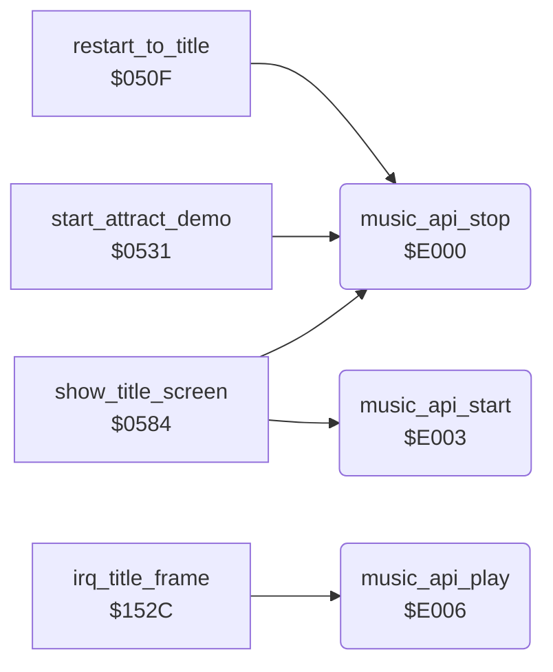

<!-- Generated by c64-docs from knowledge revision 20261025T141148.619-ij2l1b and .c64-re-tools/local/generated/src/source-map.json. Do not edit: change the knowledge, generate the source again, then run docs.ts generate. -->
# music/music_player_state.asm: Music player: entry points, voice state, note frequency table and voice reset template

Range `$E000-$E008`. Source: [music/music_player_state.asm](../../../../src/music/music_player_state.asm). Index: [the reference](../../index.md).

## Routines

| Routine | Address | Reached from | Summary |
|---|---|---|---|
| [`music_api_stop`](music_player_state.md#music_api_stop) | `$E000` | [`restart_to_title`](../game/title_demo_start.md#restart_to_title), [`start_attract_demo`](../game/title_demo_start.md#start_attract_demo), [`show_title_screen`](../game/title_demo_start.md#show_title_screen) | Music player entry points. |
| [`music_api_start`](music_player_state.md#music_api_start) | `$E003` | [`show_title_screen`](../game/title_demo_start.md#show_title_screen) | Starts the playlist at music_playlist; the title code sets it to song 0, loop, and calls this from show_title_screen. |
| [`music_api_play`](music_player_state.md#music_api_play) | `$E006` | [`irq_title_frame`](../irq/screen_raster_irqs.md#irq_title_frame) | The per-frame player (music_play_frame), called by the title screen IRQ handler irq_title_frame. |

## Data

| Range | Type | Name | Read by | Written by |
|---|---|---|---|---|
| [`$E000`](../../../../src/music/music_player_state.asm#L8)-`$E008` | jumps | [`music_api_stop`](../../../../src/music/music_player_state.asm#L7) | [`copy_sprite_frame`](../actor/actor_sprites.md#copy_sprite_frame), [`scan_mask_rows`](../actor/background_contact.md#scan_mask_rows) |  |

## Call graph

A solid arrow is a call, a thick arrow a table entry. Rounded nodes are in this file.

## Details

### [`music_api_stop`](../../../../src/music/music_player_state.asm#L7) `$E000`

*routine*

Music player entry points. The game uses only these three jumps. music_api_stop: stops the music and silences the SID (the game sets music_stop_request to 1 first).

- **Called from:** [`restart_to_title`](../game/title_demo_start.md#restart_to_title), [`start_attract_demo`](../game/title_demo_start.md#start_attract_demo), [`show_title_screen`](../game/title_demo_start.md#show_title_screen)
- **Read by:** [`copy_sprite_frame`](../actor/actor_sprites.md#copy_sprite_frame), [`scan_mask_rows`](../actor/background_contact.md#scan_mask_rows)
- **Jumps to:** [`music_jump_stop`](music_player.md#music_jump_stop)

### [`music_api_start`](../../../../src/music/music_player_state.asm#L10) `$E003`

*routine*

Starts the playlist at music_playlist; the title code sets it to song 0, loop, and calls this from show_title_screen.

- **Called from:** [`show_title_screen`](../game/title_demo_start.md#show_title_screen)
- **Jumps to:** [`music_jump_start_playlist`](music_player.md#music_jump_start_playlist)

### [`music_api_play`](../../../../src/music/music_player_state.asm#L13) `$E006`

*routine*

The per-frame player (music_play_frame), called by the title screen IRQ handler irq_title_frame.

- **Called from:** [`irq_title_frame`](../irq/screen_raster_irqs.md#irq_title_frame)
- **Jumps to:** [`music_play_frame`](music_player_e38c.md#music_play_frame)
