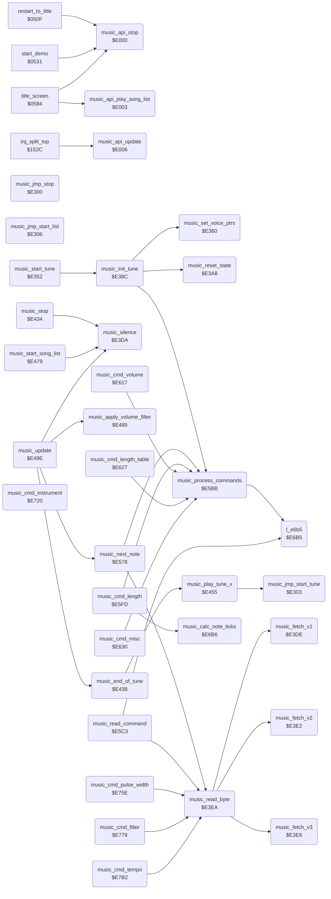

<!-- Generated by c64-docs from knowledge revision 20261016T170255.379-vv114c and src/source-map.json. Do not edit: change the knowledge, generate the source again, then run generate.ts. -->
# music_player.asm: MicroPearl music player (C) 1983 John A. Fitzpatrick

Range `$E000-$E809`. Source: [music_player.asm](../../../src/music_player.asm). Index: [the reference](../index.md).

## Call graph

A solid arrow is a call, a thick arrow a table entry, a dotted arrow a jump. Rounded nodes are in this file.

The graph shows 33 of the 71 edges: the calls only.

## Data

| Range | Type | Name | Read by | Written by |
|---|---|---|---|---|
| [`$E000`](../../../src/music_player.asm#L8)-`$E008` | jumps | [`music_api_stop`](../../../src/music_player.asm#L6) | [`reset_yamo_timer`](actors.md#reset_yamo_timer), [`shift_mask_to_buffer`](collision.md#shift_mask_to_buffer) |  |
| [`$E009`](../../../src/music_player.asm#L15)-`$E0FF` | unused |  |  |  |
| [`$E100`](../../../src/music_player.asm#L47)-`$E130` | workspace | [`music_transpose`](../../../src/music_player.asm#L46) | [`music_init_tune`](music_player.md#music_init_tune), [`music_read_byte`](music_player.md#music_read_byte), [`music_update`](music_player.md#music_update), [`music_next_note`](music_player.md#music_next_note), [`music_process_commands`](music_player.md#music_process_commands), [`music_cmd_length`](music_player.md#music_cmd_length), [`music_cmd_volume`](music_player.md#music_cmd_volume), [`music_cmd_misc`](music_player.md#music_cmd_misc), [`music_cmd_instrument`](music_player.md#music_cmd_instrument), [`music_cmd_pulse_width`](music_player.md#music_cmd_pulse_width), [`music_cmd_filter`](music_player.md#music_cmd_filter) | [`music_init_tune`](music_player.md#music_init_tune), [`music_reset_state`](music_player.md#music_reset_state), [`music_read_byte`](music_player.md#music_read_byte), [`music_play_tune_x`](music_player.md#music_play_tune_x), [`music_update`](music_player.md#music_update), [`music_next_note`](music_player.md#music_next_note), [`music_cmd_instrument`](music_player.md#music_cmd_instrument), [`music_cmd_tempo`](music_player.md#music_cmd_tempo) |
| [`$E131`](../../../src/music_player.asm#L118)-`$E1FF` | unused |  |  |  |
| [`$E200`](../../../src/music_player.asm#L146)-`$E253` | bytes | [`note_freq_lo`](../../../src/music_player.asm#L145) |  |  |
| [`$E254`](../../../src/music_player.asm#L159)-`$E2A6` | bytes | [`note_freq_hi`](../../../src/music_player.asm#L158) |  |  |
| [`$E2A7`](../../../src/music_player.asm#L171) | unused |  |  |  |
| [`$E2A8`](../../../src/music_player.asm#L174)-`$E2D5` | bytes | [`music_state_template`](../../../src/music_player.asm#L173) | [`music_reset_state`](music_player.md#music_reset_state) |  |
| [`$E2D6`](../../../src/music_player.asm#L186)-`$E2DD` | bytes | [`music_cmd_offsets`](../../../src/music_player.asm#L185) |  |  |
| [`$E2DE`](../../../src/music_player.asm#L187)-`$E2E6` | unused |  |  |  |
| [`$E2E7`](../../../src/music_player.asm#L190)-`$E2E8` | bytes | [`music_length_table_sel`](../../../src/music_player.asm#L189) | [`music_apply_volume_filter`](music_player.md#music_apply_volume_filter), [`music_calc_note_ticks`](music_player.md#music_calc_note_ticks) | [`music_reset_state`](music_player.md#music_reset_state), [`music_cmd_length_table`](music_player.md#music_cmd_length_table), [`music_cmd_filter`](music_player.md#music_cmd_filter) |
| [`$E2E9`](../../../src/music_player.asm#L193)-`$E2FF` | unused |  |  |  |
| [`$E300`](../../../src/music_player.asm#L198)-`$E308` | jumps | [`music_jmp_stop`](../../../src/music_player.asm#L197) |  |  |
| [`$E309`](../../../src/music_player.asm#L206)-`$E312` | bytes | [`music_tune_number`](../../../src/music_player.asm#L205) | [`music_set_voice_ptrs`](music_player.md#music_set_voice_ptrs), [`music_reset_state`](music_player.md#music_reset_state), [`music_end_of_tune`](music_player.md#music_end_of_tune), [`music_apply_volume_filter`](music_player.md#music_apply_volume_filter), [`music_update`](music_player.md#music_update), [`music_cmd_misc`](music_player.md#music_cmd_misc), [`music_calc_note_ticks`](music_player.md#music_calc_note_ticks), [`music_cmd_filter`](music_player.md#music_cmd_filter) | [`start_demo`](restart.md#start_demo), [`title_screen`](title.md#title_screen), [`music_start_tune`](music_player.md#music_start_tune), [`music_reset_state`](music_player.md#music_reset_state), [`music_play_tune_x`](music_player.md#music_play_tune_x), [`music_apply_volume_filter`](music_player.md#music_apply_volume_filter), [`music_read_command`](music_player.md#music_read_command), [`music_cmd_volume`](music_player.md#music_cmd_volume), [`music_cmd_misc`](music_player.md#music_cmd_misc), [`music_calc_note_ticks`](music_player.md#music_calc_note_ticks), [`music_cmd_filter`](music_player.md#music_cmd_filter), [`music_cmd_tempo`](music_player.md#music_cmd_tempo) |
| [`$E313`](../../../src/music_player.asm#L225) | unused |  |  |  |
| [`$E314`](../../../src/music_player.asm#L227) | bytes | [`music_end_action`](../../../src/music_player.asm#L226) | [`music_update`](music_player.md#music_update) | [`title_screen`](title.md#title_screen) |
| [`$E315`](../../../src/music_player.asm#L230)-`$E351` | petscii | [`music_copyright_text`](../../../src/music_player.asm#L229) |  |  |
| [`$E388`](../../../src/music_player.asm#L268)-`$E38B` | unused |  |  |  |
| [`$E5E8`](../../../src/music_player.asm#L608)-`$E5FC` | jumps | [`music_cmd_jump_table`](../../../src/music_player.asm#L607) |  |  |
| [`$E68B`](../../../src/music_player.asm#L695)-`$E68D` | bytes | [`music_adsr_set_offsets`](../../../src/music_player.asm#L694) |  |  |
| [`$E6F9`](../../../src/music_player.asm#L765)-`$E718` | bytes of 16 | [`music_length_table`](../../../src/music_player.asm#L764) |  |  |
| [`$E719`](../../../src/music_player.asm#L768)-`$E71B` | bytes | [`sid_voice_offsets`](../../../src/music_player.asm#L767) |  |  |
| [`$E71C`](../../../src/music_player.asm#L770)-`$E71F` | bytes | [`music_waveforms`](../../../src/music_player.asm#L769) |  |  |
| [`$E7BE`](../../../src/music_player.asm#L855)-`$E809` | unused |  |  |  |

## Names

### [`music_api_stop`](../../../src/music_player.asm#L6) `$E000`

*routine*

Music API: stops the music and silences SID registers $D400-$D417.

- **Called from:** [`restart_to_title`](restart.md#restart_to_title) [`$051C`](../../../src/restart.asm#L14), [`start_demo`](restart.md#start_demo) [`$054A`](../../../src/restart.asm#L36), [`title_screen`](title.md#title_screen) [`$0729`](../../../src/title.asm#L197)
- **Read by:** [`reset_yamo_timer`](actors.md#reset_yamo_timer) [`$0D55`](../../../src/actors.asm#L253), [`reset_yamo_timer`](actors.md#reset_yamo_timer) [`$0D85`](../../../src/actors.asm#L284), [`shift_mask_to_buffer`](collision.md#shift_mask_to_buffer) [`$52CB`](../../../src/collision.asm#L252)
- **Referred to by:** [`copy_frame_to_sprite`](sprite_render.md#copy_frame_to_sprite) [`$26AA`](../../../src/sprite_render.asm#L178), [`copy_frame_to_sprite`](sprite_render.md#copy_frame_to_sprite) [`$26E3`](../../../src/sprite_render.asm#L216), [`copy_frame_to_sprite`](sprite_render.md#copy_frame_to_sprite) [`$26ED`](../../../src/sprite_render.asm#L223), [`animate_scrolling_chars`](animated_chars.md#animate_scrolling_chars) [`$2D2B`](../../../src/animated_chars.asm#L118), [`test_char_row`](collision.md#test_char_row) [`$5380`](../../../src/collision.asm#L353), [`test_char_row`](collision.md#test_char_row) [`$539A`](../../../src/collision.asm#L370), [`test_char_row`](collision.md#test_char_row) [`$53B4`](../../../src/collision.asm#L387)
- **Jumps to:** [`music_jmp_stop`](music_player.md#music_jmp_stop)

### [`music_api_play_song_list`](../../../src/music_player.asm#L10) `$E003`

*routine*

Music API: starts the song list at music_song_list from music_list_start; music_end_action ($E314) decides what happens at the end of each tune.

- **Called from:** [`title_screen`](title.md#title_screen) [`$06DA`](../../../src/title.asm#L159)
- **Jumps to:** [`music_jmp_start_list`](music_player.md#music_jmp_start_list)

### [`music_api_update`](../../../src/music_player.asm#L13) `$E006`

*routine*

Music API: one music update; the game calls it once per frame from irq_split_top ($154C), on the title and game-over screens.

- **Called from:** [`irq_split_top`](raster_irq_screens.md#irq_split_top) [`$154C`](../../../src/raster_irq_screens.asm#L92)
- **Jumps to:** [`music_update`](music_player.md#music_update)

### [`music_transpose`](../../../src/music_player.asm#L46) `$E100`

*variable*

semitones added to every note (song list entry $40-$7F)

- **Read by:** [`music_next_note`](music_player.md#music_next_note) [`$E591`](../../../src/music_player.asm#L563)
- **Written by:** [`music_reset_state`](music_player.md#music_reset_state) [`$E3CE`](../../../src/music_player.asm#L303), [`music_play_tune_x`](music_player.md#music_play_tune_x) [`$E469`](../../../src/music_player.asm#L417)
- **Referred to by:** [`music_reset_state`](music_player.md#music_reset_state) [`$E3B5`](../../../src/music_player.asm#L292)

### [`music_tie_v1`](../../../src/music_player.asm#L48) `$E101`

*variable*

1 = tie: next note keeps ADSR/gate, no gate-off

- **Read by:** [`music_update`](music_player.md#music_update) [`$E4F6`](../../../src/music_player.asm#L492)
- **Referred to by:** [`music_next_note`](music_player.md#music_next_note) [`$E5A4`](../../../src/music_player.asm#L570), [`music_cmd_misc`](music_player.md#music_cmd_misc) [`$E697`](../../../src/music_player.asm#L701)

### [`music_tie_v2`](../../../src/music_player.asm#L50) `$E102`

*variable*

- **Read by:** [`music_update`](music_player.md#music_update) [`$E530`](../../../src/music_player.asm#L518)

### [`music_tie_v3`](../../../src/music_player.asm#L52) `$E103`

*variable*

- **Read by:** [`music_update`](music_player.md#music_update) [`$E56A`](../../../src/music_player.asm#L543)

### [`music_dur_v1`](../../../src/music_player.asm#L54) `$E104`

*variable*

tick counter of the current note: gate-off at 0, next note at music_release_end

- **Read by:** [`music_update`](music_player.md#music_update) [`$E4C9`](../../../src/music_player.asm#L472), [`music_update`](music_player.md#music_update) [`$E4CE`](../../../src/music_player.asm#L474)
- **Written by:** [`music_update`](music_player.md#music_update) [`$E4C9`](../../../src/music_player.asm#L472), [`music_update`](music_player.md#music_update) [`$E4D9`](../../../src/music_player.asm#L478)

### [`music_dur_v2`](../../../src/music_player.asm#L56) `$E105`

*variable*

- **Read by:** [`music_update`](music_player.md#music_update) [`$E503`](../../../src/music_player.asm#L498), [`music_update`](music_player.md#music_update) [`$E508`](../../../src/music_player.asm#L500)
- **Written by:** [`music_update`](music_player.md#music_update) [`$E503`](../../../src/music_player.asm#L498), [`music_update`](music_player.md#music_update) [`$E513`](../../../src/music_player.asm#L504)

### [`music_dur_v3`](../../../src/music_player.asm#L58) `$E106`

*variable*

- **Read by:** [`music_update`](music_player.md#music_update) [`$E53D`](../../../src/music_player.asm#L524), [`music_update`](music_player.md#music_update) [`$E542`](../../../src/music_player.asm#L526)
- **Written by:** [`music_update`](music_player.md#music_update) [`$E53D`](../../../src/music_player.asm#L524), [`music_update`](music_player.md#music_update) [`$E54D`](../../../src/music_player.asm#L530)

### [`music_release_end_v1`](../../../src/music_player.asm#L60) `$E107`

*variable*

negative counter value at which the next note starts

- **Read by:** [`music_update`](music_player.md#music_update) [`$E4D1`](../../../src/music_player.asm#L475)
- **Written by:** [`music_update`](music_player.md#music_update) [`$E4DF`](../../../src/music_player.asm#L480)

### [`music_release_end_v2`](../../../src/music_player.asm#L62) `$E108`

*variable*

- **Read by:** [`music_update`](music_player.md#music_update) [`$E50B`](../../../src/music_player.asm#L501)
- **Written by:** [`music_update`](music_player.md#music_update) [`$E519`](../../../src/music_player.asm#L506)

### [`music_release_end_v3`](../../../src/music_player.asm#L64) `$E109`

*variable*

- **Read by:** [`music_update`](music_player.md#music_update) [`$E545`](../../../src/music_player.asm#L527)
- **Written by:** [`music_update`](music_player.md#music_update) [`$E553`](../../../src/music_player.asm#L532)

### [`music_gate_len_v1`](../../../src/music_player.asm#L66) `$E10A`

*variable*

gate-on ticks for the next note (from length command)

- **Read by:** [`music_update`](music_player.md#music_update) [`$E4D6`](../../../src/music_player.asm#L477)
- **Referred to by:** [`music_cmd_length`](music_player.md#music_cmd_length) [`$E60D`](../../../src/music_player.asm#L625)

### [`music_gate_len_v2`](../../../src/music_player.asm#L68) `$E10B`

*variable*

- **Read by:** [`music_update`](music_player.md#music_update) [`$E510`](../../../src/music_player.asm#L503)

### [`music_gate_len_v3`](../../../src/music_player.asm#L70) `$E10C`

*variable*

- **Read by:** [`music_update`](music_player.md#music_update) [`$E54A`](../../../src/music_player.asm#L529)

### [`music_release_len_v1`](../../../src/music_player.asm#L72) `$E10D`

*variable*

negative release ticks for the next note

- **Read by:** [`music_update`](music_player.md#music_update) [`$E4DC`](../../../src/music_player.asm#L479)
- **Referred to by:** [`music_cmd_length`](music_player.md#music_cmd_length) [`$E611`](../../../src/music_player.asm#L627)

### [`music_release_len_v2`](../../../src/music_player.asm#L74) `$E10E`

*variable*

- **Read by:** [`music_update`](music_player.md#music_update) [`$E516`](../../../src/music_player.asm#L505)

### [`music_release_len_v3`](../../../src/music_player.asm#L76) `$E10F`

*variable*

- **Read by:** [`music_update`](music_player.md#music_update) [`$E550`](../../../src/music_player.asm#L531)

### [`music_ad`](../../../src/music_player.asm#L78) `$E110-$E112`

*variable*

SID attack/decay per voice (3 bytes)

- **Referred to by:** [`music_next_note`](music_player.md#music_next_note) [`$E5A9`](../../../src/music_player.asm#L572), [`music_cmd_misc`](music_player.md#music_cmd_misc) [`$E671`](../../../src/music_player.asm#L681)

### [`music_sr`](../../../src/music_player.asm#L80) `$E113-$E115`

*variable*

SID sustain/release per voice (3 bytes)

- **Referred to by:** [`music_next_note`](music_player.md#music_next_note) [`$E5AF`](../../../src/music_player.asm#L574), [`music_cmd_misc`](music_player.md#music_cmd_misc) [`$E66D`](../../../src/music_player.asm#L679)

### [`music_ctrl_v1`](../../../src/music_player.asm#L82) `$E116`

*variable*

SID control byte (waveform+gate) per voice

- **Read by:** [`music_update`](music_player.md#music_update) [`$E4FB`](../../../src/music_player.asm#L494)
- **Referred to by:** [`music_next_note`](music_player.md#music_next_note) [`$E5B5`](../../../src/music_player.asm#L576), [`music_cmd_misc`](music_player.md#music_cmd_misc) [`$E648`](../../../src/music_player.asm#L659), [`music_cmd_misc`](music_player.md#music_cmd_misc) [`$E6A7`](../../../src/music_player.asm#L711), [`music_cmd_misc`](music_player.md#music_cmd_misc) [`$E6AF`](../../../src/music_player.asm#L714)

### [`music_ctrl_v2`](../../../src/music_player.asm#L84) `$E117`

*variable*

- **Read by:** [`music_update`](music_player.md#music_update) [`$E535`](../../../src/music_player.asm#L520)

### [`music_ctrl_v3`](../../../src/music_player.asm#L86) `$E118`

*variable*

- **Read by:** [`music_update`](music_player.md#music_update) [`$E56F`](../../../src/music_player.asm#L545)

### [`music_articulation`](../../../src/music_player.asm#L88) `$E119-$E11B`

*variable*

per voice: 0 = gate 7/8, 1 = gate 1/2, 2 = gate full-1 (commands $A4-$A6)

- **Referred to by:** [`music_cmd_length`](music_player.md#music_cmd_length) [`$E603`](../../../src/music_player.asm#L621), [`music_cmd_misc`](music_player.md#music_cmd_misc) [`$E657`](../../../src/music_player.asm#L666)

### [`music_adsr_sets`](../../../src/music_player.asm#L90) `$E11C-$E12D`

*variable*

3 voices x 6 bytes: AD/SR pairs for articulation 0, 1, 2

- **Written by:** [`music_reset_state`](music_player.md#music_reset_state) [`$E3B5`](../../../src/music_player.asm#L292) (+16), [`music_reset_state`](music_player.md#music_reset_state) [`$E3B5`](../../../src/music_player.asm#L292) (+17), [`music_cmd_instrument`](music_player.md#music_cmd_instrument) [`$E734`](../../../src/music_player.asm#L786) (+12), [`music_cmd_instrument`](music_player.md#music_cmd_instrument) [`$E734`](../../../src/music_player.asm#L786) (+13)
- **Referred to by:** [`music_cmd_misc`](music_player.md#music_cmd_misc) [`$E666`](../../../src/music_player.asm#L675), [`music_cmd_misc`](music_player.md#music_cmd_misc) [`$E666`](../../../src/music_player.asm#L675) (+4), [`music_cmd_misc`](music_player.md#music_cmd_misc) [`$E66A`](../../../src/music_player.asm#L677), [`music_cmd_misc`](music_player.md#music_cmd_misc) [`$E66A`](../../../src/music_player.asm#L677) (+5), [`music_cmd_misc`](music_player.md#music_cmd_misc) [`$E677`](../../../src/music_player.asm#L685), [`music_cmd_misc`](music_player.md#music_cmd_misc) [`$E677`](../../../src/music_player.asm#L685) (+2), [`music_cmd_misc`](music_player.md#music_cmd_misc) [`$E67B`](../../../src/music_player.asm#L687), [`music_cmd_misc`](music_player.md#music_cmd_misc) [`$E67B`](../../../src/music_player.asm#L687) (+3), [`music_cmd_misc`](music_player.md#music_cmd_misc) [`$E681`](../../../src/music_player.asm#L690), [`music_cmd_misc`](music_player.md#music_cmd_misc) [`$E685`](../../../src/music_player.asm#L692), [`music_cmd_misc`](music_player.md#music_cmd_misc) [`$E685`](../../../src/music_player.asm#L692) (+1), [`music_cmd_instrument`](music_player.md#music_cmd_instrument) [`$E743`](../../../src/music_player.asm#L794), [`music_cmd_instrument`](music_player.md#music_cmd_instrument) [`$E752`](../../../src/music_player.asm#L802), [`music_cmd_instrument`](music_player.md#music_cmd_instrument) [`$E752`](../../../src/music_player.asm#L802) (+6)

### [`music_cur_voice`](../../../src/music_player.asm#L112) `$E12E`

*variable*

voice 0-2 that the player works on

- **Read by:** [`music_init_tune`](music_player.md#music_init_tune) [`$E39F`](../../../src/music_player.asm#L279), [`music_read_byte`](music_player.md#music_read_byte) [`$E3EA`](../../../src/music_player.asm#L334), [`music_next_note`](music_player.md#music_next_note) [`$E57E`](../../../src/music_player.asm#L554), [`music_next_note`](music_player.md#music_next_note) [`$E5A1`](../../../src/music_player.asm#L569), [`music_cmd_length`](music_player.md#music_cmd_length) [`$E600`](../../../src/music_player.asm#L620), [`music_cmd_length`](music_player.md#music_cmd_length) [`$E60A`](../../../src/music_player.asm#L624), [`music_cmd_volume`](music_player.md#music_cmd_volume) [`$E61D`](../../../src/music_player.asm#L634), [`music_cmd_misc`](music_player.md#music_cmd_misc) [`$E645`](../../../src/music_player.asm#L658), [`music_cmd_misc`](music_player.md#music_cmd_misc) [`$E654`](../../../src/music_player.asm#L665), [`music_cmd_misc`](music_player.md#music_cmd_misc) [`$E694`](../../../src/music_player.asm#L700), [`music_cmd_misc`](music_player.md#music_cmd_misc) [`$E6A4`](../../../src/music_player.asm#L710), [`music_cmd_instrument`](music_player.md#music_cmd_instrument) [`$E729`](../../../src/music_player.asm#L780), [`music_cmd_pulse_width`](music_player.md#music_cmd_pulse_width) [`$E761`](../../../src/music_player.asm#L811), [`music_cmd_pulse_width`](music_player.md#music_cmd_pulse_width) [`$E76D`](../../../src/music_player.asm#L815), [`music_cmd_filter`](music_player.md#music_cmd_filter) [`$E79B`](../../../src/music_player.asm#L840)
- **Written by:** [`music_init_tune`](music_player.md#music_init_tune) [`$E394`](../../../src/music_player.asm#L275), [`music_next_note`](music_player.md#music_next_note) [`$E578`](../../../src/music_player.asm#L552)

### [`music_tempo_counter`](../../../src/music_player.asm#L114) `$E12F`

*variable*

frames left until the next tick

- **Read by:** [`music_update`](music_player.md#music_update) [`$E4BE`](../../../src/music_player.asm#L468)
- **Written by:** [`music_reset_state`](music_player.md#music_reset_state) [`$E3BE`](../../../src/music_player.asm#L296), [`music_update`](music_player.md#music_update) [`$E4BE`](../../../src/music_player.asm#L468), [`music_update`](music_player.md#music_update) [`$E4C6`](../../../src/music_player.asm#L471), [`music_cmd_tempo`](music_player.md#music_cmd_tempo) [`$E7B8`](../../../src/music_player.asm#L853)

### [`music_lookahead`](../../../src/music_player.asm#L116) `$E130`

*variable*

byte after the last byte read from the voice stream

- **Read by:** [`music_process_commands`](music_player.md#music_process_commands) [`$E5BB`](../../../src/music_player.asm#L580)
- **Written by:** [`music_init_tune`](music_player.md#music_init_tune) [`$E399`](../../../src/music_player.asm#L277), [`music_read_byte`](music_player.md#music_read_byte) [`$E402`](../../../src/music_player.asm#L348), [`music_read_byte`](music_player.md#music_read_byte) [`$E418`](../../../src/music_player.asm#L361), [`music_read_byte`](music_player.md#music_read_byte) [`$E42E`](../../../src/music_player.asm#L374)

### [`note_freq_lo`](../../../src/music_player.asm#L145) `$E200-$E253`

*data*

SID frequency table (NTSC tuning), low bytes of notes 0-83: 0 = B0, 1 = C1, 82 = A7, 83 = A#7. The music player plays note 0 as a rest. Used by the music player and by the sound effect players.

- **Referred to by:** [`music_next_note`](music_player.md#music_next_note) [`$E59B`](../../../src/music_player.asm#L567), [`sfx_v1_read_note`](sfx_voice1.md#sfx_v1_read_note) [`$EB5C`](../../../src/sfx_voice1.asm#L63), [`sfx_v2_read_note`](sfx_voice2.md#sfx_v2_read_note) [`$EFCC`](../../../src/sfx_voice2.asm#L66), [`sfx_v3_read_note`](sfx_voice3.md#sfx_v3_read_note) [`$F0CC`](../../../src/sfx_voice3.asm#L63)

### [`note_freq_hi`](../../../src/music_player.asm#L158) `$E254-$E2A6`

*data*

SID frequency table, high bytes of notes 0-82; the high byte of note 83 (A#7, $EE54) is the next byte $E2A7, which no stream uses. Sound effect notes $54 and $55 read past the end: low byte from here, high byte $00 from music_state_template, frequency $0001/$0002 (silent).

- **Referred to by:** [`music_next_note`](music_player.md#music_next_note) [`$E595`](../../../src/music_player.asm#L565), [`sfx_v1_read_note`](sfx_voice1.md#sfx_v1_read_note) [`$EB62`](../../../src/sfx_voice1.asm#L65), [`sfx_v2_read_note`](sfx_voice2.md#sfx_v2_read_note) [`$EFD2`](../../../src/sfx_voice2.asm#L68), [`sfx_v3_read_note`](sfx_voice3.md#sfx_v3_read_note) [`$F0D2`](../../../src/sfx_voice3.asm#L65)

### [`music_state_template`](../../../src/music_player.asm#L173) `$E2A8-$E2D5`

*data*

Initial values copied to $E100-$E12D (music_transpose .. music_adsr_sets) by music_reset_state.

- **Read by:** [`music_reset_state`](music_player.md#music_reset_state) [`$E3B2`](../../../src/music_player.asm#L291) (+44), [`music_reset_state`](music_player.md#music_reset_state) [`$E3B2`](../../../src/music_player.asm#L291) (+45)

### [`music_cmd_offsets`](../../../src/music_player.asm#L185) `$E2D6-$E2DD`

*data*

Branch offsets into music_cmd_jump_table for command groups $8x-$Fx (bits 4-6 of the command byte).

- **Referred to by:** [`music_read_command`](music_player.md#music_read_command) [`$E5DF`](../../../src/music_player.asm#L601)

### [`music_length_table_sel`](../../../src/music_player.asm#L189) `$E2E7`

*variable*

0 = short note lengths, 1 = long (commands $AC/$AD); global for all voices

- **Read by:** [`music_calc_note_ticks`](music_player.md#music_calc_note_ticks) [`$E6B6`](../../../src/music_player.asm#L720)
- **Written by:** [`music_cmd_length_table`](music_player.md#music_cmd_length_table) [`$E62A`](../../../src/music_player.asm#L642)

### [`music_filter_reson`](../../../src/music_player.asm#L191) `$E2E8`

*variable*

value for SID $D417 (resonance and voice routing)

- **Read by:** [`music_apply_volume_filter`](music_player.md#music_apply_volume_filter) [`$E492`](../../../src/music_player.asm#L443)
- **Written by:** [`music_reset_state`](music_player.md#music_reset_state) [`$E3AD`](../../../src/music_player.asm#L288), [`music_cmd_filter`](music_player.md#music_cmd_filter) [`$E7AC`](../../../src/music_player.asm#L847)

### [`music_jmp_stop`](../../../src/music_player.asm#L197) `$E300`

*routine*

Internal entry: stop the music.

- **Jumped to from:** `$A300`, [`music_api_stop`](music_player.md#music_api_stop) [`$E000`](../../../src/music_player.asm#L8)
- **Entry of:** [`music_api_stop`](../tables.md#music_api_stop)
- **Jumps to:** [`music_stop`](music_player.md#music_stop)

### [`music_jmp_start_tune`](../../../src/music_player.asm#L200) `$E303`

*routine*

Internal entry: start tune music_tune_number.

- **Called from:** [`music_play_tune_x`](music_player.md#music_play_tune_x) [`$E458`](../../../src/music_player.asm#L405)
- **Jumps to:** [`music_start_tune`](music_player.md#music_start_tune)

### [`music_jmp_start_list`](../../../src/music_player.asm#L203) `$E306`

*routine*

Internal entry: start the song list.

- **Jumped to from:** `$A303`, [`music_api_play_song_list`](music_player.md#music_api_play_song_list) [`$E003`](../../../src/music_player.asm#L11)
- **Entry of:** [`music_api_stop`](../tables.md#music_api_stop)
- **Jumps to:** [`music_start_song_list`](music_player.md#music_start_song_list)

### [`music_tune_number`](../../../src/music_player.asm#L205) `$E309`

*variable*

current tune (index into music_tune_table)

- **Read by:** [`music_set_voice_ptrs`](music_player.md#music_set_voice_ptrs) [`$E360`](../../../src/music_player.asm#L242), [`music_end_of_tune`](music_player.md#music_end_of_tune) [`$E445`](../../../src/music_player.asm#L394)
- **Written by:** [`music_play_tune_x`](music_player.md#music_play_tune_x) [`$E455`](../../../src/music_player.asm#L404)

### [`music_stop_request`](../../../src/music_player.asm#L207) `$E30A`

*variable*

non-zero: next music_update stops the music

- **Read by:** [`music_update`](music_player.md#music_update) [`$E49E`](../../../src/music_player.asm#L450)
- **Written by:** [`start_demo`](restart.md#start_demo) [`$0547`](../../../src/restart.asm#L35), [`title_screen`](title.md#title_screen) [`$0726`](../../../src/title.asm#L196), [`music_reset_state`](music_player.md#music_reset_state) [`$E3C5`](../../../src/music_player.asm#L300)

### [`music_tune_ended`](../../../src/music_player.asm#L209) `$E30B`

*variable*

set to 1 by the $FF end command; nothing reads it

- **Written by:** [`music_reset_state`](music_player.md#music_reset_state) [`$E3C2`](../../../src/music_player.asm#L298), [`music_read_command`](music_player.md#music_read_command) [`$E5CC`](../../../src/music_player.asm#L589)

### [`music_playing`](../../../src/music_player.asm#L211) `$E30C`

*variable*

0 = music_update does nothing

- **Read by:** [`music_update`](music_player.md#music_update) [`$E4A3`](../../../src/music_player.asm#L452)
- **Written by:** [`music_start_tune`](music_player.md#music_start_tune) [`$E354`](../../../src/music_player.asm#L235), [`music_start_tune`](music_player.md#music_start_tune) [`$E35C`](../../../src/music_player.asm#L238), [`music_reset_state`](music_player.md#music_reset_state) [`$E3CB`](../../../src/music_player.asm#L302)

### [`music_tempo`](../../../src/music_player.asm#L213) `$E30D`

*variable*

frames per tick (command $E0 nn)

- **Read by:** [`music_reset_state`](music_player.md#music_reset_state) [`$E3BB`](../../../src/music_player.asm#L295), [`music_update`](music_player.md#music_update) [`$E4C3`](../../../src/music_player.asm#L470)
- **Written by:** [`music_cmd_tempo`](music_player.md#music_cmd_tempo) [`$E7B5`](../../../src/music_player.asm#L852)

### [`music_end_flag`](../../../src/music_player.asm#L215) `$E30E`

*variable*

$FF after a voice read the $FF end command

- **Read by:** [`music_update`](music_player.md#music_update) [`$E4A9`](../../../src/music_player.asm#L457)
- **Written by:** [`music_reset_state`](music_player.md#music_reset_state) [`$E3C8`](../../../src/music_player.asm#L301), [`music_read_command`](music_player.md#music_read_command) [`$E5D1`](../../../src/music_player.asm#L591)

### [`music_filter_mode`](../../../src/music_player.asm#L217) `$E30F`

*variable*

filter mode bits ORed with the volume into $D418

- **Read by:** [`music_apply_volume_filter`](music_player.md#music_apply_volume_filter) [`$E489`](../../../src/music_player.asm#L440)
- **Written by:** [`music_reset_state`](music_player.md#music_reset_state) [`$E3AA`](../../../src/music_player.asm#L287), [`music_cmd_filter`](music_player.md#music_cmd_filter) [`$E798`](../../../src/music_player.asm#L839)

### [`music_filter_voice`](../../../src/music_player.asm#L219) `$E310`

*variable*

voice+1 whose next note writes $D418/$D417; 0 = none

- **Read by:** [`music_update`](music_player.md#music_update) [`$E4E2`](../../../src/music_player.asm#L481), [`music_update`](music_player.md#music_update) [`$E51C`](../../../src/music_player.asm#L507), [`music_update`](music_player.md#music_update) [`$E556`](../../../src/music_player.asm#L533)
- **Written by:** [`music_apply_volume_filter`](music_player.md#music_apply_volume_filter) [`$E49A`](../../../src/music_player.asm#L446), [`music_cmd_volume`](music_player.md#music_cmd_volume) [`$E621`](../../../src/music_player.asm#L636), [`music_cmd_filter`](music_player.md#music_cmd_filter) [`$E79F`](../../../src/music_player.asm#L842)

### [`music_volume`](../../../src/music_player.asm#L221) `$E311`

*variable*

master volume 0-15 (command $9n)

- **Read by:** [`music_apply_volume_filter`](music_player.md#music_apply_volume_filter) [`$E48C`](../../../src/music_player.asm#L441)
- **Written by:** [`music_cmd_volume`](music_player.md#music_cmd_volume) [`$E61A`](../../../src/music_player.asm#L633)

### [`music_temp`](../../../src/music_player.asm#L223) `$E312`

*variable*

- **Read by:** [`music_cmd_misc`](music_player.md#music_cmd_misc) [`$E6AC`](../../../src/music_player.asm#L713), [`music_calc_note_ticks`](music_player.md#music_calc_note_ticks) [`$E6DD`](../../../src/music_player.asm#L745), [`music_calc_note_ticks`](music_player.md#music_calc_note_ticks) [`$E6E4`](../../../src/music_player.asm#L749), [`music_calc_note_ticks`](music_player.md#music_calc_note_ticks) [`$E6F4`](../../../src/music_player.asm#L760), [`music_cmd_filter`](music_player.md#music_cmd_filter) [`$E7A9`](../../../src/music_player.asm#L846)
- **Written by:** [`music_cmd_misc`](music_player.md#music_cmd_misc) [`$E6A1`](../../../src/music_player.asm#L709), [`music_calc_note_ticks`](music_player.md#music_calc_note_ticks) [`$E6D6`](../../../src/music_player.asm#L742), [`music_calc_note_ticks`](music_player.md#music_calc_note_ticks) [`$E6ED`](../../../src/music_player.asm#L756), [`music_cmd_filter`](music_player.md#music_cmd_filter) [`$E7A5`](../../../src/music_player.asm#L844)

### [`music_end_action`](../../../src/music_player.asm#L226) `$E314`

*variable*

at tune end: 0 stop, bit7 play tune bits0-6, bit1 continue song list, bit0 wrap/restart; the game sets 3

- **Read by:** [`music_update`](music_player.md#music_update) [`$E4B0`](../../../src/music_player.asm#L460)
- **Written by:** [`title_screen`](title.md#title_screen) [`$06CE`](../../../src/title.asm#L154)

### [`music_copyright_text`](../../../src/music_player.asm#L229) `$E315-$E351`

*data*

Text " MICROPEARL MUSIC PLAYER  COPYRIGHT 1983 JOHN A. FITZPATRICK "; nothing reads it.

### [`music_start_tune`](../../../src/music_player.asm#L233) `$E352`

*routine*

Starts tune music_tune_number: pauses the player, initialises all three voices (music_init_tune) and sets music_playing.

- **Jumped to from:** `$A603`, `$AB03`, [`music_jmp_start_tune`](music_player.md#music_jmp_start_tune) [`$E303`](../../../src/music_player.asm#L201)
- **Entry of:** [`music_jmp_stop`](../tables.md#music_jmp_stop)
- **Calls:** [`music_init_tune`](music_player.md#music_init_tune)
- **Writes:** [`music_playing`](music_player.md#music_playing)

### [`music_set_voice_ptrs`](../../../src/music_player.asm#L241) `$E360`

*routine*

Copies the three voice stream pointers of tune min(music_tune_number, music_last_tune) from music_tune_table into the fetch routines.

- **Called from:** [`music_init_tune`](music_player.md#music_init_tune) [`$E38C`](../../../src/music_player.asm#L271)
- **Reads:** [`music_tune_number`](music_player.md#music_tune_number), [`music_last_tune`](music_data.md#music_last_tune)
- **Writes:** [`music_v1_ptr`](music_player.md#music_v1_ptr), [`music_v2_ptr`](music_player.md#music_v2_ptr), [`music_v1_ptr+1`](music_player.md#music_v1_ptr), [`music_v2_ptr+1`](music_player.md#music_v2_ptr)
- **Refers to:** [`music_tune_table`](music_data.md#music_tune_table)

### [`music_init_tune`](../../../src/music_player.asm#L270) `$E38C`

*routine*

Sets the voice pointers, resets the player state and SID, then reads the leading command bytes of each voice stream up to its first note.

- **Called from:** [`music_start_tune`](music_player.md#music_start_tune) [`$E357`](../../../src/music_player.asm#L236)
- **Calls:** [`music_set_voice_ptrs`](music_player.md#music_set_voice_ptrs), [`music_reset_state`](music_player.md#music_reset_state), [`music_process_commands`](music_player.md#music_process_commands)
- **Reads:** [`music_cur_voice`](music_player.md#music_cur_voice)
- **Writes:** [`music_cur_voice`](music_player.md#music_cur_voice), [`music_lookahead`](music_player.md#music_lookahead)

### [`music_reset_state`](../../../src/music_player.asm#L285) `$E3A8`

*routine*

Clears filter mode and resonance, copies music_state_template to $E100-$E12D, reloads the tempo counter, then falls into music_clear_flags.

- **Called from:** [`music_init_tune`](music_player.md#music_init_tune) [`$E38F`](../../../src/music_player.asm#L272)
- **Reads:** [`music_state_template+44`](music_player.md#music_state_template), [`music_state_template+45`](music_player.md#music_state_template), [`music_tempo`](music_player.md#music_tempo)
- **Writes:** [`music_filter_mode`](music_player.md#music_filter_mode), [`music_filter_reson`](music_player.md#music_filter_reson), [`music_adsr_sets+16`](music_player.md#music_adsr_sets), [`music_adsr_sets+17`](music_player.md#music_adsr_sets), [`music_tempo_counter`](music_player.md#music_tempo_counter), [`music_tune_ended`](music_player.md#music_tune_ended), [`music_stop_request`](music_player.md#music_stop_request), [`music_end_flag`](music_player.md#music_end_flag), [`music_playing`](music_player.md#music_playing), [`music_transpose`](music_player.md#music_transpose), [`CUTHI`](../variables.md#CUTHI), [`RESON`](../variables.md#RESON)
- **Refers to:** [`music_state_template`](music_player.md#music_state_template), [`music_transpose`](music_player.md#music_transpose)

### [`music_clear_flags`](../../../src/music_player.asm#L299) `$E3C5`

*label*

A=0: clears stop request, end flag, playing, transpose and SID $D400-$D417

- **Jumped to from:** [`music_silence`](music_player.md#music_silence) [`$E3DC`](../../../src/music_player.asm#L313)

### [`music_silence`](../../../src/music_player.asm#L311) `$E3DA`

*routine*

Stops the music: clears the player flags and transpose and writes 0 to SID registers $D400-$D417.

- **Called from:** [`music_stop`](music_player.md#music_stop) [`$E434`](../../../src/music_player.asm#L380), [`music_start_song_list`](music_player.md#music_start_song_list) [`$E486`](../../../src/music_player.asm#L437), [`music_update`](music_player.md#music_update) [`$E4BB`](../../../src/music_player.asm#L466)
- **Jumps to:** [`music_clear_flags`](music_player.md#music_clear_flags)

### [`music_fetch_v1`](../../../src/music_player.asm#L315) `$E3DE`

*routine*

Self-modified LDA abs / RTS: reads the byte at the voice 1 stream pointer.

- **Called from:** [`music_read_byte`](music_player.md#music_read_byte) [`$E408`](../../../src/music_player.asm#L353), [`music_read_byte`](music_player.md#music_read_byte) [`$E415`](../../../src/music_player.asm#L360)
- **Reads:** [`music_title_v1+16`](music_data.md#music_title_v1)
- **Refers to:** [`music_title_v1`](music_data.md#music_title_v1)

### [`music_v1_ptr`](../../../src/music_player.asm#L316) `$E3DF-$E3E1`

*variable*

voice 1 stream pointer (operand)

- **Read by:** [`music_read_byte`](music_player.md#music_read_byte) [`$E40C`](../../../src/music_player.asm#L355), [`music_read_byte`](music_player.md#music_read_byte) [`$E411`](../../../src/music_player.asm#L357) (+1)
- **Written by:** [`music_set_voice_ptrs`](music_player.md#music_set_voice_ptrs) [`$E376`](../../../src/music_player.asm#L257), [`music_set_voice_ptrs`](music_player.md#music_set_voice_ptrs) [`$E37E`](../../../src/music_player.asm#L261) (+1), [`music_read_byte`](music_player.md#music_read_byte) [`$E40C`](../../../src/music_player.asm#L355), [`music_read_byte`](music_player.md#music_read_byte) [`$E411`](../../../src/music_player.asm#L357) (+1)

### [`music_fetch_v2`](../../../src/music_player.asm#L321) `$E3E2`

*routine*

Self-modified LDA abs / RTS: reads the byte at the voice 2 stream pointer.

- **Called from:** [`music_read_byte`](music_player.md#music_read_byte) [`$E41E`](../../../src/music_player.asm#L366), [`music_read_byte`](music_player.md#music_read_byte) [`$E42B`](../../../src/music_player.asm#L373)
- **Reads:** [`music_title_v2+11`](music_data.md#music_title_v2)
- **Refers to:** [`music_title_v2`](music_data.md#music_title_v2)

### [`music_v2_ptr`](../../../src/music_player.asm#L322) `$E3E3-$E3E5`

*variable*

voice 2 stream pointer (operand)

- **Read by:** [`music_read_byte`](music_player.md#music_read_byte) [`$E422`](../../../src/music_player.asm#L368), [`music_read_byte`](music_player.md#music_read_byte) [`$E427`](../../../src/music_player.asm#L370) (+1)
- **Written by:** [`music_set_voice_ptrs`](music_player.md#music_set_voice_ptrs) [`$E376`](../../../src/music_player.asm#L257), [`music_set_voice_ptrs`](music_player.md#music_set_voice_ptrs) [`$E37E`](../../../src/music_player.asm#L261) (+1), [`music_read_byte`](music_player.md#music_read_byte) [`$E422`](../../../src/music_player.asm#L368), [`music_read_byte`](music_player.md#music_read_byte) [`$E427`](../../../src/music_player.asm#L370) (+1)

### [`music_fetch_v3`](../../../src/music_player.asm#L327) `$E3E6`

*routine*

Self-modified LDA abs / RTS: reads the byte at the voice 3 stream pointer.

- **Called from:** [`music_read_byte`](music_player.md#music_read_byte) [`$E3F2`](../../../src/music_player.asm#L339), [`music_read_byte`](music_player.md#music_read_byte) [`$E3FF`](../../../src/music_player.asm#L347)
- **Reads:** [`music_title_v3+11`](music_data.md#music_title_v3)
- **Refers to:** [`music_title_v3`](music_data.md#music_title_v3)

### [`music_v3_ptr`](../../../src/music_player.asm#L328) `$E3E7-$E3E9`

*variable*

voice 3 stream pointer (operand)

- **Read by:** [`music_read_byte`](music_player.md#music_read_byte) [`$E3F6`](../../../src/music_player.asm#L341), [`music_read_byte`](music_player.md#music_read_byte) [`$E3FB`](../../../src/music_player.asm#L344) (+1)
- **Written by:** [`music_read_byte`](music_player.md#music_read_byte) [`$E3F6`](../../../src/music_player.asm#L341), [`music_read_byte`](music_player.md#music_read_byte) [`$E3FB`](../../../src/music_player.asm#L344) (+1)

### [`music_read_byte`](../../../src/music_player.asm#L333) `$E3EA`

*routine*

Reads the next byte of voice music_cur_voice, advances its pointer and stores the following byte in music_lookahead. Returns the byte in A with N/Z set by it.

- **Called from:** [`music_next_note`](music_player.md#music_next_note) [`$E57B`](../../../src/music_player.asm#L553), [`music_read_command`](music_player.md#music_read_command) [`$E5C3`](../../../src/music_player.asm#L585), [`music_cmd_pulse_width`](music_player.md#music_cmd_pulse_width) [`$E75E`](../../../src/music_player.asm#L810), [`music_cmd_pulse_width`](music_player.md#music_cmd_pulse_width) [`$E76A`](../../../src/music_player.asm#L814), [`music_cmd_filter`](music_player.md#music_cmd_filter) [`$E7A2`](../../../src/music_player.asm#L843), [`music_cmd_tempo`](music_player.md#music_cmd_tempo) [`$E7B2`](../../../src/music_player.asm#L851)
- **Calls:** [`music_fetch_v3`](music_player.md#music_fetch_v3), [`music_fetch_v1`](music_player.md#music_fetch_v1), [`music_fetch_v2`](music_player.md#music_fetch_v2)
- **Reads:** [`music_cur_voice`](music_player.md#music_cur_voice), [`music_v3_ptr`](music_player.md#music_v3_ptr), [`music_v3_ptr+1`](music_player.md#music_v3_ptr), [`music_v1_ptr`](music_player.md#music_v1_ptr), [`music_v1_ptr+1`](music_player.md#music_v1_ptr), [`music_v2_ptr`](music_player.md#music_v2_ptr), [`music_v2_ptr+1`](music_player.md#music_v2_ptr)
- **Writes:** [`music_v3_ptr`](music_player.md#music_v3_ptr), [`music_v3_ptr+1`](music_player.md#music_v3_ptr), [`music_lookahead`](music_player.md#music_lookahead), [`music_v1_ptr`](music_player.md#music_v1_ptr), [`music_v1_ptr+1`](music_player.md#music_v1_ptr), [`music_v2_ptr`](music_player.md#music_v2_ptr), [`music_v2_ptr+1`](music_player.md#music_v2_ptr)
- **Refers to:** [`music_v3_ptr`](music_player.md#music_v3_ptr), [`music_v1_ptr`](music_player.md#music_v1_ptr), [`music_v2_ptr`](music_player.md#music_v2_ptr)

### [`music_read_byte_v3`](../../../src/music_player.asm#L338) `$E3F2`

*label*

### [`music_read_byte_v1`](../../../src/music_player.asm#L352) `$E408`

*label*

- **Jumped to from:** [`music_read_byte`](music_player.md#music_read_byte) [`$E3ED`](../../../src/music_player.asm#L335)

### [`music_read_byte_v2`](../../../src/music_player.asm#L365) `$E41E`

*label*

- **Jumped to from:** [`music_read_byte`](music_player.md#music_read_byte) [`$E3F0`](../../../src/music_player.asm#L337)

### [`music_stop`](../../../src/music_player.asm#L379) `$E434`

*routine*

Target of music_api_stop: calls music_silence.

- **Jumped to from:** `$A600`, `$AB00`, [`music_jmp_stop`](music_player.md#music_jmp_stop) [`$E300`](../../../src/music_player.asm#L198)
- **Entry of:** [`music_jmp_stop`](../tables.md#music_jmp_stop)
- **Calls:** [`music_silence`](music_player.md#music_silence)

### [`music_end_of_tune`](../../../src/music_player.asm#L383) `$E438`

*routine*

Handles the end of a tune with action Y (music_end_action): bit7 plays tune Y&$7F, bit1 continues the song list, else the next tune number; bit0 wraps or restarts, otherwise the music stops.

- **Called from:** [`music_update`](music_player.md#music_update) [`$E4B5`](../../../src/music_player.asm#L462)
- **Calls:** [`music_play_tune_x`](music_player.md#music_play_tune_x)
- **Jumps to:** [`music_list_continue`](music_player.md#music_list_continue), [`l_e486`](../../../src/music_player.asm#L435)
- **Reads:** [`music_tune_number`](music_player.md#music_tune_number), [`music_last_tune`](music_data.md#music_last_tune)

### [`music_play_tune_x`](../../../src/music_player.asm#L403) `$E455`

*label*

X = tune number

- **Called from:** [`music_end_of_tune`](music_player.md#music_end_of_tune) [`$E43E`](../../../src/music_player.asm#L389)
- **Calls:** [`music_jmp_start_tune`](music_player.md#music_jmp_start_tune)
- **Jumps to:** [`l_e47b`](../../../src/music_player.asm#L429)
- **Reads:** [`music_list_pos`](music_data.md#music_list_pos), [`music_song_list+1`](music_data.md#music_song_list), [`l_e872`](../../../src/music_data.asm#L38)
- **Writes:** [`music_tune_number`](music_player.md#music_tune_number), [`music_transpose`](music_player.md#music_transpose), [`music_list_pos`](music_data.md#music_list_pos)

### [`music_list_continue`](../../../src/music_player.asm#L406) `$E45B`

*label*

- **Jumped to from:** [`music_end_of_tune`](music_player.md#music_end_of_tune) [`$E443`](../../../src/music_player.asm#L392)

### [`music_list_step`](../../../src/music_player.asm#L408) `$E45E`

*label*

song list entry: bit7 end, bit6 transpose (bits 0-5), else tune number

- **Jumped to from:** [`music_play_tune_x`](music_player.md#music_play_tune_x) [`$E46D`](../../../src/music_player.asm#L419), [`music_start_song_list`](music_player.md#music_start_song_list) [`$E484`](../../../src/music_player.asm#L434)

### [`music_start_song_list`](../../../src/music_player.asm#L427) `$E479`

*routine*

Starts the song list at music_list_start with restart at the list end.

- **Jumped to from:** `$A606`, `$AB06`, [`music_jmp_start_list`](music_player.md#music_jmp_start_list) [`$E306`](../../../src/music_player.asm#L204)
- **Entry of:** [`music_jmp_stop`](../tables.md#music_jmp_stop)
- **Calls:** [`music_silence`](music_player.md#music_silence)
- **Jumps to:** [`music_list_step`](music_player.md#music_list_step)
- **Reads:** [`music_list_start`](music_data.md#music_list_start)
- **Writes:** [`music_list_pos`](music_data.md#music_list_pos)

### [`music_apply_volume_filter`](../../../src/music_player.asm#L439) `$E489`

*routine*

Writes music_filter_mode|music_volume to $D418 and music_filter_reson to $D417, then clears music_filter_voice.

- **Called from:** [`music_update`](music_player.md#music_update) [`$E4E9`](../../../src/music_player.asm#L485), [`music_update`](music_player.md#music_update) [`$E523`](../../../src/music_player.asm#L511), [`music_update`](music_player.md#music_update) [`$E55D`](../../../src/music_player.asm#L536)
- **Reads:** [`music_filter_mode`](music_player.md#music_filter_mode), [`music_volume`](music_player.md#music_volume), [`music_filter_reson`](music_player.md#music_filter_reson)
- **Writes:** [`SIGVOL`](../variables.md#SIGVOL), [`RESON`](../variables.md#RESON), [`music_filter_voice`](music_player.md#music_filter_voice)

### [`music_update`](../../../src/music_player.asm#L449) `$E49E`

*routine*

Per-frame music update: handles stop request and tune end, counts the tempo and per voice counts the note ticks: gate-off at 0 (unless tied), next note when the release count is reached.

- **Jumped to from:** `$A306`, [`music_api_update`](music_player.md#music_api_update) [`$E006`](../../../src/music_player.asm#L14)
- **Entry of:** [`music_api_stop`](../tables.md#music_api_stop)
- **Calls:** [`music_end_of_tune`](music_player.md#music_end_of_tune), [`music_silence`](music_player.md#music_silence), [`music_apply_volume_filter`](music_player.md#music_apply_volume_filter), [`music_next_note`](music_player.md#music_next_note)
- **Reads:** [`music_stop_request`](music_player.md#music_stop_request), [`music_playing`](music_player.md#music_playing), [`music_end_flag`](music_player.md#music_end_flag), [`music_end_action`](music_player.md#music_end_action), [`music_tempo_counter`](music_player.md#music_tempo_counter), [`music_tempo`](music_player.md#music_tempo), [`music_dur_v1`](music_player.md#music_dur_v1), [`music_release_end_v1`](music_player.md#music_release_end_v1), [`music_gate_len_v1`](music_player.md#music_gate_len_v1), [`music_release_len_v1`](music_player.md#music_release_len_v1), [`music_filter_voice`](music_player.md#music_filter_voice), [`music_tie_v1`](music_player.md#music_tie_v1), [`music_ctrl_v1`](music_player.md#music_ctrl_v1), [`music_dur_v2`](music_player.md#music_dur_v2), [`music_release_end_v2`](music_player.md#music_release_end_v2), [`music_gate_len_v2`](music_player.md#music_gate_len_v2), [`music_release_len_v2`](music_player.md#music_release_len_v2), [`music_tie_v2`](music_player.md#music_tie_v2), [`music_ctrl_v2`](music_player.md#music_ctrl_v2), [`music_dur_v3`](music_player.md#music_dur_v3), [`music_release_end_v3`](music_player.md#music_release_end_v3), [`music_gate_len_v3`](music_player.md#music_gate_len_v3), [`music_release_len_v3`](music_player.md#music_release_len_v3), [`music_tie_v3`](music_player.md#music_tie_v3), [`music_ctrl_v3`](music_player.md#music_ctrl_v3)
- **Writes:** [`music_tempo_counter`](music_player.md#music_tempo_counter), [`music_dur_v1`](music_player.md#music_dur_v1), [`music_release_end_v1`](music_player.md#music_release_end_v1), [`VCREG1`](../variables.md#VCREG1), [`music_dur_v2`](music_player.md#music_dur_v2), [`music_release_end_v2`](music_player.md#music_release_end_v2), [`VCREG2`](../variables.md#VCREG2), [`music_dur_v3`](music_player.md#music_dur_v3), [`music_release_end_v3`](music_player.md#music_release_end_v3), [`VCREG3`](../variables.md#VCREG3)

### [`music_next_note`](../../../src/music_player.asm#L551) `$E578`

*routine*

X = voice: reads the next note byte, writes its frequency (note+music_transpose, 0 = rest) and, unless tied, AD/SR and control with gate on; then processes the command bytes that follow.

- **Called from:** [`music_update`](music_player.md#music_update) [`$E4EE`](../../../src/music_player.asm#L488), [`music_update`](music_player.md#music_update) [`$E528`](../../../src/music_player.asm#L514), [`music_update`](music_player.md#music_update) [`$E562`](../../../src/music_player.asm#L539)
- **Calls:** [`music_read_byte`](music_player.md#music_read_byte), [`music_process_commands`](music_player.md#music_process_commands)
- **Jumps to:** [`music_process_commands`](music_player.md#music_process_commands)
- **Reads:** [`music_cur_voice`](music_player.md#music_cur_voice), [`music_transpose`](music_player.md#music_transpose)
- **Writes:** [`music_cur_voice`](music_player.md#music_cur_voice)
- **Refers to:** [`sid_voice_offsets`](music_player.md#sid_voice_offsets), [`FRELO1`](../variables.md#FRELO1), [`FREHI1`](../variables.md#FREHI1), [`note_freq_hi`](music_player.md#note_freq_hi), [`note_freq_lo`](music_player.md#note_freq_lo), [`music_tie_v1`](music_player.md#music_tie_v1), [`music_ad`](music_player.md#music_ad), [`ATDCY1`](../variables.md#ATDCY1), [`music_sr`](music_player.md#music_sr), [`SUREL1`](../variables.md#SUREL1), [`music_ctrl_v1`](music_player.md#music_ctrl_v1), [`VCREG1`](../variables.md#VCREG1)

### [`music_process_commands`](../../../src/music_player.asm#L579) `$E5BB`

*routine*

Runs the command bytes ($80-$FF) that follow in the stream of voice music_cur_voice until the lookahead byte is a note.

- **Called from:** [`music_init_tune`](music_player.md#music_init_tune) [`$E39C`](../../../src/music_player.asm#L278), [`music_next_note`](music_player.md#music_next_note) [`$E58D`](../../../src/music_player.asm#L560), [`music_cmd_length`](music_player.md#music_cmd_length) [`$E614`](../../../src/music_player.asm#L628), [`music_cmd_volume`](music_player.md#music_cmd_volume) [`$E624`](../../../src/music_player.asm#L637), [`music_cmd_length_table`](music_player.md#music_cmd_length_table) [`$E62D`](../../../src/music_player.asm#L643), [`music_cmd_misc`](music_player.md#music_cmd_misc) [`$E64B`](../../../src/music_player.asm#L660), [`music_cmd_misc`](music_player.md#music_cmd_misc) [`$E674`](../../../src/music_player.asm#L682), [`music_cmd_misc`](music_player.md#music_cmd_misc) [`$E69A`](../../../src/music_player.asm#L703)
- **Jumped to from:** [`music_next_note`](music_player.md#music_next_note) [`$E5A7`](../../../src/music_player.asm#L571)
- **Calls:** [`l_e6b5`](../../../src/music_player.asm#L716)
- **Jumps to:** [`music_read_command`](music_player.md#music_read_command)
- **Reads:** [`music_lookahead`](music_player.md#music_lookahead)

### [`music_read_command`](../../../src/music_player.asm#L584) `$E5C3`

*routine*

Reads one command byte; $FF ends the tune (music_end_flag=$FF), other bytes dispatch on bits 4-6 through music_cmd_offsets.

- **Jumped to from:** [`music_process_commands`](music_player.md#music_process_commands) [`$E5BE`](../../../src/music_player.asm#L581)
- **Calls:** [`music_read_byte`](music_player.md#music_read_byte), [`l_e6b5`](../../../src/music_player.asm#L716)
- **Jumps to:** [`music_cmd_length`](music_player.md#music_cmd_length), [`music_cmd_volume`](music_player.md#music_cmd_volume), [`music_cmd_misc`](music_player.md#music_cmd_misc), [`music_cmd_instrument`](music_player.md#music_cmd_instrument), [`music_cmd_pulse_width`](music_player.md#music_cmd_pulse_width), [`music_cmd_filter`](music_player.md#music_cmd_filter), [`music_cmd_tempo`](music_player.md#music_cmd_tempo)
- **Writes:** [`music_tune_ended`](music_player.md#music_tune_ended), [`music_end_flag`](music_player.md#music_end_flag)
- **Refers to:** [`music_cmd_offsets`](music_player.md#music_cmd_offsets)

### [`music_cmd_branch`](../../../src/music_player.asm#L604) `$E5E7`

*variable*

branch offset patched from music_cmd_offsets

- **Written by:** [`music_read_command`](music_player.md#music_read_command) [`$E5E2`](../../../src/music_player.asm#L602)

### [`music_cmd_jump_table`](../../../src/music_player.asm#L607) `$E5E8`

*label*

JMPs for command groups $8x length, $9x volume, $Ax waveform/articulation/tie/length table, $Bx instrument, $Cx pulse width, $Dx filter, $Ex tempo; $Fx falls to the length handler after the table.

- **Jumped to from:** [`music_read_command`](music_player.md#music_read_command) [`$E5E6`](../../../src/music_player.asm#L605)

### [`music_cmd_length`](../../../src/music_player.asm#L617) `$E5FD`

*routine*

Command $8n/$Fn: n = note length index; computes gate-on and release ticks for the following notes of the voice.

- **Jumped to from:** `$A8E8`, `$ADE8`, [`music_read_command`](music_player.md#music_read_command) [`$E5E8`](../../../src/music_player.asm#L608)
- **Entry of:** [`music_cmd_jump_table`](../tables.md#music_cmd_jump_table)
- **Calls:** [`music_calc_note_ticks`](music_player.md#music_calc_note_ticks), [`music_process_commands`](music_player.md#music_process_commands)
- **Reads:** [`music_cur_voice`](music_player.md#music_cur_voice)
- **Refers to:** [`music_articulation`](music_player.md#music_articulation), [`music_gate_len_v1`](music_player.md#music_gate_len_v1), [`music_release_len_v1`](music_player.md#music_release_len_v1)

### [`music_cmd_volume`](../../../src/music_player.asm#L630) `$E617`

*routine*

Command $9n: master volume n; the next note of this voice writes it to $D418.

- **Jumped to from:** `$A8EB`, `$ADEB`, [`music_read_command`](music_player.md#music_read_command) [`$E5EB`](../../../src/music_player.asm#L609)
- **Entry of:** [`music_cmd_jump_table`](../tables.md#music_cmd_jump_table)
- **Calls:** [`music_process_commands`](music_player.md#music_process_commands)
- **Reads:** [`music_cur_voice`](music_player.md#music_cur_voice)
- **Writes:** [`music_volume`](music_player.md#music_volume), [`music_filter_voice`](music_player.md#music_filter_voice)

### [`music_cmd_length_table`](../../../src/music_player.asm#L639) `$E627`

*routine*

Commands $AC-$AF: bit0 selects the short or long note length table (music_length_table_sel).

- **Jumped to from:** [`music_cmd_misc`](music_player.md#music_cmd_misc) [`$E632`](../../../src/music_player.asm#L647)
- **Calls:** [`music_process_commands`](music_player.md#music_process_commands)
- **Writes:** [`music_length_table_sel`](music_player.md#music_length_table_sel)

### [`music_cmd_misc`](../../../src/music_player.asm#L645) `$E630`

*routine*

Command $An: $A0-$A3 waveform (triangle, saw, pulse, noise), $A4-$A6 articulation and its ADSR, $A7/$A8 tie on/off, $A9/$AA ring modulation on/off, $AB pulse+triangle, $AC-$AF length table.

- **Jumped to from:** `$A8EE`, `$ADEE`, [`music_read_command`](music_player.md#music_read_command) [`$E5EE`](../../../src/music_player.asm#L610)
- **Entry of:** [`music_cmd_jump_table`](../tables.md#music_cmd_jump_table)
- **Calls:** [`music_process_commands`](music_player.md#music_process_commands)
- **Jumps to:** [`music_cmd_length_table`](music_player.md#music_cmd_length_table)
- **Reads:** [`music_cur_voice`](music_player.md#music_cur_voice), [`music_temp`](music_player.md#music_temp)
- **Writes:** [`music_temp`](music_player.md#music_temp)
- **Refers to:** [`music_waveforms`](music_player.md#music_waveforms), [`music_ctrl_v1`](music_player.md#music_ctrl_v1), [`music_articulation`](music_player.md#music_articulation), [`music_adsr_sets`](music_player.md#music_adsr_sets), [`music_adsr_sets+4`](music_player.md#music_adsr_sets), [`music_adsr_sets+5`](music_player.md#music_adsr_sets), [`music_sr`](music_player.md#music_sr), [`music_ad`](music_player.md#music_ad), [`music_adsr_sets+2`](music_player.md#music_adsr_sets), [`music_adsr_sets+3`](music_player.md#music_adsr_sets), [`music_adsr_sets+1`](music_player.md#music_adsr_sets), [`music_tie_v1`](music_player.md#music_tie_v1)

### [`music_cmd_articulation`](../../../src/music_player.asm#L661) `$E64E`

*label*

- **Jumped to from:** [`music_cmd_misc`](music_player.md#music_cmd_misc) [`$E63F`](../../../src/music_player.asm#L654)

### [`music_adsr_set_offsets`](../../../src/music_player.asm#L694) `$E68B-$E68D`

*data*

offset of each voice in music_adsr_sets

- **Referred to by:** [`music_cmd_misc`](music_player.md#music_cmd_misc) [`$E65D`](../../../src/music_player.asm#L670)

### [`music_cmd_tie`](../../../src/music_player.asm#L696) `$E68E`

*label*

- **Jumped to from:** [`music_cmd_misc`](music_player.md#music_cmd_misc) [`$E650`](../../../src/music_player.asm#L663)

### [`music_cmd_done`](../../../src/music_player.asm#L702) `$E69A`

*label*

- **Jumped to from:** [`music_cmd_misc`](music_player.md#music_cmd_misc) [`$E6B2`](../../../src/music_player.asm#L715), [`music_cmd_instrument`](music_player.md#music_cmd_instrument) [`$E73D`](../../../src/music_player.asm#L791), [`music_cmd_instrument`](music_player.md#music_cmd_instrument) [`$E74C`](../../../src/music_player.asm#L799), [`music_cmd_instrument`](music_player.md#music_cmd_instrument) [`$E75B`](../../../src/music_player.asm#L807), [`music_cmd_pulse_width`](music_player.md#music_cmd_pulse_width) [`$E776`](../../../src/music_player.asm#L818), [`music_cmd_filter`](music_player.md#music_cmd_filter) [`$E7AF`](../../../src/music_player.asm#L848), [`music_cmd_tempo`](music_player.md#music_cmd_tempo) [`$E7BB`](../../../src/music_player.asm#L854)

### [`music_cmd_ring_mod`](../../../src/music_player.asm#L704) `$E69D`

*label*

- **Jumped to from:** [`music_cmd_misc`](music_player.md#music_cmd_misc) [`$E690`](../../../src/music_player.asm#L698)

### [`music_calc_note_ticks`](../../../src/music_player.asm#L719) `$E6B6`

*routine*

A = length index, Y = articulation: returns X = gate-on ticks and Y = negative release ticks from music_length_table (7/8, 1/2 or full-1 split).

- **Called from:** [`music_cmd_length`](music_player.md#music_cmd_length) [`$E606`](../../../src/music_player.asm#L622)
- **Reads:** [`music_length_table_sel`](music_player.md#music_length_table_sel), [`music_temp`](music_player.md#music_temp)
- **Writes:** [`music_temp`](music_player.md#music_temp)

### [`music_length_table`](../../../src/music_player.asm#L764) `$E6F9-$E718`

*data*

Note lengths in ticks: 16 entries for the short table, 16 for the long table (music_length_table_sel = 1).

- **Referred to by:** [`music_calc_note_ticks`](music_player.md#music_calc_note_ticks) [`$E6C4`](../../../src/music_player.asm#L729), [`music_calc_note_ticks`](music_player.md#music_calc_note_ticks) [`$E6CC`](../../../src/music_player.asm#L735), [`music_calc_note_ticks`](music_player.md#music_calc_note_ticks) [`$E6D9`](../../../src/music_player.asm#L743), [`music_calc_note_ticks`](music_player.md#music_calc_note_ticks) [`$E6E9`](../../../src/music_player.asm#L754)

### [`sid_voice_offsets`](../../../src/music_player.asm#L767) `$E719-$E71B`

*data*

SID register offset of voices 1-3

- **Referred to by:** [`music_next_note`](music_player.md#music_next_note) [`$E581`](../../../src/music_player.asm#L555), [`music_cmd_pulse_width`](music_player.md#music_cmd_pulse_width) [`$E764`](../../../src/music_player.asm#L812), [`music_cmd_pulse_width`](music_player.md#music_cmd_pulse_width) [`$E770`](../../../src/music_player.asm#L816)

### [`music_waveforms`](../../../src/music_player.asm#L769) `$E71C-$E71F`

*data*

control bytes $11 triangle, $21 saw, $41 pulse, $81 noise

- **Referred to by:** [`music_cmd_misc`](music_player.md#music_cmd_misc) [`$E642`](../../../src/music_player.asm#L656)

### [`music_cmd_instrument`](../../../src/music_player.asm#L772) `$E720`

*routine*

Command $Bn: copies the 6 AD/SR bytes of instrument n from music_instruments into the voice's music_adsr_sets.

- **Jumped to from:** `$A8F1`, `$ADF1`, [`music_read_command`](music_player.md#music_read_command) [`$E5F1`](../../../src/music_player.asm#L611)
- **Entry of:** [`music_cmd_jump_table`](../tables.md#music_cmd_jump_table)
- **Jumps to:** [`music_cmd_done`](music_player.md#music_cmd_done)
- **Reads:** [`music_cur_voice`](music_player.md#music_cur_voice)
- **Writes:** [`music_adsr_sets+12`](music_player.md#music_adsr_sets), [`music_adsr_sets+13`](music_player.md#music_adsr_sets)
- **Refers to:** [`music_instruments`](music_data.md#music_instruments), [`music_adsr_sets`](music_player.md#music_adsr_sets), [`music_adsr_sets+6`](music_player.md#music_adsr_sets)

### [`music_cmd_pulse_width`](../../../src/music_player.asm#L809) `$E75E`

*routine*

Command $C0 lo hi: writes the two following bytes to the voice's pulse width registers.

- **Jumped to from:** `$A8F4`, `$ADF4`, [`music_read_command`](music_player.md#music_read_command) [`$E5F4`](../../../src/music_player.asm#L612)
- **Entry of:** [`music_cmd_jump_table`](../tables.md#music_cmd_jump_table)
- **Calls:** [`music_read_byte`](music_player.md#music_read_byte)
- **Jumps to:** [`music_cmd_done`](music_player.md#music_cmd_done)
- **Reads:** [`music_cur_voice`](music_player.md#music_cur_voice)
- **Refers to:** [`sid_voice_offsets`](music_player.md#sid_voice_offsets), [`PWLO1`](../variables.md#PWLO1), [`PWHI1`](../variables.md#PWHI1)

### [`music_cmd_filter`](../../../src/music_player.asm#L820) `$E779`

*routine*

Command $Dn xx: filter preset n sets cutoff, filter mode and resonance (preset ORed with xx); the next note of this voice writes $D418/$D417.

- **Jumped to from:** `$A8F7`, `$ADF7`, [`music_read_command`](music_player.md#music_read_command) [`$E5F7`](../../../src/music_player.asm#L614)
- **Entry of:** [`music_cmd_jump_table`](../tables.md#music_cmd_jump_table)
- **Calls:** [`music_read_byte`](music_player.md#music_read_byte)
- **Jumps to:** [`music_cmd_done`](music_player.md#music_cmd_done)
- **Reads:** [`music_cur_voice`](music_player.md#music_cur_voice), [`music_temp`](music_player.md#music_temp)
- **Writes:** [`CUTLO`](../variables.md#CUTLO), [`CUTHI`](../variables.md#CUTHI), [`music_filter_mode`](music_player.md#music_filter_mode), [`music_filter_voice`](music_player.md#music_filter_voice), [`music_temp`](music_player.md#music_temp), [`music_filter_reson`](music_player.md#music_filter_reson)
- **Refers to:** [`music_instruments`](music_data.md#music_instruments)

### [`music_cmd_tempo`](../../../src/music_player.asm#L850) `$E7B2`

*routine*

Command $E0 nn: sets music_tempo and the tempo counter to nn frames per tick.

- **Jumped to from:** `$A8FA`, `$ADFA`, [`music_read_command`](music_player.md#music_read_command) [`$E5FA`](../../../src/music_player.asm#L615)
- **Entry of:** [`music_cmd_jump_table`](../tables.md#music_cmd_jump_table)
- **Calls:** [`music_read_byte`](music_player.md#music_read_byte)
- **Jumps to:** [`music_cmd_done`](music_player.md#music_cmd_done)
- **Writes:** [`music_tempo`](music_player.md#music_tempo), [`music_tempo_counter`](music_player.md#music_tempo_counter)
