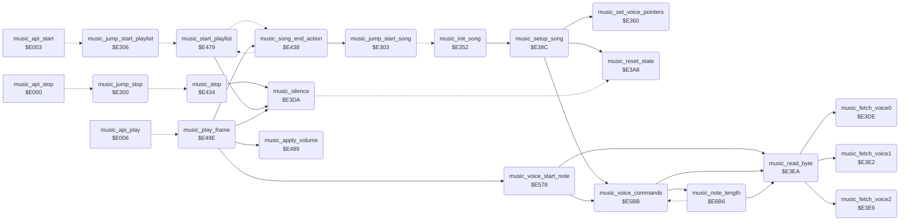

<!-- Generated by c64-docs from knowledge revision 20261017T121733.607-wszjh3 and src/source-map.json. Do not edit: change the knowledge, generate the source again, then run generate.ts. -->
# music_player.asm: Music player code (Micropearl music player by John A. Fitzpatrick, 1983)

Range `$E300-$E7BD`. Source: [music_player.asm](../../../src/music_player.asm). Index: [the reference](../index.md).

## Call graph

A solid arrow is a call, a thick arrow a table entry, a dotted arrow a jump. Rounded nodes are in this file.

## Data

| Range | Type | Name | Read by | Written by |
|---|---|---|---|---|
| [`$E300`](../../../src/music_player.asm#L7)-`$E308` | jumps | [`music_jump_stop`](../../../src/music_player.asm#L6) |  |  |
| [`$E309`](../../../src/music_player.asm#L13)-`$E314` | bytes | [`music_song`](../../../src/music_player.asm#L12) | [`music_set_voice_pointers`](music_player.md#music_set_voice_pointers), [`music_reset_state`](music_player.md#music_reset_state), [`music_song_end_action`](music_player.md#music_song_end_action), [`music_apply_volume`](music_player.md#music_apply_volume), [`music_play_frame`](music_player.md#music_play_frame), [`music_voice_commands`](music_player.md#music_voice_commands), [`music_note_length`](music_player.md#music_note_length) | [`start_attract_demo`](title_demo_start.md#start_attract_demo), [`show_title_screen`](title_demo_start.md#show_title_screen), [`music_init_song`](music_player.md#music_init_song), [`music_reset_state`](music_player.md#music_reset_state), [`music_song_end_action`](music_player.md#music_song_end_action), [`music_apply_volume`](music_player.md#music_apply_volume), [`music_voice_commands`](music_player.md#music_voice_commands), [`music_note_length`](music_player.md#music_note_length) |
| [`$E315`](../../../src/music_player.asm#L39)-`$E351` | petscii | [`music_player_credit`](../../../src/music_player.asm#L38) |  |  |
| [`$E5E8`](../../../src/music_player.asm#L447)-`$E5FC` | jumps | [`music_cmd_jumps`](../../../src/music_player.asm#L446) |  |  |
| [`$E68B`](../../../src/music_player.asm#L537)-`$E68D` | bytes | [`music_envelope_offsets`](../../../src/music_player.asm#L536) |  |  |
| [`$E6F9`](../../../src/music_player.asm#L612)-`$E718` | bytes of 16 | [`music_length_table`](../../../src/music_player.asm#L611) |  |  |
| [`$E719`](../../../src/music_player.asm#L615)-`$E71B` | bytes | [`sid_voice_offsets`](../../../src/music_player.asm#L614) |  |  |
| [`$E71C`](../../../src/music_player.asm#L617)-`$E71F` | bytes | [`music_waveforms`](../../../src/music_player.asm#L616) |  |  |

## Names

### [`music_jump_stop`](../../../src/music_player.asm#L6) `$E300`

*routine*

Internal jump table of the music player: stop, start the current song, start the playlist.

- **Jumped to from:** [`music_api_stop`](music_player_state.md#music_api_stop) [`$E000`](../../../src/music_player_state.asm#L10)
- **Entry of:** [`music_api_stop`](../tables.md#music_api_stop)
- **Jumps to:** [`music_stop`](music_player.md#music_stop)

### [`music_jump_start_song`](../../../src/music_player.asm#L8) `$E303`

*routine*

- **Called from:** [`music_song_end_action`](music_player.md#music_song_end_action) [`$E458`](../../../src/music_player.asm#L228)
- **Jumps to:** [`music_init_song`](music_player.md#music_init_song)

### [`music_jump_start_playlist`](../../../src/music_player.asm#L10) `$E306`

*routine*

- **Jumped to from:** [`music_api_start`](music_player_state.md#music_api_start) [`$E003`](../../../src/music_player_state.asm#L12)
- **Entry of:** [`music_api_stop`](../tables.md#music_api_stop)
- **Jumps to:** [`music_start_playlist`](music_player.md#music_start_playlist)

### [`music_song`](../../../src/music_player.asm#L12) `$E309`

*variable*

song number being played (0 = title tune)

- **Read by:** [`music_set_voice_pointers`](music_player.md#music_set_voice_pointers) [`$E360`](../../../src/music_player.asm#L54), [`music_song_end_action`](music_player.md#music_song_end_action) [`$E445`](../../../src/music_player.asm#L217)
- **Written by:** [`music_song_end_action`](music_player.md#music_song_end_action) [`$E455`](../../../src/music_player.asm#L227)

### [`music_stop_request`](../../../src/music_player.asm#L14) `$E30A`

*variable*

nonzero: music_play_frame silences the SID and stops

- **Read by:** [`music_play_frame`](music_player.md#music_play_frame) [`$E49E`](../../../src/music_player.asm#L280)
- **Written by:** [`start_attract_demo`](title_demo_start.md#start_attract_demo) [`$0547`](../../../src/title_demo_start.asm#L44), [`show_title_screen`](title_demo_start.md#show_title_screen) [`$0726`](../../../src/title_demo_start.asm#L294), [`music_reset_state`](music_player.md#music_reset_state) [`$E3C5`](../../../src/music_player.asm#L118)

### [`music_song_ended`](../../../src/music_player.asm#L16) `$E30B`

*variable*

set to 1 when a voice reaches its $FF end byte; nothing reads it

- **Written by:** [`music_reset_state`](music_player.md#music_reset_state) [`$E3C2`](../../../src/music_player.asm#L114), [`music_voice_commands`](music_player.md#music_voice_commands) [`$E5CC`](../../../src/music_player.asm#L426)

### [`music_playing`](../../../src/music_player.asm#L18) `$E30C`

*variable*

1 = the song plays, 0 = stopped (also 0 while a song is set up)

- **Read by:** [`music_play_frame`](music_player.md#music_play_frame) [`$E4A3`](../../../src/music_player.asm#L282)
- **Written by:** [`music_init_song`](music_player.md#music_init_song) [`$E354`](../../../src/music_player.asm#L45), [`music_init_song`](music_player.md#music_init_song) [`$E35C`](../../../src/music_player.asm#L48), [`music_reset_state`](music_player.md#music_reset_state) [`$E3CB`](../../../src/music_player.asm#L120)

### [`music_tempo`](../../../src/music_player.asm#L20) `$E30D`

*variable*

frames per tick, set by command $E0

- **Read by:** [`music_reset_state`](music_player.md#music_reset_state) [`$E3BB`](../../../src/music_player.asm#L111), [`music_play_frame`](music_player.md#music_play_frame) [`$E4C3`](../../../src/music_player.asm#L300)
- **Written by:** [`music_note_length`](music_player.md#music_note_length) [`$E7B5`](../../../src/music_player.asm#L702)

### [`music_end_marker`](../../../src/music_player.asm#L22) `$E30E`

*variable*

$FF when a voice has reached its end byte; then music_end_action decides

- **Read by:** [`music_play_frame`](music_player.md#music_play_frame) [`$E4A9`](../../../src/music_player.asm#L287)
- **Written by:** [`music_reset_state`](music_player.md#music_reset_state) [`$E3C8`](../../../src/music_player.asm#L119), [`music_voice_commands`](music_player.md#music_voice_commands) [`$E5D1`](../../../src/music_player.asm#L428)

### [`music_filter_mode`](../../../src/music_player.asm#L24) `$E30F`

*variable*

filter mode bits for the high nibble of $D418

- **Read by:** [`music_apply_volume`](music_player.md#music_apply_volume) [`$E489`](../../../src/music_player.asm#L267)
- **Written by:** [`music_reset_state`](music_player.md#music_reset_state) [`$E3AA`](../../../src/music_player.asm#L103), [`music_note_length`](music_player.md#music_note_length) [`$E798`](../../../src/music_player.asm#L689)

### [`music_volume_voice`](../../../src/music_player.asm#L26) `$E310`

*variable*

voice number + 1 whose next note writes $D418/$D417; 0 = nothing pending

- **Read by:** [`music_play_frame`](music_player.md#music_play_frame) [`$E4E2`](../../../src/music_player.asm#L312), [`music_play_frame`](music_player.md#music_play_frame) [`$E51C`](../../../src/music_player.asm#L339), [`music_play_frame`](music_player.md#music_play_frame) [`$E556`](../../../src/music_player.asm#L366)
- **Written by:** [`music_apply_volume`](music_player.md#music_apply_volume) [`$E49A`](../../../src/music_player.asm#L273), [`music_voice_commands`](music_player.md#music_voice_commands) [`$E621`](../../../src/music_player.asm#L476), [`music_note_length`](music_player.md#music_note_length) [`$E79F`](../../../src/music_player.asm#L692)

### [`music_volume`](../../../src/music_player.asm#L28) `$E311`

*variable*

master volume (low nibble of $D418), set by command $9x

- **Read by:** [`music_apply_volume`](music_player.md#music_apply_volume) [`$E48C`](../../../src/music_player.asm#L268)
- **Written by:** [`music_voice_commands`](music_player.md#music_voice_commands) [`$E61A`](../../../src/music_player.asm#L473)

### [`music_temp`](../../../src/music_player.asm#L30) `$E312-$E313`

*variable*

scratch byte of the player

- **Read by:** [`music_voice_commands`](music_player.md#music_voice_commands) [`$E6AC`](../../../src/music_player.asm#L555), [`music_note_length`](music_player.md#music_note_length) [`$E6DD`](../../../src/music_player.asm#L590), [`music_note_length`](music_player.md#music_note_length) [`$E6E4`](../../../src/music_player.asm#L594), [`music_note_length`](music_player.md#music_note_length) [`$E6F4`](../../../src/music_player.asm#L605), [`music_note_length`](music_player.md#music_note_length) [`$E7A9`](../../../src/music_player.asm#L696)
- **Written by:** [`music_voice_commands`](music_player.md#music_voice_commands) [`$E6A1`](../../../src/music_player.asm#L551), [`music_note_length`](music_player.md#music_note_length) [`$E6D6`](../../../src/music_player.asm#L587), [`music_note_length`](music_player.md#music_note_length) [`$E6ED`](../../../src/music_player.asm#L601), [`music_note_length`](music_player.md#music_note_length) [`$E7A5`](../../../src/music_player.asm#L694)

### [`music_end_action`](../../../src/music_player.asm#L35) `$E314`

*variable*

What happens when the song ends (the title code sets 3): 0 = stop; bit 7 set = play song (value AND $7F); bit 1 set = take the next playlist entry (bit 0 set = restart the playlist at its end, clear = stop); else play the next song number (after music_last_song: bit 0 set = song 0, clear = stop).

- **Read by:** [`music_play_frame`](music_player.md#music_play_frame) [`$E4B0`](../../../src/music_player.asm#L290)
- **Written by:** [`show_title_screen`](title_demo_start.md#show_title_screen) [`$06CE`](../../../src/title_demo_start.asm#L236)

### [`music_player_credit`](../../../src/music_player.asm#L38) `$E315-$E351`

*data*

Text in the player: " MICROPEARL MUSIC PLAYER  COPYRIGHT 1983 JOHN A. FITZPATRICK ". Nothing reads it.

### [`music_init_song`](../../../src/music_player.asm#L43) `$E352`

*routine*

Starts song music_song: clears music_playing, sets the song up (music_setup_song) and sets music_playing to 1. Reached through music_jump_start_song from the playlist code.

- **Jumped to from:** [`music_jump_start_song`](music_player.md#music_jump_start_song) [`$E303`](../../../src/music_player.asm#L9)
- **Entry of:** [`music_jump_stop`](../tables.md#music_jump_stop)
- **Calls:** [`music_setup_song`](music_player.md#music_setup_song)
- **Writes:** [`music_playing`](music_player.md#music_playing)

### [`music_set_voice_pointers`](../../../src/music_player.asm#L53) `$E360`

*routine*

Copies the three voice stream addresses of song music_song (limited to music_last_song) from music_song_table (8 bytes per song) into the operands of music_fetch_voice0/1/2 (music_fetch_voice0_src, music_fetch_voice1_src, music_fetch_voice2_src). X steps 0,1, 4,5, 8,9.

- **Called from:** [`music_setup_song`](music_player.md#music_setup_song) [`$E38C`](../../../src/music_player.asm#L86)
- **Reads:** [`music_song`](music_player.md#music_song), [`music_last_song`](music_data.md#music_last_song), [`music_song1_voices`](music_songs.md#music_song1_voices), [`music_song1_voices+2`](music_songs.md#music_song1_voices), [`music_song1_voices+1`](music_songs.md#music_song1_voices), [`music_song1_voices+3`](music_songs.md#music_song1_voices)
- **Writes:** [`music_fetch_voice0_src`](music_player.md#music_fetch_voice0_src), [`music_fetch_voice1_src`](music_player.md#music_fetch_voice1_src), [`music_fetch_voice0_src_hi`](music_player.md#music_fetch_voice0_src_hi), [`music_fetch_voice1_src_hi`](music_player.md#music_fetch_voice1_src_hi)
- **Refers to:** [`music_song_table`](music_songs.md#music_song_table), [`music_fetch_voice0_src`](music_player.md#music_fetch_voice0_src)

### [`music_set_voice_pointers_index`](../../../src/music_player.asm#L59) `$E36B`

*label*

song * 8 = offset in music_song_table

- **Jumped to from:** [`music_set_voice_pointers`](music_player.md#music_set_voice_pointers) [`$E366`](../../../src/music_player.asm#L56)

### [`music_set_voice_pointers_loop`](../../../src/music_player.asm#L65) `$E371`

*label*

- **Jumped to from:** [`music_set_voice_pointers`](music_player.md#music_set_voice_pointers) [`$E385`](../../../src/music_player.asm#L77)

### [`music_setup_song`](../../../src/music_player.asm#L85) `$E38C`

*routine*

Sets up the current song: voice stream pointers, reset of the voice state and the SID, then for each voice reads the commands before its first note (music_voice_commands with music_lookahead = $FF).

- **Called from:** [`music_init_song`](music_player.md#music_init_song) [`$E357`](../../../src/music_player.asm#L46)
- **Calls:** [`music_set_voice_pointers`](music_player.md#music_set_voice_pointers), [`music_reset_state`](music_player.md#music_reset_state), [`music_voice_commands`](music_player.md#music_voice_commands)
- **Reads:** [`music_voice`](music_voice_state.md#music_voice)
- **Writes:** [`music_voice`](music_voice_state.md#music_voice), [`music_lookahead`](music_voice_state.md#music_lookahead)

### [`music_setup_song_voice_loop`](../../../src/music_player.asm#L89) `$E394`

*label*

- **Jumped to from:** [`music_setup_song`](music_player.md#music_setup_song) [`$E3A5`](../../../src/music_player.asm#L97)

### [`music_reset_state`](../../../src/music_player.asm#L101) `$E3A8`

*routine*

Resets the player: filter mode and resonance 0, voice state from music_voice_init, tempo counter from music_tempo, then falls into music_clear_and_silence with A = 0.

- **Called from:** [`music_setup_song`](music_player.md#music_setup_song) [`$E38F`](../../../src/music_player.asm#L87)
- **Reads:** [`music_voice_init+44`](music_frequency_table.md#music_voice_init), [`music_voice_init+45`](music_frequency_table.md#music_voice_init), [`music_tempo`](music_player.md#music_tempo)
- **Writes:** [`music_filter_mode`](music_player.md#music_filter_mode), [`music_resonance`](music_frequency_table.md#music_resonance), [`music_envelopes+16`](music_voice_state.md#music_envelopes), [`music_envelopes+17`](music_voice_state.md#music_envelopes), [`music_tempo_counter`](music_voice_state.md#music_tempo_counter), [`music_song_ended`](music_player.md#music_song_ended), [`music_stop_request`](music_player.md#music_stop_request), [`music_end_marker`](music_player.md#music_end_marker), [`music_playing`](music_player.md#music_playing), [`music_transpose`](music_voice_state.md#music_transpose), [`CUTHI`](../variables.md#CUTHI), [`RESON`](../variables.md#RESON)
- **Refers to:** [`music_voice_init`](music_frequency_table.md#music_voice_init), [`music_transpose`](music_voice_state.md#music_transpose)

### [`music_reset_state_copy`](../../../src/music_player.asm#L106) `$E3B2`

*label*

- **Jumped to from:** [`music_reset_state`](music_player.md#music_reset_state) [`$E3B9`](../../../src/music_player.asm#L110)

### [`music_clear_and_silence`](../../../src/music_player.asm#L117) `$E3C5`

*label*

Stores A into music_stop_request, music_end_marker, music_playing and music_transpose, and zeroes the SID registers $D400-$D417 (the volume register $D418 keeps its value).

- **Jumped to from:** [`music_silence`](music_player.md#music_silence) [`$E3DC`](../../../src/music_player.asm#L131)

### [`music_clear_sid_loop`](../../../src/music_player.asm#L123) `$E3D3`

*label*

- **Jumped to from:** [`music_reset_state`](music_player.md#music_reset_state) [`$E3D7`](../../../src/music_player.asm#L126)

### [`music_silence`](../../../src/music_player.asm#L129) `$E3DA`

*routine*

Stops the music: clears the player flags and the SID voice and filter registers (A = 0).

- **Called from:** [`music_stop`](music_player.md#music_stop) [`$E434`](../../../src/music_player.asm#L200), [`music_start_playlist`](music_player.md#music_start_playlist) [`$E486`](../../../src/music_player.asm#L263), [`music_play_frame`](music_player.md#music_play_frame) [`$E4BB`](../../../src/music_player.asm#L296)
- **Jumps to:** [`music_clear_and_silence`](music_player.md#music_clear_and_silence)

### [`music_fetch_voice0`](../../../src/music_player.asm#L135) `$E3DE`

*routine*

LDA abs / RTS fetch routines, one per voice. Their operands are the stream read positions: music_set_voice_pointers sets them and music_read_byte increments them (self-modified code). The operands in the program are positions left from an earlier play of the title tune.
operand music_fetch_voice0_src = stream pointer of voice 0: set by music_set_voice_pointers, advanced by music_read_byte

- **Called from:** [`music_read_byte`](music_player.md#music_read_byte) [`$E408`](../../../src/music_player.asm#L173), [`music_read_byte`](music_player.md#music_read_byte) [`$E415`](../../../src/music_player.asm#L180)
- **Reads:** [`music_title_voice0+16`](music_songs.md#music_title_voice0)
- **Refers to:** [`music_title_voice0`](music_songs.md#music_title_voice0)

### [`music_fetch_voice0_src`](../../../src/music_player.asm#L136) `$E3DF`

*label*

- **Read by:** [`music_read_byte`](music_player.md#music_read_byte) [`$E40C`](../../../src/music_player.asm#L175)
- **Written by:** [`music_set_voice_pointers`](music_player.md#music_set_voice_pointers) [`$E376`](../../../src/music_player.asm#L69), [`music_read_byte`](music_player.md#music_read_byte) [`$E40C`](../../../src/music_player.asm#L175)
- **Referred to by:** [`music_set_voice_pointers`](music_player.md#music_set_voice_pointers) [`$E37E`](../../../src/music_player.asm#L73)

### [`music_fetch_voice0_src_hi`](../../../src/music_player.asm#L137) `$E3E0`

*label*

- **Read by:** [`music_read_byte`](music_player.md#music_read_byte) [`$E411`](../../../src/music_player.asm#L177)
- **Written by:** [`music_set_voice_pointers`](music_player.md#music_set_voice_pointers) [`$E37E`](../../../src/music_player.asm#L73), [`music_read_byte`](music_player.md#music_read_byte) [`$E411`](../../../src/music_player.asm#L177)

### [`music_fetch_voice1`](../../../src/music_player.asm#L140) `$E3E2`

*routine*

operand music_fetch_voice1_src = stream pointer of voice 1: set by music_set_voice_pointers, advanced by music_read_byte

- **Called from:** [`music_read_byte`](music_player.md#music_read_byte) [`$E41E`](../../../src/music_player.asm#L186), [`music_read_byte`](music_player.md#music_read_byte) [`$E42B`](../../../src/music_player.asm#L193)
- **Reads:** [`music_title_voice1+11`](music_songs.md#music_title_voice1)
- **Refers to:** [`music_title_voice1`](music_songs.md#music_title_voice1)

### [`music_fetch_voice1_src`](../../../src/music_player.asm#L141) `$E3E3`

*label*

- **Read by:** [`music_read_byte`](music_player.md#music_read_byte) [`$E422`](../../../src/music_player.asm#L188)
- **Written by:** [`music_set_voice_pointers`](music_player.md#music_set_voice_pointers) [`$E376`](../../../src/music_player.asm#L69), [`music_read_byte`](music_player.md#music_read_byte) [`$E422`](../../../src/music_player.asm#L188)

### [`music_fetch_voice1_src_hi`](../../../src/music_player.asm#L142) `$E3E4`

*label*

- **Read by:** [`music_read_byte`](music_player.md#music_read_byte) [`$E427`](../../../src/music_player.asm#L190)
- **Written by:** [`music_set_voice_pointers`](music_player.md#music_set_voice_pointers) [`$E37E`](../../../src/music_player.asm#L73), [`music_read_byte`](music_player.md#music_read_byte) [`$E427`](../../../src/music_player.asm#L190)

### [`music_fetch_voice2`](../../../src/music_player.asm#L145) `$E3E6`

*routine*

operand music_fetch_voice2_src = stream pointer of voice 2: set by music_set_voice_pointers, advanced by music_read_byte

- **Called from:** [`music_read_byte`](music_player.md#music_read_byte) [`$E3F2`](../../../src/music_player.asm#L159), [`music_read_byte`](music_player.md#music_read_byte) [`$E3FF`](../../../src/music_player.asm#L167)
- **Reads:** [`music_title_voice2+11`](music_songs.md#music_title_voice2)
- **Refers to:** [`music_title_voice2`](music_songs.md#music_title_voice2)

### [`music_fetch_voice2_src`](../../../src/music_player.asm#L146) `$E3E7`

*label*

- **Read by:** [`music_read_byte`](music_player.md#music_read_byte) [`$E3F6`](../../../src/music_player.asm#L161)
- **Written by:** [`music_read_byte`](music_player.md#music_read_byte) [`$E3F6`](../../../src/music_player.asm#L161)

### [`music_fetch_voice2_src_hi`](../../../src/music_player.asm#L147) `$E3E8`

*label*

- **Read by:** [`music_read_byte`](music_player.md#music_read_byte) [`$E3FB`](../../../src/music_player.asm#L164)
- **Written by:** [`music_read_byte`](music_player.md#music_read_byte) [`$E3FB`](../../../src/music_player.asm#L164)

### [`music_read_byte`](../../../src/music_player.asm#L153) `$E3EA`

*routine*

Reads the next byte of the stream of voice music_voice and advances the stream. Output: A = the byte, N and Z flags from it; music_lookahead = the byte after it. Uses the self-modified fetch routines music_fetch_voice0/1/2.

- **Called from:** [`music_voice_start_note`](music_player.md#music_voice_start_note) [`$E57B`](../../../src/music_player.asm#L388), [`music_voice_commands`](music_player.md#music_voice_commands) [`$E5C3`](../../../src/music_player.asm#L422), [`music_note_length`](music_player.md#music_note_length) [`$E75E`](../../../src/music_player.asm#L658), [`music_note_length`](music_player.md#music_note_length) [`$E76A`](../../../src/music_player.asm#L662), [`music_note_length`](music_player.md#music_note_length) [`$E7A2`](../../../src/music_player.asm#L693), [`music_note_length`](music_player.md#music_note_length) [`$E7B2`](../../../src/music_player.asm#L701)
- **Calls:** [`music_fetch_voice2`](music_player.md#music_fetch_voice2), [`music_fetch_voice0`](music_player.md#music_fetch_voice0), [`music_fetch_voice1`](music_player.md#music_fetch_voice1)
- **Reads:** [`music_voice`](music_voice_state.md#music_voice), [`music_fetch_voice2_src`](music_player.md#music_fetch_voice2_src), [`music_fetch_voice2_src_hi`](music_player.md#music_fetch_voice2_src_hi), [`music_fetch_voice0_src`](music_player.md#music_fetch_voice0_src), [`music_fetch_voice0_src_hi`](music_player.md#music_fetch_voice0_src_hi), [`music_fetch_voice1_src`](music_player.md#music_fetch_voice1_src), [`music_fetch_voice1_src_hi`](music_player.md#music_fetch_voice1_src_hi)
- **Writes:** [`music_fetch_voice2_src`](music_player.md#music_fetch_voice2_src), [`music_fetch_voice2_src_hi`](music_player.md#music_fetch_voice2_src_hi), [`music_lookahead`](music_voice_state.md#music_lookahead), [`music_fetch_voice0_src`](music_player.md#music_fetch_voice0_src), [`music_fetch_voice0_src_hi`](music_player.md#music_fetch_voice0_src_hi), [`music_fetch_voice1_src`](music_player.md#music_fetch_voice1_src), [`music_fetch_voice1_src_hi`](music_player.md#music_fetch_voice1_src_hi)

### [`music_read_byte_voice2`](../../../src/music_player.asm#L158) `$E3F2`

*label*

### [`music_read_byte_voice2_peek`](../../../src/music_player.asm#L165) `$E3FE`

*label*

- **Jumped to from:** [`music_read_byte`](music_player.md#music_read_byte) [`$E3F9`](../../../src/music_player.asm#L162)

### [`music_read_byte_voice0`](../../../src/music_player.asm#L172) `$E408`

*label*

- **Jumped to from:** [`music_read_byte`](music_player.md#music_read_byte) [`$E3ED`](../../../src/music_player.asm#L155)

### [`music_read_byte_voice0_peek`](../../../src/music_player.asm#L178) `$E414`

*label*

- **Jumped to from:** [`music_read_byte`](music_player.md#music_read_byte) [`$E40F`](../../../src/music_player.asm#L176)

### [`music_read_byte_voice1`](../../../src/music_player.asm#L185) `$E41E`

*label*

- **Jumped to from:** [`music_read_byte`](music_player.md#music_read_byte) [`$E3F0`](../../../src/music_player.asm#L157)

### [`music_read_byte_voice1_peek`](../../../src/music_player.asm#L191) `$E42A`

*label*

- **Jumped to from:** [`music_read_byte`](music_player.md#music_read_byte) [`$E425`](../../../src/music_player.asm#L189)

### [`music_stop`](../../../src/music_player.asm#L199) `$E434`

*routine*

Stop entry (music_api_stop): silences the SID and clears the player flags.

- **Jumped to from:** [`music_jump_stop`](music_player.md#music_jump_stop) [`$E300`](../../../src/music_player.asm#L7)
- **Entry of:** [`music_jump_stop`](../tables.md#music_jump_stop)
- **Calls:** [`music_silence`](music_player.md#music_silence)

### [`music_song_end_action`](../../../src/music_player.asm#L205) `$E438`

*routine*

Chooses what plays after a song ends. Input: Y = music_end_action (nonzero). Bit 7: play song Y AND $7F. Bit 1: next playlist entry. Else: next song number; after the last song, bit 0 set wraps to song 0, clear stops. Called from music_play_frame.

- **Called from:** [`music_play_frame`](music_player.md#music_play_frame) [`$E4B5`](../../../src/music_player.asm#L292)
- **Calls:** [`music_jump_start_song`](music_player.md#music_jump_start_song)
- **Jumps to:** [`music_end_stop`](music_player.md#music_end_stop), [`music_playlist_restart`](music_player.md#music_playlist_restart)
- **Reads:** [`music_song`](music_player.md#music_song), [`music_last_song`](music_data.md#music_last_song), [`music_playlist_pos`](music_data.md#music_playlist_pos), [`music_playlist_end`](music_data.md#music_playlist_end)
- **Writes:** [`music_song`](music_player.md#music_song), [`music_transpose`](music_voice_state.md#music_transpose), [`music_playlist_pos`](music_data.md#music_playlist_pos)

### [`music_end_check_playlist`](../../../src/music_player.asm#L212) `$E441`

*label*

bit 1: continue the playlist

- **Jumped to from:** [`music_song_end_action`](music_player.md#music_song_end_action) [`$E439`](../../../src/music_player.asm#L207)

### [`music_end_next_song`](../../../src/music_player.asm#L215) `$E445`

*label*

### [`music_end_wrap_song`](../../../src/music_player.asm#L224) `$E454`

*label*

- **Jumped to from:** [`music_song_end_action`](music_player.md#music_song_end_action) [`$E44B`](../../../src/music_player.asm#L219)

### [`music_start_song_x`](../../../src/music_player.asm#L226) `$E455`

*label*

start song X

- **Jumped to from:** [`music_song_end_action`](music_player.md#music_song_end_action) [`$E43E`](../../../src/music_player.asm#L211), [`music_song_end_action`](music_player.md#music_song_end_action) [`$E476`](../../../src/music_player.asm#L250)

### [`music_playlist_next`](../../../src/music_player.asm#L229) `$E45B`

*label*

- **Jumped to from:** [`music_song_end_action`](music_player.md#music_song_end_action) [`$E443`](../../../src/music_player.asm#L214)

### [`music_playlist_read`](../../../src/music_player.asm#L233) `$E45E`

*label*

Playlist entry: $00-$3F = song number; $40-$7F = transpose (value AND $3F), then the next entry; $80-$FF = end of the playlist. The transpose has no effect: music_reset_state clears it.

- **Jumped to from:** [`music_song_end_action`](music_player.md#music_song_end_action) [`$E46D`](../../../src/music_player.asm#L244), [`music_start_playlist`](music_player.md#music_start_playlist) [`$E484`](../../../src/music_player.asm#L260)

### [`music_playlist_song`](../../../src/music_player.asm#L245) `$E470`

*label*

- **Jumped to from:** [`music_song_end_action`](music_player.md#music_song_end_action) [`$E464`](../../../src/music_player.asm#L237)

### [`music_start_playlist`](../../../src/music_player.asm#L253) `$E479`

*routine*

Start entry (music_api_start): starts the playlist at music_playlist_start (Y = 1 = loop). Also the end-of-playlist path of music_song_end_action with Y = music_end_action.

- **Jumped to from:** [`music_jump_start_playlist`](music_player.md#music_jump_start_playlist) [`$E306`](../../../src/music_player.asm#L11)
- **Entry of:** [`music_jump_stop`](../tables.md#music_jump_stop)
- **Calls:** [`music_silence`](music_player.md#music_silence)
- **Jumps to:** [`music_playlist_read`](music_player.md#music_playlist_read)
- **Reads:** [`music_playlist_start`](music_data.md#music_playlist_start)
- **Writes:** [`music_playlist_pos`](music_data.md#music_playlist_pos)

### [`music_playlist_restart`](../../../src/music_player.asm#L255) `$E47B`

*label*

- **Jumped to from:** [`music_song_end_action`](music_player.md#music_song_end_action) [`$E461`](../../../src/music_player.asm#L235)

### [`music_end_stop`](../../../src/music_player.asm#L261) `$E486`

*label*

- **Jumped to from:** [`music_song_end_action`](music_player.md#music_song_end_action) [`$E452`](../../../src/music_player.asm#L223)

### [`music_apply_volume`](../../../src/music_player.asm#L266) `$E489`

*routine*

Writes $D418 = music_filter_mode OR music_volume and $D417 = music_resonance, and clears music_volume_voice. Called when the voice named in music_volume_voice starts its next note.

- **Called from:** [`music_play_frame`](music_player.md#music_play_frame) [`$E4E9`](../../../src/music_player.asm#L316), [`music_play_frame`](music_player.md#music_play_frame) [`$E523`](../../../src/music_player.asm#L343), [`music_play_frame`](music_player.md#music_play_frame) [`$E55D`](../../../src/music_player.asm#L369)
- **Reads:** [`music_filter_mode`](music_player.md#music_filter_mode), [`music_volume`](music_player.md#music_volume), [`music_resonance`](music_frequency_table.md#music_resonance)
- **Writes:** [`SIGVOL`](../variables.md#SIGVOL), [`RESON`](../variables.md#RESON), [`music_volume_voice`](music_player.md#music_volume_voice)

### [`music_play_frame`](../../../src/music_player.asm#L279) `$E49E`

*routine*

Per-frame music player (music_api_play, from the title screen IRQ). Stops on music_stop_request; does nothing while music_playing is 0; at the song end runs music_song_end_action. Every music_tempo frames (a tick) it updates the three voices: each tick counter counts down; at 0 the gate goes off (unless tied); when it reaches the end tick, the counters reload and music_voice_start_note plays the next note.

- **Jumped to from:** [`music_api_play`](music_player_state.md#music_api_play) [`$E006`](../../../src/music_player_state.asm#L14)
- **Entry of:** [`music_api_stop`](../tables.md#music_api_stop)
- **Calls:** [`music_song_end_action`](music_player.md#music_song_end_action), [`music_silence`](music_player.md#music_silence), [`music_apply_volume`](music_player.md#music_apply_volume), [`music_voice_start_note`](music_player.md#music_voice_start_note)
- **Reads:** [`music_stop_request`](music_player.md#music_stop_request), [`music_playing`](music_player.md#music_playing), [`music_end_marker`](music_player.md#music_end_marker), [`music_end_action`](music_player.md#music_end_action), [`music_tempo_counter`](music_voice_state.md#music_tempo_counter), [`music_tempo`](music_player.md#music_tempo), [`music_voice_ticks`](music_voice_state.md#music_voice_ticks), [`music_voice_end_tick`](music_voice_state.md#music_voice_end_tick), [`music_voice_gate_ticks`](music_voice_state.md#music_voice_gate_ticks), [`music_voice_end_reload`](music_voice_state.md#music_voice_end_reload), [`music_volume_voice`](music_player.md#music_volume_voice), [`music_voice_tie`](music_voice_state.md#music_voice_tie), [`music_voice_control`](music_voice_state.md#music_voice_control), [`music_voice_ticks+1`](music_voice_state.md#music_voice_ticks), [`music_voice_end_tick+1`](music_voice_state.md#music_voice_end_tick), [`music_voice_gate_ticks+1`](music_voice_state.md#music_voice_gate_ticks), [`music_voice_end_reload+1`](music_voice_state.md#music_voice_end_reload), [`music_voice_tie+1`](music_voice_state.md#music_voice_tie), [`music_voice_control+1`](music_voice_state.md#music_voice_control), [`music_voice_ticks+2`](music_voice_state.md#music_voice_ticks), [`music_voice_end_tick+2`](music_voice_state.md#music_voice_end_tick), [`music_voice_gate_ticks+2`](music_voice_state.md#music_voice_gate_ticks), [`music_voice_end_reload+2`](music_voice_state.md#music_voice_end_reload), [`music_voice_tie+2`](music_voice_state.md#music_voice_tie), [`music_voice_control+2`](music_voice_state.md#music_voice_control)
- **Writes:** [`music_tempo_counter`](music_voice_state.md#music_tempo_counter), [`music_voice_ticks`](music_voice_state.md#music_voice_ticks), [`music_voice_end_tick`](music_voice_state.md#music_voice_end_tick), [`VCREG1`](../variables.md#VCREG1), [`music_voice_ticks+1`](music_voice_state.md#music_voice_ticks), [`music_voice_end_tick+1`](music_voice_state.md#music_voice_end_tick), [`VCREG2`](../variables.md#VCREG2), [`music_voice_ticks+2`](music_voice_state.md#music_voice_ticks), [`music_voice_end_tick+2`](music_voice_state.md#music_voice_end_tick), [`VCREG3`](../variables.md#VCREG3)
- **Refers to:** [`music_voice_ticks`](music_voice_state.md#music_voice_ticks), [`music_voice_end_tick`](music_voice_state.md#music_voice_end_tick), [`music_voice_gate_ticks`](music_voice_state.md#music_voice_gate_ticks), [`music_voice_end_reload`](music_voice_state.md#music_voice_end_reload), [`music_voice_tie`](music_voice_state.md#music_voice_tie), [`music_voice_control`](music_voice_state.md#music_voice_control)

### [`music_play_frame_done`](../../../src/music_player.asm#L284) `$E4A8`

*label*

- **Jumped to from:** [`music_play_frame`](music_player.md#music_play_frame) [`$E4C1`](../../../src/music_player.asm#L299)

### [`music_play_frame_check_end`](../../../src/music_player.asm#L286) `$E4A9`

*label*

- **Jumped to from:** [`music_play_frame`](music_player.md#music_play_frame) [`$E4A6`](../../../src/music_player.asm#L283)

### [`music_play_frame_stop`](../../../src/music_player.asm#L294) `$E4BB`

*label*

- **Jumped to from:** [`music_play_frame`](music_player.md#music_play_frame) [`$E4A1`](../../../src/music_player.asm#L281), [`music_play_frame`](music_player.md#music_play_frame) [`$E4B3`](../../../src/music_player.asm#L291)

### [`music_play_frame_tick`](../../../src/music_player.asm#L297) `$E4BE`

*label*

- **Jumped to from:** [`music_play_frame`](music_player.md#music_play_frame) [`$E4AE`](../../../src/music_player.asm#L289)

### [`music_voice0_next_note`](../../../src/music_player.asm#L317) `$E4EC`

*label*

- **Jumped to from:** [`music_play_frame`](music_player.md#music_play_frame) [`$E4E7`](../../../src/music_player.asm#L314)

### [`music_voice0_check_gate`](../../../src/music_player.asm#L321) `$E4F4`

*label*

- **Jumped to from:** [`music_play_frame`](music_player.md#music_play_frame) [`$E4CC`](../../../src/music_player.asm#L304)

### [`music_voice1_update`](../../../src/music_player.asm#L329) `$E503`

*label*

Voice 1: same as voice 0 with the second entry of each array.

- **Jumped to from:** [`music_play_frame`](music_player.md#music_play_frame) [`$E4D4`](../../../src/music_player.asm#L307), [`music_play_frame`](music_player.md#music_play_frame) [`$E4F1`](../../../src/music_player.asm#L320), [`music_play_frame`](music_player.md#music_play_frame) [`$E4F4`](../../../src/music_player.asm#L322), [`music_play_frame`](music_player.md#music_play_frame) [`$E4F9`](../../../src/music_player.asm#L324)

### [`music_voice1_next_note`](../../../src/music_player.asm#L344) `$E526`

*label*

- **Jumped to from:** [`music_play_frame`](music_player.md#music_play_frame) [`$E521`](../../../src/music_player.asm#L341)

### [`music_voice1_check_gate`](../../../src/music_player.asm#L348) `$E52E`

*label*

- **Jumped to from:** [`music_play_frame`](music_player.md#music_play_frame) [`$E506`](../../../src/music_player.asm#L331)

### [`music_voice2_update`](../../../src/music_player.asm#L356) `$E53D`

*label*

Voice 2: same as voice 0 with the third entry of each array.

- **Jumped to from:** [`music_play_frame`](music_player.md#music_play_frame) [`$E50E`](../../../src/music_player.asm#L334), [`music_play_frame`](music_player.md#music_play_frame) [`$E52B`](../../../src/music_player.asm#L347), [`music_play_frame`](music_player.md#music_play_frame) [`$E52E`](../../../src/music_player.asm#L349), [`music_play_frame`](music_player.md#music_play_frame) [`$E533`](../../../src/music_player.asm#L351)

### [`music_voice2_next_note`](../../../src/music_player.asm#L370) `$E560`

*label*

- **Jumped to from:** [`music_play_frame`](music_player.md#music_play_frame) [`$E55B`](../../../src/music_player.asm#L368)

### [`music_voice2_check_gate`](../../../src/music_player.asm#L374) `$E568`

*label*

- **Jumped to from:** [`music_play_frame`](music_player.md#music_play_frame) [`$E540`](../../../src/music_player.asm#L358)

### [`music_play_frame_exit`](../../../src/music_player.asm#L381) `$E577`

*label*

- **Jumped to from:** [`music_play_frame`](music_player.md#music_play_frame) [`$E548`](../../../src/music_player.asm#L361), [`music_play_frame`](music_player.md#music_play_frame) [`$E565`](../../../src/music_player.asm#L373), [`music_play_frame`](music_player.md#music_play_frame) [`$E568`](../../../src/music_player.asm#L375), [`music_play_frame`](music_player.md#music_play_frame) [`$E56D`](../../../src/music_player.asm#L377)

### [`music_voice_start_note`](../../../src/music_player.asm#L386) `$E578`

*routine*

Plays the next note of voice X and runs the commands after it. Reads the note byte: 0 = rest (frequency 0, the gate stays as it is); else frequency = note + music_transpose from the note tables. Unless the voice is tied, writes AD, SR and control (gate on). Then music_voice_commands.

- **Called from:** [`music_play_frame`](music_player.md#music_play_frame) [`$E4EE`](../../../src/music_player.asm#L319), [`music_play_frame`](music_player.md#music_play_frame) [`$E528`](../../../src/music_player.asm#L346), [`music_play_frame`](music_player.md#music_play_frame) [`$E562`](../../../src/music_player.asm#L372)
- **Calls:** [`music_read_byte`](music_player.md#music_read_byte), [`music_voice_commands`](music_player.md#music_voice_commands)
- **Jumps to:** [`music_voice_commands`](music_player.md#music_voice_commands)
- **Reads:** [`music_voice`](music_voice_state.md#music_voice), [`music_transpose`](music_voice_state.md#music_transpose)
- **Writes:** [`music_voice`](music_voice_state.md#music_voice)
- **Refers to:** [`sid_voice_offsets`](music_player.md#sid_voice_offsets), [`FRELO1`](../variables.md#FRELO1), [`FREHI1`](../variables.md#FREHI1), [`note_freq_hi`](music_frequency_table.md#note_freq_hi), [`note_freq_lo`](music_frequency_table.md#note_freq_lo), [`music_voice_tie`](music_voice_state.md#music_voice_tie), [`music_voice_attack_decay`](music_voice_state.md#music_voice_attack_decay), [`ATDCY1`](../variables.md#ATDCY1), [`music_voice_sustain_release`](music_voice_state.md#music_voice_sustain_release), [`SUREL1`](../variables.md#SUREL1), [`music_voice_control`](music_voice_state.md#music_voice_control), [`VCREG1`](../variables.md#VCREG1)

### [`music_voice_set_freq`](../../../src/music_player.asm#L396) `$E590`

*label*

- **Jumped to from:** [`music_voice_start_note`](music_player.md#music_voice_start_note) [`$E585`](../../../src/music_player.asm#L392)

### [`music_voice_commands`](../../../src/music_player.asm#L417) `$E5BB`

*routine*

Runs the command bytes that follow in the stream of voice music_voice, until the next note byte (music_lookahead bit 7 clear). $FF ends the song (music_end_marker = $FF). Other commands go through music_cmd_offsets and the self-modified branch at music_cmd_branch to music_cmd_jumps; each handler returns here. Commands written before a note apply to that note.

- **Called from:** [`music_setup_song`](music_player.md#music_setup_song) [`$E39C`](../../../src/music_player.asm#L93), [`music_voice_start_note`](music_player.md#music_voice_start_note) [`$E58D`](../../../src/music_player.asm#L395)
- **Jumped to from:** [`music_voice_start_note`](music_player.md#music_voice_start_note) [`$E5A7`](../../../src/music_player.asm#L406)
- **Calls:** [`music_read_byte`](music_player.md#music_read_byte), [`music_note_length`](music_player.md#music_note_length)
- **Jumps to:** [`music_cmd_instrument`](music_player.md#music_cmd_instrument), [`music_cmd_pulse_width`](music_player.md#music_cmd_pulse_width), [`music_cmd_filter`](music_player.md#music_cmd_filter), [`music_cmd_tempo`](music_player.md#music_cmd_tempo)
- **Reads:** [`music_lookahead`](music_voice_state.md#music_lookahead), [`music_cmd_offsets+1`](music_frequency_table.md#music_cmd_offsets), [`music_voice`](music_voice_state.md#music_voice), [`music_temp`](music_player.md#music_temp)
- **Writes:** [`music_song_ended`](music_player.md#music_song_ended), [`music_end_marker`](music_player.md#music_end_marker), [`music_volume`](music_player.md#music_volume), [`music_volume_voice`](music_player.md#music_volume_voice), [`music_long_lengths`](music_frequency_table.md#music_long_lengths), [`music_temp`](music_player.md#music_temp)
- **Refers to:** [`music_voice_articulation`](music_voice_state.md#music_voice_articulation), [`music_voice_gate_ticks`](music_voice_state.md#music_voice_gate_ticks), [`music_voice_end_reload`](music_voice_state.md#music_voice_end_reload), [`music_waveforms`](music_player.md#music_waveforms), [`music_voice_control`](music_voice_state.md#music_voice_control), [`music_envelopes`](music_voice_state.md#music_envelopes), [`music_envelopes+4`](music_voice_state.md#music_envelopes), [`music_envelopes+5`](music_voice_state.md#music_envelopes), [`music_voice_sustain_release`](music_voice_state.md#music_voice_sustain_release), [`music_voice_attack_decay`](music_voice_state.md#music_voice_attack_decay), [`music_envelopes+2`](music_voice_state.md#music_envelopes), [`music_envelopes+3`](music_voice_state.md#music_envelopes), [`music_envelopes+1`](music_voice_state.md#music_envelopes), [`music_voice_tie`](music_voice_state.md#music_voice_tie)

### [`music_voice_read_command`](../../../src/music_player.asm#L421) `$E5C3`

*label*

- **Jumped to from:** [`music_voice_commands`](music_player.md#music_voice_commands) [`$E5BE`](../../../src/music_player.asm#L419)

### [`music_voice_dispatch`](../../../src/music_player.asm#L430) `$E5D7`

*label*

- **Jumped to from:** [`music_voice_commands`](music_player.md#music_voice_commands) [`$E5C8`](../../../src/music_player.asm#L424)

### [`music_cmd_branch`](../../../src/music_player.asm#L441) `$E5E6`

*label*

self-modified: offset from music_cmd_offsets, always taken (C = 0)

### [`music_cmd_offset`](../../../src/music_player.asm#L442) `$E5E7`

*label*

- **Written by:** [`music_voice_commands`](music_player.md#music_voice_commands) [`$E5E2`](../../../src/music_player.asm#L439)

### [`music_cmd_jumps`](../../../src/music_player.asm#L446) `$E5E8`

*label*

Command handlers: $8x length, $9x volume, $Ax voice option, $Bx instrument, $Cx pulse width, $Dx filter, $Ex tempo. Group $Fx has offset $15 and lands on music_cmd_length after the table.

- **Jumped to from:** [`music_voice_commands`](music_player.md#music_voice_commands) [`$E5E6`](../../../src/music_player.asm#L443)

### [`music_cmd_length`](../../../src/music_player.asm#L457) `$E5FD`

*label*

Command $8n (and $Fn): note length code n for the following notes; computes the gate and end ticks with the articulation of the voice (music_note_length).

- **Jumped to from:** [`music_voice_commands`](music_player.md#music_voice_commands) [`$E5E8`](../../../src/music_player.asm#L447)
- **Entry of:** [`music_cmd_jumps`](../tables.md#music_cmd_jumps)

### [`music_cmd_volume`](../../../src/music_player.asm#L470) `$E617`

*label*

Command $9n: master volume n; the voice's next note writes it to $D418 (music_volume_voice).

- **Jumped to from:** [`music_voice_commands`](music_player.md#music_voice_commands) [`$E5EB`](../../../src/music_player.asm#L448)
- **Entry of:** [`music_cmd_jumps`](../tables.md#music_cmd_jumps)

### [`music_cmd_length_set`](../../../src/music_player.asm#L479) `$E627`

*label*

Commands $AC-$AF: bit 0 selects the length table (1 = doubled lengths). Global for all voices.

- **Jumped to from:** [`music_voice_commands`](music_player.md#music_voice_commands) [`$E632`](../../../src/music_player.asm#L488)

### [`music_cmd_voice_option`](../../../src/music_player.asm#L486) `$E630`

*label*

Command $An: $A0-$A3 waveform (triangle, sawtooth, pulse, noise), $A4-$A6 articulation and its envelope, $A7/$A8 tie on/off, $A9/$AA ring modulation on/off, $AB pulse+triangle, $AC-$AF length table.

- **Jumped to from:** [`music_voice_commands`](music_player.md#music_voice_commands) [`$E5EE`](../../../src/music_player.asm#L449)
- **Entry of:** [`music_cmd_jumps`](../tables.md#music_cmd_jumps)

### [`music_cmd_store_waveform`](../../../src/music_player.asm#L498) `$E645`

*label*

- **Jumped to from:** [`music_voice_commands`](music_player.md#music_voice_commands) [`$E638`](../../../src/music_player.asm#L491)

### [`music_cmd_articulation`](../../../src/music_player.asm#L502) `$E64E`

*label*

- **Jumped to from:** [`music_voice_commands`](music_player.md#music_voice_commands) [`$E63F`](../../../src/music_player.asm#L495)

### [`music_cmd_store_envelope`](../../../src/music_player.asm#L519) `$E66D`

*label*

- **Jumped to from:** [`music_voice_commands`](music_player.md#music_voice_commands) [`$E67E`](../../../src/music_player.asm#L529), [`music_voice_commands`](music_player.md#music_voice_commands) [`$E688`](../../../src/music_player.asm#L534)

### [`music_cmd_envelope_art1`](../../../src/music_player.asm#L524) `$E677`

*label*

- **Jumped to from:** [`music_voice_commands`](music_player.md#music_voice_commands) [`$E664`](../../../src/music_player.asm#L515)

### [`music_cmd_envelope_art0`](../../../src/music_player.asm#L530) `$E681`

*label*

- **Jumped to from:** [`music_voice_commands`](music_player.md#music_voice_commands) [`$E662`](../../../src/music_player.asm#L514)

### [`music_envelope_offsets`](../../../src/music_player.asm#L536) `$E68B-$E68D`

*data*

Offset of each voice in music_envelopes: voice * 6.

- **Referred to by:** [`music_voice_commands`](music_player.md#music_voice_commands) [`$E65D`](../../../src/music_player.asm#L511)

### [`music_cmd_tie_or_ring`](../../../src/music_player.asm#L538) `$E68E`

*label*

- **Jumped to from:** [`music_voice_commands`](music_player.md#music_voice_commands) [`$E650`](../../../src/music_player.asm#L504)

### [`music_cmd_next`](../../../src/music_player.asm#L544) `$E69A`

*label*

next command

- **Jumped to from:** [`music_voice_commands`](music_player.md#music_voice_commands) [`$E6B2`](../../../src/music_player.asm#L557), [`music_note_length`](music_player.md#music_note_length) [`$E73D`](../../../src/music_player.asm#L639), [`music_note_length`](music_player.md#music_note_length) [`$E74C`](../../../src/music_player.asm#L647), [`music_note_length`](music_player.md#music_note_length) [`$E75B`](../../../src/music_player.asm#L655), [`music_note_length`](music_player.md#music_note_length) [`$E776`](../../../src/music_player.asm#L666), [`music_note_length`](music_player.md#music_note_length) [`$E7AF`](../../../src/music_player.asm#L698), [`music_note_length`](music_player.md#music_note_length) [`$E7BB`](../../../src/music_player.asm#L704)

### [`music_cmd_ring_mod`](../../../src/music_player.asm#L546) `$E69D`

*label*

- **Jumped to from:** [`music_voice_commands`](music_player.md#music_voice_commands) [`$E690`](../../../src/music_player.asm#L540)

### [`music_voice_commands_done`](../../../src/music_player.asm#L558) `$E6B5`

*label*

- **Jumped to from:** [`music_voice_commands`](music_player.md#music_voice_commands) [`$E5C0`](../../../src/music_player.asm#L420), [`music_voice_commands`](music_player.md#music_voice_commands) [`$E5D4`](../../../src/music_player.asm#L429)

### [`music_note_length`](../../../src/music_player.asm#L564) `$E6B6`

*routine*

Converts a length code into tick counts. Input: A = length code 0-15, Y = articulation. L = music_length_table[A + 16 * music_long_lengths]. Output: X = gate-on ticks, Y = end tick (minus the release ticks). Articulation 0: release L/8 (at least 1); 1: release L/2; 2: release 1 tick. The note lasts L ticks in each case.

- **Called from:** [`music_voice_commands`](music_player.md#music_voice_commands) [`$E606`](../../../src/music_player.asm#L462)
- **Calls:** [`music_read_byte`](music_player.md#music_read_byte)
- **Jumps to:** [`music_cmd_next`](music_player.md#music_cmd_next)
- **Reads:** [`music_long_lengths`](music_frequency_table.md#music_long_lengths), [`music_temp`](music_player.md#music_temp), [`music_voice`](music_voice_state.md#music_voice)
- **Writes:** [`music_temp`](music_player.md#music_temp), [`music_envelopes+12`](music_voice_state.md#music_envelopes), [`music_envelopes+13`](music_voice_state.md#music_envelopes), [`music_envelopes`](music_voice_state.md#music_envelopes), [`music_envelopes+1`](music_voice_state.md#music_envelopes), [`music_envelopes+6`](music_voice_state.md#music_envelopes), [`music_envelopes+7`](music_voice_state.md#music_envelopes), [`CUTLO`](../variables.md#CUTLO), [`CUTHI`](../variables.md#CUTHI), [`music_filter_mode`](music_player.md#music_filter_mode), [`music_volume_voice`](music_player.md#music_volume_voice), [`music_resonance`](music_frequency_table.md#music_resonance), [`music_tempo`](music_player.md#music_tempo), [`music_tempo_counter`](music_voice_state.md#music_tempo_counter)
- **Refers to:** [`music_instruments`](music_data.md#music_instruments), [`music_envelopes`](music_voice_state.md#music_envelopes), [`PWLO1`](../variables.md#PWLO1), [`PWHI1`](../variables.md#PWHI1)

### [`music_note_length_index`](../../../src/music_player.asm#L569) `$E6BE`

*label*

- **Jumped to from:** [`music_note_length`](music_player.md#music_note_length) [`$E6B9`](../../../src/music_player.asm#L566)

### [`music_note_length_normal`](../../../src/music_player.asm#L579) `$E6CC`

*label*

- **Jumped to from:** [`music_note_length`](music_player.md#music_note_length) [`$E6C2`](../../../src/music_player.asm#L573)

### [`music_note_length_normal_set`](../../../src/music_player.asm#L586) `$E6D6`

*label*

- **Jumped to from:** [`music_note_length`](music_player.md#music_note_length) [`$E6D2`](../../../src/music_player.asm#L584)

### [`music_note_length_staccato`](../../../src/music_player.asm#L597) `$E6E9`

*label*

- **Jumped to from:** [`music_note_length`](music_player.md#music_note_length) [`$E6C0`](../../../src/music_player.asm#L572)

### [`music_length_table`](../../../src/music_player.asm#L611) `$E6F9-$E718`

*data*

Note lengths in ticks, 2 rows of 16 (row 1 when music_long_lengths = 1). Codes: 0 whole, 1 half, 2 quarter, 3 eighth, 4 16th, 5 32nd, 8-13 the dotted values of 0-5; 6, 7, 14, 15 give 8 ticks. Row 0: 32 16 8 4 2 1 / 48 24 12 6 3 2. Row 1: 64 32 16 8 4 2 / 96 48 24 12 6 4.

- **Referred to by:** [`music_note_length`](music_player.md#music_note_length) [`$E6C4`](../../../src/music_player.asm#L574), [`music_note_length`](music_player.md#music_note_length) [`$E6CC`](../../../src/music_player.asm#L580), [`music_note_length`](music_player.md#music_note_length) [`$E6D9`](../../../src/music_player.asm#L588), [`music_note_length`](music_player.md#music_note_length) [`$E6E9`](../../../src/music_player.asm#L599)

### [`sid_voice_offsets`](../../../src/music_player.asm#L614) `$E719-$E71B`

*data*

offset of SID voice 1-3 registers from $D400

- **Referred to by:** [`music_voice_start_note`](music_player.md#music_voice_start_note) [`$E581`](../../../src/music_player.asm#L390), [`music_note_length`](music_player.md#music_note_length) [`$E764`](../../../src/music_player.asm#L660), [`music_note_length`](music_player.md#music_note_length) [`$E770`](../../../src/music_player.asm#L664)

### [`music_waveforms`](../../../src/music_player.asm#L616) `$E71C-$E71F`

*data*

control values of $A0-$A3: triangle, sawtooth, pulse, noise (gate on)

- **Referred to by:** [`music_voice_commands`](music_player.md#music_voice_commands) [`$E642`](../../../src/music_player.asm#L497)

### [`music_cmd_instrument`](../../../src/music_player.asm#L620) `$E720`

*label*

Command $Bn: copies the 6 envelope bytes of instrument n (music_instruments + n * 8) into the voice's part of music_envelopes. They take effect with the next articulation command $A4-$A6.

- **Jumped to from:** [`music_voice_commands`](music_player.md#music_voice_commands) [`$E5F1`](../../../src/music_player.asm#L450)
- **Entry of:** [`music_cmd_jumps`](../tables.md#music_cmd_jumps)

### [`music_cmd_instrument_voice2`](../../../src/music_player.asm#L632) `$E731`

*label*

- **Jumped to from:** [`music_note_length`](music_player.md#music_note_length) [`$E73B`](../../../src/music_player.asm#L638)

### [`music_cmd_instrument_voice0`](../../../src/music_player.asm#L640) `$E740`

*label*

- **Jumped to from:** [`music_note_length`](music_player.md#music_note_length) [`$E72C`](../../../src/music_player.asm#L629), [`music_note_length`](music_player.md#music_note_length) [`$E74A`](../../../src/music_player.asm#L646)

### [`music_cmd_instrument_voice1`](../../../src/music_player.asm#L648) `$E74F`

*label*

- **Jumped to from:** [`music_note_length`](music_player.md#music_note_length) [`$E72F`](../../../src/music_player.asm#L631), [`music_note_length`](music_player.md#music_note_length) [`$E759`](../../../src/music_player.asm#L654)

### [`music_cmd_pulse_width`](../../../src/music_player.asm#L657) `$E75E`

*label*

Command $Cx: the next two stream bytes (low, high) go to the pulse width registers of the voice.

- **Jumped to from:** [`music_voice_commands`](music_player.md#music_voice_commands) [`$E5F4`](../../../src/music_player.asm#L451)
- **Entry of:** [`music_cmd_jumps`](../tables.md#music_cmd_jumps)

### [`music_cmd_filter`](../../../src/music_player.asm#L670) `$E779`

*label*

Command $Dn: filter preset n (music_filter_presets): cutoff to $D415/$D416, mode to music_filter_mode; the next stream byte (voice routing bits) OR the preset resonance byte gives music_resonance. The voice's next note writes $D417/$D418. The title tune does not use it.

- **Jumped to from:** [`music_voice_commands`](music_player.md#music_voice_commands) [`$E5F7`](../../../src/music_player.asm#L453)
- **Entry of:** [`music_cmd_jumps`](../tables.md#music_cmd_jumps)

### [`music_cmd_tempo`](../../../src/music_player.asm#L700) `$E7B2`

*label*

Command $Ex: the next stream byte is the tempo in frames per tick (music_tempo).

- **Jumped to from:** [`music_voice_commands`](music_player.md#music_voice_commands) [`$E5FA`](../../../src/music_player.asm#L454)
- **Entry of:** [`music_cmd_jumps`](../tables.md#music_cmd_jumps)
