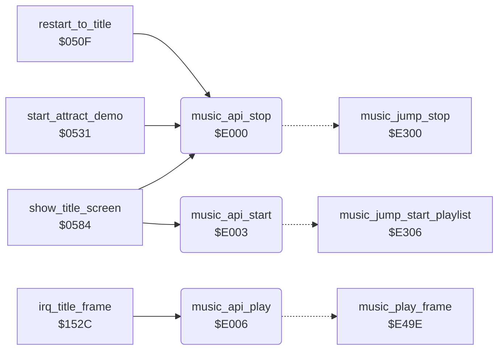

<!-- Generated by c64-docs from knowledge revision 20261017T105502.847-19cl2o and src/source-map.json. Do not edit: change the knowledge, generate the source again, then run generate.ts. -->
# music_player_state.asm: Music player: entry points, voice state, note frequency table and voice reset template

Range `$E000-$E2FF`. Source: [music_player_state.asm](../../../src/music_player_state.asm). Index: [the reference](../index.md).

## Call graph

A solid arrow is a call, a thick arrow a table entry, a dotted arrow a jump. Rounded nodes are in this file.

## Data

| Range | Type | Name | Read by | Written by |
|---|---|---|---|---|
| [`$E000`](../../../src/music_player_state.asm#L10)-`$E008` | jumps | [`music_api_stop`](../../../src/music_player_state.asm#L9) |  |  |
| [`$E009`](../../../src/music_player_state.asm#L17)-`$E0FF` | unused |  |  |  |
| [`$E100`](../../../src/music_player_state.asm#L51)-`$E130` | workspace | [`music_transpose`](../../../src/music_player_state.asm#L50) | [`music_setup_song`](music_player.md#music_setup_song), [`music_read_byte`](music_player.md#music_read_byte), [`music_play_frame`](music_player.md#music_play_frame), [`music_voice_start_note`](music_player.md#music_voice_start_note), [`music_voice_commands`](music_player.md#music_voice_commands), [`music_note_length`](music_player.md#music_note_length) | [`music_setup_song`](music_player.md#music_setup_song), [`music_reset_state`](music_player.md#music_reset_state), [`music_read_byte`](music_player.md#music_read_byte), [`music_song_end_action`](music_player.md#music_song_end_action), [`music_play_frame`](music_player.md#music_play_frame), [`music_voice_start_note`](music_player.md#music_voice_start_note), [`music_note_length`](music_player.md#music_note_length) |
| [`$E131`](../../../src/music_player_state.asm#L95)-`$E1FF` | unused |  |  |  |
| [`$E200`](../../../src/music_player_state.asm#L126)-`$E253` | bytes | [`note_freq_lo`](../../../src/music_player_state.asm#L125) |  |  |
| [`$E254`](../../../src/music_player_state.asm#L139)-`$E2A7` | bytes | [`note_freq_hi`](../../../src/music_player_state.asm#L138) |  |  |
| [`$E2A8`](../../../src/music_player_state.asm#L154)-`$E2D5` | bytes | [`music_voice_init`](../../../src/music_player_state.asm#L153) | [`music_reset_state`](music_player.md#music_reset_state) |  |
| [`$E2D6`](../../../src/music_player_state.asm#L164)-`$E2E6` | bytes | [`music_cmd_offsets`](../../../src/music_player_state.asm#L163) | [`music_voice_commands`](music_player.md#music_voice_commands) |  |
| [`$E2E7`](../../../src/music_player_state.asm#L168)-`$E2E8` | bytes | [`music_long_lengths`](../../../src/music_player_state.asm#L167) | [`music_apply_volume`](music_player.md#music_apply_volume), [`music_note_length`](music_player.md#music_note_length) | [`music_reset_state`](music_player.md#music_reset_state), [`music_voice_commands`](music_player.md#music_voice_commands), [`music_note_length`](music_player.md#music_note_length) |
| [`$E2E9`](../../../src/music_player_state.asm#L172)-`$E2FF` | unused |  |  |  |

## Names

### [`music_api_stop`](../../../src/music_player_state.asm#L9) `$E000`

*routine*

Music player entry points. The game uses only these three jumps. music_api_stop: stops the music and silences the SID (the game sets music_stop_request to 1 first). music_api_start: starts the playlist at music_playlist (the title code sets it to song 0, loop). music_api_play: the per-frame player, called by the title screen IRQ handler irq_title_frame.

- **Called from:** [`restart_to_title`](title_demo_start.md#restart_to_title) [`$051C`](../../../src/title_demo_start.asm#L17), [`start_attract_demo`](title_demo_start.md#start_attract_demo) [`$054A`](../../../src/title_demo_start.asm#L45), [`show_title_screen`](title_demo_start.md#show_title_screen) [`$0729`](../../../src/title_demo_start.asm#L295)
- **Jumps to:** [`music_jump_stop`](music_player.md#music_jump_stop)

### [`music_api_start`](../../../src/music_player_state.asm#L11) `$E003`

*routine*

- **Called from:** [`show_title_screen`](title_demo_start.md#show_title_screen) [`$06DA`](../../../src/title_demo_start.asm#L241)
- **Jumps to:** [`music_jump_start_playlist`](music_player.md#music_jump_start_playlist)

### [`music_api_play`](../../../src/music_player_state.asm#L13) `$E006`

*routine*

- **Called from:** [`irq_title_frame`](screen_raster_irqs.md#irq_title_frame) [`$154C`](../../../src/screen_raster_irqs.asm#L99)
- **Jumps to:** [`music_play_frame`](music_player.md#music_play_frame)

### [`music_transpose`](../../../src/music_player_state.asm#L50) `$E100`

*variable*

Music voice state ($E100-$E12D, 46 bytes). music_reset_state copies music_voice_init over it before each song. The arrays of 3 bytes are indexed by the voice number 0-2 (SID voice 1-3).
semitones added to every note; reset to 0 for each song

- **Read by:** [`music_voice_start_note`](music_player.md#music_voice_start_note) [`$E591`](../../../src/music_player.asm#L398)
- **Written by:** [`music_reset_state`](music_player.md#music_reset_state) [`$E3CE`](../../../src/music_player.asm#L121), [`music_song_end_action`](music_player.md#music_song_end_action) [`$E469`](../../../src/music_player.asm#L242)
- **Referred to by:** [`music_reset_state`](music_player.md#music_reset_state) [`$E3B5`](../../../src/music_player.asm#L108)

### [`music_voice_tie`](../../../src/music_player_state.asm#L53) `$E101-$E103`

*variable*

Tie flag per voice: 1 = notes are tied (no new gate, no gate off), 0 = normal. Commands $A7/$A8.

- **Read by:** [`music_play_frame`](music_player.md#music_play_frame) [`$E4F6`](../../../src/music_player.asm#L323), [`music_play_frame`](music_player.md#music_play_frame) [`$E530`](../../../src/music_player.asm#L350) (+1), [`music_play_frame`](music_player.md#music_play_frame) [`$E56A`](../../../src/music_player.asm#L376) (+2)
- **Referred to by:** [`music_voice_start_note`](music_player.md#music_voice_start_note) [`$E5A4`](../../../src/music_player.asm#L405), [`music_voice_commands`](music_player.md#music_voice_commands) [`$E697`](../../../src/music_player.asm#L543)

### [`music_voice_ticks`](../../../src/music_player_state.asm#L57) `$E104-$E106`

*variable*

Tick counter per voice. It counts down from music_voice_gate_ticks; at 0 the gate goes off, and when it reaches music_voice_end_tick (a negative value) the next note starts.

- **Read by:** [`music_play_frame`](music_player.md#music_play_frame) [`$E4C9`](../../../src/music_player.asm#L303), [`music_play_frame`](music_player.md#music_play_frame) [`$E4CE`](../../../src/music_player.asm#L305), [`music_play_frame`](music_player.md#music_play_frame) [`$E503`](../../../src/music_player.asm#L330) (+1), [`music_play_frame`](music_player.md#music_play_frame) [`$E508`](../../../src/music_player.asm#L332) (+1), [`music_play_frame`](music_player.md#music_play_frame) [`$E53D`](../../../src/music_player.asm#L357) (+2), [`music_play_frame`](music_player.md#music_play_frame) [`$E542`](../../../src/music_player.asm#L359) (+2)
- **Written by:** [`music_play_frame`](music_player.md#music_play_frame) [`$E4C9`](../../../src/music_player.asm#L303), [`music_play_frame`](music_player.md#music_play_frame) [`$E4D9`](../../../src/music_player.asm#L309), [`music_play_frame`](music_player.md#music_play_frame) [`$E503`](../../../src/music_player.asm#L330) (+1), [`music_play_frame`](music_player.md#music_play_frame) [`$E513`](../../../src/music_player.asm#L336) (+1), [`music_play_frame`](music_player.md#music_play_frame) [`$E53D`](../../../src/music_player.asm#L357) (+2), [`music_play_frame`](music_player.md#music_play_frame) [`$E54D`](../../../src/music_player.asm#L363) (+2)

### [`music_voice_end_tick`](../../../src/music_player_state.asm#L60) `$E107-$E109`

*variable*

Counter value that ends the note per voice: minus the number of release ticks ($FF = 1 tick).

- **Read by:** [`music_play_frame`](music_player.md#music_play_frame) [`$E4D1`](../../../src/music_player.asm#L306), [`music_play_frame`](music_player.md#music_play_frame) [`$E50B`](../../../src/music_player.asm#L333) (+1), [`music_play_frame`](music_player.md#music_play_frame) [`$E545`](../../../src/music_player.asm#L360) (+2)
- **Written by:** [`music_play_frame`](music_player.md#music_play_frame) [`$E4DF`](../../../src/music_player.asm#L311), [`music_play_frame`](music_player.md#music_play_frame) [`$E519`](../../../src/music_player.asm#L338) (+1), [`music_play_frame`](music_player.md#music_play_frame) [`$E553`](../../../src/music_player.asm#L365) (+2)

### [`music_voice_gate_ticks`](../../../src/music_player_state.asm#L63) `$E10A-$E10C`

*variable*

Gate-on ticks per voice for the next note, set by a length command (music_note_length).

- **Read by:** [`music_play_frame`](music_player.md#music_play_frame) [`$E4D6`](../../../src/music_player.asm#L308), [`music_play_frame`](music_player.md#music_play_frame) [`$E510`](../../../src/music_player.asm#L335) (+1), [`music_play_frame`](music_player.md#music_play_frame) [`$E54A`](../../../src/music_player.asm#L362) (+2)
- **Referred to by:** [`music_voice_commands`](music_player.md#music_voice_commands) [`$E60D`](../../../src/music_player.asm#L465)

### [`music_voice_end_reload`](../../../src/music_player_state.asm#L66) `$E10D-$E10F`

*variable*

End-tick value per voice for the next note, set by a length command (music_note_length).

- **Read by:** [`music_play_frame`](music_player.md#music_play_frame) [`$E4DC`](../../../src/music_player.asm#L310), [`music_play_frame`](music_player.md#music_play_frame) [`$E516`](../../../src/music_player.asm#L337) (+1), [`music_play_frame`](music_player.md#music_play_frame) [`$E550`](../../../src/music_player.asm#L364) (+2)
- **Referred to by:** [`music_voice_commands`](music_player.md#music_voice_commands) [`$E611`](../../../src/music_player.asm#L467)

### [`music_voice_attack_decay`](../../../src/music_player_state.asm#L69) `$E110-$E112`

*variable*

SID attack/decay value per voice, written at each new (untied) note.

- **Referred to by:** [`music_voice_start_note`](music_player.md#music_voice_start_note) [`$E5A9`](../../../src/music_player.asm#L407), [`music_voice_commands`](music_player.md#music_voice_commands) [`$E671`](../../../src/music_player.asm#L522)

### [`music_voice_sustain_release`](../../../src/music_player_state.asm#L72) `$E113-$E115`

*variable*

SID sustain/release value per voice, written at each new (untied) note.

- **Referred to by:** [`music_voice_start_note`](music_player.md#music_voice_start_note) [`$E5AF`](../../../src/music_player.asm#L409), [`music_voice_commands`](music_player.md#music_voice_commands) [`$E66D`](../../../src/music_player.asm#L520)

### [`music_voice_control`](../../../src/music_player_state.asm#L75) `$E116-$E118`

*variable*

SID control value per voice (waveform, ring bit, gate bit 0 = 1), written at each new note.

- **Read by:** [`music_play_frame`](music_player.md#music_play_frame) [`$E4FB`](../../../src/music_player.asm#L325), [`music_play_frame`](music_player.md#music_play_frame) [`$E535`](../../../src/music_player.asm#L352) (+1), [`music_play_frame`](music_player.md#music_play_frame) [`$E56F`](../../../src/music_player.asm#L378) (+2)
- **Referred to by:** [`music_voice_start_note`](music_player.md#music_voice_start_note) [`$E5B5`](../../../src/music_player.asm#L411), [`music_voice_commands`](music_player.md#music_voice_commands) [`$E648`](../../../src/music_player.asm#L500), [`music_voice_commands`](music_player.md#music_voice_commands) [`$E6A7`](../../../src/music_player.asm#L553), [`music_voice_commands`](music_player.md#music_voice_commands) [`$E6AF`](../../../src/music_player.asm#L556)

### [`music_voice_articulation`](../../../src/music_player_state.asm#L79) `$E119-$E11B`

*variable*

Articulation per voice: 0 = normal (gate off for the last 1/8 of the note), 1 = staccato (gate off for the second half), 2 = legato (gate off for the last tick only). Commands $A4-$A6.

- **Referred to by:** [`music_voice_commands`](music_player.md#music_voice_commands) [`$E603`](../../../src/music_player.asm#L461), [`music_voice_commands`](music_player.md#music_voice_commands) [`$E657`](../../../src/music_player.asm#L507)

### [`music_envelopes`](../../../src/music_player_state.asm#L84) `$E11C-$E12D`

*variable*

Envelopes of the current instrument, 6 bytes per voice (voice 0 at +0, 1 at +6, 2 at +12): AD and SR for articulation 0, AD and SR for articulation 1, AD and SR for articulation 2. Command $Bn copies instrument n here; commands $A4-$A6 load the pair of the chosen articulation.

- **Written by:** [`music_reset_state`](music_player.md#music_reset_state) [`$E3B5`](../../../src/music_player.asm#L108) (+16), [`music_reset_state`](music_player.md#music_reset_state) [`$E3B5`](../../../src/music_player.asm#L108) (+17), [`music_note_length`](music_player.md#music_note_length) [`$E734`](../../../src/music_player.asm#L634) (+12), [`music_note_length`](music_player.md#music_note_length) [`$E734`](../../../src/music_player.asm#L634) (+13), [`music_note_length`](music_player.md#music_note_length) [`$E743`](../../../src/music_player.asm#L642), [`music_note_length`](music_player.md#music_note_length) [`$E743`](../../../src/music_player.asm#L642) (+1), [`music_note_length`](music_player.md#music_note_length) [`$E752`](../../../src/music_player.asm#L650) (+6), [`music_note_length`](music_player.md#music_note_length) [`$E752`](../../../src/music_player.asm#L650) (+7)
- **Referred to by:** [`music_voice_commands`](music_player.md#music_voice_commands) [`$E666`](../../../src/music_player.asm#L516), [`music_voice_commands`](music_player.md#music_voice_commands) [`$E666`](../../../src/music_player.asm#L516) (+4), [`music_voice_commands`](music_player.md#music_voice_commands) [`$E66A`](../../../src/music_player.asm#L518), [`music_voice_commands`](music_player.md#music_voice_commands) [`$E66A`](../../../src/music_player.asm#L518) (+5), [`music_voice_commands`](music_player.md#music_voice_commands) [`$E677`](../../../src/music_player.asm#L526), [`music_voice_commands`](music_player.md#music_voice_commands) [`$E677`](../../../src/music_player.asm#L526) (+2), [`music_voice_commands`](music_player.md#music_voice_commands) [`$E67B`](../../../src/music_player.asm#L528), [`music_voice_commands`](music_player.md#music_voice_commands) [`$E67B`](../../../src/music_player.asm#L528) (+3), [`music_voice_commands`](music_player.md#music_voice_commands) [`$E681`](../../../src/music_player.asm#L531), [`music_voice_commands`](music_player.md#music_voice_commands) [`$E685`](../../../src/music_player.asm#L533), [`music_voice_commands`](music_player.md#music_voice_commands) [`$E685`](../../../src/music_player.asm#L533) (+1)

### [`music_voice`](../../../src/music_player_state.asm#L88) `$E12E`

*variable*

voice the player works on now (0-2)

- **Read by:** [`music_setup_song`](music_player.md#music_setup_song) [`$E39F`](../../../src/music_player.asm#L94), [`music_read_byte`](music_player.md#music_read_byte) [`$E3EA`](../../../src/music_player.asm#L154), [`music_voice_start_note`](music_player.md#music_voice_start_note) [`$E57E`](../../../src/music_player.asm#L389), [`music_voice_start_note`](music_player.md#music_voice_start_note) [`$E5A1`](../../../src/music_player.asm#L404), [`music_voice_commands`](music_player.md#music_voice_commands) [`$E600`](../../../src/music_player.asm#L460), [`music_voice_commands`](music_player.md#music_voice_commands) [`$E60A`](../../../src/music_player.asm#L464), [`music_voice_commands`](music_player.md#music_voice_commands) [`$E61D`](../../../src/music_player.asm#L474), [`music_voice_commands`](music_player.md#music_voice_commands) [`$E645`](../../../src/music_player.asm#L499), [`music_voice_commands`](music_player.md#music_voice_commands) [`$E654`](../../../src/music_player.asm#L506), [`music_voice_commands`](music_player.md#music_voice_commands) [`$E694`](../../../src/music_player.asm#L542), [`music_voice_commands`](music_player.md#music_voice_commands) [`$E6A4`](../../../src/music_player.asm#L552), [`music_note_length`](music_player.md#music_note_length) [`$E729`](../../../src/music_player.asm#L628), [`music_note_length`](music_player.md#music_note_length) [`$E761`](../../../src/music_player.asm#L659), [`music_note_length`](music_player.md#music_note_length) [`$E76D`](../../../src/music_player.asm#L663), [`music_note_length`](music_player.md#music_note_length) [`$E79B`](../../../src/music_player.asm#L690)
- **Written by:** [`music_setup_song`](music_player.md#music_setup_song) [`$E394`](../../../src/music_player.asm#L90), [`music_voice_start_note`](music_player.md#music_voice_start_note) [`$E578`](../../../src/music_player.asm#L387)

### [`music_tempo_counter`](../../../src/music_player_state.asm#L90) `$E12F`

*variable*

frames left until the next tick; reloaded from music_tempo

- **Read by:** [`music_play_frame`](music_player.md#music_play_frame) [`$E4BE`](../../../src/music_player.asm#L298)
- **Written by:** [`music_reset_state`](music_player.md#music_reset_state) [`$E3BE`](../../../src/music_player.asm#L112), [`music_play_frame`](music_player.md#music_play_frame) [`$E4BE`](../../../src/music_player.asm#L298), [`music_play_frame`](music_player.md#music_play_frame) [`$E4C6`](../../../src/music_player.asm#L301), [`music_note_length`](music_player.md#music_note_length) [`$E7B8`](../../../src/music_player.asm#L703)

### [`music_lookahead`](../../../src/music_player_state.asm#L92) `$E130`

*variable*

next byte of the current voice stream; bit 7 set = a command follows

- **Read by:** [`music_voice_commands`](music_player.md#music_voice_commands) [`$E5BB`](../../../src/music_player.asm#L418)
- **Written by:** [`music_setup_song`](music_player.md#music_setup_song) [`$E399`](../../../src/music_player.asm#L92), [`music_read_byte`](music_player.md#music_read_byte) [`$E402`](../../../src/music_player.asm#L168), [`music_read_byte`](music_player.md#music_read_byte) [`$E418`](../../../src/music_player.asm#L181), [`music_read_byte`](music_player.md#music_read_byte) [`$E42E`](../../../src/music_player.asm#L194)

### [`note_freq_lo`](../../../src/music_player_state.asm#L125) `$E200-$E253`

*data*

Note frequency table, low bytes (84 notes). Shared by the music player and the three effect players. Index n is the SID frequency of the note n semitones above B0, tuned for an NTSC C64 (1.0227 MHz): index 1 = C1 (32.7 Hz), 13 = C2, 58 = A5 (880 Hz), 83 = A#7. On a PAL C64 every note sounds about 2/3 of a semitone lower. The music player uses index 0 as a rest; the effect players play it as B0.

- **Referred to by:** [`music_voice_start_note`](music_player.md#music_voice_start_note) [`$E59B`](../../../src/music_player.asm#L402), [`sfx_voice1_read_note`](sfx_voice1.md#sfx_voice1_read_note) [`$EB5C`](../../../src/sfx_voice1.asm#L72), [`sfx_voice2_read_note`](sfx_voice2.md#sfx_voice2_read_note) [`$EFCC`](../../../src/sfx_voice2.asm#L72), [`sfx_voice3_read_note`](sfx_voice3.md#sfx_voice3_read_note) [`$F0CC`](../../../src/sfx_voice3.asm#L72)

### [`note_freq_hi`](../../../src/music_player_state.asm#L138) `$E254-$E2A7`

*data*

Note frequency table, high bytes (84 notes), same index as note_freq_lo.

- **Referred to by:** [`music_voice_start_note`](music_player.md#music_voice_start_note) [`$E595`](../../../src/music_player.asm#L400), [`sfx_voice1_read_note`](sfx_voice1.md#sfx_voice1_read_note) [`$EB62`](../../../src/sfx_voice1.asm#L74), [`sfx_voice2_read_note`](sfx_voice2.md#sfx_voice2_read_note) [`$EFD2`](../../../src/sfx_voice2.asm#L74), [`sfx_voice3_read_note`](sfx_voice3.md#sfx_voice3_read_note) [`$F0D2`](../../../src/sfx_voice3.asm#L74)

### [`music_voice_init`](../../../src/music_player_state.asm#L153) `$E2A8-$E2D5`

*data*

Reset template for the music voice state $E100-$E12D (46 bytes), copied by music_reset_state: transpose 0; tie 0,0,0; ticks 0,0,0; end tick $FF x3; gate ticks 7 x3; end reload $FF x3; AD $11 x3; SR $97 x3; control $21 (sawtooth, gate) x3; articulation 0 x3; envelopes of instrument 0 x3.

- **Read by:** [`music_reset_state`](music_player.md#music_reset_state) [`$E3B2`](../../../src/music_player.asm#L107) (+44), [`music_reset_state`](music_player.md#music_reset_state) [`$E3B2`](../../../src/music_player.asm#L107) (+45)

### [`music_cmd_offsets`](../../../src/music_player_state.asm#L163) `$E2D6-$E2E6`

*data*

Branch offsets into music_cmd_jumps, indexed by bits 4-6 of a command byte (entries 0-7: $8x length, $9x volume, $Ax voice option, $Bx instrument, $Cx pulse width, $Dx filter, $Ex tempo, $Fx length). Entries 8-16 continue the series and are never used.

- **Read by:** [`music_voice_commands`](music_player.md#music_voice_commands) [`$E5DF`](../../../src/music_player.asm#L438) (+1)

### [`music_long_lengths`](../../../src/music_player_state.asm#L167) `$E2E7`

*variable*

0 = normal length table, 1 = doubled lengths (commands $AC/$AD)

- **Read by:** [`music_note_length`](music_player.md#music_note_length) [`$E6B6`](../../../src/music_player.asm#L565)
- **Written by:** [`music_voice_commands`](music_player.md#music_voice_commands) [`$E62A`](../../../src/music_player.asm#L482)

### [`music_resonance`](../../../src/music_player_state.asm#L169) `$E2E8`

*variable*

value for $D417 (resonance and filter routing), written by music_apply_volume

- **Read by:** [`music_apply_volume`](music_player.md#music_apply_volume) [`$E492`](../../../src/music_player.asm#L270)
- **Written by:** [`music_reset_state`](music_player.md#music_reset_state) [`$E3AD`](../../../src/music_player.asm#L104), [`music_note_length`](music_player.md#music_note_length) [`$E7AC`](../../../src/music_player.asm#L697)
