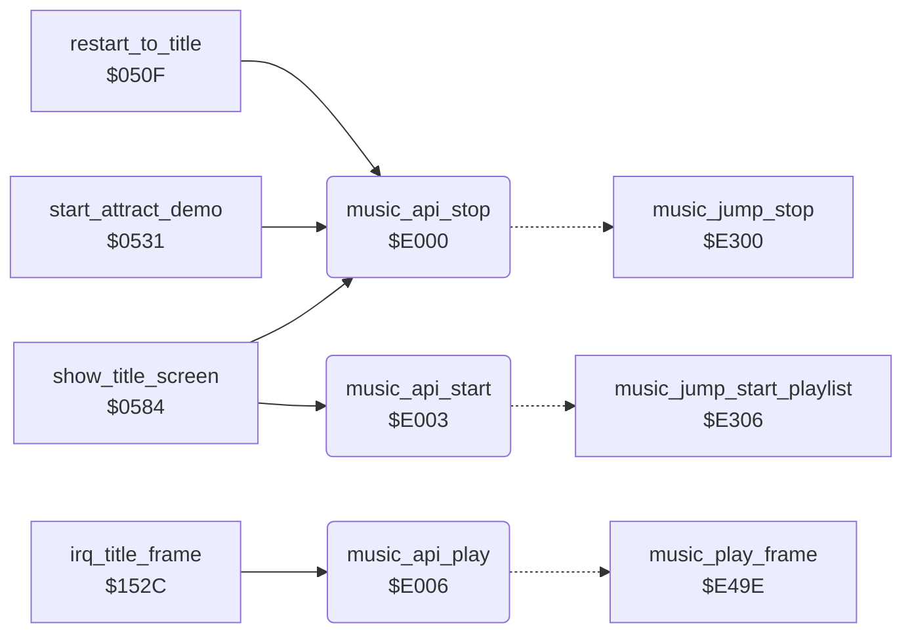

<!-- Generated by c64-docs from knowledge revision 20261018T152957.577-ll4gr6 and src/source-map.json. Do not edit: change the knowledge, generate the source again, then run docs.ts generate. -->
# music_player_state.asm: Music player: entry points, voice state, note frequency table and voice reset template

Range `$E000-$E008`. Source: [music_player_state.asm](../../../src/music_player_state.asm). Index: [the reference](../index.md).

## Call graph

A solid arrow is a call, a thick arrow a table entry, a dotted arrow a jump. Rounded nodes are in this file.

## Data

| Range | Type | Name | Read by | Written by |
|---|---|---|---|---|
| [`$E000`](../../../src/music_player_state.asm#L8)-`$E008` | jumps | [`music_api_stop`](../../../src/music_player_state.asm#L7) |  |  |

## Names

### [`music_api_stop`](../../../src/music_player_state.asm#L7) `$E000`

*routine*

Music player entry points. The game uses only these three jumps. music_api_stop: stops the music and silences the SID (the game sets music_stop_request to 1 first).

- **Called from:** [`restart_to_title`](title_demo_start.md#restart_to_title) [`$051C`](../../../src/title_demo_start.asm#L17), [`start_attract_demo`](title_demo_start.md#start_attract_demo) [`$054A`](../../../src/title_demo_start.asm#L45), [`show_title_screen`](title_demo_start.md#show_title_screen) [`$0729`](../../../src/title_demo_start.asm#L295)
- **Jumps to:** [`music_jump_stop`](music_player.md#music_jump_stop)

### [`music_api_start`](../../../src/music_player_state.asm#L10) `$E003`

*routine*

Starts the playlist at music_playlist; the title code sets it to song 0, loop, and calls this from show_title_screen.

- **Called from:** [`show_title_screen`](title_demo_start.md#show_title_screen) [`$06DA`](../../../src/title_demo_start.asm#L241)
- **Jumps to:** [`music_jump_start_playlist`](music_player.md#music_jump_start_playlist)

### [`music_api_play`](../../../src/music_player_state.asm#L13) `$E006`

*routine*

The per-frame player (music_play_frame), called by the title screen IRQ handler irq_title_frame.

- **Called from:** [`irq_title_frame`](screen_raster_irqs.md#irq_title_frame) [`$154C`](../../../src/screen_raster_irqs.asm#L99)
- **Jumps to:** [`music_play_frame`](music_player.md#music_play_frame)
