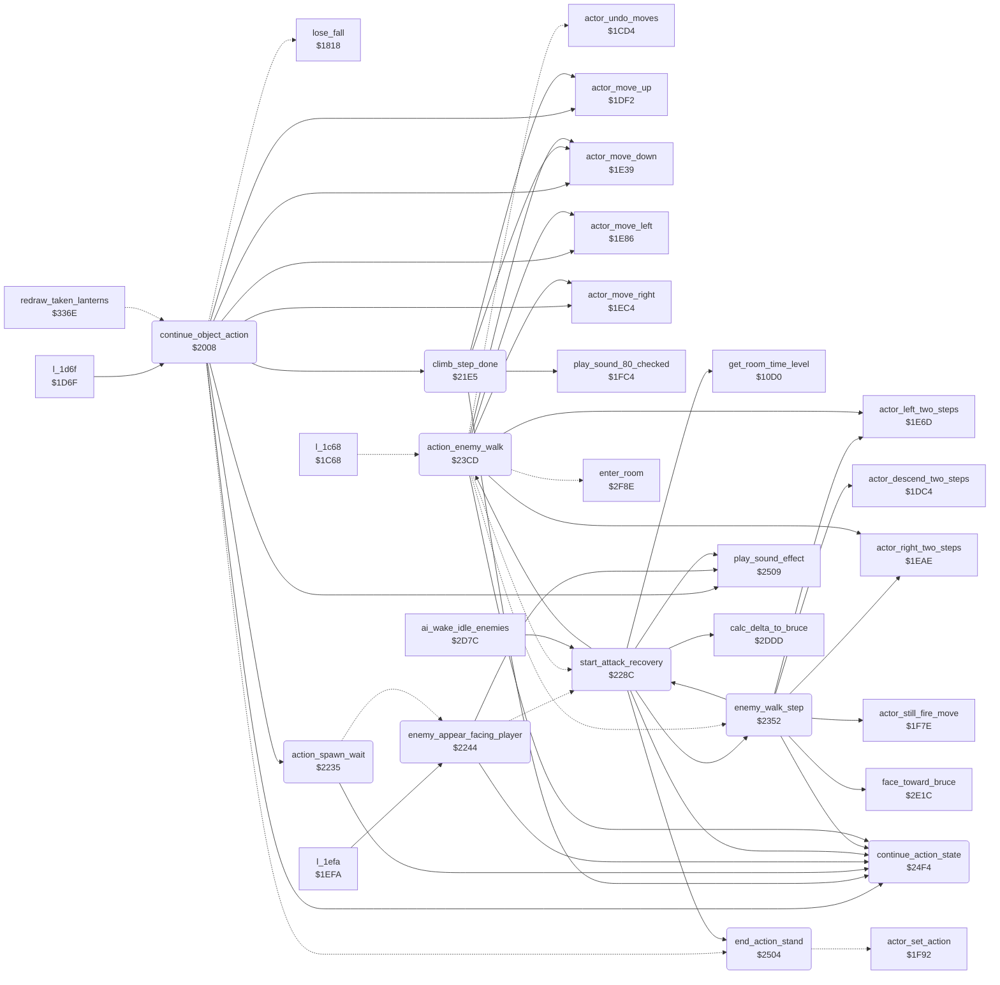

<!-- Generated by c64-docs from knowledge revision 20261016T170255.379-vv114c and src/source-map.json. Do not edit: change the knowledge, generate the source again, then run generate.ts. -->
# object_actions.asm: Object action state machine: jumps, kicks, punches, climbing, enemy behaviour states

Range `$2008-$2508`. Source: [object_actions.asm](../../../src/object_actions.asm). Index: [the reference](../index.md).

## Call graph

A solid arrow is a call, a thick arrow a table entry, a dotted arrow a jump. Rounded nodes are in this file.

## Names

### [`continue_object_action`](../../../src/object_actions.asm#L6) `$2008`

*routine*

Runs one step of the current action of object X (state $BF,X) with Y = remaining state timer $CE,X; moves the object and sets the next state and timer through continue_action_state, or ends the action. Entry code handles state 5 (jump straight up).

- **Called from:** [`l_1d6f`](../../../src/actor_movement.asm#L176) [`$1D7B`](../../../src/actor_movement.asm#L184)
- **Calls:** [`actor_move_down`](actor_movement.md#actor_move_down), [`continue_action_state`](object_actions.md#continue_action_state), [`actor_move_up`](actor_movement.md#actor_move_up), [`play_sound_effect`](sound_effects.md#play_sound_effect), [`actor_move_left`](actor_movement.md#actor_move_left), [`actor_move_right`](actor_movement.md#actor_move_right), [`action_spawn_wait`](object_actions.md#action_spawn_wait), [`climb_step_done`](object_actions.md#climb_step_done)
- **Jumps to:** [`end_action_stand`](object_actions.md#end_action_stand), [`continue_action_state`](object_actions.md#continue_action_state), [`lose_fall`](game_over.md#lose_fall), [`climb_ride_texture`](object_actions.md#climb_ride_texture)
- **Reads:** [`current_actor`](../variables.md#current_actor), [`temp_y`](../variables.md#temp_y), [`human_opponent_mode`](variables.md#human_opponent_mode)
- **Writes:** [`temp_y`](../variables.md#temp_y), [`current_actor`](../variables.md#current_actor)

### [`action_flying_kick_left`](../../../src/object_actions.asm#L40) `$2048`

*label*

State $0C: flying kick to the left, rise for timer >= 10, then fly level, then drop until the floor (terrain bit 0).

- **Jumped to from:** [`continue_object_action`](object_actions.md#continue_object_action) [`$200E`](../../../src/object_actions.asm#L10)

### [`action_flying_kick_right`](../../../src/object_actions.asm#L78) `$208D`

*label*

State $0D: flying kick to the right, same arc as state $0C.

- **Jumped to from:** [`continue_object_action`](object_actions.md#continue_object_action) [`$204A`](../../../src/object_actions.asm#L42)

### [`action_jump_left`](../../../src/object_actions.asm#L114) `$20D2`

*label*

State 6: jump to the left, 2 px per step, rising for timer >= 10, falling below 7 until the floor.

- **Jumped to from:** [`continue_object_action`](object_actions.md#continue_object_action) [`$208F`](../../../src/object_actions.asm#L80)

### [`end_action_jmp`](../../../src/object_actions.asm#L130) `$20F3`

*label*

- **Jumped to from:** [`continue_object_action`](object_actions.md#continue_object_action) [`$2080`](../../../src/object_actions.asm#L71), [`continue_object_action`](object_actions.md#continue_object_action) [`$2095`](../../../src/object_actions.asm#L83), [`continue_object_action`](object_actions.md#continue_object_action) [`$20C5`](../../../src/object_actions.asm#L108), [`continue_object_action`](object_actions.md#continue_object_action) [`$20DA`](../../../src/object_actions.asm#L119), [`continue_object_action`](object_actions.md#continue_object_action) [`$2109`](../../../src/object_actions.asm#L142), [`continue_object_action`](object_actions.md#continue_object_action) [`$2128`](../../../src/object_actions.asm#L158), [`continue_object_action`](object_actions.md#continue_object_action) [`$2154`](../../../src/object_actions.asm#L179)

### [`jump_left_descend`](../../../src/object_actions.asm#L139) `$2105`

*label*

- **Jumped to from:** [`continue_object_action`](object_actions.md#continue_object_action) [`$20F8`](../../../src/object_actions.asm#L134)

### [`action_jump_right`](../../../src/object_actions.asm#L153) `$2120`

*label*

State 7: jump to the right, same arc as state 6.

- **Jumped to from:** [`continue_object_action`](object_actions.md#continue_object_action) [`$20D4`](../../../src/object_actions.asm#L116)

### [`jump_right_descend`](../../../src/object_actions.asm#L176) `$2150`

*label*

- **Jumped to from:** [`continue_object_action`](object_actions.md#continue_object_action) [`$2143`](../../../src/object_actions.asm#L171)

### [`action_dying`](../../../src/object_actions.asm#L190) `$216B`

*label*

State $19: when the timer of object 0 reaches 1, jumps to $1818 (life lost); else the state continues.

- **Jumped to from:** [`continue_object_action`](object_actions.md#continue_object_action) [`$2122`](../../../src/object_actions.asm#L155)

### [`action_climb`](../../../src/object_actions.asm#L205) `$2180`

*label*

State $17: climbing (terrain bit 2). Moves 2 px in the joystick direction every 5th step, plays the step sound, and rides along with the moving texture when $60 = 1 ($65 = direction).

- **Jumped to from:** [`continue_object_action`](object_actions.md#continue_object_action) [`$216D`](../../../src/object_actions.asm#L192)

### [`climb_step_done`](../../../src/object_actions.asm#L260) `$21E5`

*label*

- **Called from:** [`continue_object_action`](object_actions.md#continue_object_action) [`$21BE`](../../../src/object_actions.asm#L240), [`continue_object_action`](object_actions.md#continue_object_action) [`$21CB`](../../../src/object_actions.asm#L247), [`continue_object_action`](object_actions.md#continue_object_action) [`$21D8`](../../../src/object_actions.asm#L253)
- **Calls:** [`play_sound_80_checked`](actor_movement.md#play_sound_80_checked), [`actor_move_down`](actor_movement.md#actor_move_down), [`actor_move_up`](actor_movement.md#actor_move_up), [`continue_action_state`](object_actions.md#continue_action_state)
- **Reads:** [`scroll_timer`](../variables.md#scroll_timer), [`scroll_direction`](../variables.md#scroll_direction), [`temp_y`](../variables.md#temp_y)
- **Writes:** [`temp_y`](../variables.md#temp_y)
- **Refers to:** [`actor_move_counters`](actor_vars.md#actor_move_counters), [`actor_moved_down`](actor_vars.md#actor_moved_down)

### [`climb_ride_texture`](../../../src/object_actions.asm#L265) `$21EE`

*label*

- **Jumped to from:** [`continue_object_action`](object_actions.md#continue_object_action) [`$21AF`](../../../src/object_actions.asm#L233), [`continue_object_action`](object_actions.md#continue_object_action) [`$21DD`](../../../src/object_actions.asm#L256)

### [`action_spawn_wait`](../../../src/object_actions.asm#L303) `$2235`

*label*

State $10: enemy waits until its timer is 1, then appears facing the player.

- **Called from:** [`continue_object_action`](object_actions.md#continue_object_action) [`$2184`](../../../src/object_actions.asm#L208)
- **Calls:** [`continue_action_state`](object_actions.md#continue_action_state)
- **Jumps to:** [`action_punch`](object_actions.md#action_punch), [`enemy_appear_facing_player`](object_actions.md#enemy_appear_facing_player)

### [`enemy_appear_facing_player`](../../../src/object_actions.asm#L312) `$2244`

*label*

Turns enemy X towards object 0, sets state $12 with timer $10 and plays sound $81.

- **Called from:** [`l_1efa`](../../../src/actor_movement.asm#L407) [`$1F04`](../../../src/actor_movement.asm#L414)
- **Jumped to from:** [`action_spawn_wait`](object_actions.md#action_spawn_wait) [`$223D`](../../../src/object_actions.asm#L308)
- **Calls:** [`play_sound_effect`](sound_effects.md#play_sound_effect), [`continue_action_state`](object_actions.md#continue_action_state)
- **Jumps to:** [`action_kick`](object_actions.md#action_kick), [`l_22c5`](../../../src/object_actions.asm#L396), [`start_attack_recovery`](object_actions.md#start_attack_recovery)
- **Reads:** [`actor_x`](../variables.md#actor_x), [`current_actor`](../variables.md#current_actor), [`temp_y`](../variables.md#temp_y)
- **Writes:** [`current_actor`](../variables.md#current_actor)

### [`action_punch`](../../../src/object_actions.asm#L336) `$226A`

*label*

State $11: punch; plays sound $85 at timer 8 and ends with recovery at timer 1.

- **Jumped to from:** [`action_spawn_wait`](object_actions.md#action_spawn_wait) [`$2237`](../../../src/object_actions.asm#L305)

### [`start_attack_recovery`](../../../src/object_actions.asm#L356) `$228C`

*routine*

Ends the attack of object X: state 0 with timer 6, then sets the recovery timer from the progress check $10D0 (object 0: 3 or 12; enemies: 6, 3 or 1).

- **Called from:** [`enemy_walk_step`](object_actions.md#enemy_walk_step) [`$2369`](../../../src/object_actions.asm#L498), [`enemy_walk_step`](object_actions.md#enemy_walk_step) [`$2399`](../../../src/object_actions.asm#L527), [`ai_wake_idle_enemies`](actor_checks.md#ai_wake_idle_enemies) [`$2DC0`](../../../src/actor_checks.asm#L73)
- **Jumped to from:** [`enemy_appear_facing_player`](object_actions.md#enemy_appear_facing_player) [`$2285`](../../../src/object_actions.asm#L352), [`action_enemy_walk`](object_actions.md#action_enemy_walk) [`$243D`](../../../src/object_actions.asm#L619), [`action_enemy_walk`](object_actions.md#action_enemy_walk) [`$24B0`](../../../src/object_actions.asm#L675)
- **Calls:** [`get_room_time_level`](room_state.md#get_room_time_level), [`end_action_stand`](object_actions.md#end_action_stand), [`play_sound_effect`](sound_effects.md#play_sound_effect), [`continue_action_state`](object_actions.md#continue_action_state), [`action_enemy_walk`](object_actions.md#action_enemy_walk), [`calc_delta_to_bruce`](actor_checks.md#calc_delta_to_bruce), [`enemy_walk_step`](object_actions.md#enemy_walk_step)
- **Jumps to:** [`chase_off_floor`](object_actions.md#chase_off_floor), [`chase_other_height`](object_actions.md#chase_other_height), [`chase_facing_bruce`](object_actions.md#chase_facing_bruce)
- **Reads:** [`game_cycle`](../variables.md#game_cycle), [`current_actor`](../variables.md#current_actor), [`temp_y`](../variables.md#temp_y), [`delta_y_to_bruce`](../variables.md#delta_y_to_bruce), [`delta_x_to_bruce`](../variables.md#delta_x_to_bruce), [`actor_x`](../variables.md#actor_x)
- **Writes:** [`current_actor`](../variables.md#current_actor)
- **Refers to:** [`actor_moved_right`](actor_vars.md#actor_moved_right), [`actor_moved_left`](actor_vars.md#actor_moved_left)

### [`action_kick`](../../../src/object_actions.asm#L391) `$22BD`

*label*

State $16: the Ninja's strike, started only at $23C4. Contact bit 3 ends it. Plays sound $85 at timer 12, counts one move in the facing direction in actor_moved_right/actor_moved_left each step without moving, and ends with recovery at timer 1.

- **Jumped to from:** [`enemy_appear_facing_player`](object_actions.md#enemy_appear_facing_player) [`$226C`](../../../src/object_actions.asm#L338)

### [`action_enemy_chase`](../../../src/object_actions.asm#L425) `$22F3`

*label*

State $14: enemy AI. Uses the distance to object 0 ($2DDD -> $62/$63) to turn, walk towards it, start a punch, kick (state $16) or flying kick (state $0C/$0D).

- **Jumped to from:** [`start_attack_recovery`](object_actions.md#start_attack_recovery) [`$22BF`](../../../src/object_actions.asm#L393)

### [`enemy_start_walk`](../../../src/object_actions.asm#L456) `$2327`

*label*

Sets state $15 with a timer of the X distance to a point $0F beside object 0 (minimum 5).

- **Jumped to from:** [`start_attack_recovery`](object_actions.md#start_attack_recovery) [`$231C`](../../../src/object_actions.asm#L450), [`enemy_walk_step`](object_actions.md#enemy_walk_step) [`$2389`](../../../src/object_actions.asm#L517)

### [`enemy_walk_step`](../../../src/object_actions.asm#L485) `$2352`

*label*

Moves the enemy 2 px in its facing direction and keeps state $14.

- **Called from:** [`start_attack_recovery`](object_actions.md#start_attack_recovery) [`$2324`](../../../src/object_actions.asm#L454)
- **Calls:** [`actor_right_two_steps`](actor_movement.md#actor_right_two_steps), [`continue_action_state`](object_actions.md#continue_action_state), [`face_toward_bruce`](actor_checks.md#face_toward_bruce), [`start_attack_recovery`](object_actions.md#start_attack_recovery), [`actor_left_two_steps`](actor_movement.md#actor_left_two_steps), [`actor_descend_two_steps`](actor_movement.md#actor_descend_two_steps), [`actor_still_fire_move`](actor_movement.md#actor_still_fire_move)
- **Jumps to:** [`enemy_start_walk`](object_actions.md#enemy_start_walk)
- **Reads:** [`temp_y`](../variables.md#temp_y), [`delta_y_to_bruce`](../variables.md#delta_y_to_bruce), [`delta_x_to_bruce`](../variables.md#delta_x_to_bruce)
- **Writes:** [`temp_y`](../variables.md#temp_y)

### [`chase_other_height`](../../../src/object_actions.asm#L494) `$2362`

*label*

- **Jumped to from:** [`start_attack_recovery`](object_actions.md#start_attack_recovery) [`$2309`](../../../src/object_actions.asm#L437)

### [`chase_off_floor`](../../../src/object_actions.asm#L502) `$2372`

*label*

- **Jumped to from:** [`start_attack_recovery`](object_actions.md#start_attack_recovery) [`$22FE`](../../../src/object_actions.asm#L432)

### [`chase_facing_bruce`](../../../src/object_actions.asm#L508) `$237B`

*label*

- **Jumped to from:** [`start_attack_recovery`](object_actions.md#start_attack_recovery) [`$2315`](../../../src/object_actions.asm#L446)

### [`chase_ninja_attack`](../../../src/object_actions.asm#L545) `$23B8`

*label*

- **Jumped to from:** [`enemy_walk_step`](object_actions.md#enemy_walk_step) [`$2381`](../../../src/object_actions.asm#L512)

### [`action_enemy_walk`](../../../src/object_actions.asm#L558) `$23CD`

*label*

State $15: enemy walks in its facing direction; at timer 1 it turns round and returns to state $14 with timer $80.

- **Called from:** [`start_attack_recovery`](object_actions.md#start_attack_recovery) [`$22F7`](../../../src/object_actions.asm#L428)
- **Calls:** [`actor_right_two_steps`](actor_movement.md#actor_right_two_steps), [`continue_action_state`](object_actions.md#continue_action_state), [`actor_left_two_steps`](actor_movement.md#actor_left_two_steps), [`actor_move_left`](actor_movement.md#actor_move_left), [`actor_move_right`](actor_movement.md#actor_move_right), [`actor_move_down`](actor_movement.md#actor_move_down)
- **Jumps to:** [`l_2378`](../../../src/object_actions.asm#L506), [`start_attack_recovery`](object_actions.md#start_attack_recovery), [`continue_action_state`](object_actions.md#continue_action_state), [`enter_room`](background_touch.md#enter_room), [`actor_undo_moves`](actor_movement.md#actor_undo_moves)
- **Reads:** [`current_room`](../variables.md#current_room)
- **Writes:** [`temp_y`](../variables.md#temp_y), [`current_actor`](../variables.md#current_actor), [`last_key+3`](../variables.md#last_key), [`last_key+1`](../variables.md#last_key)
- **Refers to:** [`actor_move_history`](actor_vars.md#actor_move_history), [`room_spawn_y`](room_tables.md#room_spawn_y), [`room_spawn_x`](room_tables.md#room_spawn_x)

### [`action_appear`](../../../src/object_actions.asm#L589) `$2407`

*label*

State $12: enemy appearing; only counts down the timer.

- **Jumped to from:** [`action_enemy_walk`](object_actions.md#action_enemy_walk) [`$23CF`](../../../src/object_actions.asm#L560)

### [`action_knocked_back`](../../../src/object_actions.asm#L594) `$240E`

*label*

State $0F: hit; the object is pushed 2 px per step away in its facing direction; enemies recover at timer < 2.

- **Jumped to from:** [`action_enemy_walk`](object_actions.md#action_enemy_walk) [`$2409`](../../../src/object_actions.asm#L591)

### [`action_knocked_down`](../../../src/object_actions.asm#L621) `$2440`

*label*

State $13: knocked down or knocked out. Each step: down 1 when contact bits 0 and 2 are clear, then 2 against the facing. At timer 10 the Ninja (actor 2) goes 8 more to the left when facing right, but 4 more to the right when facing left. An enemy with energy >= 0 recovers at timer 1.

- **Jumped to from:** [`action_enemy_walk`](object_actions.md#action_enemy_walk) [`$2410`](../../../src/object_actions.asm#L596)

### [`action_blocked`](../../../src/object_actions.asm#L677) `$24B3`

*label*

Last check of the chain. actor_move_step sends a running state $18 to action_blocked_step itself, so the states that get here have no handler (0-4, $0E, $1A, $1B): continue_action_state only counts their timer down.

- **Jumped to from:** [`action_enemy_walk`](object_actions.md#action_enemy_walk) [`$2442`](../../../src/object_actions.asm#L623)

### [`action_blocked_step`](../../../src/object_actions.asm#L681) `$24B7`

*label*

State $18: while the object overlaps an obstacle (terrain bit 3) its last moves are undone from the move history ($1CD4); with an empty history it is put back into the room at $4BAE/$4BC2 via $2F8E.

- **Jumped to from:** [`l_1c68`](../../../src/actor_movement.asm#L39) [`$1CC4`](../../../src/actor_movement.asm#L88)

### [`continue_action_state`](../../../src/object_actions.asm#L719) `$24F4`

*label*

Stores state A for object X, reloads the step delay $0106,X from $4A8C,state and sets the timer $CE,X to action_timer - 1.

- **Called from:** [`continue_object_action`](object_actions.md#continue_object_action) [`$2030`](../../../src/object_actions.asm#L28), [`continue_object_action`](object_actions.md#continue_object_action) [`$2045`](../../../src/object_actions.asm#L38), [`continue_object_action`](object_actions.md#continue_object_action) [`$206D`](../../../src/object_actions.asm#L59), [`continue_object_action`](object_actions.md#continue_object_action) [`$2079`](../../../src/object_actions.asm#L65), [`continue_object_action`](object_actions.md#continue_object_action) [`$208A`](../../../src/object_actions.asm#L76), [`continue_object_action`](object_actions.md#continue_object_action) [`$20B2`](../../../src/object_actions.asm#L98), [`continue_object_action`](object_actions.md#continue_object_action) [`$20BE`](../../../src/object_actions.asm#L104), [`continue_object_action`](object_actions.md#continue_object_action) [`$20CF`](../../../src/object_actions.asm#L112), [`continue_object_action`](object_actions.md#continue_object_action) [`$20F0`](../../../src/object_actions.asm#L129), [`continue_object_action`](object_actions.md#continue_object_action) [`$2102`](../../../src/object_actions.asm#L138), [`continue_object_action`](object_actions.md#continue_object_action) [`$211D`](../../../src/object_actions.asm#L151), [`continue_object_action`](object_actions.md#continue_object_action) [`$213E`](../../../src/object_actions.asm#L168), [`continue_object_action`](object_actions.md#continue_object_action) [`$214D`](../../../src/object_actions.asm#L175), [`continue_object_action`](object_actions.md#continue_object_action) [`$2168`](../../../src/object_actions.asm#L188), [`climb_step_done`](object_actions.md#climb_step_done) [`$2232`](../../../src/object_actions.asm#L301), [`action_spawn_wait`](object_actions.md#action_spawn_wait) [`$2241`](../../../src/object_actions.asm#L310), [`enemy_appear_facing_player`](object_actions.md#enemy_appear_facing_player) [`$2289`](../../../src/object_actions.asm#L354), [`start_attack_recovery`](object_actions.md#start_attack_recovery) [`$22ED`](../../../src/object_actions.asm#L421), [`enemy_walk_step`](object_actions.md#enemy_walk_step) [`$235F`](../../../src/object_actions.asm#L493), [`action_enemy_walk`](object_actions.md#action_enemy_walk) [`$23FC`](../../../src/object_actions.asm#L583), [`action_enemy_walk`](object_actions.md#action_enemy_walk) [`$2404`](../../../src/object_actions.asm#L587), [`action_enemy_walk`](object_actions.md#action_enemy_walk) [`$240B`](../../../src/object_actions.asm#L592), [`action_enemy_walk`](object_actions.md#action_enemy_walk) [`$242B`](../../../src/object_actions.asm#L610), [`action_enemy_walk`](object_actions.md#action_enemy_walk) [`$243A`](../../../src/object_actions.asm#L617), [`action_enemy_walk`](object_actions.md#action_enemy_walk) [`$248A`](../../../src/object_actions.asm#L657), [`action_enemy_walk`](object_actions.md#action_enemy_walk) [`$24AD`](../../../src/object_actions.asm#L673), [`action_enemy_walk`](object_actions.md#action_enemy_walk) [`$24C3`](../../../src/object_actions.asm#L688)
- **Jumped to from:** [`continue_object_action`](object_actions.md#continue_object_action) [`$2177`](../../../src/object_actions.asm#L198), [`action_enemy_walk`](object_actions.md#action_enemy_walk) [`$24B5`](../../../src/object_actions.asm#L679)
- **Reads:** [`temp_y`](../variables.md#temp_y)
- **Writes:** [`temp_y`](../variables.md#temp_y)
- **Refers to:** [`action_delay_table`](room_tables.md#action_delay_table)

### [`end_action_stand`](../../../src/object_actions.asm#L729) `$2504`

*label*

Ends the action: state 0 (standing) through $1F92.

- **Called from:** [`start_attack_recovery`](object_actions.md#start_attack_recovery) [`$22C7`](../../../src/object_actions.asm#L400)
- **Jumped to from:** [`continue_object_action`](object_actions.md#continue_object_action) [`$20F3`](../../../src/object_actions.asm#L131), [`continue_object_action`](object_actions.md#continue_object_action) [`$217D`](../../../src/object_actions.asm#L203)
- **Jumps to:** [`actor_set_action`](actor_movement.md#actor_set_action)
