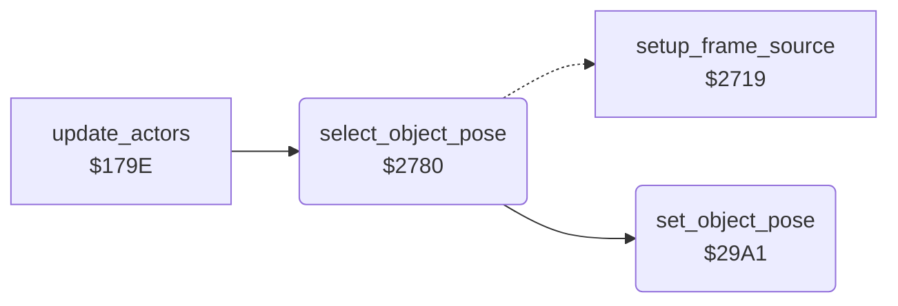

<!-- Generated by c64-docs from knowledge revision 20261016T170255.379-vv114c and src/source-map.json. Do not edit: change the knowledge, generate the source again, then run generate.ts. -->
# object_pose.asm: Animation pose selection per object state

Range `$2780-$29C2`. Source: [object_pose.asm](../../../src/object_pose.asm). Index: [the reference](../index.md).

## Call graph

A solid arrow is a call, a thick arrow a table entry, a dotted arrow a jump. Rounded nodes are in this file.

## Names

### [`select_object_pose`](../../../src/object_pose.asm#L6) `$2780`

*routine*

Chooses the animation pose of object X from its state $BF,X, timer $CE,X, facing $A4,X and terrain flags, and sets it with set_object_pose. Does nothing when obj_pose_done is set; saves the old pose in $4F54,X.

- **Called from:** [`update_actors`](actor_input.md#update_actors) [`$17DB`](../../../src/actor_input.asm#L43)
- **Calls:** [`set_object_pose`](object_pose.md#set_object_pose)
- **Jumps to:** [`l_274e`](../../../src/sprite_render.asm#L278), [`set_object_pose`](object_pose.md#set_object_pose)
- **Refers to:** [`actor_frame_updated`](actor_vars.md#actor_frame_updated), [`actor_frame_rel_a`](actor_vars.md#actor_frame_rel_a), [`actor_prev_frame_rel`](actor_vars.md#actor_prev_frame_rel)

### [`pose_walk_left`](../../../src/object_pose.asm#L189) `$28CB`

*label*

- **Jumped to from:** [`select_object_pose`](object_pose.md#select_object_pose) [`$28BB`](../../../src/object_pose.asm#L179), [`select_object_pose`](object_pose.md#select_object_pose) [`$28C5`](../../../src/object_pose.asm#L185)

### [`pose_walk_right`](../../../src/object_pose.asm#L206) `$28E9`

*label*

- **Jumped to from:** [`select_object_pose`](object_pose.md#select_object_pose) [`$28B9`](../../../src/object_pose.asm#L178), [`select_object_pose`](object_pose.md#select_object_pose) [`$28C3`](../../../src/object_pose.asm#L184)

### [`pose_climb_cycle`](../../../src/object_pose.asm#L293) `$2985`

*label*

- **Jumped to from:** [`select_object_pose`](object_pose.md#select_object_pose) [`$28D1`](../../../src/object_pose.asm#L193), [`select_object_pose`](object_pose.md#select_object_pose) [`$28EF`](../../../src/object_pose.asm#L211), [`select_object_pose`](object_pose.md#select_object_pose) [`$296B`](../../../src/object_pose.asm#L280), [`select_object_pose`](object_pose.md#select_object_pose) [`$2972`](../../../src/object_pose.asm#L284)

### [`pose_stand`](../../../src/object_pose.asm#L303) `$2996`

*label*

- **Jumped to from:** [`select_object_pose`](object_pose.md#select_object_pose) [`$2978`](../../../src/object_pose.asm#L287)

### [`set_object_pose`](../../../src/object_pose.asm#L311) `$29A1`

*routine*

Y = pose. Stores pose and pose + 1 (overlay) in $4F48,X/$4F4B,X and the frame numbers pose + frame base of the character type ($59A5 by $95,X bits 7-6) in $4F4E,X/$4F51,X.

- **Called from:** [`select_object_pose`](object_pose.md#select_object_pose) [`$279E`](../../../src/object_pose.asm#L21), [`select_object_pose`](object_pose.md#select_object_pose) [`$27A3`](../../../src/object_pose.asm#L24), [`select_object_pose`](object_pose.md#select_object_pose) [`$27B0`](../../../src/object_pose.asm#L31), [`select_object_pose`](object_pose.md#select_object_pose) [`$27B5`](../../../src/object_pose.asm#L34), [`select_object_pose`](object_pose.md#select_object_pose) [`$27BE`](../../../src/object_pose.asm#L39), [`select_object_pose`](object_pose.md#select_object_pose) [`$27D2`](../../../src/object_pose.asm#L49), [`select_object_pose`](object_pose.md#select_object_pose) [`$27D7`](../../../src/object_pose.asm#L52), [`select_object_pose`](object_pose.md#select_object_pose) [`$27EA`](../../../src/object_pose.asm#L63), [`select_object_pose`](object_pose.md#select_object_pose) [`$27EF`](../../../src/object_pose.asm#L66), [`select_object_pose`](object_pose.md#select_object_pose) [`$27F8`](../../../src/object_pose.asm#L71), [`select_object_pose`](object_pose.md#select_object_pose) [`$27FD`](../../../src/object_pose.asm#L74), [`select_object_pose`](object_pose.md#select_object_pose) [`$2810`](../../../src/object_pose.asm#L84), [`select_object_pose`](object_pose.md#select_object_pose) [`$2815`](../../../src/object_pose.asm#L87), [`select_object_pose`](object_pose.md#select_object_pose) [`$281E`](../../../src/object_pose.asm#L92), [`select_object_pose`](object_pose.md#select_object_pose) [`$2823`](../../../src/object_pose.asm#L95), [`select_object_pose`](object_pose.md#select_object_pose) [`$282C`](../../../src/object_pose.asm#L100), [`select_object_pose`](object_pose.md#select_object_pose) [`$2839`](../../../src/object_pose.asm#L107), [`select_object_pose`](object_pose.md#select_object_pose) [`$283E`](../../../src/object_pose.asm#L110), [`select_object_pose`](object_pose.md#select_object_pose) [`$284B`](../../../src/object_pose.asm#L117), [`select_object_pose`](object_pose.md#select_object_pose) [`$2863`](../../../src/object_pose.asm#L130), [`select_object_pose`](object_pose.md#select_object_pose) [`$2868`](../../../src/object_pose.asm#L133), [`select_object_pose`](object_pose.md#select_object_pose) [`$2871`](../../../src/object_pose.asm#L138), [`select_object_pose`](object_pose.md#select_object_pose) [`$2876`](../../../src/object_pose.asm#L141), [`select_object_pose`](object_pose.md#select_object_pose) [`$2883`](../../../src/object_pose.asm#L148), [`select_object_pose`](object_pose.md#select_object_pose) [`$2888`](../../../src/object_pose.asm#L151), [`select_object_pose`](object_pose.md#select_object_pose) [`$2897`](../../../src/object_pose.asm#L159), [`select_object_pose`](object_pose.md#select_object_pose) [`$289C`](../../../src/object_pose.asm#L162), [`select_object_pose`](object_pose.md#select_object_pose) [`$28AB`](../../../src/object_pose.asm#L170), [`select_object_pose`](object_pose.md#select_object_pose) [`$28B0`](../../../src/object_pose.asm#L173), [`select_object_pose`](object_pose.md#select_object_pose) [`$28DD`](../../../src/object_pose.asm#L199), [`select_object_pose`](object_pose.md#select_object_pose) [`$28E2`](../../../src/object_pose.asm#L202), [`select_object_pose`](object_pose.md#select_object_pose) [`$28FB`](../../../src/object_pose.asm#L217), [`select_object_pose`](object_pose.md#select_object_pose) [`$2900`](../../../src/object_pose.asm#L220), [`select_object_pose`](object_pose.md#select_object_pose) [`$290F`](../../../src/object_pose.asm#L228), [`select_object_pose`](object_pose.md#select_object_pose) [`$2918`](../../../src/object_pose.asm#L233), [`select_object_pose`](object_pose.md#select_object_pose) [`$2921`](../../../src/object_pose.asm#L238), [`select_object_pose`](object_pose.md#select_object_pose) [`$292A`](../../../src/object_pose.asm#L243), [`select_object_pose`](object_pose.md#select_object_pose) [`$292F`](../../../src/object_pose.asm#L246), [`select_object_pose`](object_pose.md#select_object_pose) [`$293E`](../../../src/object_pose.asm#L255), [`select_object_pose`](object_pose.md#select_object_pose) [`$2947`](../../../src/object_pose.asm#L260) and 6 more
- **Jumped to from:** [`select_object_pose`](object_pose.md#select_object_pose) [`$2850`](../../../src/object_pose.asm#L120)
- **Refers to:** [`actor_frame_rel_a`](actor_vars.md#actor_frame_rel_a), [`actor_type_frame_base`](sprite_data.md#actor_type_frame_base), [`actor_frame_a`](actor_vars.md#actor_frame_a), [`actor_frame_b`](actor_vars.md#actor_frame_b)
