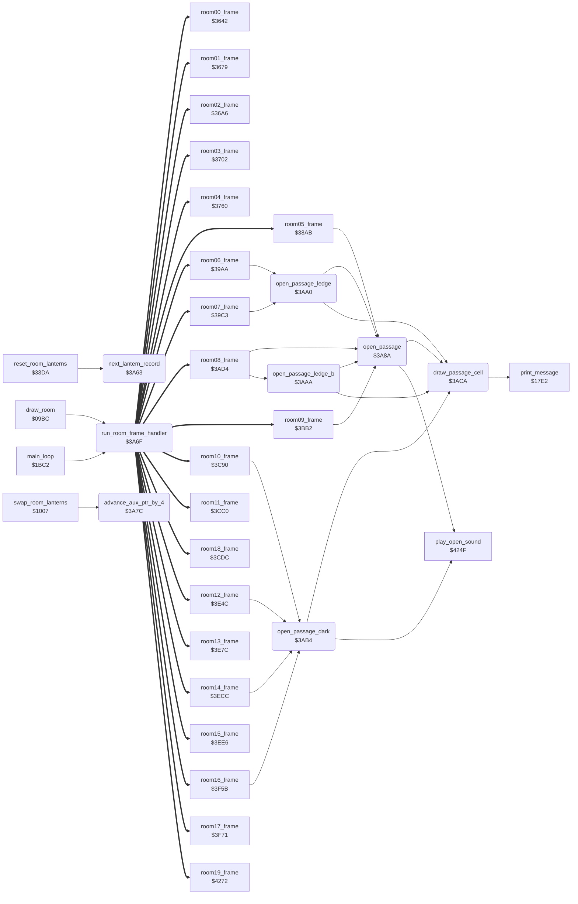

<!-- Generated by c64-docs from knowledge revision 20261018T152957.577-ll4gr6 and src/source-map.json. Do not edit: change the knowledge, generate the source again, then run docs.ts generate. -->
# passage_open.asm: Room frame dispatch and passage-opening helpers

Range `$3A63-$3AD3`. Source: [passage_open.asm](../../../src/passage_open.asm). Index: [the reference](../index.md).

## Call graph

A solid arrow is a call, a thick arrow a table entry, a dotted arrow a jump. Rounded nodes are in this file.

## Names

### [`next_lantern_record`](../../../src/passage_open.asm#L6) `$3A63`

*routine*

Adds 4 (one lantern record) to lantern_ptr. Changes A.

- **Called from:** [`reset_room_lanterns`](lantern_pickup.md#reset_room_lanterns) [`$33EE`](../../../src/lantern_pickup.asm#L171)
- **Reads:** [`lantern_ptr`](../memory-map.md#lantern_ptr), [`lantern_ptr+1`](../memory-map.md#lantern_ptr)
- **Writes:** [`lantern_ptr`](../memory-map.md#lantern_ptr), [`lantern_ptr+1`](../memory-map.md#lantern_ptr)
- **Refers to:** [`lantern_ptr`](../memory-map.md#lantern_ptr)

### [`next_lantern_record_done`](../../../src/passage_open.asm#L13) `$3A6E`

*label*

- **Jumped to from:** [`next_lantern_record`](passage_open.md#next_lantern_record) [`$3A6A`](../../../src/passage_open.asm#L11)

### [`run_room_frame_handler`](../../../src/passage_open.asm#L18) `$3A6F`

*routine*

Jumps to the frame handler of the room through the RTS table room_frame_handlers (index room*2, target - 1, low byte first). Called by the main loop on every pass and one time at the end of draw_room. The handler returns to the caller.

- **Called from:** [`draw_room`](draw_room.md#draw_room) [`$0B40`](../../../src/draw_room.asm#L229), [`main_loop`](game_main_loop.md#main_loop) [`$1C0A`](../../../src/game_main_loop.asm#L61)
- **Jumps to:** [`room00_frame`](room_frames_0_7.md#room00_frame), [`room01_frame`](room_frames_0_7.md#room01_frame), [`room02_frame`](room_frames_0_7.md#room02_frame), [`room03_frame`](room_frames_0_7.md#room03_frame), [`room04_frame`](room_frames_0_7.md#room04_frame), [`room05_frame`](room_frames_0_7.md#room05_frame), [`room06_frame`](room_frames_0_7.md#room06_frame), [`room07_frame`](room_frames_0_7.md#room07_frame), [`room08_frame`](room_frames_8_11.md#room08_frame), [`room09_frame`](room_frames_8_11.md#room09_frame), [`room10_frame`](room_frames_8_11.md#room10_frame), [`room11_frame`](room_frames_8_11.md#room11_frame), [`room18_frame`](wizard_room.md#room18_frame), [`room12_frame`](room_frames_12_17.md#room12_frame), [`room13_frame`](room_frames_12_17.md#room13_frame), [`room14_frame`](room_frames_12_17.md#room14_frame), [`room15_frame`](room_frames_12_17.md#room15_frame), [`room16_frame`](room_frames_12_17.md#room16_frame), [`room17_frame`](room_frames_12_17.md#room17_frame), [`room19_frame`](ending_room.md#room19_frame)
- **Reads:** [`room`](../memory-map.md#room)
- **Refers to:** [`room_frame_handlers+1`](room_dispatch.md#room_frame_handlers), [`room_frame_handlers`](room_dispatch.md#room_frame_handlers)

### [`advance_aux_ptr_by_4`](../../../src/passage_open.asm#L28) `$3A7C`

*routine*

Adds 4 (one lantern record) to aux_ptr. Called by swap_room_lanterns (the two-player lantern swap). Changes A.

- **Called from:** [`swap_room_lanterns`](game_setup.md#swap_room_lanterns) [`$1021`](../../../src/game_setup.asm#L131)
- **Reads:** [`aux_ptr`](../memory-map.md#aux_ptr), [`aux_ptr+1`](../memory-map.md#aux_ptr)
- **Writes:** [`aux_ptr`](../memory-map.md#aux_ptr), [`aux_ptr+1`](../memory-map.md#aux_ptr)
- **Refers to:** [`aux_ptr`](../memory-map.md#aux_ptr)

### [`open_passage`](../../../src/passage_open.asm#L42) `$3A8A`

*routine*

Opens a passage in a wall: plays play_open_sound (sound $8A), then draws tile $13 (blank) at rows R and R+1 and tile $14 (char BE) at row R+2, all in column C. Input: A = top row R, Y = column C. Output: passage_row = R+3, passage_col = C. Used in the rooms with the character set charset_rooms_0_9 (rooms 0-9).

- **Called from:** [`room05_frame`](room_frames_0_7.md#room05_frame) [`$38BC`](../../../src/room_frames_0_7.asm#L387), [`room05_frame`](room_frames_0_7.md#room05_frame) [`$38C3`](../../../src/room_frames_0_7.asm#L390), [`room05_frame`](room_frames_0_7.md#room05_frame) [`$38DC`](../../../src/room_frames_0_7.asm#L402), [`room05_frame`](room_frames_0_7.md#room05_frame) [`$390B`](../../../src/room_frames_0_7.asm#L427), [`room05_frame`](room_frames_0_7.md#room05_frame) [`$3912`](../../../src/room_frames_0_7.asm#L430), [`open_passage_ledge`](passage_open.md#open_passage_ledge) [`$3AA0`](../../../src/passage_open.asm#L55), [`open_passage_ledge_b`](passage_open.md#open_passage_ledge_b) [`$3AAA`](../../../src/passage_open.asm#L63), [`room08_frame`](room_frames_8_11.md#room08_frame) [`$3AE7`](../../../src/room_frames_8_11.asm#L26), [`room08_frame`](room_frames_8_11.md#room08_frame) [`$3B0C`](../../../src/room_frames_8_11.asm#L46), [`room08_frame`](room_frames_8_11.md#room08_frame) [`$3B39`](../../../src/room_frames_8_11.asm#L70), [`room08_frame`](room_frames_8_11.md#room08_frame) [`$3B4E`](../../../src/room_frames_8_11.asm#L82), [`room09_frame`](room_frames_8_11.md#room09_frame) [`$3BD9`](../../../src/room_frames_8_11.asm#L170)
- **Calls:** [`play_open_sound`](wizard_fireballs.md#play_open_sound), [`draw_passage_cell`](passage_open.md#draw_passage_cell)
- **Writes:** [`passage_row`](../memory-map.md#passage_row), [`passage_col`](../memory-map.md#passage_col)

### [`open_passage_ledge`](../../../src/passage_open.asm#L54) `$3AA0`

*routine*

Same as open_passage, then tile $17 (char 91) at row R+2 in place of tile $14. Input: A = top row, Y = column.

- **Called from:** [`room06_frame`](room_frames_0_7.md#room06_frame) [`$39BA`](../../../src/room_frames_0_7.asm#L528), [`room07_frame`](room_frames_0_7.md#room07_frame) [`$39E3`](../../../src/room_frames_0_7.asm#L555), [`room07_frame`](room_frames_0_7.md#room07_frame) [`$3A06`](../../../src/room_frames_0_7.asm#L571)
- **Calls:** [`open_passage`](passage_open.md#open_passage), [`draw_passage_cell`](passage_open.md#draw_passage_cell)
- **Reads:** [`passage_row`](../memory-map.md#passage_row)
- **Writes:** [`passage_row`](../memory-map.md#passage_row)

### [`open_passage_ledge_b`](../../../src/passage_open.asm#L61) `$3AAA`

*routine*

Same as open_passage, then tile $2D (char 91) at row R+2. Tile $2D has the same char as tile $17. Input: A = top row, Y = column.

- **Called from:** [`room08_frame`](room_frames_8_11.md#room08_frame) [`$3B25`](../../../src/room_frames_8_11.asm#L59)
- **Calls:** [`open_passage`](passage_open.md#open_passage), [`draw_passage_cell`](passage_open.md#draw_passage_cell)
- **Reads:** [`passage_row`](../memory-map.md#passage_row)
- **Writes:** [`passage_row`](../memory-map.md#passage_row)

### [`open_passage_dark`](../../../src/passage_open.asm#L69) `$3AB4`

*routine*

Opens a passage in rooms 10-17: plays play_open_sound (sound $8A), then draws tile $63 (char 07) at rows R and R+1 and tile $64 (char 8E) at row R+2, in column C. Input: A = top row R, Y = column C.

- **Called from:** [`room10_frame`](room_frames_8_11.md#room10_frame) [`$3CA4`](../../../src/room_frames_8_11.asm#L288), [`room12_frame`](room_frames_12_17.md#room12_frame) [`$3E5D`](../../../src/room_frames_12_17.asm#L20), [`room12_frame`](room_frames_12_17.md#room12_frame) [`$3E76`](../../../src/room_frames_12_17.asm#L32), [`room14_frame`](room_frames_12_17.md#room14_frame) [`$3EE0`](../../../src/room_frames_12_17.asm#L98), [`room16_frame`](room_frames_12_17.md#room16_frame) [`$3F6B`](../../../src/room_frames_12_17.asm#L175)
- **Calls:** [`play_open_sound`](wizard_fireballs.md#play_open_sound), [`draw_passage_cell`](passage_open.md#draw_passage_cell)
- **Writes:** [`passage_row`](../memory-map.md#passage_row), [`passage_col`](../memory-map.md#passage_col)

### [`draw_passage_cell`](../../../src/passage_open.asm#L80) `$3ACA`

*routine*

Draws tile A at text row passage_row, column passage_col (print_message), then increments passage_row.

- **Called from:** [`open_passage`](passage_open.md#open_passage) [`$3A93`](../../../src/passage_open.asm#L47), [`open_passage`](passage_open.md#open_passage) [`$3A98`](../../../src/passage_open.asm#L49), [`open_passage`](passage_open.md#open_passage) [`$3A9D`](../../../src/passage_open.asm#L51), [`open_passage_ledge`](passage_open.md#open_passage_ledge) [`$3AA7`](../../../src/passage_open.asm#L58), [`open_passage_ledge_b`](passage_open.md#open_passage_ledge_b) [`$3AB1`](../../../src/passage_open.asm#L66), [`open_passage_dark`](passage_open.md#open_passage_dark) [`$3ABD`](../../../src/passage_open.asm#L74), [`open_passage_dark`](passage_open.md#open_passage_dark) [`$3AC2`](../../../src/passage_open.asm#L76), [`open_passage_dark`](passage_open.md#open_passage_dark) [`$3AC7`](../../../src/passage_open.asm#L78)
- **Calls:** [`print_message`](actor_driver_text.md#print_message)
- **Reads:** [`passage_row`](../memory-map.md#passage_row), [`passage_col`](../memory-map.md#passage_col)
- **Writes:** [`passage_row`](../memory-map.md#passage_row)
