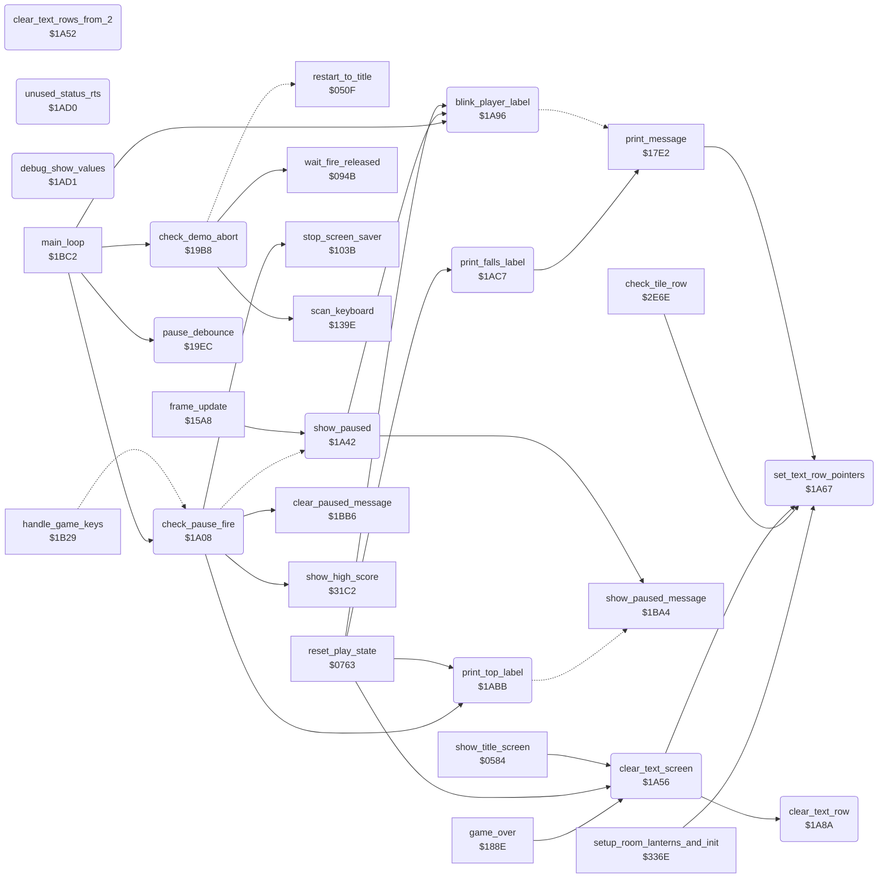

<!-- Generated by c64-docs from knowledge revision 20261017T124710.947-seivas and src/source-map.json. Do not edit: change the knowledge, generate the source again, then run generate.ts. -->
# pause_status_line.asm: Demo abort, pause handling, text screen clearing and status line labels

Range `$19B8-$1AEC`. Source: [pause_status_line.asm](../../../src/pause_status_line.asm). Index: [the reference](../index.md).

## Call graph

A solid arrow is a call, a thick arrow a table entry, a dotted arrow a jump. Rounded nodes are in this file.

## Names

### [`check_demo_abort`](../../../src/pause_status_line.asm#L7) `$19B8`

*routine*

Main loop, in the demo only: fire on joystick port 1 or the F1 key ends the demo. It waits until fire is released, waits 6 frames and jumps to restart_to_title. In a game it returns at once.

- **Called from:** [`main_loop`](game_main_loop.md#main_loop) [`$1BC6`](../../../src/game_main_loop.asm#L26)
- **Calls:** [`scan_keyboard`](keyboard_scan.md#scan_keyboard), [`wait_fire_released`](title_menu.md#wait_fire_released)
- **Jumps to:** [`restart_to_title`](title_demo_start.md#restart_to_title)
- **Reads:** [`game_mode`](../variables.md#game_mode), [`CIAPRB`](../variables.md#CIAPRB), [`key_ready`](../variables.md#key_ready), [`key_code`](../variables.md#key_code), [`frame_countdown`](../variables.md#frame_countdown)
- **Writes:** [`key_scan_mode`](../variables.md#key_scan_mode), [`key_ready`](../variables.md#key_ready), [`frame_countdown`](../variables.md#frame_countdown)

### [`demo_abort_to_title`](../../../src/pause_status_line.asm#L24) `$19DD`

*label*

wait until fire is released

- **Jumped to from:** [`check_demo_abort`](pause_status_line.md#check_demo_abort) [`$19C2`](../../../src/pause_status_line.asm#L12)

### [`demo_abort_wait`](../../../src/pause_status_line.asm#L28) `$19E4`

*label*

- **Jumped to from:** [`check_demo_abort`](pause_status_line.md#check_demo_abort) [`$19E6`](../../../src/pause_status_line.asm#L30)

### [`check_demo_abort_done`](../../../src/pause_status_line.asm#L32) `$19EB`

*label*

- **Jumped to from:** [`check_demo_abort`](pause_status_line.md#check_demo_abort) [`$19BB`](../../../src/pause_status_line.asm#L9), [`check_demo_abort`](pause_status_line.md#check_demo_abort) [`$19CF`](../../../src/pause_status_line.asm#L17), [`check_demo_abort`](pause_status_line.md#check_demo_abort) [`$19DB`](../../../src/pause_status_line.asm#L23)

### [`pause_debounce`](../../../src/pause_status_line.asm#L36) `$19EC`

*routine*

Main loop: count down the pause debounce. pause_state bit 7 = paused, bits 0-2 = debounce count (6 after a change). Each call lowers the count (6 -> 5 -> 3 -> 1 -> 0) and sets last_game_key to $FF while it runs.

- **Called from:** [`main_loop`](game_main_loop.md#main_loop) [`$1BD1`](../../../src/game_main_loop.asm#L30)
- **Reads:** [`pause_state`](../variables.md#pause_state)
- **Writes:** [`pause_state`](../variables.md#pause_state), [`last_game_key`](../variables.md#last_game_key)

### [`pause_debounce_done`](../../../src/pause_status_line.asm#L50) `$1A07`

*label*

- **Jumped to from:** [`pause_debounce`](pause_status_line.md#pause_debounce) [`$19F8`](../../../src/pause_status_line.asm#L43)

### [`check_pause_fire`](../../../src/pause_status_line.asm#L53) `$1A08`

*routine*

Main loop: while paused and not debouncing, fire on the joystick of the current player ends the pause.

- **Called from:** [`main_loop`](game_main_loop.md#main_loop) [`$1BD4`](../../../src/game_main_loop.asm#L31)
- **Calls:** [`clear_paused_message`](status_and_keys.md#clear_paused_message), [`stop_screen_saver`](game_setup.md#stop_screen_saver), [`print_top_label`](pause_status_line.md#print_top_label), [`show_high_score`](score.md#show_high_score)
- **Jumps to:** [`check_pause_fire_done`](pause_status_line.md#check_pause_fire_done), [`show_paused`](pause_status_line.md#show_paused)
- **Reads:** [`pause_state`](../variables.md#pause_state), [`current_player`](../variables.md#current_player), [`idle_timer`](../variables.md#idle_timer)
- **Writes:** [`pause_state`](../variables.md#pause_state), [`idle_timer`](../variables.md#idle_timer)
- **Refers to:** [`CIAPRA`](../variables.md#CIAPRA)

### [`toggle_pause`](../../../src/pause_status_line.asm#L69) `$1A22`

*label*

Toggle the pause (also the SPACE key, handle_game_keys). Sets the debounce count. Entering the pause shows ** PAUSED **. Leaving it clears the message, stops the screen saver, resets idle_timer and draws the TOP label and the top score again.

- **Jumped to from:** [`handle_game_keys`](status_and_keys.md#handle_game_keys) [`$1B65`](../../../src/status_and_keys.asm#L90)

### [`toggle_pause_resume`](../../../src/pause_status_line.asm#L80) `$1A38`

*label*

- **Jumped to from:** [`check_pause_fire`](pause_status_line.md#check_pause_fire) [`$1A33`](../../../src/pause_status_line.asm#L77)

### [`show_paused`](../../../src/pause_status_line.asm#L88) `$1A42`

*routine*

Show the pause: draws the 1UP/2UP label steadily (up_blink_timer = $11), sets idle_timer to $51 (the screen saver starts 47*256 frames later) and prints ** PAUSED ** on the status line. Called by toggle_pause and by frame_update (automatic pause).

- **Called from:** [`frame_update`](frame_update.md#frame_update) [`$1639`](../../../src/frame_update.asm#L107)
- **Jumped to from:** [`check_pause_fire`](pause_status_line.md#check_pause_fire) [`$1A2C`](../../../src/pause_status_line.asm#L74)
- **Calls:** [`blink_player_label`](pause_status_line.md#blink_player_label), [`show_paused_message`](status_and_keys.md#show_paused_message)
- **Writes:** [`up_blink_timer`](fireball_text_score_vars.md#up_blink_timer), [`idle_timer`](../variables.md#idle_timer)

### [`check_pause_fire_done`](../../../src/pause_status_line.asm#L95) `$1A51`

*label*

- **Jumped to from:** [`check_pause_fire`](pause_status_line.md#check_pause_fire) [`$1A0D`](../../../src/pause_status_line.asm#L56), [`check_pause_fire`](pause_status_line.md#check_pause_fire) [`$1A12`](../../../src/pause_status_line.asm#L58), [`check_pause_fire`](pause_status_line.md#check_pause_fire) [`$1A20`](../../../src/pause_status_line.asm#L65)

### [`clear_text_rows_from_2`](../../../src/pause_status_line.asm#L98) `$1A52`

*routine*

Unused entry: clears the text rows 2-12 only. Nothing jumps here.

### [`clear_text_screen`](../../../src/pause_status_line.asm#L104) `$1A56`

*routine*

Clear the text rows 0-12 (screen rows 0-24, both halves of each text row) with character 0. Sets text_single_height = 0 (double-height text). Changes A, X, Y.

- **Called from:** [`show_title_screen`](title_demo_start.md#show_title_screen) [`$0595`](../../../src/title_demo_start.asm#L91), [`reset_play_state`](play_init.md#reset_play_state) [`$0792`](../../../src/play_init.asm#L41), [`game_over`](lose_fall_game_over.md#game_over) [`$1891`](../../../src/lose_fall_game_over.asm#L84)
- **Calls:** [`set_text_row_pointers`](pause_status_line.md#set_text_row_pointers), [`clear_text_row`](pause_status_line.md#clear_text_row)
- **Writes:** [`text_single_height`](../variables.md#text_single_height)

### [`clear_text_screen_loop`](../../../src/pause_status_line.asm#L107) `$1A5B`

*label*

- **Jumped to from:** [`clear_text_screen`](pause_status_line.md#clear_text_screen) [`$1A64`](../../../src/pause_status_line.asm#L112)

### [`set_text_row_pointers`](../../../src/pause_status_line.asm#L117) `$1A67`

*routine*

Input: X = text row. Sets row_ptr_top = address of the upper screen row (text_line_top_lo/hi) and row_ptr_bottom = address of the lower screen row (text_line_bottom_lo/hi). When text_single_height is nonzero, row_ptr_bottom = io1_dummy so the lower half is not drawn.

- **Called from:** [`print_message`](actor_driver_text.md#print_message) [`$17E3`](../../../src/actor_driver_text.asm#L61), [`clear_text_screen`](pause_status_line.md#clear_text_screen) [`$1A5B`](../../../src/pause_status_line.asm#L108), [`check_tile_row`](background_touch.md#check_tile_row) [`$2E71`](../../../src/background_touch.asm#L44), [`setup_room_lanterns_and_init`](lantern_pickup.md#setup_room_lanterns_and_init) [`$3392`](../../../src/lantern_pickup.asm#L103)
- **Reads:** [`text_single_height`](../variables.md#text_single_height)
- **Writes:** [`row_ptr_top`](../variables.md#row_ptr_top), [`row_ptr_top+1`](../variables.md#row_ptr_top), [`row_ptr_bottom`](../variables.md#row_ptr_bottom), [`row_ptr_bottom+1`](../variables.md#row_ptr_bottom)
- **Refers to:** [`text_line_top_lo`](fireball_text_score_vars.md#text_line_top_lo), [`text_line_top_hi`](fireball_text_score_vars.md#text_line_top_hi), [`row_ptr_top`](../variables.md#row_ptr_top), [`text_line_bottom_lo`](fireball_text_score_vars.md#text_line_bottom_lo), [`text_line_bottom_hi`](fireball_text_score_vars.md#text_line_bottom_hi), [`row_ptr_bottom`](../variables.md#row_ptr_bottom), [`io1_dummy`](../variables.md#io1_dummy)

### [`set_text_row_one_high`](../../../src/pause_status_line.asm#L129) `$1A81`

*label*

- **Jumped to from:** [`set_text_row_pointers`](pause_status_line.md#set_text_row_pointers) [`$1A7E`](../../../src/pause_status_line.asm#L127)

### [`clear_text_row`](../../../src/pause_status_line.asm#L136) `$1A8A`

*routine*

Write character 0 to the 40 bytes at (row_ptr_top) and (row_ptr_bottom). Changes A, Y.

- **Called from:** [`clear_text_screen`](pause_status_line.md#clear_text_screen) [`$1A5E`](../../../src/pause_status_line.asm#L109)
- **Reads:** [`row_ptr_top`](../variables.md#row_ptr_top), [`row_ptr_bottom`](../variables.md#row_ptr_bottom)

### [`clear_text_row_loop`](../../../src/pause_status_line.asm#L139) `$1A8E`

*label*

- **Jumped to from:** [`clear_text_row`](pause_status_line.md#clear_text_row) [`$1A93`](../../../src/pause_status_line.asm#L143)

### [`blink_player_label`](../../../src/pause_status_line.asm#L147) `$1A96`

*routine*

Main loop: blink the 1UP / 2UP label at row 1 column 4 with up_blink_timer (period 32 calls): at 0 it prints blanks (message 0), at 16 it prints message 1 + current_player (1UP or 2UP).

- **Called from:** [`reset_play_state`](play_init.md#reset_play_state) [`$080A`](../../../src/play_init.asm#L95), [`show_paused`](pause_status_line.md#show_paused) [`$1A47`](../../../src/pause_status_line.asm#L91), [`main_loop`](game_main_loop.md#main_loop) [`$1BEB`](../../../src/game_main_loop.asm#L44)
- **Jumps to:** [`print_message`](actor_driver_text.md#print_message)
- **Reads:** [`up_blink_timer`](fireball_text_score_vars.md#up_blink_timer), [`current_player`](../variables.md#current_player)
- **Writes:** [`up_blink_timer`](fireball_text_score_vars.md#up_blink_timer)

### [`blink_player_label_show`](../../../src/pause_status_line.asm#L156) `$1AA8`

*label*

- **Jumped to from:** [`blink_player_label`](pause_status_line.md#blink_player_label) [`$1A99`](../../../src/pause_status_line.asm#L149)

### [`blink_player_label_done`](../../../src/pause_status_line.asm#L166) `$1ABA`

*label*

- **Jumped to from:** [`blink_player_label`](pause_status_line.md#blink_player_label) [`$1AAD`](../../../src/pause_status_line.asm#L159)

### [`print_top_label`](../../../src/pause_status_line.asm#L170) `$1ABB`

*routine*

Print TOP (message 3) at row 1 column 16, one row high (text_single_height = 3). Ends through print_status_row_message.

- **Called from:** [`reset_play_state`](play_init.md#reset_play_state) [`$080D`](../../../src/play_init.asm#L96), [`check_pause_fire`](pause_status_line.md#check_pause_fire) [`$1A3C`](../../../src/pause_status_line.asm#L83)
- **Jumps to:** [`print_status_row_message`](status_and_keys.md#print_status_row_message)
- **Writes:** [`text_single_height`](../variables.md#text_single_height)

### [`print_falls_label`](../../../src/pause_status_line.asm#L177) `$1AC7`

*routine*

Print FALLS (message 5) at row 1 column 28.

- **Called from:** [`reset_play_state`](play_init.md#reset_play_state) [`$0810`](../../../src/play_init.asm#L97)
- **Calls:** [`print_message`](actor_driver_text.md#print_message)

### [`unused_status_rts`](../../../src/pause_status_line.asm#L184) `$1AD0`

*routine*

Unused: an RTS and a debug routine that shows actor_cell_col, actor_cell_row, lantern_test_col and lantern_test_row as hex on the status line.

### [`debug_show_values`](../../../src/pause_status_line.asm#L187) `$1AD1`

*routine*
