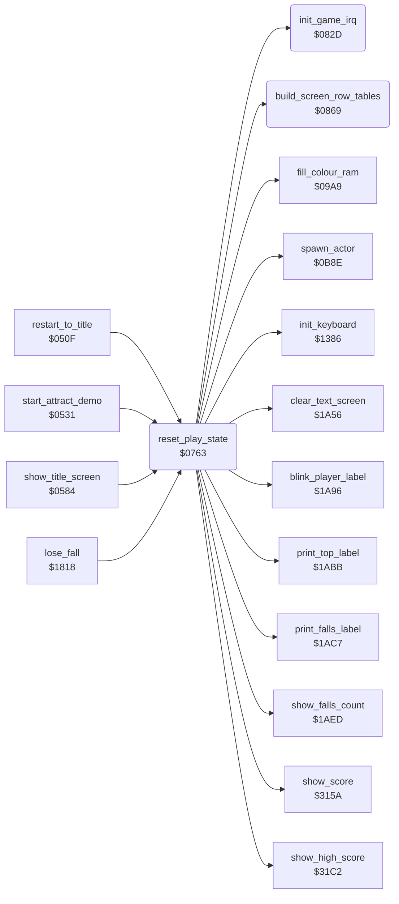

<!-- Generated by c64-docs from knowledge revision 20261017T121733.607-wszjh3 and src/source-map.json. Do not edit: change the knowledge, generate the source again, then run generate.ts. -->
# play_init.asm: Play state reset: IRQ setup, game screen, status line and screen row tables

Range `$0763-$08B0`. Source: [play_init.asm](../../../src/play_init.asm). Index: [the reference](../index.md).

## Call graph

A solid arrow is a call, a thick arrow a table entry, a dotted arrow a jump. Rounded nodes are in this file.

## Names

### [`reset_play_state`](../../../src/play_init.asm#L19) `$0763`

*routine*

Reset the play state. Called by restart_to_title, start_attract_demo, start_new_game and next_turn_enter_room (new fall or the other player's turn). - Clears enemy_follow_x of Yamo and the Ninja (no enemy follows Bruce into the next room). - init_game_irq (game raster IRQ, CIA interrupts off), init_keyboard; last_game_key = $FF. - Builds the text row address tables (text_line_top_lo/hi, text_line_bottom_lo/hi) for double rows from screen row -1, then makes entry 0 the single status row 0 and sends the lower rows of entries 0 and 1 to io1_dummy. - Prepares the game screen: colour RAM $F8 (multicolour, black), rows 0-1 black with spaces, row 2 of character 6 (separator), all eight sprite pointers to block $0F, sprite_buf_a_spr0-sprite_buf_b_spr4 ($8180-$83FF) cleared, border/background colours from vic_start_colours, VIC bank 2, screen game_screen with charset_rooms_0_9, multicolour text, sprites off and X-expanded. - Draws the status line (score, TOP, the blinking player label, FALLS) and sets anim_chars_delay and anim_chars_step_count to 1 and all sprite_owner slots free. - Tail-jumps to spawn_actor with X = 0, A = 0: spawns Bruce.

- **Called from:** [`restart_to_title`](title_demo_start.md#restart_to_title) [`$052B`](../../../src/title_demo_start.asm#L24), [`start_attract_demo`](title_demo_start.md#start_attract_demo) [`$0553`](../../../src/title_demo_start.asm#L49), [`show_title_screen`](title_demo_start.md#show_title_screen) [`$0749`](../../../src/title_demo_start.asm#L307), [`lose_fall`](lose_fall_game_over.md#lose_fall) [`$1886`](../../../src/lose_fall_game_over.asm#L73)
- **Calls:** [`init_game_irq`](play_init.md#init_game_irq), [`init_keyboard`](keyboard_scan.md#init_keyboard), [`build_screen_row_tables`](play_init.md#build_screen_row_tables), [`clear_text_screen`](pause_status_line.md#clear_text_screen), [`fill_colour_ram`](title_menu.md#fill_colour_ram), [`show_score`](score.md#show_score), [`show_high_score`](score.md#show_high_score), [`blink_player_label`](pause_status_line.md#blink_player_label), [`print_top_label`](pause_status_line.md#print_top_label), [`print_falls_label`](pause_status_line.md#print_falls_label), [`show_falls_count`](status_and_keys.md#show_falls_count), [`spawn_actor`](actor_spawn.md#spawn_actor)
- **Reads:** [`vic_start_colours+2`](room_palettes.md#vic_start_colours), [`vic_start_colours+3`](room_palettes.md#vic_start_colours)
- **Writes:** [`enemy_follow_x`](../variables.md#enemy_follow_x), [`enemy_follow_x+1`](../variables.md#enemy_follow_x), [`last_game_key`](../variables.md#last_game_key), [`text_line_top_lo`](fireball_text_score_vars.md#text_line_top_lo), [`text_line_bottom_lo`](fireball_text_score_vars.md#text_line_bottom_lo), [`text_line_bottom_lo+1`](fireball_text_score_vars.md#text_line_bottom_lo), [`text_line_top_hi`](fireball_text_score_vars.md#text_line_top_hi), [`text_line_bottom_hi`](fireball_text_score_vars.md#text_line_bottom_hi), [`text_line_bottom_hi+1`](fireball_text_score_vars.md#text_line_bottom_hi), [`RANDOM+1035`](../variables.md#RANDOM), [`RANDOM+1036`](../variables.md#RANDOM), [`RANDOM+1075`](../variables.md#RANDOM), [`RANDOM+1076`](../variables.md#RANDOM), [`game_screen+38`](../variables.md#game_screen), [`game_screen+39`](../variables.md#game_screen), [`game_screen+118`](../variables.md#game_screen), [`game_screen+119`](../variables.md#game_screen), [`room_charset_a+30`](room_charset_a.md#room_charset_a), [`text_font_letters+38`](../variables.md#text_font_letters), [`sprite_buf_a_spr0`](../variables.md#sprite_buf_a_spr0), [`sprite_buf_a_spr0+1`](../variables.md#sprite_buf_a_spr0), [`sprite_buf_a_spr4`](../variables.md#sprite_buf_a_spr4), [`sprite_buf_a_spr4+1`](../variables.md#sprite_buf_a_spr4), [`sprite_buf_b_spr1`](../variables.md#sprite_buf_b_spr1), [`sprite_buf_b_spr1+1`](../variables.md#sprite_buf_b_spr1), [`BGCOL1`](../variables.md#BGCOL1), [`BGCOL2`](../variables.md#BGCOL2), [`CI2PRA`](../variables.md#CI2PRA), [`VMCSB`](../variables.md#VMCSB), [`room_vmcsb`](../variables.md#room_vmcsb), [`SCROLX`](../variables.md#SCROLX), [`SPENA`](../variables.md#SPENA), [`YXPAND`](../variables.md#YXPAND), [`SPBGPR`](../variables.md#SPBGPR), [`SPMC`](../variables.md#SPMC), [`XXPAND`](../variables.md#XXPAND), [`up_blink_timer`](fireball_text_score_vars.md#up_blink_timer), [`anim_chars_delay`](../variables.md#anim_chars_delay), [`anim_chars_step_count`](../variables.md#anim_chars_step_count), [`sprite_owner+3`](../variables.md#sprite_owner) and 1 more
- **Refers to:** [`enemy_follow_x`](../variables.md#enemy_follow_x), [`game_screen`](../variables.md#game_screen), [`text_line_bottom_lo`](fireball_text_score_vars.md#text_line_bottom_lo), [`io1_dummy`](../variables.md#io1_dummy), [`text_line_bottom_hi`](fireball_text_score_vars.md#text_line_bottom_hi), [`sprite_buf_b_spr4`](../variables.md#sprite_buf_b_spr4)

### [`reset_play_clear_top_rows`](../../../src/play_init.asm#L45) `$079C`

*label*

- **Jumped to from:** [`reset_play_state`](play_init.md#reset_play_state) [`$07BD`](../../../src/play_init.asm#L61)

### [`reset_play_next_column`](../../../src/play_init.asm#L59) `$07BC`

*label*

- **Jumped to from:** [`reset_play_state`](play_init.md#reset_play_state) [`$07B0`](../../../src/play_init.asm#L54)

### [`reset_play_clear_sprite_data`](../../../src/play_init.asm#L64) `$07C2`

*label*

clear sprite blocks 6-15 ($8180-$83FF)

- **Jumped to from:** [`reset_play_state`](play_init.md#reset_play_state) [`$07CC`](../../../src/play_init.asm#L69)

### [`reset_play_set_colours`](../../../src/play_init.asm#L71) `$07D0`

*label*

$D020-$D023 = black, dark grey, white, light blue

- **Jumped to from:** [`reset_play_state`](play_init.md#reset_play_state) [`$07D7`](../../../src/play_init.asm#L75)

### [`reset_play_clear_sprite_owners`](../../../src/play_init.asm#L104) `$0820`

*label*

all five sprite slots free

- **Jumped to from:** [`reset_play_state`](play_init.md#reset_play_state) [`$0824`](../../../src/play_init.asm#L107)

### [`init_game_irq`](../../../src/play_init.asm#L114) `$082D`

*routine*

Set up the game interrupts: disable and acknowledge all CIA interrupts, set irq_vector to irq_game_bottom, enable the VIC raster IRQ at line 251 (below the play area; that handler starts the chain of the frame) and start SID voice 3 noise again (random source). Called by reset_play_state. Changes A.

- **Called from:** [`reset_play_state`](play_init.md#reset_play_state) [`$0769`](../../../src/play_init.asm#L23)
- **Reads:** [`CI2ICR`](../variables.md#CI2ICR), [`CIAICR`](../variables.md#CIAICR), [`SCROLY`](../variables.md#SCROLY)
- **Writes:** [`CI2ICR`](../variables.md#CI2ICR), [`CIAICR`](../variables.md#CIAICR), [`irq_vector`](cold_start.md#irq_vector), [`irq_vector_hi`](cold_start.md#irq_vector_hi), [`IRQMSK`](../variables.md#IRQMSK), [`VICIRQ`](../variables.md#VICIRQ), [`SCROLY`](../variables.md#SCROLY), [`RASTER`](../variables.md#RASTER), [`FRELO3`](../variables.md#FRELO3), [`FREHI3`](../variables.md#FREHI3), [`VCREG3`](../variables.md#VCREG3)
- **Refers to:** [`irq_game_bottom`](game_irq.md#irq_game_bottom)

### [`init_game_irq_enable`](../../../src/play_init.asm#L126) `$0848`

*label*

### [`build_screen_row_tables`](../../../src/play_init.asm#L144) `$0869`

*routine*

Build the text row address tables of print_message and the room code. Input: A/Y = low/high byte of the first address. Entry i (0-13) of text_line_top_lo/hi = first + 80*i; entry i of text_line_bottom_lo/hi = first + 40 + 80*i. reset_play_state passes game_screen - 40, so entry i is the double row of screen rows 2i-1 (upper) and 2i (lower). Changes A, X.

- **Called from:** [`reset_play_state`](play_init.md#reset_play_state) [`$0777`](../../../src/play_init.asm#L29)
- **Reads:** [`text_line_top_lo`](fireball_text_score_vars.md#text_line_top_lo), [`text_line_top_lo+1`](fireball_text_score_vars.md#text_line_top_lo), [`text_line_top_hi`](fireball_text_score_vars.md#text_line_top_hi), [`text_line_top_hi+1`](fireball_text_score_vars.md#text_line_top_hi), [`text_line_bottom_lo`](fireball_text_score_vars.md#text_line_bottom_lo), [`text_line_bottom_lo+1`](fireball_text_score_vars.md#text_line_bottom_lo), [`text_line_bottom_hi`](fireball_text_score_vars.md#text_line_bottom_hi), [`text_line_bottom_hi+1`](fireball_text_score_vars.md#text_line_bottom_hi)
- **Writes:** [`text_line_top_lo`](fireball_text_score_vars.md#text_line_top_lo), [`text_line_top_hi`](fireball_text_score_vars.md#text_line_top_hi), [`text_line_top_lo+1`](fireball_text_score_vars.md#text_line_top_lo), [`text_line_top_lo+2`](fireball_text_score_vars.md#text_line_top_lo), [`text_line_top_hi+1`](fireball_text_score_vars.md#text_line_top_hi), [`text_line_top_hi+2`](fireball_text_score_vars.md#text_line_top_hi), [`text_line_bottom_lo`](fireball_text_score_vars.md#text_line_bottom_lo), [`text_line_bottom_hi`](fireball_text_score_vars.md#text_line_bottom_hi), [`text_line_bottom_lo+1`](fireball_text_score_vars.md#text_line_bottom_lo), [`text_line_bottom_lo+2`](fireball_text_score_vars.md#text_line_bottom_lo), [`text_line_bottom_hi+1`](fireball_text_score_vars.md#text_line_bottom_hi), [`text_line_bottom_hi+2`](fireball_text_score_vars.md#text_line_bottom_hi)
- **Refers to:** [`text_line_top_lo`](fireball_text_score_vars.md#text_line_top_lo), [`text_line_top_hi`](fireball_text_score_vars.md#text_line_top_hi), [`text_line_bottom_lo`](fireball_text_score_vars.md#text_line_bottom_lo), [`text_line_bottom_hi`](fireball_text_score_vars.md#text_line_bottom_hi)

### [`build_row_tables_top_loop`](../../../src/play_init.asm#L148) `$0871`

*label*

- **Jumped to from:** [`build_screen_row_tables`](play_init.md#build_screen_row_tables) [`$0885`](../../../src/play_init.asm#L158)

### [`build_row_tables_bottom_loop`](../../../src/play_init.asm#L167) `$089A`

*label*

- **Jumped to from:** [`build_screen_row_tables`](play_init.md#build_screen_row_tables) [`$08AE`](../../../src/play_init.asm#L177)
