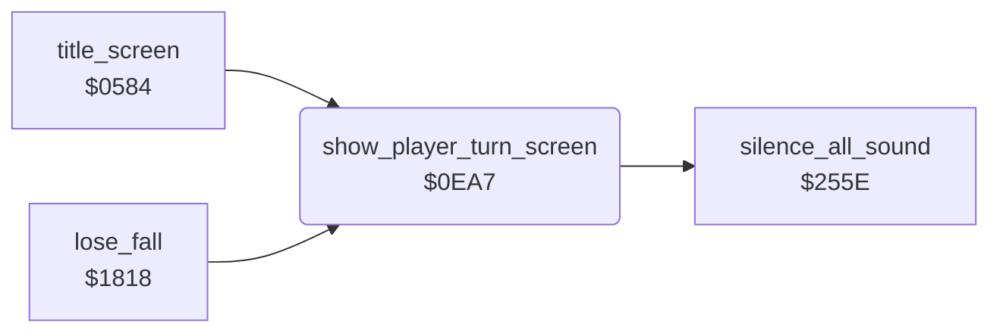

<!-- Generated by c64-docs from knowledge revision 20261016T170255.379-vv114c and src/source-map.json. Do not edit: change the knowledge, generate the source again, then run generate.ts. -->
# player_turn.asm: Player turn screen

Range `$0EA7-$0F71`. Source: [player_turn.asm](../../../src/player_turn.asm). Index: [the reference](../index.md).

## Call graph

A solid arrow is a call, a thick arrow a table entry, a dotted arrow a jump. Rounded nodes are in this file.

## Names

### [`show_player_turn_screen`](../../../src/player_turn.asm#L6) `$0EA7`

*routine*

Shows the player turn screen: blue screen, two text lines with the digit of current_player, IRQ at $14A4; waits 64 frames (128 in two-player mode).

- **Called from:** [`title_screen`](title.md#title_screen) [`$0738`](../../../src/title.asm#L202), [`lose_fall`](game_over.md#lose_fall) [`$184B`](../../../src/game_over.asm#L32)
- **Calls:** [`silence_all_sound`](sound_effects.md#silence_all_sound)
- **Reads:** [`SCROLY`](../variables.md#SCROLY), [`current_player`](../variables.md#current_player), [`room_atari_colour_records+1`](room_tables.md#room_atari_colour_records), [`room_atari_colour_records+2`](room_tables.md#room_atari_colour_records), [`room_atari_colour_records+5`](room_tables.md#room_atari_colour_records), [`room_atari_colour_records+6`](room_tables.md#room_atari_colour_records), [`player_banner_top+14`](room_tables.md#player_banner_top), [`player_banner_top+15`](room_tables.md#player_banner_top), [`player_banner_bottom+14`](room_tables.md#player_banner_bottom), [`player_banner_bottom+15`](room_tables.md#player_banner_bottom), [`two_player_mode`](variables.md#two_player_mode), [`frame_countdown`](../variables.md#frame_countdown), [`turn_wait_lo`](../variables.md#turn_wait_lo), [`turn_wait_mid`](../variables.md#turn_wait_mid), [`turn_wait_hi`](../variables.md#turn_wait_hi)
- **Writes:** [`SCROLY`](../variables.md#SCROLY), [`SPENA`](../variables.md#SPENA), [`EXTCOL`](../variables.md#EXTCOL), [`BGCOL0`](../variables.md#BGCOL0), [`screen_ram`](vic_bank2.md#screen_ram), [`screen_ram+1`](vic_bank2.md#screen_ram), [`screen_ram+256`](vic_bank2.md#screen_ram), [`screen_ram+257`](vic_bank2.md#screen_ram), [`screen_ram+512`](vic_bank2.md#screen_ram), [`screen_ram+513`](vic_bank2.md#screen_ram), [`screen_ram+768`](vic_bank2.md#screen_ram), [`screen_ram+769`](vic_bank2.md#screen_ram), [`player_banner_top+14`](room_tables.md#player_banner_top), [`player_banner_top+15`](room_tables.md#player_banner_top), [`player_banner_bottom+14`](room_tables.md#player_banner_bottom), [`player_banner_bottom+15`](room_tables.md#player_banner_bottom), [`screen_ram+306`](vic_bank2.md#screen_ram), [`screen_ram+307`](vic_bank2.md#screen_ram), [`screen_ram+346`](vic_bank2.md#screen_ram), [`screen_ram+347`](vic_bank2.md#screen_ram), [`irq_chain_vector`](init.md#irq_chain_vector), [`irq_vector_hi`](init.md#irq_vector_hi), [`IRQMSK`](../variables.md#IRQMSK), [`VICIRQ`](../variables.md#VICIRQ), [`RASTER`](../variables.md#RASTER), [`VMCSB`](../variables.md#VMCSB), [`SCROLX`](../variables.md#SCROLX), [`turn_wait_lo`](../variables.md#turn_wait_lo), [`turn_wait_mid`](../variables.md#turn_wait_mid), [`turn_wait_hi`](../variables.md#turn_wait_hi), [`frame_countdown`](../variables.md#frame_countdown)
- **Refers to:** [`screen_ram`](vic_bank2.md#screen_ram), [`player_banner_top`](room_tables.md#player_banner_top), [`player_banner_bottom`](room_tables.md#player_banner_bottom), [`irq_player_up_screen`](raster_irq_screens.md#irq_player_up_screen)

### [`turn_screen_wait`](../../../src/player_turn.asm#L79) `$0F47`

*label*

until frame_countdown = 0 or turn_wait_lo/mid/hi are all 0

- **Jumped to from:** [`show_player_turn_screen`](player_turn.md#show_player_turn_screen) [`$0F43`](../../../src/player_turn.asm#L77), [`show_player_turn_screen`](player_turn.md#show_player_turn_screen) [`$0F6F`](../../../src/player_turn.asm#L102)

### [`turn_screen_done`](../../../src/player_turn.asm#L103) `$0F71`

*label*

- **Jumped to from:** [`show_player_turn_screen`](player_turn.md#show_player_turn_screen) [`$0F49`](../../../src/player_turn.asm#L81)
