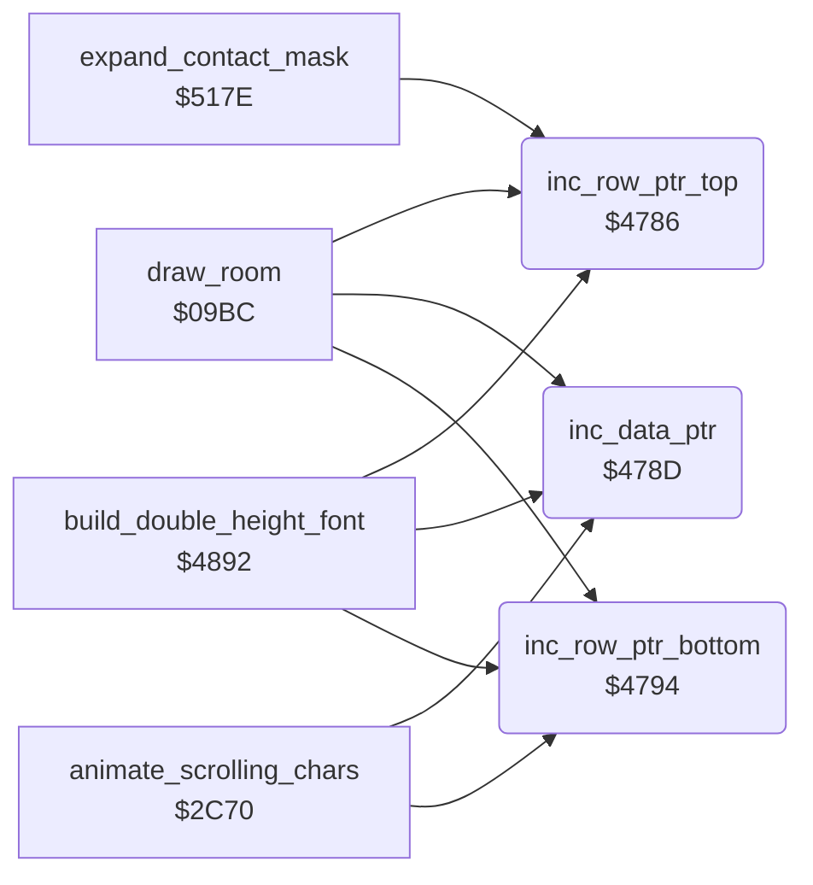

<!-- Generated by c64-docs from knowledge revision 20261017T105502.847-19cl2o and src/source-map.json. Do not edit: change the knowledge, generate the source again, then run generate.ts. -->
# pointer_helpers.asm: Increment helpers for the zero-page pointers row_ptr_top, data_ptr and row_ptr_bottom

Range `$4786-$479A`. Source: [pointer_helpers.asm](../../../src/pointer_helpers.asm). Index: [the reference](../index.md).

## Call graph

A solid arrow is a call, a thick arrow a table entry, a dotted arrow a jump. Rounded nodes are in this file.

## Names

### [`inc_row_ptr_top`](../../../src/pointer_helpers.asm#L7) `$4786`

*routine*

Increments the 16-bit pointer row_ptr_top. A, X, Y unchanged. Used by draw_room, build_double_height_font and expand_contact_mask.

- **Called from:** [`draw_room`](draw_room.md#draw_room) [`$0AF0`](../../../src/draw_room.asm#L193), [`draw_room`](draw_room.md#draw_room) [`$0B18`](../../../src/draw_room.asm#L213), [`build_double_height_font`](draw_helpers.md#build_double_height_font) [`$48A2`](../../../src/draw_helpers.asm#L61), [`build_double_height_font`](draw_helpers.md#build_double_height_font) [`$48B6`](../../../src/draw_helpers.asm#L72), [`expand_contact_mask`](frame_builder.md#expand_contact_mask) [`$51E8`](../../../src/frame_builder.asm#L151)
- **Reads:** [`row_ptr_top`](../variables.md#row_ptr_top), [`row_ptr_top+1`](../variables.md#row_ptr_top)
- **Writes:** [`row_ptr_top`](../variables.md#row_ptr_top), [`row_ptr_top+1`](../variables.md#row_ptr_top)
- **Refers to:** [`row_ptr_top`](../variables.md#row_ptr_top)

### [`inc_row_ptr_top_done`](../../../src/pointer_helpers.asm#L11) `$478C`

*label*

- **Jumped to from:** [`inc_row_ptr_top`](pointer_helpers.md#inc_row_ptr_top) [`$4788`](../../../src/pointer_helpers.asm#L9)

### [`inc_data_ptr`](../../../src/pointer_helpers.asm#L15) `$478D`

*routine*

Increments the 16-bit pointer data_ptr. A, X, Y unchanged. Used by draw_room, build_double_height_font and animate_scrolling_chars.

- **Called from:** [`draw_room`](draw_room.md#draw_room) [`$0AE0`](../../../src/draw_room.asm#L184), [`draw_room`](draw_room.md#draw_room) [`$0AF3`](../../../src/draw_room.asm#L194), [`draw_room`](draw_room.md#draw_room) [`$0B08`](../../../src/draw_room.asm#L204), [`draw_room`](draw_room.md#draw_room) [`$0B2A`](../../../src/draw_room.asm#L220), [`animate_scrolling_chars`](animated_chars.md#animate_scrolling_chars) [`$2D34`](../../../src/animated_chars.asm#L130), [`build_double_height_font`](draw_helpers.md#build_double_height_font) [`$489A`](../../../src/draw_helpers.asm#L58), [`build_double_height_font`](draw_helpers.md#build_double_height_font) [`$489F`](../../../src/draw_helpers.asm#L60)
- **Reads:** [`data_ptr`](../variables.md#data_ptr), [`data_ptr+1`](../variables.md#data_ptr)
- **Writes:** [`data_ptr`](../variables.md#data_ptr), [`data_ptr+1`](../variables.md#data_ptr)
- **Refers to:** [`data_ptr`](../variables.md#data_ptr)

### [`inc_data_ptr_done`](../../../src/pointer_helpers.asm#L19) `$4793`

*label*

- **Jumped to from:** [`inc_data_ptr`](pointer_helpers.md#inc_data_ptr) [`$478F`](../../../src/pointer_helpers.asm#L17)

### [`inc_row_ptr_bottom`](../../../src/pointer_helpers.asm#L23) `$4794`

*routine*

Increments the 16-bit pointer row_ptr_bottom. A, X, Y unchanged. Used by draw_room, build_double_height_font and animate_scrolling_chars.

- **Called from:** [`draw_room`](draw_room.md#draw_room) [`$0AF6`](../../../src/draw_room.asm#L195), [`draw_room`](draw_room.md#draw_room) [`$0B1B`](../../../src/draw_room.asm#L214), [`animate_scrolling_chars`](animated_chars.md#animate_scrolling_chars) [`$2D3E`](../../../src/animated_chars.asm#L135), [`build_double_height_font`](draw_helpers.md#build_double_height_font) [`$48AE`](../../../src/draw_helpers.asm#L69), [`build_double_height_font`](draw_helpers.md#build_double_height_font) [`$48B3`](../../../src/draw_helpers.asm#L71)
- **Reads:** [`row_ptr_bottom`](../variables.md#row_ptr_bottom), [`row_ptr_bottom+1`](../variables.md#row_ptr_bottom)
- **Writes:** [`row_ptr_bottom`](../variables.md#row_ptr_bottom), [`row_ptr_bottom+1`](../variables.md#row_ptr_bottom)
- **Refers to:** [`row_ptr_bottom`](../variables.md#row_ptr_bottom)

### [`inc_row_ptr_bottom_done`](../../../src/pointer_helpers.asm#L27) `$479A`

*label*

- **Jumped to from:** [`inc_row_ptr_bottom`](pointer_helpers.md#inc_row_ptr_bottom) [`$4796`](../../../src/pointer_helpers.asm#L25)
