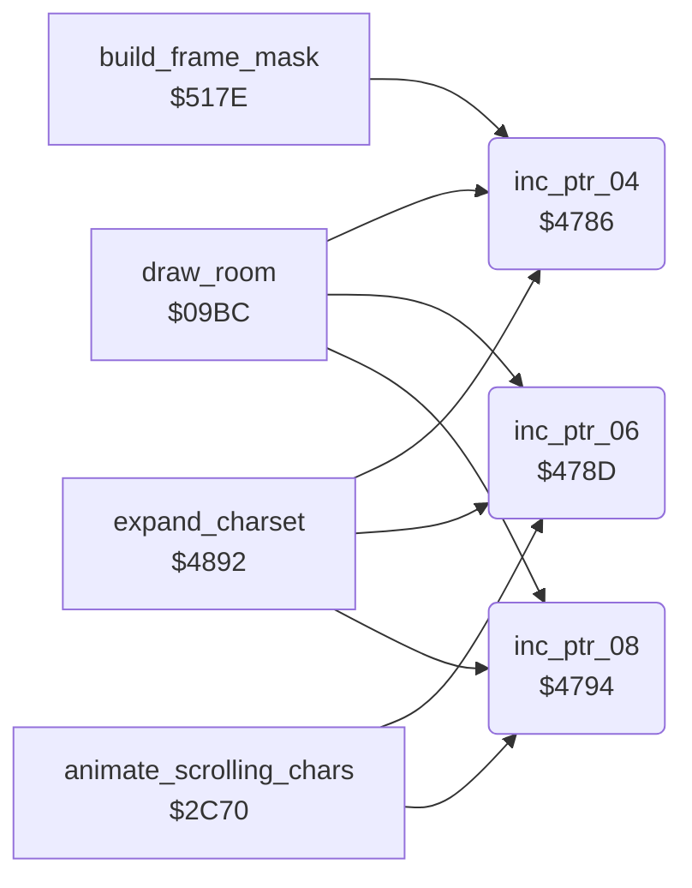

<!-- Generated by c64-docs from knowledge revision 20261016T170255.379-vv114c and src/source-map.json. Do not edit: change the knowledge, generate the source again, then run generate.ts. -->
# pointer_helpers.asm: 16-bit pointer increment helpers

Range `$4786-$479A`. Source: [pointer_helpers.asm](../../../src/pointer_helpers.asm). Index: [the reference](../index.md).

## Call graph

A solid arrow is a call, a thick arrow a table entry, a dotted arrow a jump. Rounded nodes are in this file.

## Names

### [`inc_ptr_04`](../../../src/pointer_helpers.asm#L6) `$4786`

*routine*

Increments the 16-bit pointer $04/$05.

- **Called from:** [`draw_room`](room_draw.md#draw_room) [`$0AF0`](../../../src/room_draw.asm#L169), [`draw_room`](room_draw.md#draw_room) [`$0B18`](../../../src/room_draw.asm#L189), [`expand_charset`](charset_expand.md#expand_charset) [`$48A2`](../../../src/charset_expand.asm#L52), [`expand_charset`](charset_expand.md#expand_charset) [`$48B6`](../../../src/charset_expand.asm#L62), [`build_frame_mask`](collision.md#build_frame_mask) [`$51E8`](../../../src/collision.asm#L119)
- **Reads:** [`work_ptr_a`](../variables.md#work_ptr_a), [`work_ptr_a+1`](../variables.md#work_ptr_a)
- **Writes:** [`work_ptr_a`](../variables.md#work_ptr_a), [`work_ptr_a+1`](../variables.md#work_ptr_a)
- **Refers to:** [`work_ptr_a`](../variables.md#work_ptr_a)

### [`inc_ptr_06`](../../../src/pointer_helpers.asm#L13) `$478D`

*routine*

Increments the 16-bit pointer $06/$07.

- **Called from:** [`draw_room`](room_draw.md#draw_room) [`$0AE0`](../../../src/room_draw.asm#L160), [`draw_room`](room_draw.md#draw_room) [`$0AF3`](../../../src/room_draw.asm#L170), [`draw_room`](room_draw.md#draw_room) [`$0B08`](../../../src/room_draw.asm#L180), [`draw_room`](room_draw.md#draw_room) [`$0B2A`](../../../src/room_draw.asm#L196), [`animate_scrolling_chars`](animated_chars.md#animate_scrolling_chars) [`$2D34`](../../../src/animated_chars.asm#L122), [`expand_charset`](charset_expand.md#expand_charset) [`$489A`](../../../src/charset_expand.asm#L49), [`expand_charset`](charset_expand.md#expand_charset) [`$489F`](../../../src/charset_expand.asm#L51)
- **Reads:** [`work_ptr_b`](../variables.md#work_ptr_b), [`work_ptr_b+1`](../variables.md#work_ptr_b)
- **Writes:** [`work_ptr_b`](../variables.md#work_ptr_b), [`work_ptr_b+1`](../variables.md#work_ptr_b)
- **Refers to:** [`work_ptr_b`](../variables.md#work_ptr_b)

### [`inc_ptr_08`](../../../src/pointer_helpers.asm#L20) `$4794`

*routine*

Increments the 16-bit pointer $08/$09.

- **Called from:** [`draw_room`](room_draw.md#draw_room) [`$0AF6`](../../../src/room_draw.asm#L171), [`draw_room`](room_draw.md#draw_room) [`$0B1B`](../../../src/room_draw.asm#L190), [`animate_scrolling_chars`](animated_chars.md#animate_scrolling_chars) [`$2D3E`](../../../src/animated_chars.asm#L127), [`expand_charset`](charset_expand.md#expand_charset) [`$48AE`](../../../src/charset_expand.asm#L59), [`expand_charset`](charset_expand.md#expand_charset) [`$48B3`](../../../src/charset_expand.asm#L61)
- **Reads:** [`work_ptr_c`](../variables.md#work_ptr_c), [`work_ptr_c+1`](../variables.md#work_ptr_c)
- **Writes:** [`work_ptr_c`](../variables.md#work_ptr_c), [`work_ptr_c+1`](../variables.md#work_ptr_c)
- **Refers to:** [`work_ptr_c`](../variables.md#work_ptr_c)
