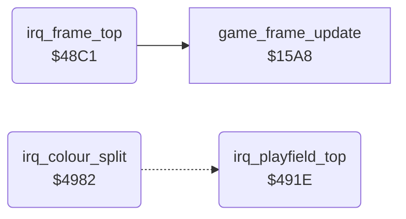

<!-- Generated by c64-docs from knowledge revision 20261016T170255.379-vv114c and src/source-map.json. Do not edit: change the knowledge, generate the source again, then run generate.ts. -->
# raster_irq_game.asm: Raster IRQ chain: status line, room charset, colour splits

Range `$48C1-$49BC`. Source: [raster_irq_game.asm](../../../src/raster_irq_game.asm). Index: [the reference](../index.md).

## Call graph

A solid arrow is a call, a thick arrow a table entry, a dotted arrow a jump. Rounded nodes are in this file.

## Names

### [`irq_frame_top`](../../../src/raster_irq_game.asm#L6) `$48C1`

*routine*

Raster IRQ at line $FD ($FB on the first frame, set by init_game_irq): status charset $8800 ($D018=$32) and background $FC for screen rows 0-1 of the next frame, next IRQ irq_playfield_top at line $40, copies the 4 colour triplets of current_room to raster_colours $0153-$015E and 4 raster-list bytes to current_raster_splits, then runs game_frame_update.

- **Referred to by:** [`init_game_irq`](game_setup.md#init_game_irq) [`$083C`](../../../src/game_setup.asm#L104), [`init_game_irq`](game_setup.md#init_game_irq) [`$0841`](../../../src/game_setup.asm#L106), [`irq_playfield_top`](raster_irq_game.md#irq_playfield_top) [`$4975`](../../../src/raster_irq_game.asm#L101), [`irq_playfield_top`](raster_irq_game.md#irq_playfield_top) [`$497A`](../../../src/raster_irq_game.asm#L103)
- **Calls:** [`game_frame_update`](frame_update.md#game_frame_update)
- **Reads:** [`SCROLY`](../variables.md#SCROLY), [`current_room`](../variables.md#current_room), [`work_ptr_c+2`](../variables.md#work_ptr_c), [`exit2_x+12`](room_tables.md#exit2_x), [`exit2_x+13`](room_tables.md#exit2_x), [`work_ptr_c+4`](../variables.md#work_ptr_c)
- **Writes:** [`VMCSB`](../variables.md#VMCSB), [`BGCOL0`](../variables.md#BGCOL0), [`irq_chain_vector`](init.md#irq_chain_vector), [`irq_vector_hi`](init.md#irq_vector_hi), [`IRQMSK`](../variables.md#IRQMSK), [`VICIRQ`](../variables.md#VICIRQ), [`SCROLY`](../variables.md#SCROLY), [`RASTER`](../variables.md#RASTER), [`work_ptr_c+2`](../variables.md#work_ptr_c), [`work_ptr_c+3`](../variables.md#work_ptr_c), [`work_ptr_c+4`](../variables.md#work_ptr_c), [`work_ptr_c+5`](../variables.md#work_ptr_c), [`raster_colours+10`](../variables.md#raster_colours), [`raster_colours+11`](../variables.md#raster_colours), [`raster_lines_room2`](room_colours.md#raster_lines_room2)
- **Refers to:** [`irq_playfield_top`](raster_irq_game.md#irq_playfield_top), [`room_split_colour_ptrs`](room_split_tables.md#room_split_colour_ptrs), [`room_split_colour_ptrs+1`](room_split_tables.md#room_split_colour_ptrs), [`room_raster_line_ptrs`](room_split_tables.md#room_raster_line_ptrs), [`room_raster_line_ptrs+1`](room_split_tables.md#room_raster_line_ptrs)

### [`irq_copy_room_colours`](../../../src/raster_irq_game.asm#L36) `$4904`

*label*

Y = 11..0: raster_colours[Y] from the room's band colours; for Y < 4 also current_raster_splits[Y] from the room's raster list (bytes after the $FD end are copied too).

- **Jumped to from:** [`irq_frame_top`](raster_irq_game.md#irq_frame_top) [`$4913`](../../../src/raster_irq_game.asm#L45)

### [`irq_playfield_top`](../../../src/raster_irq_game.asm#L54) `$491E`

*routine*

Raster IRQ at line $40: waits for line $42, sets the room charset ($F2) and the first colour triplet $0153-$0155, then schedules the first colour split.

- **Referred to by:** [`irq_frame_top`](raster_irq_game.md#irq_frame_top) [`$48CB`](../../../src/raster_irq_game.asm#L11), [`irq_frame_top`](raster_irq_game.md#irq_frame_top) [`$48D0`](../../../src/raster_irq_game.asm#L13)
- **Reads:** [`RASTER`](../variables.md#RASTER), [`room_charset_d018`](../variables.md#room_charset_d018), [`raster_colours`](../variables.md#raster_colours), [`raster_colours+1`](../variables.md#raster_colours), [`raster_colours+2`](../variables.md#raster_colours), [`SCROLY`](../variables.md#SCROLY), [`split_index`](../variables.md#split_index), [`current_raster_splits`](room_colours.md#current_raster_splits)
- **Writes:** [`VMCSB`](../variables.md#VMCSB), [`BGCOL0`](../variables.md#BGCOL0), [`BGCOL1`](../variables.md#BGCOL1), [`BGCOL2`](../variables.md#BGCOL2), [`split_index`](../variables.md#split_index), [`split_colour_offset`](../variables.md#split_colour_offset), [`irq_chain_vector`](init.md#irq_chain_vector), [`irq_vector_hi`](init.md#irq_vector_hi), [`IRQMSK`](../variables.md#IRQMSK), [`VICIRQ`](../variables.md#VICIRQ), [`SCROLY`](../variables.md#SCROLY), [`RASTER`](../variables.md#RASTER)
- **Refers to:** [`raster_colours`](../variables.md#raster_colours), [`irq_colour_split`](raster_irq_game.md#irq_colour_split), [`irq_frame_top`](raster_irq_game.md#irq_frame_top)

### [`irq_wait_line_42`](../../../src/raster_irq_game.asm#L56) `$4920`

*label*

- **Jumped to from:** [`irq_playfield_top`](raster_irq_game.md#irq_playfield_top) [`$4923`](../../../src/raster_irq_game.asm#L58)

### [`irq_schedule_split`](../../../src/raster_irq_game.asm#L80) `$4953`

*label*

Acknowledges the raster IRQ and sets the next compare line to current_raster_splits[split_index]. When that line is $FD the next handler is irq_frame_top; otherwise irq_chain_vector stays irq_colour_split. Returns from the IRQ.

- **Jumped to from:** [`irq_colour_split`](raster_irq_game.md#irq_colour_split) [`$49BA`](../../../src/raster_irq_game.asm#L139)

### [`irq_return`](../../../src/raster_irq_game.asm#L92) `$496F`

*label*

- **Jumped to from:** [`irq_playfield_top`](raster_irq_game.md#irq_playfield_top) [`$497F`](../../../src/raster_irq_game.asm#L105)

### [`irq_schedule_frame_top`](../../../src/raster_irq_game.asm#L100) `$4975`

*label*

Last band done: the IRQ at line $FD goes to irq_frame_top.

- **Jumped to from:** [`irq_playfield_top`](raster_irq_game.md#irq_playfield_top) [`$496D`](../../../src/raster_irq_game.asm#L91)

### [`irq_colour_split`](../../../src/raster_irq_game.asm#L107) `$4982`

*routine*

Raster IRQ for one colour band: waits for the listed line +2 (or +3), sets $D021 from $0153+$F4 and $D022/$D023 from the next bytes, advances $F4 by 3 and $44 by 1, then schedules the next split.

- **Referred to by:** [`irq_playfield_top`](raster_irq_game.md#irq_playfield_top) [`$4949`](../../../src/raster_irq_game.asm#L75), [`irq_playfield_top`](raster_irq_game.md#irq_playfield_top) [`$494E`](../../../src/raster_irq_game.asm#L77)
- **Jumps to:** [`irq_schedule_split`](raster_irq_game.md#irq_schedule_split)
- **Reads:** [`split_colour_offset`](../variables.md#split_colour_offset), [`random_table+43`](../variables.md#random_table), [`split_index`](../variables.md#split_index), [`RASTER`](../variables.md#RASTER), [`random_table+44`](../variables.md#random_table), [`random_table+45`](../variables.md#random_table)
- **Writes:** [`BGCOL0`](../variables.md#BGCOL0), [`BGCOL1`](../variables.md#BGCOL1), [`BGCOL2`](../variables.md#BGCOL2), [`split_colour_offset`](../variables.md#split_colour_offset), [`split_index`](../variables.md#split_index)
- **Refers to:** [`current_raster_splits`](room_colours.md#current_raster_splits), [`raster_colours`](../variables.md#raster_colours)

### [`irq_split_wait_line`](../../../src/raster_irq_game.asm#L118) `$4991`

*label*

Waits until the raster is at the listed line + 2 (then about 50 cycles more) or already at line + 3.

- **Jumped to from:** [`irq_colour_split`](raster_irq_game.md#irq_colour_split) [`$4999`](../../../src/raster_irq_game.asm#L122)

### [`irq_split_set_colours`](../../../src/raster_irq_game.asm#L127) `$49A0`

*label*

- **Jumped to from:** [`irq_colour_split`](raster_irq_game.md#irq_colour_split) [`$4994`](../../../src/raster_irq_game.asm#L120)
