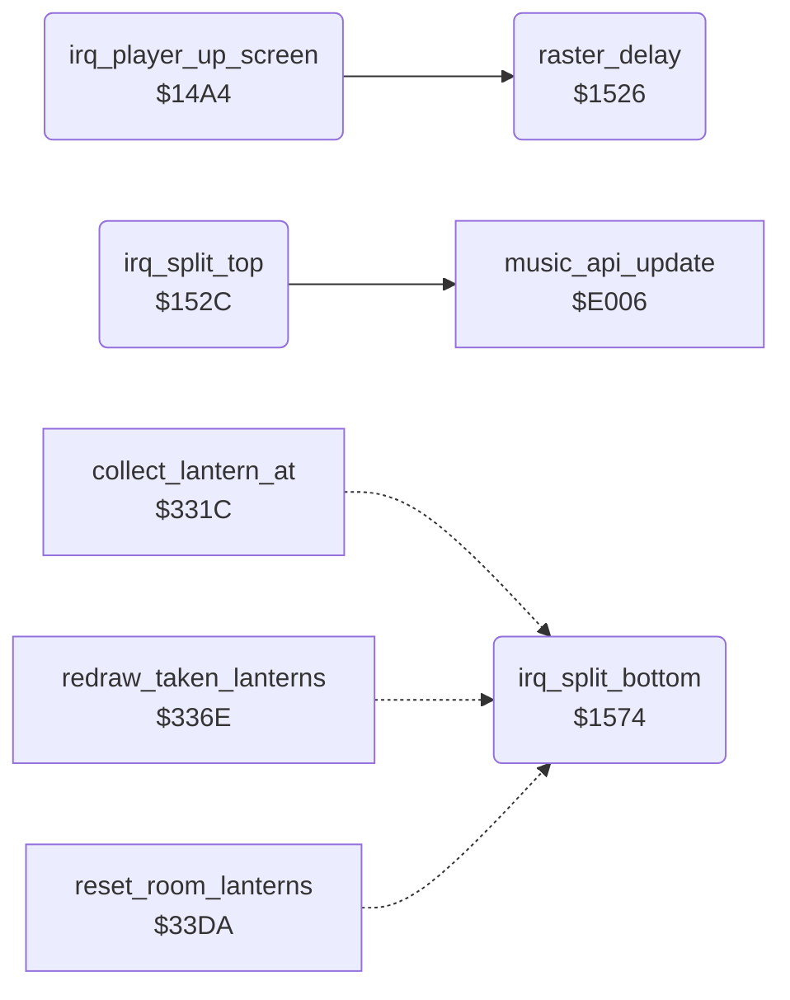

<!-- Generated by c64-docs from knowledge revision 20261016T170255.379-vv114c and src/source-map.json. Do not edit: change the knowledge, generate the source again, then run generate.ts. -->
# raster_irq_screens.asm: Raster IRQ handlers of the player-up screen and of the title / game-over split screen

Range `$14A4-$15A7`. Source: [raster_irq_screens.asm](../../../src/raster_irq_screens.asm). Index: [the reference](../index.md).

## Call graph

A solid arrow is a call, a thick arrow a table entry, a dotted arrow a jump. Rounded nodes are in this file.

## Names

### [`irq_player_up_screen`](../../../src/raster_irq_screens.asm#L6) `$14A4`

*routine*

Raster IRQ at line $63 of the player-up screen ($0EA7): waits for line $6D/$6E, then changes $D022 seven times to draw colour bars over the text, sets charset $8000 multicolour, rearms itself at line $63 and decrements frame_countdown.

- **Referred to by:** [`show_player_turn_screen`](player_turn.md#show_player_turn_screen) [`$0F00`](../../../src/player_turn.asm#L49), [`show_player_turn_screen`](player_turn.md#show_player_turn_screen) [`$0F05`](../../../src/player_turn.asm#L51)
- **Calls:** [`raster_delay`](raster_irq_screens.md#raster_delay)
- **Reads:** [`RASTER`](../variables.md#RASTER), [`SCROLY`](../variables.md#SCROLY), [`frame_countdown`](../variables.md#frame_countdown)
- **Writes:** [`BGCOL1`](../variables.md#BGCOL1), [`VMCSB`](../variables.md#VMCSB), [`SCROLX`](../variables.md#SCROLX), [`IRQMSK`](../variables.md#IRQMSK), [`VICIRQ`](../variables.md#VICIRQ), [`SCROLY`](../variables.md#SCROLY), [`RASTER`](../variables.md#RASTER), [`frame_countdown`](../variables.md#frame_countdown)

### [`player_up_wait_line`](../../../src/raster_irq_screens.asm#L9) `$14A8`

*label*

- **Jumped to from:** [`irq_player_up_screen`](raster_irq_screens.md#irq_player_up_screen) [`$14B0`](../../../src/raster_irq_screens.asm#L13)

### [`player_up_colour_bars`](../../../src/raster_irq_screens.asm#L18) `$14B7`

*label*

- **Jumped to from:** [`irq_player_up_screen`](raster_irq_screens.md#irq_player_up_screen) [`$14AB`](../../../src/raster_irq_screens.asm#L11)

### [`raster_delay`](../../../src/raster_irq_screens.asm#L67) `$1526`

*routine*

Delay loop of 10 DEX steps (about one raster line).

- **Called from:** [`irq_player_up_screen`](raster_irq_screens.md#irq_player_up_screen) [`$14BC`](../../../src/raster_irq_screens.asm#L21), [`irq_player_up_screen`](raster_irq_screens.md#irq_player_up_screen) [`$14BF`](../../../src/raster_irq_screens.asm#L22), [`irq_player_up_screen`](raster_irq_screens.md#irq_player_up_screen) [`$14C7`](../../../src/raster_irq_screens.asm#L25), [`irq_player_up_screen`](raster_irq_screens.md#irq_player_up_screen) [`$14CA`](../../../src/raster_irq_screens.asm#L26), [`irq_player_up_screen`](raster_irq_screens.md#irq_player_up_screen) [`$14D2`](../../../src/raster_irq_screens.asm#L29), [`irq_player_up_screen`](raster_irq_screens.md#irq_player_up_screen) [`$14D5`](../../../src/raster_irq_screens.asm#L30), [`irq_player_up_screen`](raster_irq_screens.md#irq_player_up_screen) [`$14DD`](../../../src/raster_irq_screens.asm#L33), [`irq_player_up_screen`](raster_irq_screens.md#irq_player_up_screen) [`$14E5`](../../../src/raster_irq_screens.asm#L36), [`irq_player_up_screen`](raster_irq_screens.md#irq_player_up_screen) [`$14E8`](../../../src/raster_irq_screens.asm#L37), [`irq_player_up_screen`](raster_irq_screens.md#irq_player_up_screen) [`$14F0`](../../../src/raster_irq_screens.asm#L40), [`irq_player_up_screen`](raster_irq_screens.md#irq_player_up_screen) [`$14F3`](../../../src/raster_irq_screens.asm#L41)

### [`irq_split_top`](../../../src/raster_irq_screens.asm#L74) `$152C`

*routine*

Raster IRQ at line $FD of the title and game-over screens: decrements frame_countdown, counts attract_countdown down, selects charset $8000 multicolour for the upper part, runs the music player $E006 and sets irq_split_bottom at line $82.

- **Referred to by:** [`title_screen`](title.md#title_screen) [`$05DA`](../../../src/title.asm#L44), [`title_screen`](title.md#title_screen) [`$05DF`](../../../src/title.asm#L46), [`irq_split_bottom`](raster_irq_screens.md#irq_split_bottom) [`$1583`](../../../src/raster_irq_screens.asm#L121), [`irq_split_bottom`](raster_irq_screens.md#irq_split_bottom) [`$1588`](../../../src/raster_irq_screens.asm#L124), [`game_over`](game_over.md#game_over) [`$18A2`](../../../src/game_over.asm#L76), [`game_over`](game_over.md#game_over) [`$18A7`](../../../src/game_over.asm#L78)
- **Calls:** [`music_api_update`](music_player.md#music_api_update)
- **Reads:** [`frame_countdown`](../variables.md#frame_countdown), [`attract_countdown`](../variables.md#attract_countdown), [`title_timeout_hi`](../variables.md#title_timeout_hi), [`SCROLY`](../variables.md#SCROLY)
- **Writes:** [`frame_countdown`](../variables.md#frame_countdown), [`attract_countdown`](../variables.md#attract_countdown), [`title_timeout_hi`](../variables.md#title_timeout_hi), [`VMCSB`](../variables.md#VMCSB), [`SCROLX`](../variables.md#SCROLX), [`irq_chain_vector`](init.md#irq_chain_vector), [`irq_vector_hi`](init.md#irq_vector_hi), [`IRQMSK`](../variables.md#IRQMSK), [`VICIRQ`](../variables.md#VICIRQ), [`SCROLY`](../variables.md#SCROLY), [`RASTER`](../variables.md#RASTER)
- **Refers to:** [`irq_split_bottom`](raster_irq_screens.md#irq_split_bottom)

### [`split_top_attract_tick`](../../../src/raster_irq_screens.asm#L78) `$1532`

*label*

- **Jumped to from:** [`irq_split_top`](raster_irq_screens.md#irq_split_top) [`$152E`](../../../src/raster_irq_screens.asm#L76)

### [`irq_split_bottom`](../../../src/raster_irq_screens.asm#L112) `$1574`

*routine*

Raster IRQ at line $82 of the title and game-over screens: selects charset $8800 and 38 columns with X scroll 6 for the lower part, and sets irq_split_top at line $FD.

- **Referred to by:** [`irq_split_top`](raster_irq_screens.md#irq_split_top) [`$154F`](../../../src/raster_irq_screens.asm#L93), [`irq_split_top`](raster_irq_screens.md#irq_split_top) [`$1554`](../../../src/raster_irq_screens.asm#L95)
- **Reads:** [`SCROLY`](../variables.md#SCROLY)
- **Writes:** [`VMCSB`](../variables.md#VMCSB), [`SCROLX`](../variables.md#SCROLX), [`irq_chain_vector`](init.md#irq_chain_vector), [`irq_vector_hi`](init.md#irq_vector_hi), [`IRQMSK`](../variables.md#IRQMSK), [`VICIRQ`](../variables.md#VICIRQ), [`SCROLY`](../variables.md#SCROLY), [`RASTER`](../variables.md#RASTER)
- **Refers to:** [`irq_split_top`](raster_irq_screens.md#irq_split_top)
