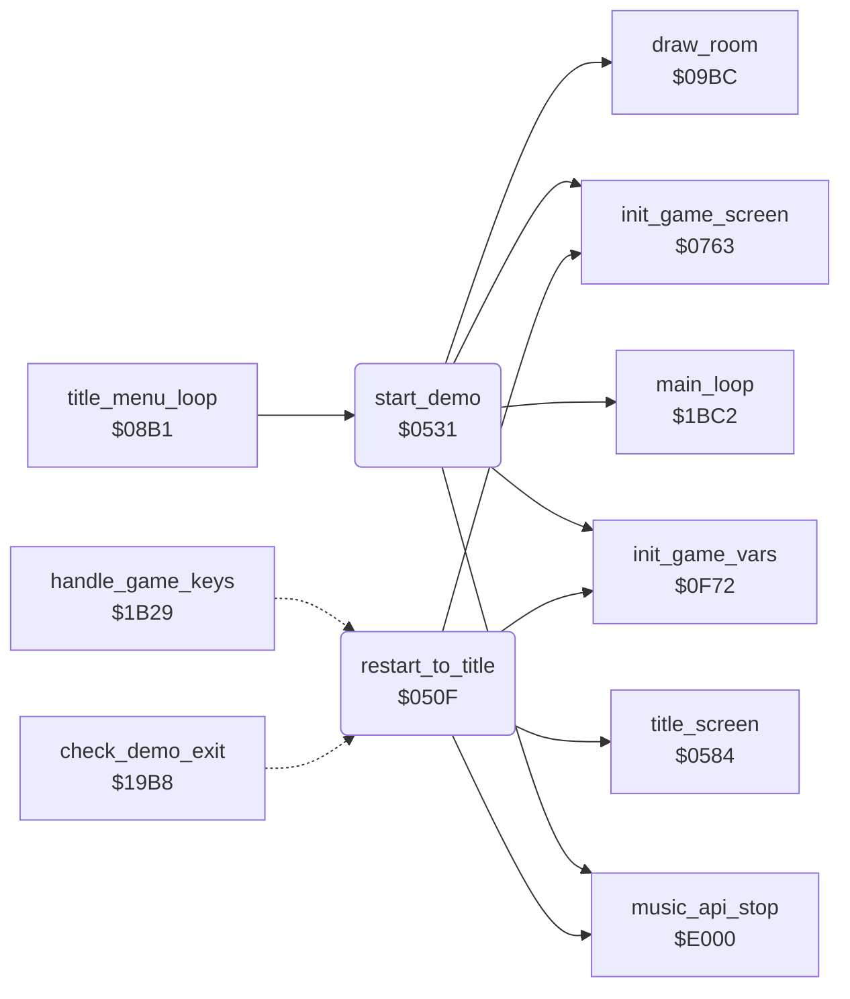

<!-- Generated by c64-docs from knowledge revision 20261016T170255.379-vv114c and src/source-map.json. Do not edit: change the knowledge, generate the source again, then run generate.ts. -->
# restart.asm: Restart to title and demo start

Range `$050F-$0583`. Source: [restart.asm](../../../src/restart.asm). Index: [the reference](../index.md).

## Call graph

A solid arrow is a call, a thick arrow a table entry, a dotted arrow a jump. Rounded nodes are in this file.

## Names

### [`restart_to_title`](../../../src/restart.asm#L6) `$050F`

*routine*

Resets the stack, blanks the screen, initialises the sound engine, points random_ptr at random_table, initialises the game variables and the game screen, then enters title_screen.

- **Jumped to from:** [`check_demo_exit`](status.md#check_demo_exit) [`$19E8`](../../../src/status.asm#L42), [`handle_game_keys`](status.md#handle_game_keys) [`$1B47`](../../../src/status.asm#L251)
- **Calls:** [`music_api_stop`](music_player.md#music_api_stop), [`init_game_vars`](game_vars.md#init_game_vars), [`init_game_screen`](game_setup.md#init_game_screen), [`title_screen`](title.md#title_screen)
- **Reads:** [`SCROLY`](../variables.md#SCROLY)
- **Writes:** [`SCROLY`](../variables.md#SCROLY), [`random_ptr`](../variables.md#random_ptr), [`random_ptr+1`](../variables.md#random_ptr)
- **Refers to:** [`random_table`](../variables.md#random_table), [`random_ptr`](../variables.md#random_ptr)

### [`start_demo`](../../../src/restart.asm#L24) `$0531`

*routine*

Attract mode: resets the game, clears game_playing, saves the title options to saved_two_player_mode/saved_human_opponent_mode and clears them, draws room 0, points demo_input_ptr at demo_input_data and enters main_loop.

- **Called from:** [`title_menu_loop`](title_menu.md#title_menu_loop) [`$08B7`](../../../src/title_menu.asm#L10)
- **Calls:** [`music_api_stop`](music_player.md#music_api_stop), [`init_game_vars`](game_vars.md#init_game_vars), [`init_game_screen`](game_setup.md#init_game_screen), [`draw_room`](room_draw.md#draw_room), [`main_loop`](main_loop.md#main_loop)
- **Reads:** [`SCROLY`](../variables.md#SCROLY), [`game_playing`](../variables.md#game_playing), [`two_player_mode`](variables.md#two_player_mode), [`human_opponent_mode`](variables.md#human_opponent_mode)
- **Writes:** [`SCROLY`](../variables.md#SCROLY), [`SPENA`](../variables.md#SPENA), [`SP0X`](../variables.md#SP0X), [`SP0Y`](../variables.md#SP0Y), [`music_stop_request`](music_player.md#music_stop_request), [`game_playing`](../variables.md#game_playing), [`saved_two_player_mode`](variables.md#saved_two_player_mode), [`saved_human_opponent_mode`](variables.md#saved_human_opponent_mode), [`human_opponent_mode`](variables.md#human_opponent_mode), [`two_player_mode`](variables.md#two_player_mode), [`demo_input_ptr`](../variables.md#demo_input_ptr), [`demo_input_ptr+1`](../variables.md#demo_input_ptr)
- **Refers to:** [`demo_input_data`](demo_input.md#demo_input_data), [`demo_input_ptr`](../variables.md#demo_input_ptr)
