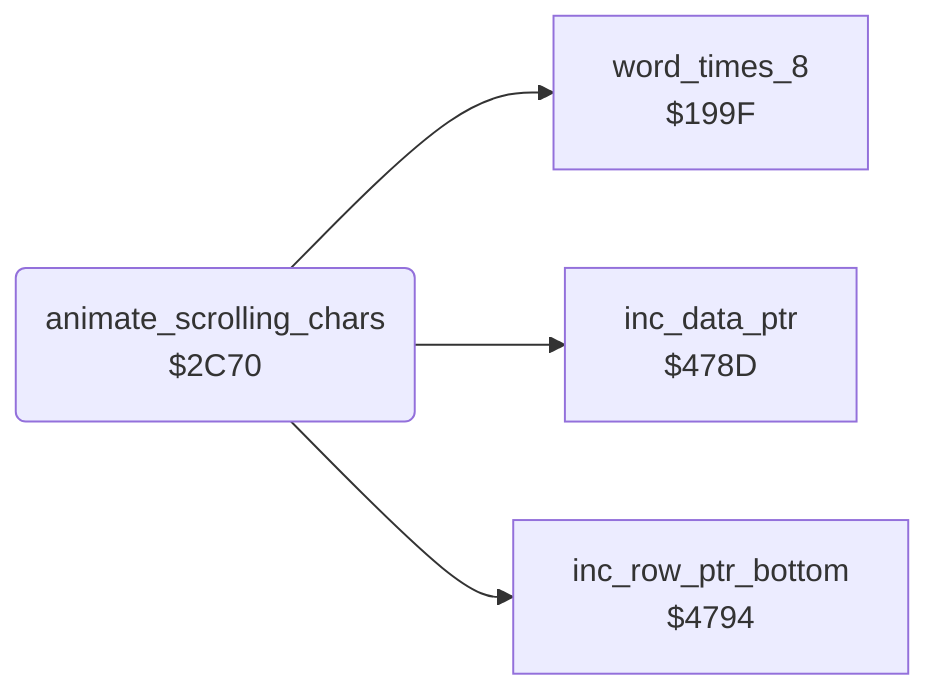

<!-- Generated by c64-docs from knowledge revision 20261025T214801.837-ucnw24 and .c64-re-tools/local/generated/src/source-map.json. Do not edit: change the knowledge, generate the source again, then run docs.ts generate. -->
# room/animated_chars.asm: Animated background characters $61-$63 (rooms 4, 5, 6, 8, 9 and 11)

Range `$2C70-$2D54`. Source: [room/animated_chars.asm](../../../../src/room/animated_chars.asm). Index: [the reference](../../index.md).

## Routines

| Routine | Address | Reached from | Summary |
|---|---|---|---|
| [`animate_scrolling_chars`](animated_chars.md#animate_scrolling_chars) | `$2C70` | [`room04_frame`](room_frames_0_7.md#room04_frame), [`room05_frame`](room_frames_0_7.md#room05_frame), [`room06_frame`](room_frames_0_7.md#room06_frame), [`room08_frame`](room_frames_8_11.md#room08_frame), [`room09_frame`](room_frames_8_11.md#room09_frame), [`room11_frame`](room_frames_8_11.md#room11_frame) | Animates the background characters $61, $62 and $63 by rotating their 8-byte patterns (moving scenery that an actor can ride, state $17). |
| [`animate_scrolling_chars_src`](animated_chars.md#animate_scrolling_chars_src) | `$2D2C` |  |  |

## Data

| Range | Type | Name | Read by | Written by |
|---|---|---|---|---|
| [`$2CED`](../../../../src/room/animated_chars.asm#L85)-`$2CEE` | dual-use | [`animate_scrolling_chars_wrap`](../../../../src/room/animated_chars.asm#L84) |  |  |

## Call graph

A solid arrow is a call, a thick arrow a table entry. Rounded nodes are in this file.

## Details

### [`animate_scrolling_chars`](../../../../src/room/animated_chars.asm#L12) `$2C70`

*routine*

Animates the background characters $61, $62 and $63 by rotating their 8-byte patterns (moving scenery that an actor can ride, state $17). Called by the frame handlers of rooms 4, 5, 6, 8, 9 and 11. anim_chars_delay is a frame delay: when it counts to 0, the patterns move one row (animate_scrolling_chars_step); bit 7 of anim_chars_delay is a pause of (value AND $7F) calls. The delays come from anim_step_delay indexed by anim_chars_speed_step (7 down to 0: 8, 6, 4, 2, 4, 6, 8, then a pause of 4); each delay lasts 16 rows (anim_chars_step_count). When anim_chars_speed_step passes 0 it restarts at 7 and anim_chars_direction flips.

- **Jumped to from:** [`room04_frame`](room_frames_0_7.md#room04_frame), [`room05_frame`](room_frames_0_7.md#room05_frame), [`room06_frame`](room_frames_0_7.md#room06_frame), [`room08_frame`](room_frames_8_11.md#room08_frame), [`room09_frame`](room_frames_8_11.md#room09_frame), [`room11_frame`](room_frames_8_11.md#room11_frame)
- **Calls:** [`word_times_8`](../game/lose_fall_game_over.md#word_times_8), [`inc_data_ptr`](../text/pointer_helpers.md#inc_data_ptr), [`inc_row_ptr_bottom`](../text/pointer_helpers.md#inc_row_ptr_bottom)
- **Reads:** [`anim_chars_delay`](../../memory-map.md#anim_chars_delay), [`anim_chars_speed_step`](../game/options_and_patterns.md#anim_chars_speed_step), [`anim_step_delay`](room_tables.md#anim_step_delay), [`anim_chars_step_count`](../../memory-map.md#anim_chars_step_count), [`room`](../../memory-map.md#room), [`anim_chars_direction`](../../memory-map.md#anim_chars_direction), [`anim_chars_phase`](../../memory-map.md#anim_chars_phase), [`actor_contact_upper`](../../memory-map.md#actor_contact_upper), [`anim_chars_pattern_ptr`](../../memory-map.md#anim_chars_pattern_ptr), [`mul8_value`](../game/fireball_text_score_vars_4392.md#mul8_value), [`mul8_result_hi`](../game/fireball_text_score_vars_4392.md#mul8_result_hi), [`room_charset_hi`](../../memory-map.md#room_charset_hi) and 3 more
- **Writes:** [`anim_chars_delay`](../../memory-map.md#anim_chars_delay), [`anim_chars_step_count`](../../memory-map.md#anim_chars_step_count), [`room_charset_hi`](../../memory-map.md#room_charset_hi), [`anim_chars_pattern_ptr`](../../memory-map.md#anim_chars_pattern_ptr), [`anim_chars_speed_step`](../game/options_and_patterns.md#anim_chars_speed_step), [`anim_chars_direction`](../../memory-map.md#anim_chars_direction), [`anim_chars_phase`](../../memory-map.md#anim_chars_phase), [`current_actor`](../../memory-map.md#current_actor), [`mul8_value`](../game/fireball_text_score_vars_4392.md#mul8_value), [`data_ptr`](../../memory-map.md#data_ptr), [`row_ptr_bottom`](../../memory-map.md#row_ptr_bottom)
- **Refers to:** [`charset_rooms_0_9`](../../memory-map.md#charset_rooms_0_9), [`anim_char_patterns_low_rooms`](../game/options_and_patterns.md#anim_char_patterns_low_rooms), [`anim_chars_pattern_ptr`](../../memory-map.md#anim_chars_pattern_ptr), [`charset_rooms_10_19`](../../memory-map.md#charset_rooms_10_19), [`anim_char_patterns_high_rooms`](../game/options_and_patterns.md#anim_char_patterns_high_rooms), [`data_ptr`](../../memory-map.md#data_ptr), [`row_ptr_bottom`](../../memory-map.md#row_ptr_bottom)

| Label | Address | Comment |
|---|---|---|
| [`animate_scrolling_chars_pause`](../../../../src/room/animated_chars.asm#L19) | `$2C79` | Pause: count the low 7 bits down; at the end reload the delay and count one step of anim_chars_step_count. |
| [`animate_scrolling_chars_pause_end`](../../../../src/room/animated_chars.asm#L27) | `$2C85` |  |
| [`animate_scrolling_chars_step`](../../../../src/room/animated_chars.asm#L36) | `$2C92` | Rooms 0-9: character set charset_rooms_0_9 and patterns anim_char_patterns_low_rooms. Rooms 10-19: charset_rooms_10_19 and anim_char_patterns_high_rooms. high byte of the character set |
| [`animate_scrolling_chars_delay`](../../../../src/room/animated_chars.asm#L52) | `$2CB0` |  |
| [`animate_scrolling_chars_next_speed`](../../../../src/room/animated_chars.asm#L58) | `$2CBC` |  |
| [`animate_scrolling_chars_load_delay`](../../../../src/room/animated_chars.asm#L66) | `$2CCC` |  |
| [`animate_scrolling_chars_move`](../../../../src/room/animated_chars.asm#L72) | `$2CD8` | direction: 0 = rotation index up, 1 = down |
| [`animate_scrolling_chars_move_back`](../../../../src/room/animated_chars.asm#L80) | `$2CE6` |  |
| [`animate_scrolling_chars_wrap`](../../../../src/room/animated_chars.asm#L84) | `$2CED` |  |
| [`animate_scrolling_chars_copy`](../../../../src/room/animated_chars.asm#L90) | `$2CF1` | For the characters $63, $62, $61: copy their 8-byte pattern, rotated by anim_chars_phase rows. Pattern rows 0-3 go doubled to the 8 rows of the character (top half of a 2-line tile, through data_ptr), rows 4-7 go doubled to character + $80 (bottom half of the tile, $400 bytes higher, through row_ptr_bottom). |
| [`animate_scrolling_chars_copy_loop`](../../../../src/room/animated_chars.asm#L92) | `$2CF3` |  |
| [`animate_scrolling_chars_row_loop`](../../../../src/room/animated_chars.asm#L123) | `$2D2B` | pattern byte; operand animate_scrolling_chars_src/_hi, written in animate_scrolling_chars_copy_loop ($E000 is a placeholder) |
| [`animate_scrolling_chars_src_hi`](../../../../src/room/animated_chars.asm#L125) | `$2D2D` |  |
| [`animate_scrolling_chars_bottom`](../../../../src/room/animated_chars.asm#L133) | `$2D3C` |  |
| [`animate_scrolling_chars_row_next`](../../../../src/room/animated_chars.asm#L137) | `$2D43` |  |
| [`animate_scrolling_chars_row_check`](../../../../src/room/animated_chars.asm#L143) | `$2D4B` |  |

### [`animate_scrolling_chars_src`](../../../../src/room/animated_chars.asm#L124) `$2D2C`

*label*

- **Written by:** [`animate_scrolling_chars`](animated_chars.md#animate_scrolling_chars)
