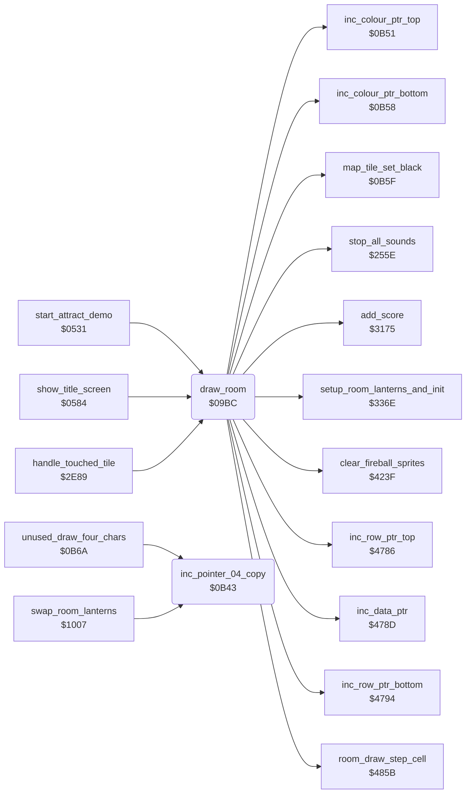

<!-- Generated by c64-docs from knowledge revision 20261025T141148.619-ij2l1b and .c64-re-tools/local/generated/src/source-map.json. Do not edit: change the knowledge, generate the source again, then run docs.ts generate. -->
# room/draw_room.asm: Room drawing: colours, run-length map decoder and per-room state reset

Range `$09BC-$0B49`. Source: [room/draw_room.asm](../../../../src/room/draw_room.asm). Index: [the reference](../../index.md).

## Routines

| Routine | Address | Reached from | Summary |
|---|---|---|---|
| [`draw_room`](draw_room.md#draw_room) | `$09BC` | [`start_attract_demo`](../game/title_demo_start.md#start_attract_demo), [`show_title_screen`](../game/title_demo_start.md#show_title_screen), [`handle_touched_tile`](../actor/background_touch.md#handle_touched_tile) | Draw the current room and reset the per-room state. |
| [`inc_pointer_04_copy`](draw_room.md#inc_pointer_04_copy) | `$0B43` | [`unused_draw_four_chars`](../leftovers/leftover_0b6a.md#unused_draw_four_chars), [`swap_room_lanterns`](../game/game_setup.md#swap_room_lanterns) | Increment the 16-bit pointer row_ptr_top. |

## Call graph

A solid arrow is a call, a thick arrow a table entry. Rounded nodes are in this file.

## Details

### [`draw_room`](../../../../src/room/draw_room.asm#L28) `$09BC`

*routine*

Draw the current room and reset the per-room state. Called by change_room, start_new_game and start_attract_demo. Screen and sprites are off while it draws. 1. Clears status row 0, fills colour RAM rows 3-24 with room_colour_fill[room], clears the fireball sprites and silences the sound effects. 2. Room 11 when room_lanterns_left of rooms 12, 14 and 16 are all 0: goes to room 13 instead (place_bruce_at_room_start with X = 13). 3. First visit of the room by the current player (room_unvisited[room*2 + current_player] = 1): clears the flag and adds 2000 points. 4. Clears actor_move_queue (the move history of the actors, $4F57-$4FDA), room_time and anim_chars_direction; anim_chars_speed_step = 7. 5. room_no_enemy_flag = room_no_enemies[room] (nonzero also clears enemy_follow_x). Loads the spawn timers from ninja_room_delay / yamo_room_delay (3 for both when game_loop_count is nonzero, Yamo 8 when player 2 controls him). 6. Resets Bruce's actor_contact, actor_timer, actor_state and actor_step_delay and the burst_trap_timer slots, copies the 20-byte block of room_aux_ptr to room_band_colours and sets room_vmcsb: charset_rooms_0_9 for rooms 0-9, charset_wizard for room 18, charset_rooms_10_19 for the others. 7. Decodes the run-length room map (room_map_ptr_lo/hi) into screen rows 3-24. 8. setup_room_lanterns_and_init (lanterns, room init), screen and sprites 0-4 on, then tail-jumps to run_room_frame_handler (the room's frame handler runs once and returns to the caller). Map format: a stream of codes. $80 ends the map. $81-$FF: (code AND $7F) literal tile bytes follow. $01-$7F: one tile byte follows, repeated code times. A tile byte draws one double-height cell: bits 0-6 = character c (upper row c, lower row c+128), bit 7 = colour RAM $F8 (multicolour, colour 0) for the cell instead of the room colour. Cells fill 40 columns, then the next double row.
screen off

- **Called from:** [`start_attract_demo`](../game/title_demo_start.md#start_attract_demo), [`show_title_screen`](../game/title_demo_start.md#show_title_screen), [`handle_touched_tile`](../actor/background_touch.md#handle_touched_tile)
- **Calls:** [`clear_fireball_sprites`](wizard_fireballs.md#clear_fireball_sprites), [`stop_all_sounds`](../sfx/sound_request.md#stop_all_sounds), [`add_score`](../game/score.md#add_score), [`inc_data_ptr`](../text/pointer_helpers.md#inc_data_ptr), [`map_tile_set_black`](draw_room_0b51.md#map_tile_set_black), [`inc_row_ptr_top`](../text/pointer_helpers.md#inc_row_ptr_top), [`inc_row_ptr_bottom`](../text/pointer_helpers.md#inc_row_ptr_bottom), [`inc_colour_ptr_top`](draw_room_0b51.md#inc_colour_ptr_top), [`inc_colour_ptr_bottom`](draw_room_0b51.md#inc_colour_ptr_bottom), [`room_draw_step_cell`](draw_helpers.md#room_draw_step_cell), [`setup_room_lanterns_and_init`](lantern_pickup.md#setup_room_lanterns_and_init)
- **Jumps to:** [`place_bruce_at_room_start`](room_misc_support.md#place_bruce_at_room_start), [`run_room_frame_handler`](passage_open.md#run_room_frame_handler)
- **Reads:** [`SCROLY`](../../memory-map.md#SCROLY), [`SPENA`](../../memory-map.md#SPENA), [`room`](../../memory-map.md#room), [`room_colour_fill`](room_palettes_47a0.md#room_colour_fill), [`room_lanterns_left`](../../memory-map.md#room_lanterns_left), [`saved_sprite_enable`](../../memory-map.md#saved_sprite_enable), [`current_player`](../../memory-map.md#current_player), [`room_unvisited`](../../memory-map.md#room_unvisited), [`room_no_enemies`](room_tables.md#room_no_enemies), [`ninja_room_delay`](room_enemy_tables.md#ninja_room_delay), [`yamo_room_delay`](room_enemy_tables.md#yamo_room_delay), [`game_loop_count`](../../memory-map.md#game_loop_count) and 7 more
- **Writes:** [`SCROLY`](../../memory-map.md#SCROLY), [`saved_sprite_enable`](../../memory-map.md#saved_sprite_enable), [`SPENA`](../../memory-map.md#SPENA), [`game_screen`](../../memory-map.md#game_screen), `$D878`, `$D900`, `$DA00`, `$DB00`, [`room_unvisited`](../../memory-map.md#room_unvisited), [`actor_move_queue`](../../memory-map.md#actor_move_queue), [`room_time`](../../memory-map.md#room_time), [`anim_chars_direction`](../../memory-map.md#anim_chars_direction) and 18 more
- **Refers to:** [`room_lanterns_left`](../../memory-map.md#room_lanterns_left), [`room_time`](../../memory-map.md#room_time), [`enemy_follow_x`](../../memory-map.md#enemy_follow_x), [`burst_trap_timer`](../../memory-map.md#burst_trap_timer), [`room_aux_ptr`](room_tables.md#room_aux_ptr), [`data_ptr`](../../memory-map.md#data_ptr), [`game_screen`](../../memory-map.md#game_screen), [`row_ptr_top`](../../memory-map.md#row_ptr_top), [`row_ptr_bottom`](../../memory-map.md#row_ptr_bottom), [`colour_ptr_top`](../../memory-map.md#colour_ptr_top), [`colour_ptr_bottom`](../../memory-map.md#colour_ptr_bottom)

| Label | Address | Comment |
|---|---|---|
| [`draw_room_clear_top_row`](../../../../src/room/draw_room.asm#L39) | `$09D4` |  |
| [`draw_room_fill_colours`](../../../../src/room/draw_room.asm#L46) | `$09E1` | colour RAM rows 3-24 |
| [`draw_room_first_visit_check`](../../../../src/room/draw_room.asm#L68) | `$0A0E` |  |
| [`draw_room_reset_state`](../../../../src/room/draw_room.asm#L82) | `$0A2A` |  |
| [`draw_room_clear_object_state`](../../../../src/room/draw_room.asm#L85) | `$0A2E` | clear actor_move_queue: 11 records x 4 directions x 3 actors ($4F57-$4FDA) |
| [`draw_room_load_spawn_timers`](../../../../src/room/draw_room.asm#L101) | `$0A4E` | Ninja spawn timer |
| [`draw_room_check_two_player_yamo`](../../../../src/room/draw_room.asm#L111) | `$0A62` | player 2 controls Yamo: Yamo comes after 8 passes |
| [`draw_room_reset_bruce`](../../../../src/room/draw_room.asm#L118) | `$0A6B` | Reset Bruce (actor 0): actor_contact = 1 (floor), actor_timer = 4, actor_state = 0, actor_step_delay = 0; free the three burst trap slots (burst_trap_timer). |
| [`draw_room_copy_room_record`](../../../../src/room/draw_room.asm#L139) | `$0A93` |  |
| [`draw_room_wizard_charset`](../../../../src/room/draw_room.asm#L152) | `$0AAB` | $3C: charset_wizard (room 18) |
| [`draw_room_set_charset`](../../../../src/room/draw_room.asm#L154) | `$0AAD` |  |
| [`draw_room_next_code`](../../../../src/room/draw_room.asm#L177) | `$0AD7` |  |
| [`draw_room_literal_loop`](../../../../src/room/draw_room.asm#L184) | `$0AE3` |  |
| [`draw_room_store_literal`](../../../../src/room/draw_room.asm#L188) | `$0AEA` | top half: character c |
| [`draw_room_repeat_run`](../../../../src/room/draw_room.asm#L201) | `$0B07` |  |
| [`draw_room_repeat_loop`](../../../../src/room/draw_room.asm#L204) | `$0B0B` |  |
| [`draw_room_store_repeat`](../../../../src/room/draw_room.asm#L208) | `$0B12` |  |
| [`draw_room_done`](../../../../src/room/draw_room.asm#L221) | `$0B30` | draw the lanterns of the room |

### [`inc_pointer_04_copy`](../../../../src/room/draw_room.asm#L236) `$0B43`

*routine*

Increment the 16-bit pointer row_ptr_top. Same code as inc_row_ptr_top. Only caller: swap_room_lanterns (not executed).

- **Called from:** [`unused_draw_four_chars`](../leftovers/leftover_0b6a.md#unused_draw_four_chars), [`swap_room_lanterns`](../game/game_setup.md#swap_room_lanterns)
- **Reads:** [`row_ptr_top`](../../memory-map.md#row_ptr_top)
- **Writes:** [`row_ptr_top`](../../memory-map.md#row_ptr_top)
- **Refers to:** [`row_ptr_top`](../../memory-map.md#row_ptr_top)

| Label | Address | Comment |
|---|---|---|
| [`inc_pointer_04_copy_done`](../../../../src/room/draw_room.asm#L241) | `$0B49` |  |
