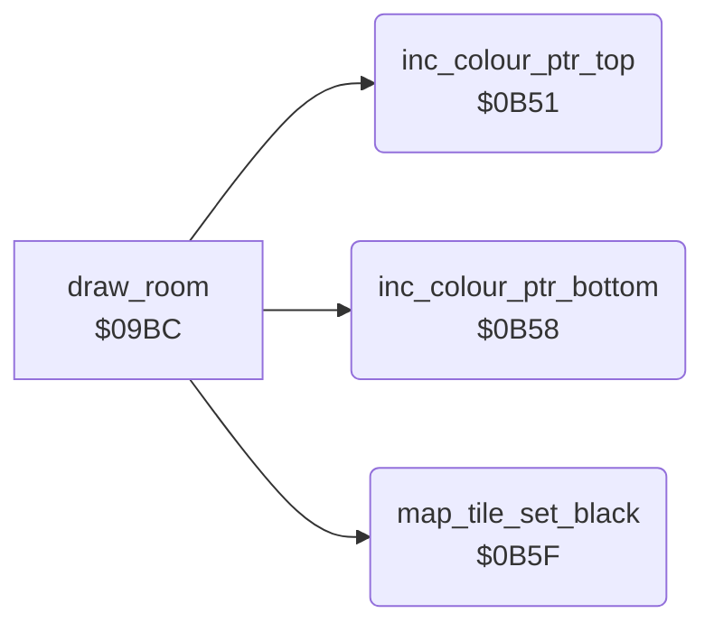

<!-- Generated by c64-docs from knowledge revision 20261023T151738.098-ndlxeh and .c64-re-tools/local/generated/src/source-map.json. Do not edit: change the knowledge, generate the source again, then run docs.ts generate. -->
# room/draw_room_0b51.asm

Range `$0B51-$0B69`. Source: [room/draw_room_0b51.asm](../../../../src/room/draw_room_0b51.asm). Index: [the reference](../../index.md).

## Call graph

A solid arrow is a call, a thick arrow a table entry, a dotted arrow a jump. Rounded nodes are in this file.

## Names

### [`inc_colour_ptr_top`](../../../../src/room/draw_room_0b51.asm#L6) `$0B51`

*routine*

Increment the colour RAM pointer colour_ptr_top (upper row of the map cell). Called by draw_room.

- **Called from:** [`draw_room`](draw_room.md#draw_room) [`$0AF9`](../../../../src/room/draw_room.asm#L196), [`draw_room`](draw_room.md#draw_room) [`$0B1E`](../../../../src/room/draw_room.asm#L215)
- **Reads:** [`colour_ptr_top`](../../memory-map.md#colour_ptr_top), [`colour_ptr_top+1`](../../memory-map.md#colour_ptr_top)
- **Writes:** [`colour_ptr_top`](../../memory-map.md#colour_ptr_top), [`colour_ptr_top+1`](../../memory-map.md#colour_ptr_top)
- **Refers to:** [`colour_ptr_top`](../../memory-map.md#colour_ptr_top)

### [`inc_colour_ptr_top_done`](../../../../src/room/draw_room_0b51.asm#L10) `$0B57`

*label*

- **Jumped to from:** [`inc_colour_ptr_top`](draw_room_0b51.md#inc_colour_ptr_top) [`$0B53`](../../../../src/room/draw_room_0b51.asm#L8)

### [`inc_colour_ptr_bottom`](../../../../src/room/draw_room_0b51.asm#L13) `$0B58`

*routine*

Increment the colour RAM pointer colour_ptr_bottom (lower row of the map cell). Called by draw_room.

- **Called from:** [`draw_room`](draw_room.md#draw_room) [`$0AFC`](../../../../src/room/draw_room.asm#L197), [`draw_room`](draw_room.md#draw_room) [`$0B21`](../../../../src/room/draw_room.asm#L216)
- **Reads:** [`colour_ptr_bottom`](../../memory-map.md#colour_ptr_bottom), [`colour_ptr_bottom+1`](../../memory-map.md#colour_ptr_bottom)
- **Writes:** [`colour_ptr_bottom`](../../memory-map.md#colour_ptr_bottom), [`colour_ptr_bottom+1`](../../memory-map.md#colour_ptr_bottom)
- **Refers to:** [`colour_ptr_bottom`](../../memory-map.md#colour_ptr_bottom)

### [`inc_colour_ptr_bottom_done`](../../../../src/room/draw_room_0b51.asm#L17) `$0B5E`

*label*

- **Jumped to from:** [`inc_colour_ptr_bottom`](draw_room_0b51.md#inc_colour_ptr_bottom) [`$0B5A`](../../../../src/room/draw_room_0b51.asm#L15)

### [`map_tile_set_black`](../../../../src/room/draw_room_0b51.asm#L21) `$0B5F`

*routine*

Map tile with bit 7: write colour $F8 (multicolour, colour 0) to both colour RAM cells of the tile. Input: A = tile byte, Y = 0. Output: A = tile byte & $7F.

- **Called from:** [`draw_room`](draw_room.md#draw_room) [`$0AE7`](../../../../src/room/draw_room.asm#L188), [`draw_room`](draw_room.md#draw_room) [`$0B0F`](../../../../src/room/draw_room.asm#L208)
- **Reads:** [`colour_ptr_top`](../../memory-map.md#colour_ptr_top), [`colour_ptr_bottom`](../../memory-map.md#colour_ptr_bottom)
