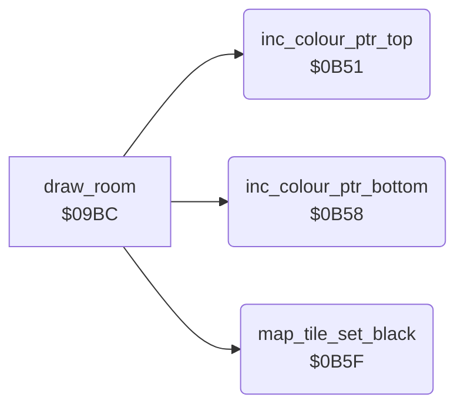

<!-- Generated by c64-docs from knowledge revision 20261029T162352.521-4j8tu8 and .c64-re-tools/local/generated/src/source-map.json. Do not edit: change the knowledge, generate the source again, then run docs.ts generate. -->
# room/draw_room_0b51.asm

Range `$0B51-$0B69`. Source: [room/draw_room_0b51.asm](../../../../src/room/draw_room_0b51.asm). Index: [the reference](../../index.md).

## Routines

| Routine | Address | Reached from | Summary |
|---|---|---|---|
| [`inc_colour_ptr_top`](draw_room_0b51.md#inc_colour_ptr_top) | `$0B51` | [`draw_room`](draw_room.md#draw_room) | Increment the colour RAM pointer colour_ptr_top (upper row of the map cell). |
| [`inc_colour_ptr_bottom`](draw_room_0b51.md#inc_colour_ptr_bottom) | `$0B58` | [`draw_room`](draw_room.md#draw_room) | Increment the colour RAM pointer colour_ptr_bottom (lower row of the map cell). |
| [`map_tile_set_black`](draw_room_0b51.md#map_tile_set_black) | `$0B5F` | [`draw_room`](draw_room.md#draw_room) | Map tile with bit 7: write colour $F8 (multicolour, colour 0) to both colour RAM cells of the tile. |

## Call graph

A solid arrow is a call, a thick arrow a table entry. Rounded nodes are in this file.

## Details

### [`inc_colour_ptr_top`](../../../../src/room/draw_room_0b51.asm#L6) `$0B51`

*routine*

Increment the colour RAM pointer colour_ptr_top (upper row of the map cell). Called by draw_room.

- **Called from:** [`draw_room`](draw_room.md#draw_room)
- **Reads:** [`colour_ptr_top`](../../memory-map.md#colour_ptr_top)
- **Writes:** [`colour_ptr_top`](../../memory-map.md#colour_ptr_top)
- **Refers to:** [`colour_ptr_top`](../../memory-map.md#colour_ptr_top)

| Label | Address | Comment |
|---|---|---|
| [`inc_colour_ptr_top_done`](../../../../src/room/draw_room_0b51.asm#L10) | `$0B57` |  |

### [`inc_colour_ptr_bottom`](../../../../src/room/draw_room_0b51.asm#L13) `$0B58`

*routine*

Increment the colour RAM pointer colour_ptr_bottom (lower row of the map cell). Called by draw_room.

- **Called from:** [`draw_room`](draw_room.md#draw_room)
- **Reads:** [`colour_ptr_bottom`](../../memory-map.md#colour_ptr_bottom)
- **Writes:** [`colour_ptr_bottom`](../../memory-map.md#colour_ptr_bottom)
- **Refers to:** [`colour_ptr_bottom`](../../memory-map.md#colour_ptr_bottom)

| Label | Address | Comment |
|---|---|---|
| [`inc_colour_ptr_bottom_done`](../../../../src/room/draw_room_0b51.asm#L17) | `$0B5E` |  |

### [`map_tile_set_black`](../../../../src/room/draw_room_0b51.asm#L21) `$0B5F`

*routine*

Map tile with bit 7: write colour $F8 (multicolour, colour 0) to both colour RAM cells of the tile. Input: A = tile byte, Y = 0. Output: A = tile byte & $7F.

- **Called from:** [`draw_room`](draw_room.md#draw_room)
- **Reads:** [`colour_ptr_top`](../../memory-map.md#colour_ptr_top), [`colour_ptr_bottom`](../../memory-map.md#colour_ptr_bottom)
