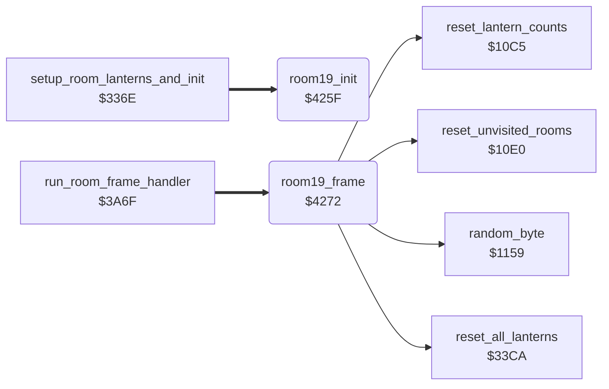

<!-- Generated by c64-docs from knowledge revision 20261025T214801.837-ucnw24 and .c64-re-tools/local/generated/src/source-map.json. Do not edit: change the knowledge, generate the source again, then run docs.ts generate. -->
# room/ending_room.asm: Room 19: congratulations sequence and start of the next game loop

Range `$425F-$42C4`. Source: [room/ending_room.asm](../../../../src/room/ending_room.asm). Index: [the reference](../../index.md).

## Routines

| Routine | Address | Reached from | Summary |
|---|---|---|---|
| [`room19_init`](ending_room.md#room19_init) | `$425F` | [`setup_room_lanterns_and_init`](lantern_pickup.md#setup_room_lanterns_and_init) | Room 19 (congratulations) init: the countdown title_countdown = $0458 frames (decremented by the interrupt) and a blank status line (screen row 0, char 0). |
| [`room19_frame`](ending_room.md#room19_frame) | `$4272` | [`run_room_frame_handler`](passage_open.md#run_room_frame_handler) | Room 19 frame handler. |

## Call graph

A solid arrow is a call, a thick arrow a table entry. Rounded nodes are in this file.

## Details

### [`room19_init`](../../../../src/room/ending_room.asm#L7) `$425F`

*routine*

Room 19 (congratulations) init: the countdown title_countdown = $0458 frames (decremented by the interrupt) and a blank status line (screen row 0, char 0).

- **Jumped to from:** [`setup_room_lanterns_and_init`](lantern_pickup.md#setup_room_lanterns_and_init)
- **Entry of:** [`room_init_handlers`](../../tables.md#room_init_handlers)
- **Writes:** [`title_countdown`](../../memory-map.md#title_countdown), [`game_screen`](../../memory-map.md#game_screen)
- **Refers to:** [`title_countdown`](../../memory-map.md#title_countdown)

| Label | Address | Comment |
|---|---|---|
| [`room19_init_clear_status_loop`](../../../../src/room/ending_room.asm#L14) | `$426B` |  |
| [`room19_init_done`](../../../../src/room/ending_room.asm#L18) | `$4271` |  |

### [`room19_frame`](../../../../src/room/ending_room.asm#L27) `$4272`

*routine*

Room 19 frame handler. While title_countdown runs: random colours on screen rows 17-24, columns 4-32, and message 4 ('** CONGRATULATIONS **') at text line 0, column 10. When the countdown is 0, the next game loop starts: game_loop_count + 1, the room 13 bonus flags (room13_band_bonus) of the current player set again, lantern counts (reset_lantern_counts) and lanterns (reset_all_lanterns) reset, per-player room flags (reset_unvisited_rooms) reset, and Bruce goes to the start of room 0 (place_bruce_at_room_start).

- **Jumped to from:** [`run_room_frame_handler`](passage_open.md#run_room_frame_handler)
- **Entry of:** [`room_frame_handlers`](../../tables.md#room_frame_handlers)
- **Calls:** [`reset_lantern_counts`](../game/game_setup.md#reset_lantern_counts), [`reset_all_lanterns`](lantern_pickup.md#reset_all_lanterns), [`reset_unvisited_rooms`](../game/game_setup.md#reset_unvisited_rooms), [`random_byte`](../irq/interrupt_entry_1131.md#random_byte)
- **Jumps to:** [`place_bruce_at_room_start`](room_misc_support.md#place_bruce_at_room_start), [`print_message`](../actor/actor_driver_text.md#print_message)
- **Reads:** [`title_countdown`](../../memory-map.md#title_countdown), [`game_loop_count`](../../memory-map.md#game_loop_count), [`current_player`](../../memory-map.md#current_player)
- **Writes:** [`game_loop_count`](../../memory-map.md#game_loop_count), [`room13_band_bonus`](../../memory-map.md#room13_band_bonus), `$DAAC`, `$DAD4`, `$DAFC`, `$DB24`, `$DB4C`, `$DB74`, `$DB9C`, `$DBC4`
- **Refers to:** [`title_countdown`](../../memory-map.md#title_countdown)

| Label | Address | Comment |
|---|---|---|
| [`room19_frame_rearm_loop`](../../../../src/room/ending_room.asm#L39) | `$4283` | room 13 bonus flags |
| [`room19_frame_shimmer`](../../../../src/room/ending_room.asm#L49) | `$4298` |  |
| [`room19_frame_shimmer_loop`](../../../../src/room/ending_room.asm#L54) | `$42A1` | colour RAM, screen rows 17-24, columns 4-32 |
