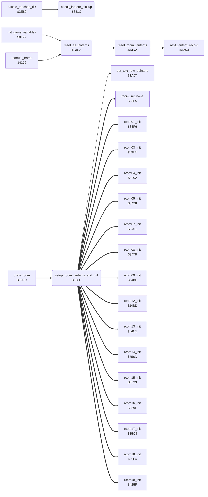

<!-- Generated by c64-docs from knowledge revision 20261029T162352.521-4j8tu8 and .c64-re-tools/local/generated/src/source-map.json. Do not edit: change the knowledge, generate the source again, then run docs.ts generate. -->
# room/lantern_pickup.asm: Lantern pickup, lantern redraw and reset, room init dispatch

Range `$331C-$33F4`. Source: [room/lantern_pickup.asm](../../../../src/room/lantern_pickup.asm). Index: [the reference](../../index.md).

## Routines

| Routine | Address | Reached from | Summary |
|---|---|---|---|
| [`check_lantern_pickup`](lantern_pickup.md#check_lantern_pickup) | `$331C` | [`handle_touched_tile`](../actor/background_touch.md#handle_touched_tile) | Looks for a lantern of the current room at the cell that the actor touches, and takes it. |
| [`setup_room_lanterns_and_init`](lantern_pickup.md#setup_room_lanterns_and_init) | `$336E` | [`draw_room`](draw_room.md#draw_room) | Called by draw_room after the room map is drawn. |
| [`reset_all_lanterns`](lantern_pickup.md#reset_all_lanterns) | `$33CA` | [`init_game_variables`](../game/game_setup.md#init_game_variables), [`room19_frame`](ending_room.md#room19_frame) | Marks every lantern of rooms 19..0 as present again (state 1). |
| [`reset_room_lanterns`](lantern_pickup.md#reset_room_lanterns) | `$33DA` | [`reset_all_lanterns`](lantern_pickup.md#reset_all_lanterns) | Sets the state byte of every lantern record of one room to 1 (present). |

## Call graph

A solid arrow is a call, a thick arrow a table entry. Rounded nodes are in this file.

## Details

### [`check_lantern_pickup`](../../../../src/room/lantern_pickup.asm#L15) `$331C`

*routine*

Looks for a lantern of the current room at the cell that the actor touches, and takes it. Input: current_actor (only Bruce calls it), Y = column of the touched cell. The row is actor_cell_row of the actor. The lantern list of the room comes from the pointer table lantern_list_ptr (index room*2). A record is 4 bytes: +0 state (1 = present, 0 = taken, $FF = end of list), +1 replacement char (drawn after the pickup), +2 column, +3 row. Output: C=1 when no present lantern is at that cell. C=0 when found: the record state becomes 0, room_lanterns_left+room is decremented, and A = replacement char AND $7F (the caller draws it and plays the pickup sound and score). Work: lantern_ptr list pointer, lantern_test_col, lantern_test_row, lantern_match.

- **Called from:** [`handle_touched_tile`](../actor/background_touch.md#handle_touched_tile)
- **Reads:** [`current_actor`](../../memory-map.md#current_actor), [`actor_cell_row`](../../memory-map.md#actor_cell_row), [`room`](../../memory-map.md#room), [`lantern_list_ptr`](lantern_lists.md#lantern_list_ptr), [`lantern_ptr`](../../memory-map.md#lantern_ptr), [`lantern_match`](../../memory-map.md#lantern_match), [`lantern_test_col`](../../memory-map.md#lantern_test_col), [`lantern_test_row`](../../memory-map.md#lantern_test_row), [`room_lanterns_left`](../../memory-map.md#room_lanterns_left)
- **Writes:** [`lantern_test_row`](../../memory-map.md#lantern_test_row), [`lantern_test_col`](../../memory-map.md#lantern_test_col), [`lantern_ptr`](../../memory-map.md#lantern_ptr), [`lantern_match`](../../memory-map.md#lantern_match), [`room_lanterns_left`](../../memory-map.md#room_lanterns_left)
- **Refers to:** [`lantern_ptr`](../../memory-map.md#lantern_ptr)

| Label | Address | Comment |
|---|---|---|
| [`check_lantern_pickup_loop`](../../../../src/room/lantern_pickup.asm#L28) | `$3334` | match flag = 1; each failed test halves it to 0 |
| [`check_lantern_pickup_taken`](../../../../src/room/lantern_pickup.asm#L34) | `$333E` |  |
| [`check_lantern_pickup_cmp_col`](../../../../src/room/lantern_pickup.asm#L36) | `$3340` |  |
| [`check_lantern_pickup_cmp_row`](../../../../src/room/lantern_pickup.asm#L43) | `$334A` |  |
| [`check_lantern_pickup_test`](../../../../src/room/lantern_pickup.asm#L49) | `$3353` |  |
| [`check_lantern_pickup_none`](../../../../src/room/lantern_pickup.asm#L54) | `$335A` | C=1: no lantern here |
| [`check_lantern_pickup_found`](../../../../src/room/lantern_pickup.asm#L59) | `$335C` | Found: mark the record taken, decrement the lantern count of the room, return the replacement char. |

### [`setup_room_lanterns_and_init`](../../../../src/room/lantern_pickup.asm#L79) `$336E`

*routine*

Called by draw_room after the room map is drawn. 1. For each lantern record of the room with state 0 (taken), draws its replacement char in place of the lantern: char AND $7F in the top line of the cell and char OR $80 in the bottom line (row from the record, screen row address from set_text_row_pointers). 2. Clears the five room variables room_state_a..room_state_e. 3. Jumps to the room init handler through the RTS table room_init_handlers (index room*2). Work: lantern_ptr list pointer, temp_y saved list index.

- **Called from:** [`draw_room`](draw_room.md#draw_room)
- **Calls:** [`set_text_row_pointers`](../game/pause_status_line.md#set_text_row_pointers)
- **Jumps to:** [`room_init_none`](room_specific_init.md#room_init_none), [`room01_init`](room_specific_init.md#room01_init), [`room03_init`](room_specific_init.md#room03_init), [`room04_init`](room_specific_init.md#room04_init), [`room05_init`](room_specific_init.md#room05_init), [`room07_init`](room_specific_init.md#room07_init), [`room08_init`](room_specific_init.md#room08_init), [`room09_init`](room_specific_init.md#room09_init), [`room12_init`](room_specific_init.md#room12_init), [`room13_init`](room_specific_init.md#room13_init), [`room14_init`](room_specific_init.md#room14_init), [`room15_init`](room_specific_init.md#room15_init) and 4 more
- **Reads:** [`room`](../../memory-map.md#room), [`lantern_list_ptr`](lantern_lists.md#lantern_list_ptr), [`lantern_ptr`](../../memory-map.md#lantern_ptr), [`row_ptr_top`](../../memory-map.md#row_ptr_top), [`temp_y`](../../memory-map.md#temp_y), [`room_init_handlers`](room_dispatch.md#room_init_handlers)
- **Writes:** [`lantern_ptr`](../../memory-map.md#lantern_ptr), [`temp_y`](../../memory-map.md#temp_y), [`room_state_a`](room_dispatch.md#room_state_a)
- **Refers to:** [`lantern_ptr`](../../memory-map.md#lantern_ptr)

| Label | Address | Comment |
|---|---|---|
| [`setup_room_lanterns_loop`](../../../../src/room/lantern_pickup.asm#L88) | `$337E` |  |
| [`setup_room_lanterns_skip_record`](../../../../src/room/lantern_pickup.asm#L119) | `$33AC` |  |
| [`setup_room_lanterns_next_record`](../../../../src/room/lantern_pickup.asm#L123) | `$33AF` |  |
| [`room_init_clear_vars`](../../../../src/room/lantern_pickup.asm#L128) | `$33B3` | Clear the room variables room_state_a..room_state_e, which the room handlers use as one-shot flags and timers. |
| [`room_init_clear_loop`](../../../../src/room/lantern_pickup.asm#L131) | `$33B7` |  |
| [`room_init_dispatch`](../../../../src/room/lantern_pickup.asm#L136) | `$33BD` | Dispatch to the init handler of the room (RTS table room_init_handlers: target - 1, low byte first). |

### [`reset_all_lanterns`](../../../../src/room/lantern_pickup.asm#L147) `$33CA`

*routine*

Marks every lantern of rooms 19..0 as present again (state 1). Called at the start of a game and at the end of room 19 before the next game loop. Uses next_room as the room loop counter.
start at room 19

- **Called from:** [`init_game_variables`](../game/game_setup.md#init_game_variables), [`room19_frame`](ending_room.md#room19_frame)
- **Calls:** [`reset_room_lanterns`](lantern_pickup.md#reset_room_lanterns)
- **Reads:** [`next_room`](../../memory-map.md#next_room)
- **Writes:** [`next_room`](../../memory-map.md#next_room)

| Label | Address | Comment |
|---|---|---|
| [`reset_all_lanterns_loop`](../../../../src/room/lantern_pickup.asm#L150) | `$33CE` |  |

### [`reset_room_lanterns`](../../../../src/room/lantern_pickup.asm#L160) `$33DA`

*routine*

Sets the state byte of every lantern record of one room to 1 (present). Input: X = room*2 (index into lantern_list_ptr). Uses lantern_ptr.

- **Called from:** [`reset_all_lanterns`](lantern_pickup.md#reset_all_lanterns)
- **Calls:** [`next_lantern_record`](passage_open.md#next_lantern_record)
- **Reads:** [`lantern_list_ptr`](lantern_lists.md#lantern_list_ptr), [`lantern_ptr`](../../memory-map.md#lantern_ptr)
- **Writes:** [`lantern_ptr`](../../memory-map.md#lantern_ptr)
- **Refers to:** [`lantern_ptr`](../../memory-map.md#lantern_ptr)

| Label | Address | Comment |
|---|---|---|
| [`reset_room_lanterns_loop`](../../../../src/room/lantern_pickup.asm#L166) | `$33E6` |  |
| [`reset_room_lanterns_done`](../../../../src/room/lantern_pickup.asm#L173) | `$33F4` |  |
