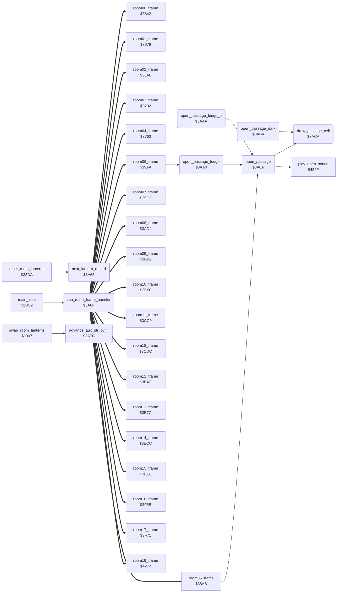

<!-- Generated by c64-docs from knowledge revision 20261025T214801.837-ucnw24 and .c64-re-tools/local/generated/src/source-map.json. Do not edit: change the knowledge, generate the source again, then run docs.ts generate. -->
# room/passage_open.asm: Room frame dispatch and passage-opening helpers

Range `$3A63-$3AD3`. Source: [room/passage_open.asm](../../../../src/room/passage_open.asm). Index: [the reference](../../index.md).

## Routines

| Routine | Address | Reached from | Summary |
|---|---|---|---|
| [`next_lantern_record`](passage_open.md#next_lantern_record) | `$3A63` | [`reset_room_lanterns`](lantern_pickup.md#reset_room_lanterns) | Adds 4 (one lantern record) to lantern_ptr. |
| [`run_room_frame_handler`](passage_open.md#run_room_frame_handler) | `$3A6F` | [`main_loop`](../game/game_main_loop.md#main_loop), [`draw_room`](draw_room.md#draw_room) | Jumps to the frame handler of the room through the RTS table room_frame_handlers (index room*2, target - 1, low byte first). |
| [`advance_aux_ptr_by_4`](passage_open.md#advance_aux_ptr_by_4) | `$3A7C` | [`swap_room_lanterns`](../game/game_setup.md#swap_room_lanterns) | Adds 4 (one lantern record) to aux_ptr. |
| [`open_passage`](passage_open.md#open_passage) | `$3A8A` | [`room05_frame`](room_frames_0_7.md#room05_frame), [`open_passage_ledge`](passage_open.md#open_passage_ledge), [`open_passage_ledge_b`](passage_open.md#open_passage_ledge_b), [`room08_frame`](room_frames_8_11.md#room08_frame), [`room09_frame`](room_frames_8_11.md#room09_frame) | Opens a passage in a wall: plays play_open_sound (sound $8A), then draws tile $13 (blank) at rows R and R+1 and tile $14 (char BE) at row R+2, all in column C. |
| [`open_passage_ledge`](passage_open.md#open_passage_ledge) | `$3AA0` | [`room06_frame`](room_frames_0_7.md#room06_frame), [`room07_frame`](room_frames_0_7.md#room07_frame) | Same as open_passage, then tile $17 (char 91) at row R+2 in place of tile $14. |
| [`open_passage_ledge_b`](passage_open.md#open_passage_ledge_b) | `$3AAA` | [`room08_frame`](room_frames_8_11.md#room08_frame) | Same as open_passage, then tile $2D (char 91) at row R+2. |
| [`open_passage_dark`](passage_open.md#open_passage_dark) | `$3AB4` | [`room10_frame`](room_frames_8_11.md#room10_frame), [`room12_frame`](room_frames_12_17.md#room12_frame), [`room14_frame`](room_frames_12_17.md#room14_frame), [`room16_frame`](room_frames_12_17.md#room16_frame) | Opens a passage in rooms 10-17: plays play_open_sound (sound $8A), then draws tile $63 (char 07) at rows R and R+1 and tile $64 (char 8E) at row R+2, in column C. |
| [`draw_passage_cell`](passage_open.md#draw_passage_cell) | `$3ACA` | [`open_passage`](passage_open.md#open_passage), [`open_passage_dark`](passage_open.md#open_passage_dark) | Draws tile A at text row passage_row, column passage_col (print_message), then increments passage_row. |

## Call graph

A solid arrow is a call, a thick arrow a table entry. Rounded nodes are in this file.

The graph shows 30 of the 39 edges.

## Details

### [`next_lantern_record`](../../../../src/room/passage_open.asm#L6) `$3A63`

*routine*

Adds 4 (one lantern record) to lantern_ptr. Changes A.

- **Called from:** [`reset_room_lanterns`](lantern_pickup.md#reset_room_lanterns)
- **Reads:** [`lantern_ptr`](../../memory-map.md#lantern_ptr)
- **Writes:** [`lantern_ptr`](../../memory-map.md#lantern_ptr)
- **Refers to:** [`lantern_ptr`](../../memory-map.md#lantern_ptr)

| Label | Address | Comment |
|---|---|---|
| [`next_lantern_record_done`](../../../../src/room/passage_open.asm#L13) | `$3A6E` |  |

### [`run_room_frame_handler`](../../../../src/room/passage_open.asm#L18) `$3A6F`

*routine*

Jumps to the frame handler of the room through the RTS table room_frame_handlers (index room*2, target - 1, low byte first). Called by the main loop on every pass and one time at the end of draw_room. The handler returns to the caller.

- **Called from:** [`main_loop`](../game/game_main_loop.md#main_loop)
- **Jumped to from:** [`draw_room`](draw_room.md#draw_room)
- **Jumps to:** [`room00_frame`](room_frames_0_7.md#room00_frame), [`room01_frame`](room_frames_0_7.md#room01_frame), [`room02_frame`](room_frames_0_7.md#room02_frame), [`room03_frame`](room_frames_0_7.md#room03_frame), [`room04_frame`](room_frames_0_7.md#room04_frame), [`room05_frame`](room_frames_0_7.md#room05_frame), [`room06_frame`](room_frames_0_7.md#room06_frame), [`room07_frame`](room_frames_0_7.md#room07_frame), [`room08_frame`](room_frames_8_11.md#room08_frame), [`room09_frame`](room_frames_8_11.md#room09_frame), [`room10_frame`](room_frames_8_11.md#room10_frame), [`room11_frame`](room_frames_8_11.md#room11_frame) and 8 more
- **Reads:** [`room`](../../memory-map.md#room), [`room_frame_handlers`](room_dispatch.md#room_frame_handlers)

### [`advance_aux_ptr_by_4`](../../../../src/room/passage_open.asm#L28) `$3A7C`

*routine*

Adds 4 (one lantern record) to aux_ptr. Called by swap_room_lanterns (the two-player lantern swap). Changes A.

- **Called from:** [`swap_room_lanterns`](../game/game_setup.md#swap_room_lanterns)
- **Reads:** [`aux_ptr`](../../memory-map.md#aux_ptr)
- **Writes:** [`aux_ptr`](../../memory-map.md#aux_ptr)
- **Refers to:** [`aux_ptr`](../../memory-map.md#aux_ptr)

### [`open_passage`](../../../../src/room/passage_open.asm#L41) `$3A8A`

*routine*

Opens a passage in a wall: plays play_open_sound (sound $8A), then draws tile $13 (blank) at rows R and R+1 and tile $14 (char BE) at row R+2, all in column C. Input: A = top row R, Y = column C. Output: passage_row = R+3, passage_col = C. Used in the rooms with the character set charset_rooms_0_9 (rooms 0-9).

- **Called from:** [`room05_frame`](room_frames_0_7.md#room05_frame), [`open_passage_ledge`](passage_open.md#open_passage_ledge), [`open_passage_ledge_b`](passage_open.md#open_passage_ledge_b), [`room08_frame`](room_frames_8_11.md#room08_frame), [`room09_frame`](room_frames_8_11.md#room09_frame)
- **Calls:** [`play_open_sound`](wizard_fireballs.md#play_open_sound), [`draw_passage_cell`](passage_open.md#draw_passage_cell)
- **Jumps to:** [`draw_passage_cell`](passage_open.md#draw_passage_cell)
- **Writes:** [`passage_row`](../../memory-map.md#passage_row), [`passage_col`](../../memory-map.md#passage_col)

### [`open_passage_ledge`](../../../../src/room/passage_open.asm#L53) `$3AA0`

*routine*

Same as open_passage, then tile $17 (char 91) at row R+2 in place of tile $14. Input: A = top row, Y = column.

- **Called from:** [`room06_frame`](room_frames_0_7.md#room06_frame)
- **Jumped to from:** [`room07_frame`](room_frames_0_7.md#room07_frame)
- **Calls:** [`open_passage`](passage_open.md#open_passage)
- **Jumps to:** [`draw_passage_cell`](passage_open.md#draw_passage_cell)
- **Reads:** [`passage_row`](../../memory-map.md#passage_row)
- **Writes:** [`passage_row`](../../memory-map.md#passage_row)

### [`open_passage_ledge_b`](../../../../src/room/passage_open.asm#L60) `$3AAA`

*routine*

Same as open_passage, then tile $2D (char 91) at row R+2. Tile $2D has the same char as tile $17. Input: A = top row, Y = column.

- **Called from:** [`room08_frame`](room_frames_8_11.md#room08_frame)
- **Calls:** [`open_passage`](passage_open.md#open_passage)
- **Jumps to:** [`draw_passage_cell`](passage_open.md#draw_passage_cell)
- **Reads:** [`passage_row`](../../memory-map.md#passage_row)
- **Writes:** [`passage_row`](../../memory-map.md#passage_row)

### [`open_passage_dark`](../../../../src/room/passage_open.asm#L68) `$3AB4`

*routine*

Opens a passage in rooms 10-17: plays play_open_sound (sound $8A), then draws tile $63 (char 07) at rows R and R+1 and tile $64 (char 8E) at row R+2, in column C. Input: A = top row R, Y = column C.

- **Called from:** [`room10_frame`](room_frames_8_11.md#room10_frame), [`room12_frame`](room_frames_12_17.md#room12_frame), [`room14_frame`](room_frames_12_17.md#room14_frame), [`room16_frame`](room_frames_12_17.md#room16_frame)
- **Calls:** [`play_open_sound`](wizard_fireballs.md#play_open_sound), [`draw_passage_cell`](passage_open.md#draw_passage_cell)
- **Jumps to:** [`draw_passage_cell`](passage_open.md#draw_passage_cell)
- **Writes:** [`passage_row`](../../memory-map.md#passage_row), [`passage_col`](../../memory-map.md#passage_col)

### [`draw_passage_cell`](../../../../src/room/passage_open.asm#L79) `$3ACA`

*routine*

Draws tile A at text row passage_row, column passage_col (print_message), then increments passage_row.

- **Called from:** [`open_passage`](passage_open.md#open_passage), [`open_passage_dark`](passage_open.md#open_passage_dark)
- **Jumped to from:** [`open_passage`](passage_open.md#open_passage), [`open_passage_ledge`](passage_open.md#open_passage_ledge), [`open_passage_ledge_b`](passage_open.md#open_passage_ledge_b), [`open_passage_dark`](passage_open.md#open_passage_dark)
- **Calls:** [`print_message`](../actor/actor_driver_text.md#print_message)
- **Reads:** [`passage_row`](../../memory-map.md#passage_row), [`passage_col`](../../memory-map.md#passage_col)
- **Writes:** [`passage_row`](../../memory-map.md#passage_row)
