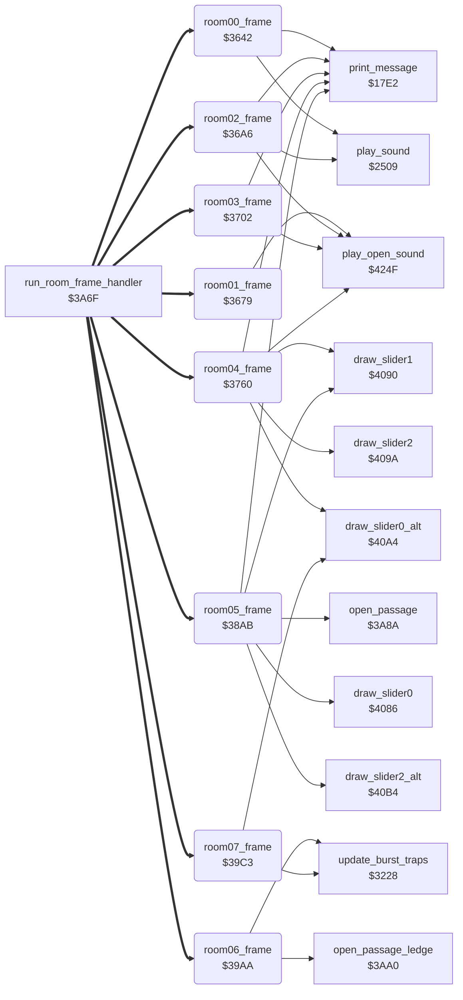

<!-- Generated by c64-docs from knowledge revision 20261029T162352.521-4j8tu8 and .c64-re-tools/local/generated/src/source-map.json. Do not edit: change the knowledge, generate the source again, then run docs.ts generate. -->
# room/room_frames_0_7.asm: Room frame handlers for rooms 0-7

Range `$3642-$3A61`. Source: [room/room_frames_0_7.asm](../../../../src/room/room_frames_0_7.asm). Index: [the reference](../../index.md).

## Routines

| Routine | Address | Reached from | Summary |
|---|---|---|---|
| [`room00_frame`](room_frames_0_7.md#room00_frame) | `$3642` | [`run_room_frame_handler`](passage_open.md#run_room_frame_handler) | Room 0 frame handler (every main loop pass, through run_room_frame_handler). |
| [`room01_frame`](room_frames_0_7.md#room01_frame) | `$3679` | [`run_room_frame_handler`](passage_open.md#run_room_frame_handler) | Room 1 frame handler: opens the trapdoor in the floor (row 12, columns 17-21). |
| [`room02_frame`](room_frames_0_7.md#room02_frame) | `$36A6` | [`run_room_frame_handler`](passage_open.md#run_room_frame_handler) | Room 2 frame handler. |
| [`room03_frame`](room_frames_0_7.md#room03_frame) | `$3702` | [`run_room_frame_handler`](passage_open.md#run_room_frame_handler) | Room 3 frame handler. |
| [`room04_frame`](room_frames_0_7.md#room04_frame) | `$3760` | [`run_room_frame_handler`](passage_open.md#run_room_frame_handler) | Room 4 frame handler (dark cave). |
| [`room05_frame`](room_frames_0_7.md#room05_frame) | `$38AB` | [`run_room_frame_handler`](passage_open.md#run_room_frame_handler) | Room 5 frame handler. |
| [`room06_frame`](room_frames_0_7.md#room06_frame) | `$39AA` | [`run_room_frame_handler`](passage_open.md#run_room_frame_handler) | Room 6 frame handler: when room 6 has no lanterns left, one time (room_state_a) a passage opens at row 5, column 1 (open_passage_ledge). |
| [`room07_frame`](room_frames_0_7.md#room07_frame) | `$39C3` | [`run_room_frame_handler`](passage_open.md#run_room_frame_handler) | Room 7 frame handler. |

## Call graph

A solid arrow is a call, a thick arrow a table entry. Rounded nodes are in this file.

## Details

### [`room00_frame`](../../../../src/room/room_frames_0_7.asm#L9) `$3642`

*routine*

Room 0 frame handler (every main loop pass, through run_room_frame_handler). When room 6 has no lanterns left (room_lanterns_left+6 = 0), the mouth of the statue at row 9, column 7 moves: on even passes (pass_parity = 0) the timer room_state_a counts down; tile $1D (char C6) is shown with sound $81 for one step, then tile $1E (char C7) for 6 steps. room_state_b = which tile is shown.
lanterns left in room 6

- **Jumped to from:** [`run_room_frame_handler`](passage_open.md#run_room_frame_handler)
- **Entry of:** [`room_frame_handlers`](../../tables.md#room_frame_handlers)
- **Calls:** [`play_sound`](../sfx/sound_request.md#play_sound), [`print_message`](../actor/actor_driver_text.md#print_message)
- **Reads:** [`room_lanterns_left`](../../memory-map.md#room_lanterns_left), [`pass_parity`](../../memory-map.md#pass_parity), [`room_state_a`](room_dispatch.md#room_state_a), [`room_state_b`](room_dispatch.md#room_state_b)
- **Writes:** [`room_state_a`](room_dispatch.md#room_state_a), [`room_state_b`](room_dispatch.md#room_state_b)
- **Refers to:** [`room_lanterns_left`](../../memory-map.md#room_lanterns_left)

| Label | Address | Comment |
|---|---|---|
| [`room00_frame_mouth_b`](../../../../src/room/room_frames_0_7.asm#L28) | `$3667` | tile $1E (char C7) at row 9, column 7 |
| [`room00_frame_done`](../../../../src/room/room_frames_0_7.asm#L36) | `$3678` |  |

### [`room01_frame`](../../../../src/room/room_frames_0_7.asm#L42) `$3679`

*routine*

Room 1 frame handler: opens the trapdoor in the floor (row 12, columns 17-21). Condition: rooms 0, 1 and 2 have no lanterns left (room_lanterns_left+0/+1/+2 = 0) while room 6 still has lanterns. On even passes room_state_a counts 3 -> $FF and tile $10 + room_state_a is drawn: $12, $11, $10, $0F (the last step is the open trapdoor). play_open_sound at the first step.

- **Jumped to from:** [`run_room_frame_handler`](passage_open.md#run_room_frame_handler)
- **Entry of:** [`room_frame_handlers`](../../tables.md#room_frame_handlers)
- **Calls:** [`play_open_sound`](wizard_fireballs.md#play_open_sound)
- **Jumps to:** [`print_message`](../actor/actor_driver_text.md#print_message)
- **Reads:** [`pass_parity`](../../memory-map.md#pass_parity), [`room_state_a`](room_dispatch.md#room_state_a), [`room_lanterns_left`](../../memory-map.md#room_lanterns_left)
- **Writes:** [`room_state_a`](room_dispatch.md#room_state_a)
- **Refers to:** [`room_lanterns_left`](../../memory-map.md#room_lanterns_left)

| Label | Address | Comment |
|---|---|---|
| [`room01_frame_draw_trapdoor`](../../../../src/room/room_frames_0_7.asm#L59) | `$369B` |  |
| [`room01_frame_done`](../../../../src/room/room_frames_0_7.asm#L65) | `$36A5` |  |

### [`room02_frame`](../../../../src/room/room_frames_0_7.asm#L75) `$36A6`

*routine*

Room 2 frame handler. First a protection check: loops forever unless zero page $00 (D6510) holds $EF, the value the protected loader leaves there. When room 6 has no lanterns left: - one time (room_state_b): play_open_sound, tile $1A at row 11 and tile $07 at row 12, column 37 (opens the floor at the bottom right); - the mouth of the statue at row 9, column 33 moves as in room 0 (timer room_state_c, shown tile in room_state_a).

- **Jumped to from:** [`run_room_frame_handler`](passage_open.md#run_room_frame_handler)
- **Entry of:** [`room_frame_handlers`](../../tables.md#room_frame_handlers)
- **Calls:** [`play_open_sound`](wizard_fireballs.md#play_open_sound), [`print_message`](../actor/actor_driver_text.md#print_message), [`play_sound`](../sfx/sound_request.md#play_sound)
- **Reads:** [`D6510`](../../memory-map.md#D6510), [`room_lanterns_left`](../../memory-map.md#room_lanterns_left), [`room_state_b`](room_dispatch.md#room_state_b), [`pass_parity`](../../memory-map.md#pass_parity), [`room_state_c`](room_dispatch.md#room_state_c), [`room_state_a`](room_dispatch.md#room_state_a)
- **Writes:** [`room_state_b`](room_dispatch.md#room_state_b), [`room_state_c`](room_dispatch.md#room_state_c), [`room_state_a`](room_dispatch.md#room_state_a)
- **Refers to:** [`room_lanterns_left`](../../memory-map.md#room_lanterns_left)

| Label | Address | Comment |
|---|---|---|
| [`room02_frame_mouth`](../../../../src/room/room_frames_0_7.asm#L106) | `$36CF` |  |
| [`room02_frame_mouth_b`](../../../../src/room/room_frames_0_7.asm#L121) | `$36F0` | tile $1E at row 9, column 33 |
| [`room02_frame_done`](../../../../src/room/room_frames_0_7.asm#L129) | `$3701` |  |

### [`room03_frame`](../../../../src/room/room_frames_0_7.asm#L136) `$3702`

*routine*

Room 3 frame handler. 1. When room 3 has no lanterns left (room_lanterns_left+3 = 0): opens the trapdoor at row 12, columns 29-33 in 4 steps on even passes (as room 1: tiles $12, $11, $10, $0F; play_open_sound at the first step). 2. Every pass: the alternating ledges of row 6. room_state_c counts 33 passes; then room_state_b toggles and tile $06 (chars 4B x7) and tile $60 (chars 09 x7) swap places between columns 9-15 and 21-27.

- **Jumped to from:** [`run_room_frame_handler`](passage_open.md#run_room_frame_handler)
- **Entry of:** [`room_frame_handlers`](../../tables.md#room_frame_handlers)
- **Calls:** [`play_open_sound`](wizard_fireballs.md#play_open_sound), [`print_message`](../actor/actor_driver_text.md#print_message)
- **Jumps to:** [`print_message`](../actor/actor_driver_text.md#print_message)
- **Reads:** [`pass_parity`](../../memory-map.md#pass_parity), [`room_state_a`](room_dispatch.md#room_state_a), [`room_lanterns_left`](../../memory-map.md#room_lanterns_left), [`room_state_c`](room_dispatch.md#room_state_c), [`room_state_b`](room_dispatch.md#room_state_b)
- **Writes:** [`room_state_a`](room_dispatch.md#room_state_a), [`room_state_c`](room_dispatch.md#room_state_c), [`room_state_b`](room_dispatch.md#room_state_b)
- **Refers to:** [`room_lanterns_left`](../../memory-map.md#room_lanterns_left)

| Label | Address | Comment |
|---|---|---|
| [`room03_frame_draw_trapdoor`](../../../../src/room/room_frames_0_7.asm#L149) | `$371C` |  |
| [`room03_frame_ledges`](../../../../src/room/room_frames_0_7.asm#L155) | `$3726` |  |
| [`room03_frame_ledges_wait`](../../../../src/room/room_frames_0_7.asm#L158) | `$372B` |  |
| [`room03_frame_swap_ledges`](../../../../src/room/room_frames_0_7.asm#L160) | `$372C` | next swap in 33 passes |
| [`room03_frame_ledges_phase_b`](../../../../src/room/room_frames_0_7.asm#L174) | `$374B` |  |

### [`room04_frame`](../../../../src/room/room_frames_0_7.asm#L195) `$3760`

*routine*

Room 4 frame handler (dark cave). Lantern 1 (row 4, column 11, record lantern_list_room4) and lantern 2 (row 4, column 28, record lantern_list_room4+4) blink while present: a counter (room_state_c / room_state_d) shows the lit lantern (tile $34 / $35, chars $13/$93 and $14/$94, which can be picked up) at 32 and the dark lantern (tile $36 / $37, chars E6 / E7) at 64, then restarts. Taking lantern 1, one time (room_state_a): play_open_sound, clears 4 cells at rows 8-9 from column 11, erases slider 1. Taking lantern 2, one time (room_state_b): restarts the animated chars (anim_chars_direction = 0, anim_chars_speed_step = 7), play_open_sound, clears 4 cells at rows 8-9 from column 25, erases slider 2. Then the sliders: slider 0 (row 11, columns 1-3, second look), slider 1 (row 7, columns 11-12) while lantern 1 is present, slider 2 (row 7, columns 26-27) while lantern 2 is present. At the end, animate_scrolling_chars.
lantern 1 present?

- **Jumped to from:** [`run_room_frame_handler`](passage_open.md#run_room_frame_handler)
- **Entry of:** [`room_frame_handlers`](../../tables.md#room_frame_handlers)
- **Calls:** [`print_message`](../actor/actor_driver_text.md#print_message), [`play_open_sound`](wizard_fireballs.md#play_open_sound), [`draw_slider1`](room_hazard_draw.md#draw_slider1), [`draw_slider2`](room_hazard_draw.md#draw_slider2), [`draw_slider0_alt`](room_hazard_draw.md#draw_slider0_alt)
- **Jumps to:** [`animate_scrolling_chars`](animated_chars.md#animate_scrolling_chars)
- **Reads:** [`lantern_list_room4`](lantern_lists.md#lantern_list_room4), [`room_state_c`](room_dispatch.md#room_state_c), [`room_state_a`](room_dispatch.md#room_state_a), [`room_state_d`](room_dispatch.md#room_state_d), [`room_state_b`](room_dispatch.md#room_state_b), [`slider_timer`](../../memory-map.md#slider_timer), [`slider_col`](../../memory-map.md#slider_col)
- **Writes:** [`room_state_c`](room_dispatch.md#room_state_c), [`room_state_a`](room_dispatch.md#room_state_a), [`room_state_d`](room_dispatch.md#room_state_d), [`room_state_b`](room_dispatch.md#room_state_b), [`anim_chars_direction`](../../memory-map.md#anim_chars_direction), [`anim_chars_speed_step`](../game/options_and_patterns.md#anim_chars_speed_step), [`slider_timer`](../../memory-map.md#slider_timer), [`slider_col`](../../memory-map.md#slider_col)
- **Refers to:** [`lantern_list_room4`](lantern_lists.md#lantern_list_room4), [`slider_timer`](../../memory-map.md#slider_timer), [`slider_col`](../../memory-map.md#slider_col)

| Label | Address | Comment |
|---|---|---|
| [`room04_frame_lantern1_check_dark`](../../../../src/room/room_frames_0_7.asm#L207) | `$377B` | counter 64: dark lantern, restart |
| [`room04_frame_lantern1_taken`](../../../../src/room/room_frames_0_7.asm#L216) | `$378D` |  |
| [`room04_frame_lantern2_blink`](../../../../src/room/room_frames_0_7.asm#L235) | `$37B4` | Lantern 2 (row 4, column 28): blink while present, else open the cells below it one time. |
| [`room04_frame_lantern2_check_dark`](../../../../src/room/room_frames_0_7.asm#L247) | `$37CF` |  |
| [`room04_frame_lantern2_taken`](../../../../src/room/room_frames_0_7.asm#L256) | `$37E1` |  |
| [`room04_frame_slider0`](../../../../src/room/room_frames_0_7.asm#L281) | `$3811` | Slider 0. slider_timer counts up each pass; negative = waiting. Frames 0-6 draw tiles; at frame 3 the slider moves one column right (blank frame at the old place, frame 2 at the new place, timer back to 2) until the end column; at frame 7 it waits again and goes back to the start column. |
| [`room04_frame_slider0_frame`](../../../../src/room/room_frames_0_7.asm#L284) | `$3815` |  |
| [`room04_frame_slider0_draw`](../../../../src/room/room_frames_0_7.asm#L290) | `$381F` | draw frame A (tiles $26-$2C) |
| [`room04_frame_slider0_step`](../../../../src/room/room_frames_0_7.asm#L293) | `$3825` |  |
| [`room04_frame_slider0_reset`](../../../../src/room/room_frames_0_7.asm#L303) | `$3838` | wait 96 passes |
| [`room04_frame_slider1`](../../../../src/room/room_frames_0_7.asm#L309) | `$3840` | Slider 1 (row 7, columns 11-12) while lantern 1 is present. slider 1 only while lantern 1 is present |
| [`room04_frame_slider1_draw`](../../../../src/room/room_frames_0_7.asm#L319) | `$3853` | draw frame A (tiles $1F-$25) |
| [`room04_frame_slider1_step`](../../../../src/room/room_frames_0_7.asm#L322) | `$3859` |  |
| [`room04_frame_slider1_reset`](../../../../src/room/room_frames_0_7.asm#L332) | `$386C` | wait 28 passes |
| [`room04_frame_slider2`](../../../../src/room/room_frames_0_7.asm#L338) | `$3874` | Slider 2 (row 7, columns 26-27) while lantern 2 is present. slider 2 only while lantern 2 is present |
| [`room04_frame_slider2_draw`](../../../../src/room/room_frames_0_7.asm#L348) | `$3887` |  |
| [`room04_frame_slider2_step`](../../../../src/room/room_frames_0_7.asm#L351) | `$388D` |  |
| [`room04_frame_slider2_reset`](../../../../src/room/room_frames_0_7.asm#L361) | `$38A0` |  |
| [`room04_frame_animate_chars`](../../../../src/room/room_frames_0_7.asm#L366) | `$38A8` | animate chars $61-$63 |

### [`room05_frame`](../../../../src/room/room_frames_0_7.asm#L378) `$38AB`

*routine*

Room 5 frame handler. - Lantern lantern_list_room5+32 (row 10, column 26) taken, one time (room_state_c): passages at columns 25 and 26 from row 10 (open_passage) and slider 1 erased. - Lantern lantern_list_room5+24 (row 10, column 2) taken, one time (room_state_d): passage at column 0 from row 10, tile $15 at row 11. - Room 6 has no lanterns left and lantern lantern_list_room5+8 (row 3, column 28) or lantern_list_room5+16 (row 3, column 38) is taken, one time (room_state_e): tile $19 (61 85 63) at row 2, column 34, passages at row 3 column 30 and row 6 column 32. - Sliders: 0 at row 9 columns 27-28, 1 at row 10 columns 27-28 while lantern lantern_list_room5+32 is present, 2 at row 5 columns 1-2 (second look). Then animate_scrolling_chars.
lantern at row 10, column 26 present?

- **Jumped to from:** [`run_room_frame_handler`](passage_open.md#run_room_frame_handler)
- **Entry of:** [`room_frame_handlers`](../../tables.md#room_frame_handlers)
- **Calls:** [`open_passage`](passage_open.md#open_passage), [`draw_slider1`](room_hazard_draw.md#draw_slider1), [`print_message`](../actor/actor_driver_text.md#print_message), [`draw_slider0`](room_hazard_draw.md#draw_slider0), [`draw_slider2_alt`](room_hazard_draw_40b4.md#draw_slider2_alt)
- **Jumps to:** [`animate_scrolling_chars`](animated_chars.md#animate_scrolling_chars)
- **Reads:** [`lantern_list_room5`](lantern_lists.md#lantern_list_room5), [`room_state_c`](room_dispatch.md#room_state_c), [`room_state_d`](room_dispatch.md#room_state_d), [`room_lanterns_left`](../../memory-map.md#room_lanterns_left), [`room_state_e`](room_dispatch.md#room_state_e), [`slider_timer`](../../memory-map.md#slider_timer), [`slider_col`](../../memory-map.md#slider_col)
- **Writes:** [`room_state_c`](room_dispatch.md#room_state_c), [`room_state_d`](room_dispatch.md#room_state_d), [`room_state_e`](room_dispatch.md#room_state_e), [`slider_timer`](../../memory-map.md#slider_timer), [`slider_col`](../../memory-map.md#slider_col)
- **Refers to:** [`lantern_list_room5`](lantern_lists.md#lantern_list_room5), [`room_lanterns_left`](../../memory-map.md#room_lanterns_left), [`slider_timer`](../../memory-map.md#slider_timer), [`slider_col`](../../memory-map.md#slider_col)

| Label | Address | Comment |
|---|---|---|
| [`room05_frame_left_passage`](../../../../src/room/room_frames_0_7.asm#L394) | `$38CB` | Lantern at row 10, column 2 taken: passage at column 0 from row 10, one time. lantern at row 10, column 2 present? |
| [`room05_frame_top_passage`](../../../../src/room/room_frames_0_7.asm#L408) | `$38E8` | Room 6 cleared and one of the lanterns of row 3 (columns 28, 38) taken: top passages, one time. room 6 cleared and lantern at row 3, column 28 taken |
| [`room05_frame_top_passage_alt`](../../../../src/room/room_frames_0_7.asm#L412) | `$38EF` | or room 6 cleared and lantern at row 3, column 38 taken |
| [`room05_frame_open_top`](../../../../src/room/room_frames_0_7.asm#L416) | `$38F6` |  |
| [`room05_frame_slider0`](../../../../src/room/room_frames_0_7.asm#L432) | `$3915` | Slider 0 (row 9, columns 27-28). |
| [`room05_frame_slider0_frame`](../../../../src/room/room_frames_0_7.asm#L435) | `$3919` |  |
| [`room05_frame_slider0_draw`](../../../../src/room/room_frames_0_7.asm#L441) | `$3923` |  |
| [`room05_frame_slider0_step`](../../../../src/room/room_frames_0_7.asm#L444) | `$3929` |  |
| [`room05_frame_slider0_reset`](../../../../src/room/room_frames_0_7.asm#L454) | `$393C` | wait 32 passes |
| [`room05_frame_slider1`](../../../../src/room/room_frames_0_7.asm#L460) | `$3944` | Slider 1 (row 10, columns 27-28) while the lantern at row 10, column 26 is present. slider 1 only while the lantern at row 10, column 26 is present |
| [`room05_frame_slider1_draw`](../../../../src/room/room_frames_0_7.asm#L470) | `$3957` |  |
| [`room05_frame_slider1_step`](../../../../src/room/room_frames_0_7.asm#L473) | `$395D` |  |
| [`room05_frame_slider1_reset`](../../../../src/room/room_frames_0_7.asm#L483) | `$3970` |  |
| [`room05_frame_slider2`](../../../../src/room/room_frames_0_7.asm#L489) | `$3978` | Slider 2 (row 5, columns 1-2, second look). |
| [`room05_frame_slider2_draw`](../../../../src/room/room_frames_0_7.asm#L497) | `$3986` | second look: tiles $26-$2C |
| [`room05_frame_slider2_step`](../../../../src/room/room_frames_0_7.asm#L500) | `$398C` |  |
| [`room05_frame_slider2_reset`](../../../../src/room/room_frames_0_7.asm#L510) | `$399F` | wait 30 passes |
| [`room05_frame_animate_chars`](../../../../src/room/room_frames_0_7.asm#L515) | `$39A7` |  |

### [`room06_frame`](../../../../src/room/room_frames_0_7.asm#L519) `$39AA`

*routine*

Room 6 frame handler: when room 6 has no lanterns left, one time (room_state_a) a passage opens at row 5, column 1 (open_passage_ledge). Then update_burst_traps and animate_scrolling_chars.
lanterns left in room 6

- **Jumped to from:** [`run_room_frame_handler`](passage_open.md#run_room_frame_handler)
- **Entry of:** [`room_frame_handlers`](../../tables.md#room_frame_handlers)
- **Calls:** [`open_passage_ledge`](passage_open.md#open_passage_ledge), [`update_burst_traps`](room_misc_support.md#update_burst_traps)
- **Jumps to:** [`animate_scrolling_chars`](animated_chars.md#animate_scrolling_chars)
- **Reads:** [`room_lanterns_left`](../../memory-map.md#room_lanterns_left), [`room_state_a`](room_dispatch.md#room_state_a)
- **Writes:** [`room_state_a`](room_dispatch.md#room_state_a)
- **Refers to:** [`room_lanterns_left`](../../memory-map.md#room_lanterns_left)

| Label | Address | Comment |
|---|---|---|
| [`room06_frame_bursts`](../../../../src/room/room_frames_0_7.asm#L529) | `$39BD` |  |

### [`room07_frame`](../../../../src/room/room_frames_0_7.asm#L542) `$39C3`

*routine*

Room 7 frame handler. - update_burst_traps. - The 5 lanterns of row 2 taken, one time (room_state_a): passage at row 2, column 33 (open_passage_ledge), and return. - The 6 lanterns of row 5 taken, one time (room_state_b): passage at row 5, column 38 (open_passage_ledge), and return. - Slider 0 at row 4, columns 34-36 (second look). - The runner at row 11 moves right (columns 5-35, then back to 5) while lantern lantern_list_room7+$2C or lantern_list_room7+$30 (row 9) is present, and moves left (columns 36-5, then back to 36) when both are taken.

- **Jumped to from:** [`run_room_frame_handler`](passage_open.md#run_room_frame_handler)
- **Entry of:** [`room_frame_handlers`](../../tables.md#room_frame_handlers)
- **Calls:** [`update_burst_traps`](room_misc_support.md#update_burst_traps), [`draw_slider0_alt`](room_hazard_draw.md#draw_slider0_alt)
- **Jumps to:** [`open_passage_ledge`](passage_open.md#open_passage_ledge), [`draw_runner_step`](room_hazard_draw.md#draw_runner_step)
- **Reads:** [`lantern_list_room7`](lantern_lists.md#lantern_list_room7), [`room_state_a`](room_dispatch.md#room_state_a), [`room_state_b`](room_dispatch.md#room_state_b), [`slider_timer`](../../memory-map.md#slider_timer), [`slider_col`](../../memory-map.md#slider_col), [`runner_col`](../../memory-map.md#runner_col)
- **Writes:** [`room_state_a`](room_dispatch.md#room_state_a), [`room_state_b`](room_dispatch.md#room_state_b), [`slider_timer`](../../memory-map.md#slider_timer), [`slider_col`](../../memory-map.md#slider_col), [`runner_old_col`](../../memory-map.md#runner_old_col), [`runner_col`](../../memory-map.md#runner_col)
- **Refers to:** [`lantern_list_room7`](lantern_lists.md#lantern_list_room7)

| Label | Address | Comment |
|---|---|---|
| [`room07_frame_middle_passage`](../../../../src/room/room_frames_0_7.asm#L557) | `$39E6` | The 6 lanterns of row 5 taken: passage at row 5, column 38, one time. lanterns of row 5 present? |
| [`room07_frame_slider0`](../../../../src/room/room_frames_0_7.asm#L573) | `$3A09` | Slider 0 (row 4, columns 34-36, second look). |
| [`room07_frame_slider0_frame`](../../../../src/room/room_frames_0_7.asm#L576) | `$3A0D` |  |
| [`room07_frame_slider0_draw`](../../../../src/room/room_frames_0_7.asm#L582) | `$3A17` |  |
| [`room07_frame_slider0_step`](../../../../src/room/room_frames_0_7.asm#L585) | `$3A1D` |  |
| [`room07_frame_slider0_reset`](../../../../src/room/room_frames_0_7.asm#L595) | `$3A30` | back to column 34 |
| [`room07_frame_runner`](../../../../src/room/room_frames_0_7.asm#L601) | `$3A38` | Runner of row 11: right while a lantern of row 9 is present, left when both are taken. lanterns of row 9 present? |
| [`room07_frame_runner_draw`](../../../../src/room/room_frames_0_7.asm#L612) | `$3A4E` |  |
| [`room07_frame_runner_left`](../../../../src/room/room_frames_0_7.asm#L614) | `$3A51` |  |
| [`room07_frame_runner_left_draw`](../../../../src/room/room_frames_0_7.asm#L623) | `$3A5F` |  |
