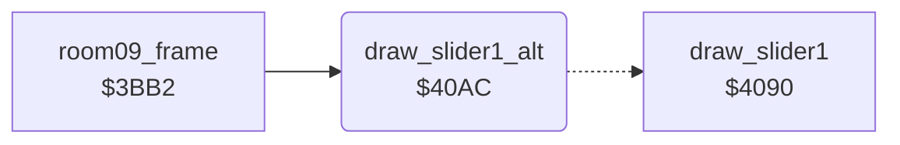

<!-- Generated by c64-docs from knowledge revision 20261023T151738.098-ndlxeh and .c64-re-tools/local/generated/src/source-map.json. Do not edit: change the knowledge, generate the source again, then run docs.ts generate. -->
# room/room_hazard_draw_40ac.asm

Range `$40AC-$40B1`. Source: [room/room_hazard_draw_40ac.asm](../../../../src/room/room_hazard_draw_40ac.asm). Index: [the reference](../../index.md).

## Call graph

A solid arrow is a call, a thick arrow a table entry, a dotted arrow a jump. Rounded nodes are in this file.

## Names

### [`draw_slider1_alt`](../../../../src/room/room_hazard_draw_40ac.asm#L6) `$40AC`

*routine*

Draws slider 1 with the second look: tile $26 + A.

- **Called from:** [`room09_frame`](room_frames_8_11.md#room09_frame) [`$3C6C`](../../../../src/room/room_frames_8_11.asm#L253), [`room09_frame`](room_frames_8_11.md#room09_frame) [`$3C7A`](../../../../src/room/room_frames_8_11.asm#L260)
- **Jumps to:** [`draw_slider1`](room_hazard_draw.md#draw_slider1)
