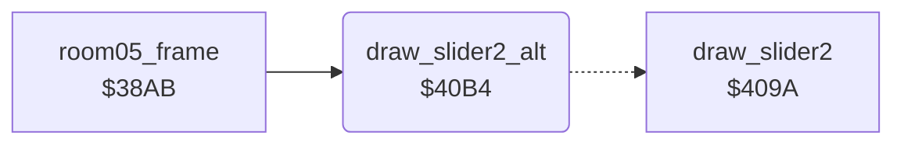

<!-- Generated by c64-docs from knowledge revision 20261023T151738.098-ndlxeh and .c64-re-tools/local/generated/src/source-map.json. Do not edit: change the knowledge, generate the source again, then run docs.ts generate. -->
# room/room_hazard_draw_40b4.asm

Range `$40B4-$40B9`. Source: [room/room_hazard_draw_40b4.asm](../../../../src/room/room_hazard_draw_40b4.asm). Index: [the reference](../../index.md).

## Call graph

A solid arrow is a call, a thick arrow a table entry, a dotted arrow a jump. Rounded nodes are in this file.

## Names

### [`draw_slider2_alt`](../../../../src/room/room_hazard_draw_40b4.asm#L6) `$40B4`

*routine*

Draws slider 2 with the second look: tile $26 + A.

- **Called from:** [`room05_frame`](room_frames_0_7.md#room05_frame) [`$3986`](../../../../src/room/room_frames_0_7.asm#L498), [`room05_frame`](room_frames_0_7.md#room05_frame) [`$3994`](../../../../src/room/room_frames_0_7.asm#L505)
- **Jumps to:** [`draw_slider2`](room_hazard_draw.md#draw_slider2)
