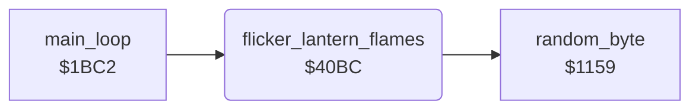

<!-- Generated by c64-docs from knowledge revision 20261025T141148.619-ij2l1b and .c64-re-tools/local/generated/src/source-map.json. Do not edit: change the knowledge, generate the source again, then run docs.ts generate. -->
# room/room_hazard_draw_40bc.asm

Range `$40BC-$4132`. Source: [room/room_hazard_draw_40bc.asm](../../../../src/room/room_hazard_draw_40bc.asm). Index: [the reference](../../index.md).

## Routines

| Routine | Address | Reached from | Summary |
|---|---|---|---|
| [`flicker_lantern_flames`](room_hazard_draw_40bc.md#flicker_lantern_flames) | `$40BC` | [`main_loop`](../game/game_main_loop.md#main_loop) | Flickers the flame chars; the main loop calls it on every pass in every room. |

## Call graph

A solid arrow is a call, a thick arrow a table entry. Rounded nodes are in this file.

## Details

### [`flicker_lantern_flames`](../../../../src/room/room_hazard_draw_40bc.asm#L13) `$40BC`

*routine*

Flickers the flame chars; the main loop calls it on every pass in every room. Three timers (flame_timer_a, _b, _c) count down; when one reaches 0 it gets a new random value 1-15 and new random pixel bytes go into bytes 2 and 3 of its chars, in both room charsets (charset_rooms_0_9 and charset_rooms_10_19): timer a: char $93 (lantern flame) and char $86 (charset_rooms_0_9 only) timer b: char $B1 timer c: char $94 (lantern flame) and char $E7 (charset_rooms_0_9 only). Random numbers from random_byte.

- **Called from:** [`main_loop`](../game/game_main_loop.md#main_loop)
- **Calls:** [`random_byte`](../irq/interrupt_entry_1131.md#random_byte)
- **Reads:** [`flame_timer_a`](../../memory-map.md#flame_timer_a), [`flame_timer_b`](../../memory-map.md#flame_timer_b), [`flame_timer_c`](../../memory-map.md#flame_timer_c)
- **Writes:** [`flame_timer_a`](../../memory-map.md#flame_timer_a), [`charset_rooms_10_19`](../../memory-map.md#charset_rooms_10_19), [`charset_rooms_0_9`](../../memory-map.md#charset_rooms_0_9), [`flame_timer_b`](../../memory-map.md#flame_timer_b), [`flame_timer_c`](../../memory-map.md#flame_timer_c)
- **Refers to:** [`charset_rooms_10_19`](../../memory-map.md#charset_rooms_10_19), [`charset_rooms_0_9`](../../memory-map.md#charset_rooms_0_9)

| Label | Address | Comment |
|---|---|---|
| [`flicker_flames_a_new_time`](../../../../src/room/room_hazard_draw_40bc.asm#L16) | `$40C1` |  |
| [`flicker_flames_a_new_pixels`](../../../../src/room/room_hazard_draw_40bc.asm#L20) | `$40C8` |  |
| [`flicker_flames_b`](../../../../src/room/room_hazard_draw_40bc.asm#L33) | `$40E6` | Timer b: char $B1. |
| [`flicker_flames_b_new_time`](../../../../src/room/room_hazard_draw_40bc.asm#L36) | `$40EB` |  |
| [`flicker_flames_b_new_pixels`](../../../../src/room/room_hazard_draw_40bc.asm#L40) | `$40F2` |  |
| [`flicker_flames_c`](../../../../src/room/room_hazard_draw_40bc.asm#L50) | `$4108` | Timer c: chars $94 and $E7. |
| [`flicker_flames_c_new_time`](../../../../src/room/room_hazard_draw_40bc.asm#L53) | `$410D` |  |
| [`flicker_flames_c_new_pixels`](../../../../src/room/room_hazard_draw_40bc.asm#L57) | `$4114` |  |
| [`flicker_flames_done`](../../../../src/room/room_hazard_draw_40bc.asm#L69) | `$4132` |  |
