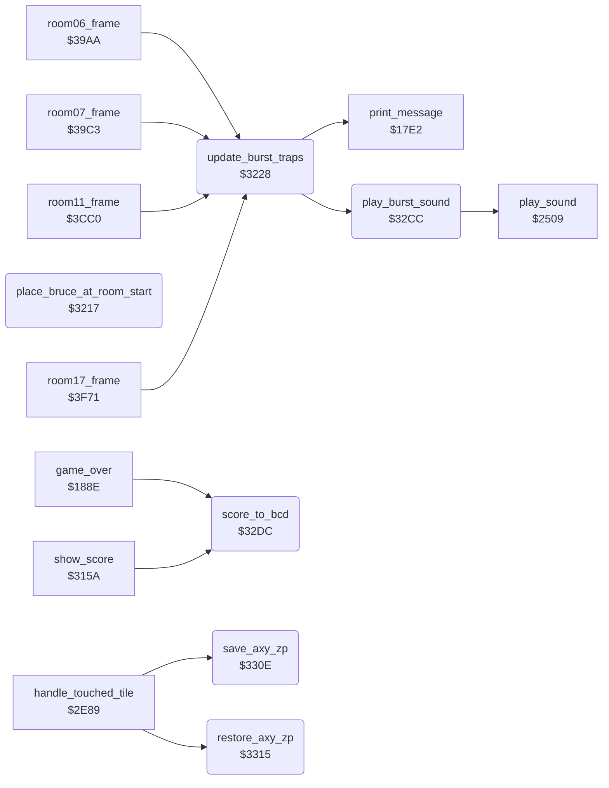

<!-- Generated by c64-docs from knowledge revision 20261029T162352.521-4j8tu8 and .c64-re-tools/local/generated/src/source-map.json. Do not edit: change the knowledge, generate the source again, then run docs.ts generate. -->
# room/room_misc_support.asm: Room start position, burst traps, score to BCD, register save

Range `$3217-$331B`. Source: [room/room_misc_support.asm](../../../../src/room/room_misc_support.asm). Index: [the reference](../../index.md).

## Routines

| Routine | Address | Reached from | Summary |
|---|---|---|---|
| [`place_bruce_at_room_start`](room_misc_support.md#place_bruce_at_room_start) | `$3217` | [`draw_room`](draw_room.md#draw_room), [`lose_fall`](../game/lose_fall_game_over.md#lose_fall), [`room19_frame`](ending_room.md#room19_frame) | Puts Bruce at the start position of room X and enters that room. |
| [`update_burst_traps`](room_misc_support.md#update_burst_traps) | `$3228` | [`room06_frame`](room_frames_0_7.md#room06_frame), [`room07_frame`](room_frames_0_7.md#room07_frame), [`room11_frame`](room_frames_8_11.md#room11_frame), [`room17_frame`](room_frames_12_17.md#room17_frame), [`room10_frame`](room_frames_8_11.md#room10_frame), [`room12_frame`](room_frames_12_17.md#room12_frame), [`room14_frame`](room_frames_12_17.md#room14_frame), [`room16_frame`](room_frames_12_17.md#room16_frame) | Updates the three burst trap slots (floor traps that erupt after an actor touches them). |
| [`play_burst_sound`](room_misc_support.md#play_burst_sound) | `$32CC` | [`update_burst_traps`](room_misc_support.md#update_burst_traps) | Plays sound effect $8D (burst trap) through play_sound. |
| [`score_to_bcd`](room_misc_support.md#score_to_bcd) | `$32DC` | [`game_over`](../game/lose_fall_game_over.md#game_over), [`show_score`](../game/score.md#show_score) | Converts the score to decimal digits for the status line. |
| [`save_axy_zp`](room_misc_support.md#save_axy_zp) | `$330E` | [`handle_touched_tile`](../actor/background_touch.md#handle_touched_tile) | Saves A, X and Y in saved_a, saved_x and saved_y. |
| [`restore_axy_zp`](room_misc_support.md#restore_axy_zp) | `$3315` | [`handle_touched_tile`](../actor/background_touch.md#handle_touched_tile) | Loads A, X and Y back from saved_a, saved_x and saved_y. |

## Call graph

A solid arrow is a call, a thick arrow a table entry. Rounded nodes are in this file.

## Details

### [`place_bruce_at_room_start`](../../../../src/room/room_misc_support.asm#L11) `$3217`

*routine*

Puts Bruce at the start position of room X and enters that room. Input: X = room number (0-19). Sets current_actor = 0 (Bruce), next_room = X, and loads the start position from spawn_a_x/spawn_a_y,X. Then it jumps to enter_room, which stores the position, sets room, draws the room, resets the stack and enters the main loop. It does not return. Callers: lose_fall (respawn in the same room), draw_room (the room 11 shortcut to room 13) and room19_frame (back to room 0 for the next game loop).

- **Jumped to from:** [`draw_room`](draw_room.md#draw_room), [`lose_fall`](../game/lose_fall_game_over.md#lose_fall), [`room19_frame`](ending_room.md#room19_frame)
- **Jumps to:** [`enter_room`](../actor/background_touch.md#enter_room)
- **Reads:** [`spawn_a_y`](room_tables.md#spawn_a_y), [`spawn_a_x`](room_tables.md#spawn_a_x)
- **Writes:** [`current_actor`](../../memory-map.md#current_actor), [`next_room`](../../memory-map.md#next_room)

### [`update_burst_traps`](../../../../src/room/room_misc_support.asm#L33) `$3228`

*routine*

Updates the three burst trap slots (floor traps that erupt after an actor touches them). A slot starts when an actor touches trap char $60 whose colour is not 5 (touch_trap_tile): the slot counter burst_trap_timer+n becomes 1, the cell above-left of the touched cell goes to burst_trap_row+n (row) and burst_trap_col+n (column), and the touched cell gets colour 5 so it does not trigger again. Each call increments every active counter (0 = slot free). By the counter value before the increment: $08: tiles $2F/$30 (chars $F1-$F6, 3 wide x 2 rows) and sound $8D $0C: tiles $31/$32 (chars $F7-$FC) $10: tiles $2F/$30 again (no sound) $14: top row blank (tile 0), bottom row tile $33 (chars $FD $E0 $FD) with colour 8 on its middle cell, so the trap char $60 is armed again $18: counter = 0, slot free. The burst chars $71-$7C kill an actor on contact (handle_touched_tile). Called by the frame handlers of rooms 6, 7, 10, 11, 12, 14, 16 and 17. Uses burst_slot as the slot index (2..0).

- **Called from:** [`room06_frame`](room_frames_0_7.md#room06_frame), [`room07_frame`](room_frames_0_7.md#room07_frame), [`room11_frame`](room_frames_8_11.md#room11_frame), [`room17_frame`](room_frames_12_17.md#room17_frame)
- **Jumped to from:** [`room10_frame`](room_frames_8_11.md#room10_frame), [`room12_frame`](room_frames_12_17.md#room12_frame), [`room14_frame`](room_frames_12_17.md#room14_frame), [`room16_frame`](room_frames_12_17.md#room16_frame)
- **Calls:** [`play_burst_sound`](room_misc_support.md#play_burst_sound), [`print_message`](../actor/actor_driver_text.md#print_message)
- **Reads:** [`burst_slot`](../../memory-map.md#burst_slot), [`burst_trap_timer`](../../memory-map.md#burst_trap_timer), [`burst_trap_col`](../../memory-map.md#burst_trap_col), [`burst_trap_row`](../../memory-map.md#burst_trap_row), [`row_ptr_top`](../../memory-map.md#row_ptr_top)
- **Writes:** [`burst_slot`](../../memory-map.md#burst_slot), [`burst_trap_timer`](../../memory-map.md#burst_trap_timer), [`row_ptr_top`](../../memory-map.md#row_ptr_top)
- **Refers to:** [`game_screen`](../../memory-map.md#game_screen), [`row_ptr_top`](../../memory-map.md#row_ptr_top)

| Label | Address | Comment |
|---|---|---|
| [`update_burst_traps_slot`](../../../../src/room/room_misc_support.asm#L36) | `$322C` |  |
| [`update_burst_traps_active`](../../../../src/room/room_misc_support.asm#L41) | `$3236` | A keeps the value before the increment |
| [`update_burst_traps_draw_small`](../../../../src/room/room_misc_support.asm#L48) | `$3240` | Draw tile $2F at (row, column) and tile $30 one row below. |
| [`update_burst_traps_stage_large`](../../../../src/room/room_misc_support.asm#L63) | `$3260` | stage 2: large burst |
| [`update_burst_traps_stage_small2`](../../../../src/room/room_misc_support.asm#L79) | `$3282` | stage 3: small burst again |
| [`update_burst_traps_stage_free`](../../../../src/room/room_misc_support.asm#L110) | `$32BB` | stage 5: slot free |
| [`update_burst_traps_next`](../../../../src/room/room_misc_support.asm#L115) | `$32C4` |  |
| [`update_burst_traps_done`](../../../../src/room/room_misc_support.asm#L119) | `$32CB` |  |

### [`play_burst_sound`](../../../../src/room/room_misc_support.asm#L122) `$32CC`

*routine*

Plays sound effect $8D (burst trap) through play_sound. Keeps A, X and Y.

- **Called from:** [`update_burst_traps`](room_misc_support.md#update_burst_traps)
- **Calls:** [`play_sound`](../sfx/sound_request.md#play_sound)

### [`score_to_bcd`](../../../../src/room/room_misc_support.asm#L142) `$32DC`

*routine*

Converts the score to decimal digits for the status line. Input: score, a 24-bit binary number (high byte first). Output: 8 packed BCD digits in bcd_conv_digits..bcd_conv_digits+3 (high to low). Work copy of the score in bcd_conv_binary..+2. Method: shift the binary number left 24 times; after each shift double the BCD value in decimal mode and add the carry. Keeps the decimal flag state of the caller (PHP/PLP).

- **Called from:** [`game_over`](../game/lose_fall_game_over.md#game_over), [`show_score`](../game/score.md#show_score)
- **Reads:** [`score`](../../memory-map.md#score), [`bcd_conv_binary`](../game/fireball_text_score_vars_4392.md#bcd_conv_binary), [`bcd_conv_digits`](../game/fireball_text_score_vars_4392.md#bcd_conv_digits)
- **Writes:** [`bcd_conv_binary`](../game/fireball_text_score_vars_4392.md#bcd_conv_binary), [`bcd_conv_digits`](../game/fireball_text_score_vars_4392.md#bcd_conv_digits)
- **Refers to:** [`bcd_conv_digits`](../game/fireball_text_score_vars_4392.md#bcd_conv_digits), [`bcd_conv_binary`](../game/fireball_text_score_vars_4392.md#bcd_conv_binary)

| Label | Address | Comment |
|---|---|---|
| [`score_to_bcd_copy`](../../../../src/room/room_misc_support.asm#L144) | `$32DE` |  |
| [`score_to_bcd_bit_loop`](../../../../src/room/room_misc_support.asm#L155) | `$32F2` |  |
| [`score_to_bcd_digit_loop`](../../../../src/room/room_misc_support.asm#L160) | `$32FD` | BCD = BCD*2 + carry, from the low byte up |

### [`save_axy_zp`](../../../../src/room/room_misc_support.asm#L171) `$330E`

*routine*

Saves A, X and Y in saved_a, saved_x and saved_y. Used around the lantern pickup check.

- **Called from:** [`handle_touched_tile`](../actor/background_touch.md#handle_touched_tile)
- **Writes:** [`saved_a`](../../memory-map.md#saved_a), [`saved_x`](../../memory-map.md#saved_x), [`saved_y`](../../memory-map.md#saved_y)

### [`restore_axy_zp`](../../../../src/room/room_misc_support.asm#L177) `$3315`

*routine*

Loads A, X and Y back from saved_a, saved_x and saved_y.

- **Called from:** [`handle_touched_tile`](../actor/background_touch.md#handle_touched_tile)
- **Jumped to from:** [`handle_touched_tile`](../actor/background_touch.md#handle_touched_tile)
- **Reads:** [`saved_a`](../../memory-map.md#saved_a), [`saved_x`](../../memory-map.md#saved_x), [`saved_y`](../../memory-map.md#saved_y)
