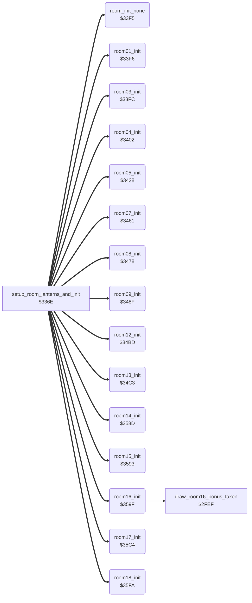

<!-- Generated by c64-docs from knowledge revision 20261023T151738.098-ndlxeh and .c64-re-tools/local/generated/src/source-map.json. Do not edit: change the knowledge, generate the source again, then run docs.ts generate. -->
# room/room_specific_init.asm: Room init handlers (rooms 1-18), called once when a room is drawn

Range `$33F5-$3641`. Source: [room/room_specific_init.asm](../../../../src/room/room_specific_init.asm). Index: [the reference](../../index.md).

## Call graph

A solid arrow is a call, a thick arrow a table entry, a dotted arrow a jump. Rounded nodes are in this file.

## Names

### [`room_init_none`](../../../../src/room/room_specific_init.asm#L6) `$33F5`

*routine*

Room init handler of rooms 0, 2, 6, 10 and 11: nothing to set up.

- **Jumped to from:** [`setup_room_lanterns_and_init`](lantern_pickup.md#setup_room_lanterns_and_init) [`$33C9`](../../../../src/room/lantern_pickup.asm#L144)
- **Entry of:** [`room_init_handlers`](../../tables.md#room_init_handlers)

### [`room01_init`](../../../../src/room/room_specific_init.asm#L9) `$33F6`

*routine*

Room 1 init: the trapdoor step counter room_state_a = 3 (room01_frame opens the trapdoor in 4 steps).

- **Jumped to from:** [`setup_room_lanterns_and_init`](lantern_pickup.md#setup_room_lanterns_and_init) [`$33C9`](../../../../src/room/lantern_pickup.asm#L144)
- **Entry of:** [`room_init_handlers`](../../tables.md#room_init_handlers)
- **Writes:** [`room_state_a`](room_dispatch.md#room_state_a)

### [`room03_init`](../../../../src/room/room_specific_init.asm#L14) `$33FC`

*routine*

Room 3 init: the trapdoor step counter room_state_a = 3 (room03_frame opens the trapdoor in 4 steps).

- **Jumped to from:** [`setup_room_lanterns_and_init`](lantern_pickup.md#setup_room_lanterns_and_init) [`$33C9`](../../../../src/room/lantern_pickup.asm#L144)
- **Entry of:** [`room_init_handlers`](../../tables.md#room_init_handlers)
- **Writes:** [`room_state_a`](room_dispatch.md#room_state_a)

### [`room04_init`](../../../../src/room/room_specific_init.asm#L22) `$3402`

*routine*

Room 4 init: sets up three slider hazards and the phase of the second lantern blink. Slider 0 at row 11 from column 1, slider 1 at row 7 from column 11, slider 2 at row 7 from column 26. slider_timer 0/1/2 start at $FF/$FF/$F4 (negative = waiting). room_state_d = $1F starts the blink counter of lantern 2 half way, so the two lanterns blink out of step.

- **Jumped to from:** [`setup_room_lanterns_and_init`](lantern_pickup.md#setup_room_lanterns_and_init) [`$33C9`](../../../../src/room/lantern_pickup.asm#L144)
- **Entry of:** [`room_init_handlers`](../../tables.md#room_init_handlers)
- **Writes:** [`room_state_d`](room_dispatch.md#room_state_d), [`slider_col`](../../memory-map.md#slider_col), [`slider_row`](../../memory-map.md#slider_row), [`slider_col+1`](../../memory-map.md#slider_col), [`slider_row+1`](../../memory-map.md#slider_row), [`slider_row+2`](../../memory-map.md#slider_row), [`slider_col+2`](../../memory-map.md#slider_col), [`slider_timer`](../../memory-map.md#slider_timer), [`slider_timer+1`](../../memory-map.md#slider_timer), [`slider_timer+2`](../../memory-map.md#slider_timer)
- **Refers to:** [`slider_col`](../../memory-map.md#slider_col), [`slider_row`](../../memory-map.md#slider_row), [`slider_timer`](../../memory-map.md#slider_timer)

### [`room05_init`](../../../../src/room/room_specific_init.asm#L48) `$3428`

*routine*

Room 5 init. First a protection check: it loops forever unless prot_loader_mark (zero page $02) holds $32, a value that the original loader leaves there. Then colour 12 for the cells of text line 2, columns 34-36 (where room05_frame later draws tile $19), and the three sliders: slider 0 at row 9 column 27, slider 1 at row 10 column 27, slider 2 at row 5 column 1. slider_timer 0/1/2 = $FF/$FC/$F8.

- **Jumped to from:** [`setup_room_lanterns_and_init`](lantern_pickup.md#setup_room_lanterns_and_init) [`$33C9`](../../../../src/room/lantern_pickup.asm#L144)
- **Entry of:** [`room_init_handlers`](../../tables.md#room_init_handlers)
- **Reads:** [`prot_loader_mark`](../../memory-map.md#prot_loader_mark)
- **Writes:** `$D89A`, `$D8C2`, [`slider_col`](../../memory-map.md#slider_col), [`slider_col+1`](../../memory-map.md#slider_col), [`slider_col+2`](../../memory-map.md#slider_col), [`slider_row`](../../memory-map.md#slider_row), [`slider_row+1`](../../memory-map.md#slider_row), [`slider_row+2`](../../memory-map.md#slider_row), [`slider_timer`](../../memory-map.md#slider_timer), [`slider_timer+1`](../../memory-map.md#slider_timer), [`slider_timer+2`](../../memory-map.md#slider_timer)
- **Refers to:** [`slider_col`](../../memory-map.md#slider_col), [`slider_row`](../../memory-map.md#slider_row), [`slider_timer`](../../memory-map.md#slider_timer)

### [`room05_init_colour_loop`](../../../../src/room/room_specific_init.asm#L68) `$3435`

*label*

colour RAM, screen row 3 (top of text line 2), columns 34-36

- **Jumped to from:** [`room05_init`](room_specific_init.md#room05_init) [`$343C`](../../../../src/room/room_specific_init.asm#L72)

### [`room07_init`](../../../../src/room/room_specific_init.asm#L93) `$3461`

*routine*

Room 7 init: the runner hazard at row 11, column 5 (runner_col new column, runner_old_col old column, runner_row), and slider 0 at row 4 column 34 with slider_timer = $FF.

- **Jumped to from:** [`setup_room_lanterns_and_init`](lantern_pickup.md#setup_room_lanterns_and_init) [`$33C9`](../../../../src/room/lantern_pickup.asm#L144)
- **Entry of:** [`room_init_handlers`](../../tables.md#room_init_handlers)
- **Writes:** [`runner_col`](../../memory-map.md#runner_col), [`runner_old_col`](../../memory-map.md#runner_old_col), [`runner_row`](../../memory-map.md#runner_row), [`slider_col`](../../memory-map.md#slider_col), [`slider_row`](../../memory-map.md#slider_row), [`slider_timer`](../../memory-map.md#slider_timer)

### [`room08_init`](../../../../src/room/room_specific_init.asm#L107) `$3478`

*routine*

Room 8 init: slider 0 at row 5 column 6 (timer $FF) and slider 1 at row 5 column 27 (timer $F2).

- **Jumped to from:** [`setup_room_lanterns_and_init`](lantern_pickup.md#setup_room_lanterns_and_init) [`$33C9`](../../../../src/room/lantern_pickup.asm#L144)
- **Entry of:** [`room_init_handlers`](../../tables.md#room_init_handlers)
- **Writes:** [`slider_col`](../../memory-map.md#slider_col), [`slider_col+1`](../../memory-map.md#slider_col), [`slider_row`](../../memory-map.md#slider_row), [`slider_row+1`](../../memory-map.md#slider_row), [`slider_timer`](../../memory-map.md#slider_timer), [`slider_timer+1`](../../memory-map.md#slider_timer)
- **Refers to:** [`slider_col`](../../memory-map.md#slider_col), [`slider_row`](../../memory-map.md#slider_row), [`slider_timer`](../../memory-map.md#slider_timer)

### [`room09_init`](../../../../src/room/room_specific_init.asm#L123) `$348F`

*routine*

Room 9 init: colour 10 for the cells of text line 2, columns 35-38 (where room09_frame later draws tile $18), the runner at row 12 column 4, slider 0 at row 5 column 16 (timer $FC) and slider 1 at row 6 column 16 (timer $FF).
colour 10

- **Jumped to from:** [`setup_room_lanterns_and_init`](lantern_pickup.md#setup_room_lanterns_and_init) [`$33C9`](../../../../src/room/lantern_pickup.asm#L144)
- **Entry of:** [`room_init_handlers`](../../tables.md#room_init_handlers)
- **Writes:** `$D89B`, `$D8C3`, [`runner_col`](../../memory-map.md#runner_col), [`runner_old_col`](../../memory-map.md#runner_old_col), [`runner_row`](../../memory-map.md#runner_row), [`slider_col`](../../memory-map.md#slider_col), [`slider_col+1`](../../memory-map.md#slider_col), [`slider_row`](../../memory-map.md#slider_row), [`slider_row+1`](../../memory-map.md#slider_row), [`slider_timer`](../../memory-map.md#slider_timer), [`slider_timer+1`](../../memory-map.md#slider_timer)
- **Refers to:** [`slider_col`](../../memory-map.md#slider_col), [`slider_row`](../../memory-map.md#slider_row), [`slider_timer`](../../memory-map.md#slider_timer)

### [`room09_init_colour_loop`](../../../../src/room/room_specific_init.asm#L126) `$3493`

*label*

colour RAM, screen row 3 (top of text line 2), columns 35-38

- **Jumped to from:** [`room09_init`](room_specific_init.md#room09_init) [`$349A`](../../../../src/room/room_specific_init.asm#L130)

### [`room12_init`](../../../../src/room/room_specific_init.asm#L149) `$34BD`

*routine*

Room 12 init: room_state_a = 1. The first passage of room12_frame is drawn on two passes (1 -> 0 -> $FF).

- **Jumped to from:** [`setup_room_lanterns_and_init`](lantern_pickup.md#setup_room_lanterns_and_init) [`$33C9`](../../../../src/room/lantern_pickup.asm#L144)
- **Entry of:** [`room_init_handlers`](../../tables.md#room_init_handlers)
- **Writes:** [`room_state_a`](room_dispatch.md#room_state_a)

### [`room13_init`](../../../../src/room/room_specific_init.asm#L159) `$34C3`

*routine*

Room 13 init: sets up the floor movers (mover_* tables, slots 0-9) for update_floor_movers. Slot n has: mover_dir+n state (0 = off, $02 = moves left, $82 = moves right), mover_col+n column, mover_row+n row, mover_old_col+n old column, mover_min_col+n left limit, mover_wrap_col+n right limit. Slots 0-2 and 4 move left, slots 5-8 move right, slots 3 and 9 are off. Rows: slots 0/7 row 7, 1/8 row 10, 2/4 row 12, 5/6 row 5. Several start columns and limits depend on game_loop_count (0 in the first game, nonzero after the game was completed once), so later games have longer mover tracks.

- **Jumped to from:** [`setup_room_lanterns_and_init`](lantern_pickup.md#setup_room_lanterns_and_init) [`$33C9`](../../../../src/room/lantern_pickup.asm#L144)
- **Entry of:** [`room_init_handlers`](../../tables.md#room_init_handlers)
- **Reads:** [`game_loop_count`](../../memory-map.md#game_loop_count)
- **Writes:** [`mover_dir`](../../memory-map.md#mover_dir), [`mover_dir+5`](../../memory-map.md#mover_dir), [`mover_dir+9`](../../memory-map.md#mover_dir), [`mover_dir+3`](../../memory-map.md#mover_dir), [`mover_min_col+1`](../../memory-map.md#mover_min_col), [`mover_col+5`](../../memory-map.md#mover_col), [`mover_old_col+5`](../../memory-map.md#mover_old_col), [`mover_min_col+5`](../../memory-map.md#mover_min_col), [`mover_min_col+6`](../../memory-map.md#mover_min_col), [`mover_col+2`](../../memory-map.md#mover_col), [`mover_old_col+2`](../../memory-map.md#mover_old_col), [`mover_min_col+2`](../../memory-map.md#mover_min_col), [`mover_min_col+4`](../../memory-map.md#mover_min_col), [`mover_col+7`](../../memory-map.md#mover_col), [`mover_old_col+7`](../../memory-map.md#mover_old_col), [`mover_min_col+7`](../../memory-map.md#mover_min_col), [`mover_min_col`](../../memory-map.md#mover_min_col), [`mover_wrap_col+7`](../../memory-map.md#mover_wrap_col), [`mover_col+1`](../../memory-map.md#mover_col), [`mover_old_col+1`](../../memory-map.md#mover_old_col), [`mover_wrap_col+1`](../../memory-map.md#mover_wrap_col), [`mover_col+6`](../../memory-map.md#mover_col), [`mover_old_col+6`](../../memory-map.md#mover_old_col), [`mover_col+4`](../../memory-map.md#mover_col), [`mover_old_col+4`](../../memory-map.md#mover_old_col), [`mover_col+8`](../../memory-map.md#mover_col), [`mover_old_col+8`](../../memory-map.md#mover_old_col), [`mover_min_col+8`](../../memory-map.md#mover_min_col), [`mover_col`](../../memory-map.md#mover_col), [`mover_old_col`](../../memory-map.md#mover_old_col), [`mover_wrap_col`](../../memory-map.md#mover_wrap_col), [`mover_wrap_col+2`](../../memory-map.md#mover_wrap_col), [`mover_wrap_col+4`](../../memory-map.md#mover_wrap_col), [`mover_wrap_col+5`](../../memory-map.md#mover_wrap_col), [`mover_wrap_col+6`](../../memory-map.md#mover_wrap_col), [`mover_wrap_col+8`](../../memory-map.md#mover_wrap_col), [`mover_row+5`](../../memory-map.md#mover_row), [`mover_row+6`](../../memory-map.md#mover_row), [`mover_row`](../../memory-map.md#mover_row), [`mover_row+7`](../../memory-map.md#mover_row) and 4 more
- **Refers to:** [`mover_dir`](../../memory-map.md#mover_dir), [`mover_min_col`](../../memory-map.md#mover_min_col), [`mover_col`](../../memory-map.md#mover_col), [`mover_old_col`](../../memory-map.md#mover_old_col), [`mover_wrap_col`](../../memory-map.md#mover_wrap_col), [`mover_row`](../../memory-map.md#mover_row)

### [`room13_init_state_loop`](../../../../src/room/room_specific_init.asm#L161) `$34C5`

*label*

- **Jumped to from:** [`room13_init`](room_specific_init.md#room13_init) [`$34D0`](../../../../src/room/room_specific_init.asm#L167)

### [`room13_init_store_slot7_start`](../../../../src/room/room_specific_init.asm#L185) `$34FF`

*label*

slot 7 column: 2 in later games, 6 in the first

- **Jumped to from:** [`room13_init`](room_specific_init.md#room13_init) [`$34FB`](../../../../src/room/room_specific_init.asm#L183)

### [`room13_init_store_slot0_limit`](../../../../src/room/room_specific_init.asm#L193) `$3510`

*label*

slot 0 left limit / slot 7 right limit

- **Jumped to from:** [`room13_init`](room_specific_init.md#room13_init) [`$350C`](../../../../src/room/room_specific_init.asm#L191)

### [`room13_init_store_slot1_start`](../../../../src/room/room_specific_init.asm#L200) `$351E`

*label*

slot 1 column

- **Jumped to from:** [`room13_init`](room_specific_init.md#room13_init) [`$351A`](../../../../src/room/room_specific_init.asm#L198)

### [`room13_init_store_slot8_start`](../../../../src/room/room_specific_init.asm#L212) `$353B`

*label*

slot 8 column

- **Jumped to from:** [`room13_init`](room_specific_init.md#room13_init) [`$3537`](../../../../src/room/room_specific_init.asm#L210)

### [`room13_init_store_right_a`](../../../../src/room/room_specific_init.asm#L224) `$3555`

*label*

slot 2 right limit

- **Jumped to from:** [`room13_init`](room_specific_init.md#room13_init) [`$3551`](../../../../src/room/room_specific_init.asm#L221)

### [`room13_init_store_right_b`](../../../../src/room/room_specific_init.asm#L231) `$3563`

*label*

slot 5 right limit

- **Jumped to from:** [`room13_init`](room_specific_init.md#room13_init) [`$355F`](../../../../src/room/room_specific_init.asm#L229)

### [`room14_init`](../../../../src/room/room_specific_init.asm#L249) `$358D`

*routine*

Room 14 init: room_state_a = 1. The passage of room14_frame is drawn on two passes (1 -> 0 -> $FF).

- **Jumped to from:** [`setup_room_lanterns_and_init`](lantern_pickup.md#setup_room_lanterns_and_init) [`$33C9`](../../../../src/room/lantern_pickup.asm#L144)
- **Entry of:** [`room_init_handlers`](../../tables.md#room_init_handlers)
- **Writes:** [`room_state_a`](room_dispatch.md#room_state_a)

### [`room15_init`](../../../../src/room/room_specific_init.asm#L255) `$3593`

*routine*

Room 15 init: room_state_a, room_state_b and room_state_c = 1. Each of the three openings of room15_frame is drawn on two passes (1 -> 0 -> $FF).

- **Jumped to from:** [`setup_room_lanterns_and_init`](lantern_pickup.md#setup_room_lanterns_and_init) [`$33C9`](../../../../src/room/lantern_pickup.asm#L144)
- **Entry of:** [`room_init_handlers`](../../tables.md#room_init_handlers)
- **Writes:** [`room_state_a`](room_dispatch.md#room_state_a), [`room_state_b`](room_dispatch.md#room_state_b), [`room_state_c`](room_dispatch.md#room_state_c)

### [`room16_init`](../../../../src/room/room_specific_init.asm#L264) `$359F`

*routine*

Room 16 init: colour 15 for the cells of the extra fall bonus (text lines 10-11 = screen rows 19-22, columns 36-37). If current_player has taken the bonus already (extra_fall_pickups_left+player = 0), it erases the item (draw_room16_bonus_taken). collect_room16_bonus gives the extra fall.

- **Jumped to from:** [`setup_room_lanterns_and_init`](lantern_pickup.md#setup_room_lanterns_and_init) [`$33C9`](../../../../src/room/lantern_pickup.asm#L144)
- **Entry of:** [`room_init_handlers`](../../tables.md#room_init_handlers)
- **Calls:** [`draw_room16_bonus_taken`](../actor/touch_effects.md#draw_room16_bonus_taken)
- **Reads:** [`current_player`](../../memory-map.md#current_player), [`extra_fall_pickups_left`](lantern_lists.md#extra_fall_pickups_left)
- **Writes:** `$DB1C`, `$DB1D`, `$DB44`, `$DB45`, `$DB6C`, `$DB6D`, `$DB94`, `$DB95`

### [`room16_init_done`](../../../../src/room/room_specific_init.asm#L279) `$35C3`

*label*

- **Jumped to from:** [`room16_init`](room_specific_init.md#room16_init) [`$35BE`](../../../../src/room/room_specific_init.asm#L276)

### [`room17_init`](../../../../src/room/room_specific_init.asm#L284) `$35C4`

*routine*

Room 17 init: colour 15 for one cell (screen row 19, column 38), the two lantern flags room_state_a/_b = 1 (room17_frame decrements each one time), the runner at row 5 column 11, and three sliders that start at column 8 on rows 3, 7 and 9 with timers $F8/$F1/$EA.

- **Jumped to from:** [`setup_room_lanterns_and_init`](lantern_pickup.md#setup_room_lanterns_and_init) [`$33C9`](../../../../src/room/lantern_pickup.asm#L144)
- **Entry of:** [`room_init_handlers`](../../tables.md#room_init_handlers)
- **Writes:** `$DB1E`, [`room_state_a`](room_dispatch.md#room_state_a), [`room_state_b`](room_dispatch.md#room_state_b), [`slider_col`](../../memory-map.md#slider_col), [`slider_col+1`](../../memory-map.md#slider_col), [`slider_col+2`](../../memory-map.md#slider_col), [`slider_row`](../../memory-map.md#slider_row), [`runner_row`](../../memory-map.md#runner_row), [`slider_row+1`](../../memory-map.md#slider_row), [`slider_row+2`](../../memory-map.md#slider_row), [`runner_col`](../../memory-map.md#runner_col), [`slider_timer`](../../memory-map.md#slider_timer), [`slider_timer+1`](../../memory-map.md#slider_timer), [`slider_timer+2`](../../memory-map.md#slider_timer)
- **Refers to:** [`slider_col`](../../memory-map.md#slider_col), [`slider_row`](../../memory-map.md#slider_row), [`slider_timer`](../../memory-map.md#slider_timer)

### [`room18_init`](../../../../src/room/room_specific_init.asm#L317) `$35FA`

*routine*

Room 18 (wizard) init. Colour 14 for the whole play area (colour RAM from screen row 3), clears the 128 bytes of fireball sprite data at sprite_buf_b_spr2/spr3 ($8340-$83BF), no Y expansion, X expansion for all sprites. room_state_a = 1 (wizard present) and room_state_b = 1 (wizard animation timer). Both fireballs inactive (fireball_active+0/+1 = 0); fireball 0 launches at once (fireball_respawn_delay = 0), fireball 1 after 16 passes (fireball_respawn_delay+1 = $10). fireball_unused_init+0/+1 = 6/7 (written, not read).

- **Jumped to from:** [`setup_room_lanterns_and_init`](lantern_pickup.md#setup_room_lanterns_and_init) [`$33C9`](../../../../src/room/lantern_pickup.asm#L144)
- **Entry of:** [`room_init_handlers`](../../tables.md#room_init_handlers)
- **Writes:** `$D878`, `$D900`, `$DA00`, `$DB00`, [`sprite_buf_b_spr2`](../../memory-map.md#sprite_buf_b_spr2), [`YXPAND`](../../memory-map.md#YXPAND), [`XXPAND`](../../memory-map.md#XXPAND), [`room_state_a`](room_dispatch.md#room_state_a), [`room_state_b`](room_dispatch.md#room_state_b), [`fireball_active`](../game/fireball_text_score_vars.md#fireball_active), [`fireball_active+1`](../game/fireball_text_score_vars.md#fireball_active), [`fireball_respawn_delay`](../game/fireball_text_score_vars.md#fireball_respawn_delay), [`fireball_respawn_delay+1`](../game/fireball_text_score_vars.md#fireball_respawn_delay), [`fireball_unused_init`](../game/fireball_text_score_vars.md#fireball_unused_init), [`fireball_unused_init+1`](../game/fireball_text_score_vars.md#fireball_unused_init)
- **Refers to:** [`fireball_respawn_delay`](../game/fireball_text_score_vars.md#fireball_respawn_delay), [`fireball_unused_init`](../game/fireball_text_score_vars.md#fireball_unused_init)

### [`room18_init_colour_loop`](../../../../src/room/room_specific_init.asm#L320) `$35FE`

*label*

- **Jumped to from:** [`room18_init`](room_specific_init.md#room18_init) [`$360B`](../../../../src/room/room_specific_init.asm#L326)

### [`room18_init_clear_sprite_loop`](../../../../src/room/room_specific_init.asm#L329) `$3611`

*label*

- **Jumped to from:** [`room18_init`](room_specific_init.md#room18_init) [`$3615`](../../../../src/room/room_specific_init.asm#L332)
