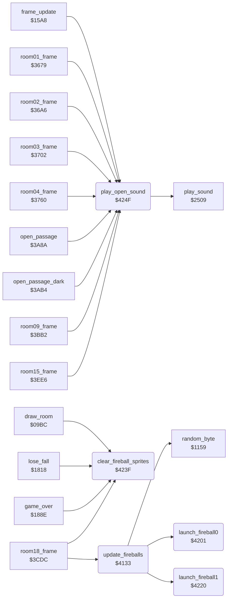

<!-- Generated by c64-docs from knowledge revision 20261029T162352.521-4j8tu8 and .c64-re-tools/local/generated/src/source-map.json. Do not edit: change the knowledge, generate the source again, then run docs.ts generate. -->
# room/wizard_fireballs.asm: Wizard fireball sprites (room 18) and sound helper

Range `$4133-$425E`. Source: [room/wizard_fireballs.asm](../../../../src/room/wizard_fireballs.asm). Index: [the reference](../../index.md).

## Routines

| Routine | Address | Reached from | Summary |
|---|---|---|---|
| [`update_fireballs`](wizard_fireballs.md#update_fireballs) | `$4133` | [`room18_frame`](wizard_room.md#room18_frame) | Updates the two wizard fireballs (sprites 6 and 7) in room 18. |
| [`launch_fireball0`](wizard_fireballs.md#launch_fireball0) | `$4201` | [`update_fireballs`](wizard_fireballs.md#update_fireballs) | Launches fireball 0: sprite 6 pointer = $0D (sprite_buf_b_spr2), sprite 6 on, active, X = $50, Y = $37, then sound $86 (play_hit_sound). |
| [`launch_fireball1`](wizard_fireballs.md#launch_fireball1) | `$4220` | [`update_fireballs`](wizard_fireballs.md#update_fireballs) | Launches fireball 1: sprite 7 pointer = $0E (sprite_buf_b_spr3), sprite 7 on, active, X = $5E, Y = $37, then sound $86 (play_hit_sound). |
| [`clear_fireball_sprites`](wizard_fireballs.md#clear_fireball_sprites) | `$423F` | [`draw_room`](draw_room.md#draw_room), [`lose_fall`](../game/lose_fall_game_over.md#lose_fall), [`game_over`](../game/lose_fall_game_over.md#game_over), [`room18_frame`](wizard_room.md#room18_frame) | Clears the first byte of sprite rows 0-3 of both fireball sprites (sprite_buf_b_spr2 and sprite_buf_b_spr3, the bytes that update_fireballs fills). |
| [`play_open_sound`](wizard_fireballs.md#play_open_sound) | `$424F` | [`frame_update`](../game/frame_update.md#frame_update), [`room01_frame`](room_frames_0_7.md#room01_frame), [`room02_frame`](room_frames_0_7.md#room02_frame), [`room03_frame`](room_frames_0_7.md#room03_frame), [`room04_frame`](room_frames_0_7.md#room04_frame), [`open_passage`](passage_open.md#open_passage), [`open_passage_dark`](passage_open.md#open_passage_dark), [`room09_frame`](room_frames_8_11.md#room09_frame), [`room15_frame`](room_frames_12_17.md#room15_frame) | Plays sound effect $8A (passage opens) through play_sound. |

## Call graph

A solid arrow is a call, a thick arrow a table entry. Rounded nodes are in this file.

## Details

### [`update_fireballs`](../../../../src/room/wizard_fireballs.asm#L13) `$4133`

*routine*

Updates the two wizard fireballs (sprites 6 and 7) in room 18. 1. New random shapes: the first byte of sprite rows 0-3 of both sprites (sprite_buf_b_spr2, sprite_buf_b_spr3) = random AND fireball_shape_mask+row, so the fireballs sparkle. 2. An inactive fireball (fireball_active+n = 0) waits fireball_respawn_delay+n passes, then launches (launch_fireball0 / launch_fireball1). 3. An active fireball falls 5 lines per pass (fireball_y+n); at Y >= $E0 it becomes inactive with a delay of 2. 4. An active fireball moves its X (fireball_x+n) toward Bruce's actor_x: 3 steps per pass while Y < $A8, 2 steps below. Sprite X = X*2 (bit 8 in MSIGX), sprite Y = Y + $1D, random colour.
4 sprite rows

- **Called from:** [`room18_frame`](wizard_room.md#room18_frame)
- **Calls:** [`random_byte`](../irq/interrupt_entry_1131.md#random_byte), [`launch_fireball0`](wizard_fireballs.md#launch_fireball0), [`launch_fireball1`](wizard_fireballs.md#launch_fireball1)
- **Reads:** [`fireball_shape_mask`](../graphics/fireball_shape.md#fireball_shape_mask), [`fireball_active`](../game/fireball_text_score_vars.md#fireball_active), [`fireball_respawn_delay`](../game/fireball_text_score_vars.md#fireball_respawn_delay), [`fireball_y`](../game/fireball_text_score_vars.md#fireball_y), [`fireball_x`](../game/fireball_text_score_vars.md#fireball_x), [`actor_x`](../../memory-map.md#actor_x), [`MSIGX`](../../memory-map.md#MSIGX), [`fireball_msb_set_mask`](../game/options_and_patterns.md#fireball_msb_set_mask), [`fireball_msb_clear_mask`](../game/options_and_patterns.md#fireball_msb_clear_mask)
- **Writes:** [`sprite_buf_b_spr2`](../../memory-map.md#sprite_buf_b_spr2), [`sprite_buf_b_spr3`](../../memory-map.md#sprite_buf_b_spr3), [`fireball_respawn_delay`](../game/fireball_text_score_vars.md#fireball_respawn_delay), [`fireball_y`](../game/fireball_text_score_vars.md#fireball_y), [`fireball_active`](../game/fireball_text_score_vars.md#fireball_active), [`fireball_x`](../game/fireball_text_score_vars.md#fireball_x), [`MSIGX`](../../memory-map.md#MSIGX), [`SP6X`](../../memory-map.md#SP6X), [`SP6Y`](../../memory-map.md#SP6Y), [`SP6COL`](../../memory-map.md#SP6COL)
- **Refers to:** [`fireball_respawn_delay`](../game/fireball_text_score_vars.md#fireball_respawn_delay)

| Label | Address | Comment |
|---|---|---|
| [`update_fireballs_shape_loop`](../../../../src/room/wizard_fireballs.asm#L16) | `$4137` |  |
| [`update_fireballs_check_delay0`](../../../../src/room/wizard_fireballs.asm#L31) | `$4154` |  |
| [`update_fireballs_launch0`](../../../../src/room/wizard_fireballs.asm#L34) | `$4159` |  |
| [`update_fireballs_wait0`](../../../../src/room/wizard_fireballs.asm#L37) | `$415F` |  |
| [`update_fireballs_check1`](../../../../src/room/wizard_fireballs.asm#L39) | `$4162` |  |
| [`update_fireballs_check_delay1`](../../../../src/room/wizard_fireballs.asm#L42) | `$4167` |  |
| [`update_fireballs_launch1`](../../../../src/room/wizard_fireballs.asm#L45) | `$416C` |  |
| [`update_fireballs_wait1`](../../../../src/room/wizard_fireballs.asm#L48) | `$4172` |  |
| [`update_fireballs_fall`](../../../../src/room/wizard_fireballs.asm#L51) | `$4175` | Active fireballs fall 5 lines per pass; at the bottom they wait 2 passes. |
| [`update_fireballs_fall_loop`](../../../../src/room/wizard_fireballs.asm#L53) | `$4177` |  |
| [`update_fireballs_fall_next`](../../../../src/room/wizard_fireballs.asm#L66) | `$4193` |  |
| [`update_fireballs_no_effect`](../../../../src/room/wizard_fireballs.asm#L72) | `$419B` |  |
| [`update_fireballs_position`](../../../../src/room/wizard_fireballs.asm#L76) | `$41A0` | Active fireballs home in on Bruce's X and are written to the VIC-II with a random colour. |
| [`update_fireballs_position_loop`](../../../../src/room/wizard_fireballs.asm#L78) | `$41A2` |  |
| [`update_fireballs_home_loop`](../../../../src/room/wizard_fireballs.asm#L86) | `$41B1` |  |
| [`update_fireballs_home_left`](../../../../src/room/wizard_fireballs.asm#L92) | `$41BD` |  |
| [`update_fireballs_home_next`](../../../../src/room/wizard_fireballs.asm#L95) | `$41C2` |  |
| [`update_fireballs_set_sprite`](../../../../src/room/wizard_fireballs.asm#L98) | `$41C5` |  |
| [`update_fireballs_msb_clear`](../../../../src/room/wizard_fireballs.asm#L107) | `$41D4` | clear bit 6/7 of MSIGX |
| [`update_fireballs_msb_store`](../../../../src/room/wizard_fireballs.asm#L109) | `$41D7` |  |
| [`update_fireballs_position_next`](../../../../src/room/wizard_fireballs.asm#L134) | `$41FD` |  |
| [`update_fireballs_done`](../../../../src/room/wizard_fireballs.asm#L137) | `$4200` |  |

### [`launch_fireball0`](../../../../src/room/wizard_fireballs.asm#L141) `$4201`

*routine*

Launches fireball 0: sprite 6 pointer = $0D (sprite_buf_b_spr2), sprite 6 on, active, X = $50, Y = $37, then sound $86 (play_hit_sound).

- **Called from:** [`update_fireballs`](wizard_fireballs.md#update_fireballs)
- **Jumps to:** [`play_hit_sound`](../actor/actor_helpers.md#play_hit_sound)
- **Reads:** [`SPENA`](../../memory-map.md#SPENA)
- **Writes:** [`sprite_pointers`](../../memory-map.md#sprite_pointers), [`SPENA`](../../memory-map.md#SPENA), [`fireball_active`](../game/fireball_text_score_vars.md#fireball_active), [`fireball_x`](../game/fireball_text_score_vars.md#fireball_x), [`fireball_y`](../game/fireball_text_score_vars.md#fireball_y)
- **Refers to:** [`sprite_buf_b_spr2`](../../memory-map.md#sprite_buf_b_spr2), [`sprite_pointers`](../../memory-map.md#sprite_pointers)

### [`launch_fireball1`](../../../../src/room/wizard_fireballs.asm#L156) `$4220`

*routine*

Launches fireball 1: sprite 7 pointer = $0E (sprite_buf_b_spr3), sprite 7 on, active, X = $5E, Y = $37, then sound $86 (play_hit_sound).

- **Called from:** [`update_fireballs`](wizard_fireballs.md#update_fireballs)
- **Jumps to:** [`play_hit_sound`](../actor/actor_helpers.md#play_hit_sound)
- **Reads:** [`SPENA`](../../memory-map.md#SPENA)
- **Writes:** [`sprite_pointers`](../../memory-map.md#sprite_pointers), [`SPENA`](../../memory-map.md#SPENA), [`fireball_active`](../game/fireball_text_score_vars.md#fireball_active), [`fireball_x`](../game/fireball_text_score_vars.md#fireball_x), [`fireball_y`](../game/fireball_text_score_vars.md#fireball_y)
- **Refers to:** [`sprite_buf_b_spr3`](../../memory-map.md#sprite_buf_b_spr3), [`sprite_pointers`](../../memory-map.md#sprite_pointers), [`fireball_x`](../game/fireball_text_score_vars.md#fireball_x), [`fireball_y`](../game/fireball_text_score_vars.md#fireball_y)

### [`clear_fireball_sprites`](../../../../src/room/wizard_fireballs.asm#L171) `$423F`

*routine*

Clears the first byte of sprite rows 0-3 of both fireball sprites (sprite_buf_b_spr2 and sprite_buf_b_spr3, the bytes that update_fireballs fills). Called by draw_room, lose_fall (after a death), game_over and room18_frame (at the wizard defeat).

- **Called from:** [`draw_room`](draw_room.md#draw_room), [`lose_fall`](../game/lose_fall_game_over.md#lose_fall), [`game_over`](../game/lose_fall_game_over.md#game_over), [`room18_frame`](wizard_room.md#room18_frame)
- **Writes:** [`sprite_buf_b_spr2`](../../memory-map.md#sprite_buf_b_spr2), [`sprite_buf_b_spr3`](../../memory-map.md#sprite_buf_b_spr3)

| Label | Address | Comment |
|---|---|---|
| [`clear_fireball_sprites_loop`](../../../../src/room/wizard_fireballs.asm#L174) | `$4243` |  |

### [`play_open_sound`](../../../../src/room/wizard_fireballs.asm#L183) `$424F`

*routine*

Plays sound effect $8A (passage opens) through play_sound. Keeps A, X and Y.

- **Called from:** [`frame_update`](../game/frame_update.md#frame_update), [`room01_frame`](room_frames_0_7.md#room01_frame), [`room02_frame`](room_frames_0_7.md#room02_frame), [`room03_frame`](room_frames_0_7.md#room03_frame), [`room04_frame`](room_frames_0_7.md#room04_frame), [`open_passage`](passage_open.md#open_passage), [`open_passage_dark`](passage_open.md#open_passage_dark), [`room09_frame`](room_frames_8_11.md#room09_frame), [`room15_frame`](room_frames_12_17.md#room15_frame)
- **Calls:** [`play_sound`](../sfx/sound_request.md#play_sound)
